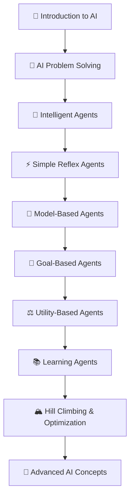

# 🧠 Primitive AI

<div align="center">

### From AI Fundamentals to Intelligent Systems

**Learn Artificial Intelligence, one concept at a time.**

A visual-first, open-source learning repository featuring structured AI notes, illustrated explanations, intelligent agent architectures, search algorithms, and practical Python examples.

[](https://github.com/ranjiGT/primitive-ai/stargazers)
[](https://github.com/ranjiGT/primitive-ai/forks)
[](LICENSE)
[](https://github.com/ranjiGT/primitive-ai/commits/main)

**[📚 Explore AI Vault](./ai-vault) · [🚀 Start Learning](#-learning-roadmap) · [🤝 Contribute](#-contributing) · [⭐ Star Repository](https://github.com/ranjiGT/primitive-ai)**

</div>

---

## 🌟 About Primitive AI

**Primitive AI** is an educational initiative focused on making the fundamental concepts of Artificial Intelligence understandable, accessible, and practical.

The repository brings together foundational AI concepts, visual learning materials, and hands-on programming examples to help students, educators, researchers, and developers build a strong understanding of intelligent systems.

Whether you are learning AI for the first time, preparing for university examinations, or revisiting fundamental concepts before exploring Machine Learning and Large Language Models (LLMs), this repository provides a structured starting point.

### 🎯 Our Mission

> Make Artificial Intelligence easier to learn through clear explanations, visual storytelling, and practical experimentation.

We believe understanding AI starts with mastering its foundations — from problem-solving techniques and intelligent agents to search algorithms and optimization.

## ✨ What Makes This Repository Different?

| Feature | Description |
|---|---|
| 📚 Structured Learning | Organized chapters covering fundamental AI concepts |
| 🎨 Visual Explanations | Cartoon-style educational infographics |
| 📄 AI Learning Notes | Downloadable PDF learning materials |
| 🧠 Conceptual Foundations | Clear explanations of intelligent agents and problem-solving |
| 💻 Practical Examples | Python implementations and exercises in chapter READMEs |
| 🎓 Beginner Friendly | Designed for students and self-paced learners |
| 🌍 Open Source | Accessible to learners and contributors worldwide |

---

## 🗺️ Learning Roadmap

Follow this suggested learning sequence to understand how Artificial Intelligence systems perceive, reason, decide, and learn.



**Learning Philosophy:** Understand the concept → Study the visual → Explore the notes → Implement an example → Experiment.

---

## 📚 AI Vault — Chapter Directory

The **AI Vault** is the central learning collection of Primitive AI.

Each chapter is organized around a specific Artificial Intelligence topic, supported by PDF learning materials and illustrated explanations.

### 🧠 Part 1 — Foundations of Artificial Intelligence

| Chapter | Topic | Learning Focus |
|---|---|---|
| 01 | [Introduction to AI](./ai-vault/01-basics) | Fundamentals, definitions, applications, and AI concepts |
| 02 | [Water Jug Problem](./ai-vault/02-water-jug-problem) | State-space representation and problem-solving |
| 03 | [Steps to Solve an AI Problem](./ai-vault/03-steps-to-solve-ai-problem) | Problem formulation and solution workflows |

### 🤖 Part 2 — Intelligent Agents

| Chapter | Topic | Learning Focus |
|---|---|---|
| 04 | [Intelligent Agent](./ai-vault/04-intelligent-agent) | Agents, environments, sensors, and actuators |
| 05 | [Simple Reflex Agent](./ai-vault/05-simple-reflex-agent) | Condition–action rules and reactive behavior |
| 06 | [Model-Based Reflex Agent](./ai-vault/06-model-based-agent) | Internal state, memory, and world models |
| 07 | [Goal-Based Agent](./ai-vault/07-goal-based-agent) | Goal-directed decision-making and planning |
| 08 | [Utility-Based Agent](./ai-vault/08-utility-based-agent) | Utility functions and decision optimization |
| 09 | [Learning Agent](./ai-vault/09-learning-agent) | Learning elements, feedback, and adaptation |

### 🔍 Part 3 — Search & Optimization

| Chapter | Topic | Learning Focus |
|---|---|---|
| 10 | [Hill Climbing](./ai-vault/10-hill-climbing) | Local search, optimization, and search landscapes |

**More learning materials will be added as the repository grows.**

---

## 🎨 Learn AI Visually

Complex AI concepts become easier to understand when represented visually.

Primitive AI includes cartoon-style educational infographics that introduce fundamental ideas through diagrams, illustrations, and intuitive examples.

### 🧠 Introduction to Artificial Intelligence

<div align="center">
  
</div>

### 🤖 Intelligent Agent Architecture

<div align="center">
  
</div>

### 🎯 Goal-Based Agent

<div align="center">
  
</div>

### 🏔️ Hill Climbing Algorithm

<div align="center">
  
</div>

> Explore individual chapter folders for additional diagrams, explanations, and learning resources.

---

## 🧠 Understanding Intelligent Agents

Intelligent agents form one of the foundational concepts of Artificial Intelligence.

An intelligent agent perceives its environment and selects actions based on its architecture, available information, and objectives.

### Agent Architecture Comparison

| Agent Type | Main Principle | Example |
|---|---|---|
| Simple Reflex | Reacts to current percepts | Basic thermostat |
| Model-Based Reflex | Maintains internal state | Obstacle-aware robot |
| Goal-Based | Plans toward goals | Navigation system |
| Utility-Based | Maximizes expected utility | Route recommendation agent |
| Learning Agent | Improves through experience | Reinforcement learning agent |

These architectures help explain how AI systems progress from simple reactive behavior to more sophisticated decision-making and adaptation.

---

## 💻 Learn by Coding

Understanding Artificial Intelligence becomes more meaningful when theory is combined with implementation.

For example, consider a simple reflex agent:

```python
class SimpleReflexAgent:
    def act(self, percept):
        if percept == "DIRTY":
            return "CLEAN"

        return "MOVE"


agent = SimpleReflexAgent()

print(agent.act("DIRTY"))
print(agent.act("CLEAN"))
```

**Output:**

```text
CLEAN
MOVE
```

This example demonstrates how an agent can select actions using predefined condition–action rules.

Explore the chapter READMEs for additional Python examples involving goal-based navigation, utility-based decisions, learning agents, and hill climbing.

---

## 📂 Repository Structure

```text
primitive-ai/
│
├── ai-vault/
│   │
│   ├── 01-basics/
│   ├── 02-water-jug-problem/
│   ├── 03-steps-to-solve-ai-problem/
│   ├── 04-intelligent-agent/
│   ├── 05-simple-reflex-agent/
│   ├── 06-model-based-agent/
│   ├── 07-goal-based-agent/
│   ├── 08-utility-based-agent/
│   ├── 09-learning-agent/
│   └── 10-hill-climbing/
│
├── .gitattributes
├── LICENSE
└── README.md
```

Each chapter can contain PDF notes, educational infographics, and a dedicated README with explanations and examples.

## 🚀 Getting Started

### Option 1 — Learn Directly on GitHub

1. Open the [AI Vault](./ai-vault).
2. Select a chapter.
3. Read its README.
4. Study the infographic.
5. Explore the PDF notes.
6. Try the Python examples.

### Option 2 — Clone the Repository

```bash
git clone https://github.com/ranjiGT/primitive-ai.git
cd primitive-ai
```

If Git LFS is installed, initialize it before working with large PDF assets:

```bash
git lfs install
git lfs pull
```

Some PDF learning materials are managed using **Git Large File Storage (Git LFS)**.

---

## 🎓 Who Is This Repository For?

**Students:** Build a foundation in AI concepts and prepare for academic coursework.

**Beginners:** Understand intelligent agents, problem-solving, and search algorithms without needing advanced prerequisites.

**Educators:** Use visual explanations and structured materials as supplementary teaching resources.

**Developers:** Revisit foundational concepts and experiment with basic AI implementations.

**AI Enthusiasts:** Explore how intelligent systems reason, learn, and make decisions.

## 🛠️ Future Roadmap

Primitive AI aims to expand into a broader collection of educational AI resources.

Potential future additions include:

- [ ] Interactive AI algorithm visualizations
- [ ] Search algorithms: BFS, DFS, Uniform-Cost Search, and A*
- [ ] Cryptarithmetic and constraint satisfaction problems
- [ ] Simulated Annealing and Genetic Algorithms
- [ ] Minimax and Alpha-Beta Pruning
- [ ] Knowledge Representation and Reasoning
- [ ] Reinforcement Learning fundamentals
- [ ] Practice quizzes and self-assessment exercises
- [ ] Jupyter notebooks with executable examples
- [ ] A dedicated interactive learning website

These are proposed enhancements, not necessarily completed features.

---

## 🤝 Contributing

Contributions are welcome!

You can help make Artificial Intelligence education more accessible by:

- Improving explanations and documentation.
- Adding beginner-friendly Python examples.
- Creating new educational diagrams.
- Fixing broken links or formatting issues.
- Suggesting additional AI topics.
- Improving accessibility and readability.

### How to Contribute

1. Fork the repository.
2. Create a feature branch.
3. Make your changes.
4. Commit your improvements.
5. Open a Pull Request.

You can also [open an issue](https://github.com/ranjiGT/primitive-ai/issues) to suggest new topics or report problems.

Please contribute original material or content you have permission to share.

## 📜 License

This project is licensed under the **Apache License 2.0**.

See the [LICENSE](./LICENSE) file for details.

Check individual learning materials for any additional third-party attribution or usage requirements.

---

## 👨‍💻 Maintainer

**Ranji Raj — [@ranjiGT](https://github.com/ranjiGT)**

Technology educator, open-source enthusiast, and Artificial Intelligence learner and practitioner.

Passionate about making technical education accessible through practical examples, visual explanations, and community-driven learning resources.

**Connect & Explore**

[](https://github.com/ranjiGT)

---

## ⭐ Support Primitive AI

If this repository helps you learn Artificial Intelligence:

- ⭐ Star the repository to support the project.
- 🍴 Fork it to experiment with the examples.
- 📢 Share it with students and fellow learners.
- 🤝 Contribute improvements and new learning materials.

<div align="center">

### 🧠 Learn • Explore • Build • Share

**Making Artificial Intelligence accessible, one concept at a time.**

[⭐ Star Primitive AI](https://github.com/ranjiGT/primitive-ai) | [📚 Explore AI Vault](./ai-vault)

</div>
