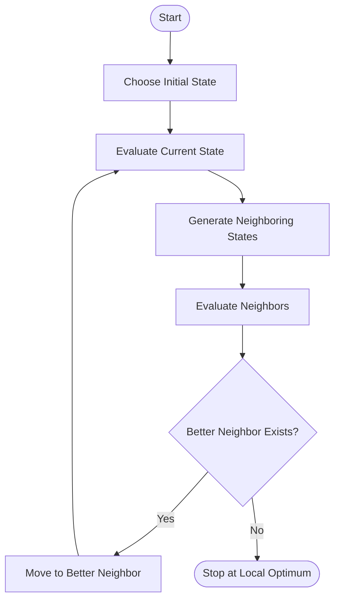

# 🏔️ Hill Climbing Algorithm in Artificial Intelligence

### AI Vault | Chapter 10 — Local Search & Optimization Techniques

Welcome to the **Hill Climbing Algorithm** chapter of [Primitive AI](https://github.com/ranjiGT/primitive-ai)!

**Hill Climbing** is a local search algorithm used in Artificial Intelligence to find better solutions by repeatedly moving from the current state to a neighboring state with a higher evaluation value.

Imagine climbing a mountain in thick fog. You cannot see the entire mountain, but you can examine nearby positions and move uphill. Eventually, you may reach a peak where no neighboring position is higher.

This is the fundamental idea behind the Hill Climbing Algorithm.

This chapter explores hill climbing through visual explanations, mathematical concepts, practical examples, Python implementations, and common optimization challenges.

---

## 🎨 Hill Climbing — Visual Explanation

<p align="center">
  
</p>

<p align="center">
  <em>Figure 1: An illustrated overview of the Hill Climbing Algorithm, showing how an agent searches for better solutions by moving uphill.</em>
</p>

The infographic helps visualize how hill climbing searches a landscape of possible solutions, improves its current position, and encounters challenges such as local maxima.

---

## 🧠 What Is Hill Climbing?

**Hill Climbing** is an iterative local search algorithm that attempts to improve a solution by examining neighboring states.

It starts with an initial solution and repeatedly moves to a better neighboring solution until no improvement is possible.

### Key Idea

**Initial State → Evaluate Neighbors → Choose Better State → Repeat → Local Optimum**

Hill climbing is commonly used for optimization problems where finding a good solution is more important than exploring every possible state.

### Key Characteristics

- 🔍 Uses local search rather than exhaustive search.
- 📈 Improves the current solution iteratively.
- 🧠 Uses an evaluation or objective function.
- ⚡ Often requires relatively little memory.
- 🎯 Can find good solutions efficiently.
- ⚠️ Does not guarantee finding the global optimum.

## ⚙️ How Does Hill Climbing Work?

### Step 1: Initialize a State

Choose a starting point in the search space.

**Example:** Start at position `x = 0`.

### Step 2: Evaluate the Current State

Calculate the objective function value.

**Example:** Evaluate `f(x)`.

### Step 3: Generate Neighboring States

Identify nearby possible solutions.

**Example:** Consider `x - 1` and `x + 1`.

### Step 4: Compare Neighboring States

Evaluate the neighboring solutions.

### Step 5: Move to a Better Neighbor

If a neighboring state has a better evaluation value, move to that state.

### Step 6: Repeat

Continue evaluating and moving to better states.

### Step 7: Terminate

Stop when no neighboring state provides an improvement.

The final state is a **local optimum with respect to the chosen neighborhood**, which may or may not be the global optimum.

---

## 🗺️ Hill Climbing Search Workflow



### Basic Pseudocode

```text
HILL_CLIMBING(initial_state):

    current = initial_state

    LOOP:

        neighbor = BEST_NEIGHBOR(current)

        IF VALUE(neighbor) <= VALUE(current):
            RETURN current

        current = neighbor
```

This represents steepest-ascent hill climbing for a maximization problem.

For minimization problems, the comparison is reversed.

## 📈 Understanding the Search Landscape

Consider a landscape containing several peaks.

```text
Objective Value
      ^
      |
      |                         GLOBAL MAXIMUM
      |                              /\
      |                             /  \
      |          LOCAL MAXIMUM     /    \
      |              /\           /      \
      |             /  \         /        \
      |            /    \_______/          \
      |           /
      |     START
      |       ●
      |
      +----------------------------------------> State Space
```

The algorithm moves toward states with higher objective values.

However, if it reaches the smaller peak, it may stop because moving toward the larger peak would initially require moving downhill.

This is called the **local maximum problem**.

## 🧩 Types of Hill Climbing Algorithms

### 1. Simple Hill Climbing

Examines neighboring states sequentially and moves to the first state that improves the objective value.

**Advantages:** Easy to implement and often computationally inexpensive.

**Limitation:** The
