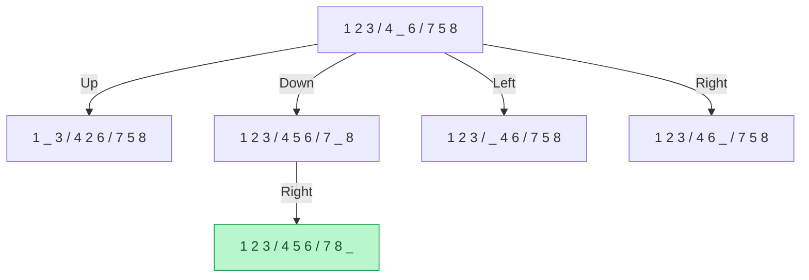

# 🧩 8-Puzzle Problem in Artificial Intelligence

### AI Vault | Chapter 11 — State-Space Search & Problem Solving

Welcome to the **8-Puzzle Problem** chapter of [Primitive AI](https://github.com/ranjiGT/primitive-ai)!

The **8-Puzzle Problem** is a classic Artificial Intelligence problem used to understand state-space search, problem formulation, search algorithms, and heuristic-based problem-solving.

It consists of a 3×3 board containing eight numbered tiles and one empty space. The objective is to rearrange the tiles from an initial configuration into a desired goal configuration by sliding adjacent tiles into the empty space.

This chapter introduces the 8-puzzle through visual explanations, state-space representations, search strategies, heuristic functions, and a practical Python implementation.

---

## 🎨 8-Puzzle Problem — Visual Explanation

<div align="center">


*Figure 1: An illustrated overview of the 8-Puzzle Problem, its components, possible moves, state-space search, and AI search algorithms.*

</div>

The infographic illustrates how an AI search algorithm explores different board configurations to reach a goal state.

**Note:** The infographic is a conceptual learning aid. Use the validated board examples below for exact tile movements and state transitions.

---

## 🧠 What Is the 8-Puzzle Problem?

The 8-puzzle is a sliding-tile puzzle containing:

- **8 numbered tiles:** Numbers 1 through 8.
- **1 blank space:** Allows adjacent tiles to move.
- **3×3 board:** Contains nine positions.
- **Initial state:** Starting arrangement of the tiles.
- **Goal state:** Desired final arrangement.

The objective is to transform the initial state into the goal state using a valid sequence of moves.

### Example

**Initial State**

```text
+---+---+---+
| 1 | 2 | 3 |
+---+---+---+
| 4 | _ | 6 |
+---+---+---+
| 7 | 5 | 8 |
+---+---+---+
```

**Goal State**

```text
+---+---+---+
| 1 | 2 | 3 |
+---+---+---+
| 4 | 5 | 6 |
+---+---+---+
| 7 | 8 | _ |
+---+---+---+
```

Here, `_` represents the blank space.

A valid solution requires only two moves:

1. Move the blank space **down**.
2. Move the blank space **right**.

---

## ⚙️ Problem Formulation in AI

The 8-puzzle can be formally described using five components.

| Component | Description |
|---|---|
| Initial State | Starting configuration of the board |
| State Space | All configurations reachable through legal moves |
| Actions | Move the blank up, down, left, or right |
| Transition Model | Defines the resulting board after a legal move |
| Goal Test | Checks whether the current board matches the goal |
| Path Cost | Commonly assigns a cost of 1 per move |

### State Representation

A board can be represented as a tuple:

```python
initial_state = (
    1, 2, 3,
    4, 0, 6,
    7, 5, 8
)
```

Here, `0` represents the blank tile.

The goal state is:

```python
goal_state = (
    1, 2, 3,
    4, 5, 6,
    7, 8, 0
)
```

This representation is compact and suitable for implementing graph-search algorithms.

---

## 🔄 Possible Moves

The blank tile can move in four directions, depending on its current position.

| Action | Description |
|---|---|
| ⬆️ Up | Swap the blank with the tile directly above |
| ⬇️ Down | Swap the blank with the tile directly below |
| ⬅️ Left | Swap the blank with the tile directly left |
| ➡️ Right | Swap the blank with the tile directly right |

### Important Rules

- A tile can move only if it is adjacent to the blank.
- Diagonal moves are not allowed.
- Moves cannot cross the board boundary.
- Each move changes the current state.

The blank has two legal moves from a corner, three from an edge, and four from the center.

---

## 🌳 State-Space Search

In Artificial Intelligence, a **state space** represents the set of possible configurations that can be explored while solving a problem.

For the 8-puzzle, each board configuration is a state, and every legal tile movement creates a transition to another state.

### Example State-Space Tree



The green node represents the goal state.

In practice, search algorithms must detect repeated states to avoid exploring the same board configurations unnecessarily.

---

## 🔍 Search Algorithms for the 8-Puzzle

Different AI search algorithms can solve the 8-puzzle.

### 1. Breadth-First Search (BFS)

BFS explores states level by level.

**Advantages:** Finds a shortest solution in terms of moves when all moves have equal cost.

**Limitation:** Can require substantial memory.

### 2. Depth-First Search (DFS)

DFS explores one path deeply before backtracking.

**Advantages:** Can use relatively little memory in depth-limited implementations.

**Limitation:** Does not guarantee the shortest solution and requires safeguards against cycles.

### 3. Iterative Deepening Search (IDS)

IDS repeatedly performs depth-limited DFS with increasing depth limits.

**Advantages:** Combines the optimality of BFS for unit-cost moves with the lower memory requirements of depth-first exploration.

### 4. Uniform-Cost Search (UCS)

UCS expands the state with the lowest accumulated path cost.

When every move costs one unit, UCS behaves similarly to BFS.

### 5. Greedy Best-First Search

Greedy Best-First Search selects states based on their estimated distance to the goal.

**Advantage:** Can quickly find a solution.

**Limitation:** Does not guarantee a shortest solution.

### 6. A* Search

A* combines the cost of reaching a state with an estimate of the remaining cost.

Its evaluation function is:

**f(n) = g(n) + h(n)**

Where:

- `g(n)` is the cost from the initial state to the current state.
- `h(n)` is the estimated cost from the current state to the goal.
- `f(n)` is the estimated total solution cost through the state.

A* can find an optimal solution when used with an admissible heuristic and an appropriate search implementation.

---

## 📏 Heuristic Functions

Heuristics estimate how far a state is from the goal.

Two commonly used heuristics for the 8-puzzle are:

### 1. Misplaced Tiles Heuristic

Counts the number of numbered tiles that are not in their goal positions.

The blank tile is excluded.

**Example:**

```text
Current State       Goal State

1  2  3             1  2  3
4  _  6             4  5  6
7  5  8             7  8  _
```

The misplaced tiles are `5` and `8`.

Therefore:

**h(n) = 2**

### 2. Manhattan Distance Heuristic

Calculates the total horizontal and vertical distance of each numbered tile from its goal position.

The formula is:

**h(n) = Σ (|xᵢ − xᵢ*| + |yᵢ − yᵢ*|)**

Where:

- `(xᵢ, yᵢ)` is the current position of tile `i`.
- `(xᵢ*, yᵢ*)` is its goal position.
- The blank tile is excluded.

For the example above:

- Tile 5 is one position away.
- Tile 8 is one position away.

Therefore:

**Manhattan Distance = 2**

For the standard 8-puzzle with unit-cost moves, Manhattan distance is an admissible and consistent heuristic.

---

## 💻 Python Implementation — A* Search

The following implementation solves the 8-puzzle using the A* search algorithm and Manhattan distance.

```python
import heapq
from itertools import count

GOAL = (
    1, 2, 3,
    4, 5, 6,
    7, 8, 0
)


def manhattan_distance(state):
    distance = 0

    for index, tile in enumerate(state):
        if tile == 0:
            continue

        goal_index = tile - 1

        row, col = divmod(index, 3)
        goal_row, goal_col = divmod(goal_index, 3)

        distance += (
            abs(row - goal_row)
            + abs(col - goal_col)
        )

    return distance


def get_neighbors(state):
    blank = state.index(0)
    row, col = divmod(blank, 3)

    moves = [
        (-1, 0, "Up"),
        (1, 0, "Down"),
        (0, -1, "Left"),
        (0, 1, "Right")
    ]

    for dr, dc, action in moves:
        new_row = row + dr
        new_col = col + dc

        if 0 <= new_row < 3 and 0 <= new_col < 3:
            new_blank = new_row * 3 + new_col

            new_state = list(state)

            new_state[blank], new_state[new_blank] = (
                new_state[new_blank],
                new_state[blank]
            )

            yield tuple(new_state), action


def is_solvable(state):
    numbers = [x for x in state if x != 0]

    inversions = sum(
        numbers[i] > numbers[j]
        for i in range(len(numbers))
        for j in range(i + 1, len(numbers))
    )

    return inversions % 2 == 0


def a_star(start):
    if not is_solvable(start):
        return None

    tie_breaker = count()

    queue = [
        (manhattan_distance(start), 0, next(tie_breaker), start)
    ]

    best_cost = {start: 0}
    parent = {start: (None, None)}

    while queue:
        _, cost, _, current = heapq.heappop(queue)

        if cost != best_cost[current]:
            continue

        if current == GOAL:
            path = []

            while parent[current][0] is not None:
                previous, action = parent[current]
                path.append(action)
                current = previous

            return path[::-1]

        for neighbor, action in get_neighbors(current):
            new_cost = cost + 1

            if new_cost < best_cost.get(neighbor, float("inf")):
                best_cost[neighbor] = new_cost
                parent[neighbor] = (current, action)

                priority = (
                    new_cost + manhattan_distance(neighbor)
                )

                heapq.heappush(
                    queue,
                    (
                        priority,
                        new_cost,
                        next(tie_breaker),
                        neighbor
                    )
                )

    return None


initial_state = (
    1, 2, 3,
    4, 0, 6,
    7, 5, 8
)

solution = a_star(initial_state)

print("Solution:", solution)

if solution is not None:
    print("Number of moves:", len(solution))
```

### Expected Output

```text
Solution: ['Down', 'Right']
Number of moves: 2
```

### How the Code Works

1. Represents the puzzle using a tuple.
2. Calculates Manhattan distance for each state.
3. Generates valid neighboring states.
4. Uses a priority queue to select the most promising state.
5. Tracks the best known path cost for each state.
6. Reconstructs the solution when the goal is reached.

The implementation also checks whether the initial puzzle is solvable.

For a 3×3 puzzle with the standard goal arrangement, a state is solvable exactly when the inversion count is even.

---

## 🔢 How Many States Are Possible?

The 8-puzzle contains nine positions, including the blank.

The total number of possible permutations is:

**9! = 362,880**

However, only half of these configurations are reachable from a given state.

Therefore, the number of reachable states is:

**9! / 2 = 181,440**

This is why efficient search algorithms and heuristics are important.

---

## ⚖️ Algorithm Comparison

| Algorithm | Complete? | Optimal? | Uses Heuristic? |
|---|---|---|---|
| BFS | Yes | Yes, for unit costs | No |
| DFS | Not generally | No | No |
| IDS | Yes | Yes, for unit costs | No |
| UCS | Yes, for positive costs | Yes | No |
| Greedy Best-First | With finite-state duplicate detection | No | Yes |
| A* | Yes, under standard conditions | Yes, with admissible heuristic and suitable implementation | Yes |

For this puzzle, A* with Manhattan distance is a strong practical starting point.

---

## 🌍 Applications and Learning Relevance

Although the 8-puzzle is a small educational problem, it demonstrates techniques relevant to larger AI systems.

| Area | Related Concept |
|---|---|
| Robotics | State-space planning |
| Navigation | Search and pathfinding |
| Game AI | Exploring possible actions |
| Automated Planning | Goal-directed state transitions |
| Optimization | Comparing candidate solutions |
| AI Education | Heuristics and search strategies |

The 8-puzzle is particularly useful for comparing uninformed and informed search algorithms.

---

## 📚 Learning Resources

| Resource | Description |
|---|---|
| [🎨 8-Puzzle Infographic](./Eight%20Puzzle%20Problem%20in%20AI%20Infographic.png) | Visual explanation of the puzzle and search algorithms |
| [📚 AI Vault](../) | Explore other Artificial Intelligence chapters |
| [🏠 Primitive AI](../../) | Return to the main repository |

Additional PDF notes can be linked here when organized into this chapter.

---

## 🎓 Learning Outcomes

After completing this chapter, you should be able to:

- [ ] Define the 8-Puzzle Problem.
- [ ] Explain initial states and goal states.
- [ ] Identify valid tile movements.
- [ ] Represent the puzzle as a state-space search problem.
- [ ] Compare BFS, DFS, IDS, UCS, Greedy Best-First, and A*.
- [ ] Calculate misplaced-tile and Manhattan-distance heuristics.
- [ ] Explain the A* evaluation function.
- [ ] Implement an 8-puzzle solver in Python.
- [ ] Identify solvable and unsolvable configurations.
- [ ] Explain why heuristic search improves efficiency.

---

## 💡 Key Takeaway

> The 8-Puzzle Problem demonstrates how an intelligent search algorithm can transform an initial state into a goal state by exploring valid actions and selecting promising paths.

It provides an excellent foundation for understanding state-space search, heuristic evaluation, and automated problem-solving in Artificial Intelligence.

---

## 🚀 Continue Learning

Explore more topics in the [AI Vault](../), including:

- Water Jug Problem
- Intelligent Agents
- Goal-Based Agents
- Hill Climbing
- Search and Optimization

### ⭐ Support Primitive AI

If this chapter helps you understand Artificial Intelligence, consider giving the [Primitive AI repository](https://github.com/ranjiGT/primitive-ai) a ⭐.

**Learn • Explore • Build • Share**

Made for curious minds and lifelong learners.
