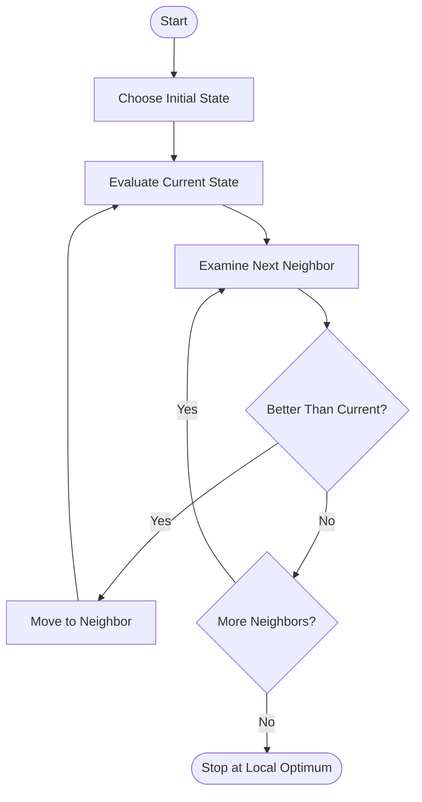

# 🏔️ Simple Hill Climbing Algorithm in Artificial Intelligence

### AI Vault | Chapter 12 — Local Search & Optimization

Welcome to the **Simple Hill Climbing Algorithm** chapter of [Primitive AI](https://github.com/ranjiGT/primitive-ai)!

Simple Hill Climbing is a fundamental **local search algorithm** used in Artificial Intelligence to improve a solution by repeatedly moving to a better neighboring state.

Imagine a hiker climbing a mountain in thick fog. The hiker cannot see the entire mountain landscape but can examine nearby positions and move uphill whenever a better position is found.

This is the central idea behind Simple Hill Climbing.

---

## 🎨 Simple Hill Climbing — Visual Explanation

<div align="center">


*Figure 1: A visual explanation of Simple Hill Climbing, including its workflow, search landscape, local maxima, plateaus, and limitations.*

</div>

The infographic demonstrates how a search algorithm improves its current state by exploring neighboring solutions.

---

## 🧠 What Is Simple Hill Climbing?

Simple Hill Climbing is a **greedy, iterative local search algorithm**.

It begins with an initial state and examines neighboring states sequentially. As soon as it finds a better neighbor, it moves to that state.

The process continues until no improving neighbor can be found.

### Key Characteristics

- Uses a local evaluation function.
- Moves only to a strictly better neighboring state.
- Accepts the first improvement found.
- Does not require storing the entire search tree.
- Does not generally backtrack.
- Can terminate at a local optimum rather than the global optimum.

### Important Distinction

**Simple Hill Climbing:** Selects the first improving neighbor.

**Steepest-Ascent Hill Climbing:** Evaluates all immediate neighbors and selects the best improving neighbor.

This distinction is important because the two algorithms can follow different paths and reach different solutions.

---

## ⚙️ How Simple Hill Climbing Works

### Step 1 — Initialize

Choose an initial state.

### Step 2 — Evaluate

Calculate the evaluation value of the current state.

### Step 3 — Examine Neighbors

Generate neighboring states in a defined order.

### Step 4 — Accept the First Improvement

If a neighbor has a better evaluation value, immediately move to that neighbor.

### Step 5 — Repeat

Continue examining neighbors from the new state.

### Step 6 — Terminate

Stop when every available neighbor has been examined and none improves the current state.

---

## 🔄 Algorithm Workflow



The algorithm follows the first improving move instead of comparing every neighbor to identify the best one.

---

## 🏔️ Example — Finding a Higher Peak

Suppose an AI agent wants to maximize an objective function:

**f(x) = −(x − 5)² + 25**

Starting at `x = 0`, the agent examines neighboring positions using a step size of 1.

| Iteration | Current x | f(x) | Next improving state |
|---|---:|---:|---|
| 1 | 0 | 0 | 1 |
| 2 | 1 | 9 | 2 |
| 3 | 2 | 16 | 3 |
| 4 | 3 | 21 | 4 |
| 5 | 4 | 24 | 5 |
| 6 | 5 | 25 | None |

The algorithm stops at `x = 5`.

For this particular objective function, the solution is also the global maximum.

However, this outcome is not guaranteed for arbitrary optimization problems.

---

## 💻 Python Implementation

The following example implements **Simple Hill Climbing using first-improvement selection**.

```python
def objective_function(x):
    return -(x - 5) ** 2 + 25


def simple_hill_climbing(start, step_size=1):
    current = start

    while True:
        current_value = objective_function(current)
        improved = False

        neighbors = [
            current - step_size,
            current + step_size
        ]

        for neighbor in neighbors:
            neighbor_value = objective_function(neighbor)

            if neighbor_value > current_value:
                current = neighbor
                improved = True

                print(
                    f"x = {current}, "
                    f"f(x) = {neighbor_value}"
                )

                # First improvement: move immediately
                break

        if not improved:
            return current


solution = simple_hill_climbing(start=0)

print("\nFinal solution:", solution)
print("Final value:", objective_function(solution))
```

### Expected Output

```text
x = 1, f(x) = 9
x = 2, f(x) = 16
x = 3, f(x) = 21
x = 4, f(x) = 24
x = 5, f(x) = 25

Final solution: 5
Final value: 25
```

### Explanation

The algorithm starts at `x = 0`.

At every iteration, it examines the neighboring states in order. When it finds a better state, it moves there immediately without evaluating the remaining neighbors.

At `x = 5`, neither neighboring state has a higher evaluation value, so the algorithm terminates.

---

## ⚠️ Common Problems in Simple Hill Climbing

### 1. Local Maximum

A local maximum is a state whose immediate neighbors are not better, even though a better solution may exist elsewhere.

**Problem:** The algorithm can stop prematurely.

### 2. Plateau

A plateau is a region containing neighboring states with equal evaluation values.

**Problem:** Strictly improving hill climbing cannot cross a flat region.

### 3. Ridge

A ridge is a search-space structure where progress toward a better solution may require a sequence of movements not captured by the available neighborhood operations.

**Problem:** The algorithm may fail to find a suitable improving move.

### 4. Shoulder

A shoulder is a flat region from which improvement may eventually become possible.

**Problem:** The algorithm may terminate before reaching the improving region.

### Possible Improvements

- Random-restart hill climbing
- Allowing limited sideways moves
- Using alternative neighborhood functions
- Stochastic search
- Simulated annealing

---

## 🆚 Simple vs. Steepest-Ascent Hill Climbing

| Feature | Simple Hill Climbing | Steepest-Ascent Hill Climbing |
|---|---|---|
| Neighbor selection | First improving neighbor | Best improving neighbor |
| Evaluates all neighbors? | Not necessarily | Yes |
| Decision strategy | First improvement | Best improvement |
| Computational effort per step | Often lower | Often higher |
| Sensitive to neighbor order | Yes | Less so |
| Guarantees global optimum | No | No |

Both are greedy local search methods, but their selection strategies differ.

---

## 🌍 Applications

Simple Hill Climbing can be used in problems such as:

| Application | Purpose |
|---|---|
| Feature Selection | Improve candidate feature subsets |
| Scheduling | Improve task arrangements |
| Route Optimization | Improve existing routes |
| Resource Allocation | Improve resource assignments |
| Timetabling | Reduce conflicts |
| Parameter Optimization | Improve objective-function values |

Its effectiveness depends on the evaluation function, initial state, and neighborhood definition.

---

## ⚖️ Advantages and Limitations

### ✅ Advantages

- Simple to understand and implement.
- Requires relatively little memory.
- Often finds improvements quickly.
- Suitable for many local optimization problems.
- Does not require constructing a complete search tree.

### ❌ Limitations

- Can become trapped in local maxima.
- Cannot cross plateaus when strictly improving.
- May struggle with ridges.
- Sensitive to the initial state.
- Results may depend on neighbor examination order.
- Does not guarantee the global optimum.

---

## 🎓 Learning Outcomes

After completing this chapter, you should be able to:

- [ ] Define Simple Hill Climbing.
- [ ] Explain local search and greedy improvement.
- [ ] Describe the first-improvement strategy.
- [ ] Trace the algorithm through an example.
- [ ] Implement Simple Hill Climbing in Python.
- [ ] Explain local and global maxima.
- [ ] Identify plateaus, ridges, and shoulders.
- [ ] Compare Simple and Steepest-Ascent Hill Climbing.
- [ ] Describe the algorithm's advantages and limitations.

---

## 📚 Learning Resources

| Resource | Description |
|---|---|
| [🎨 Simple Hill Climbing Infographic](./Simple%20Hill%20Climbing%20in%20AI%20Infographic.png) | Illustrated explanation of the algorithm |
| [🏔️ Hill Climbing Fundamentals](../10-hill-climbing/) | General introduction to hill climbing |
| [📚 AI Vault](../) | Explore the full learning collection |
| [🏠 Primitive AI](../../) | Return to the repository homepage |

---

## 💡 Key Takeaway

> Simple Hill Climbing is a greedy local search algorithm that moves to the first better neighboring state and continues until no improvement is possible.

It is easy to implement and often efficient, but its success depends heavily on the starting state, evaluation function, and neighborhood structure.

Understanding Simple Hill Climbing prepares you for more advanced local search methods, including Steepest-Ascent Hill Climbing, Stochastic Hill Climbing, Random-Restart Hill Climbing, and Simulated Annealing.

---

## ⭐ Support Primitive AI

If this chapter helps you learn Artificial Intelligence, consider starring the [Primitive AI repository](https://github.com/ranjiGT/primitive-ai).

**Learn • Explore • Build • Share**

Made for curious minds and lifelong learners.
