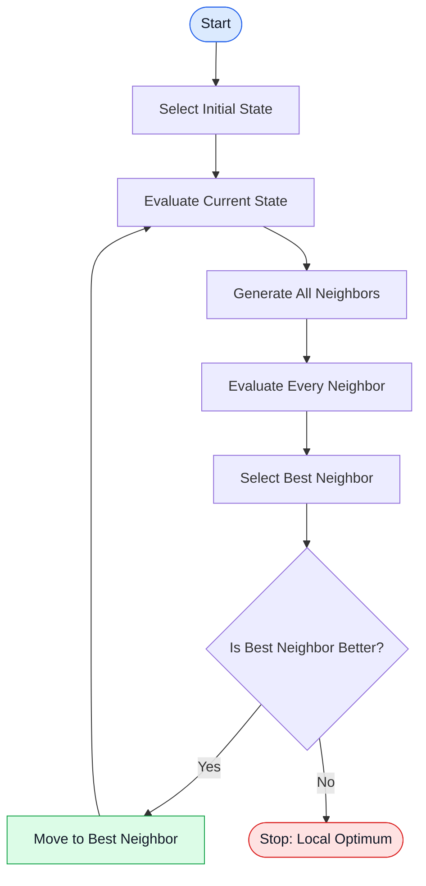
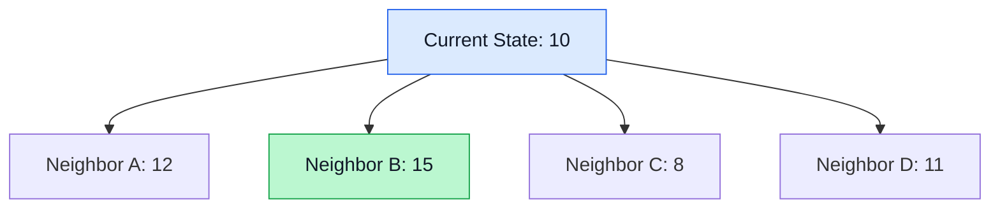

# 🏔️ Steepest-Ascent Hill Climbing in Artificial Intelligence

### AI Vault | Chapter 13 — Local Search & Optimization

[](https://github.com/ranjiGT/primitive-ai)


[](https://github.com/ranjiGT/primitive-ai)

Welcome to **Chapter 13 of Primitive AI**, an open educational resource for understanding Artificial Intelligence through handwritten notes, visual explanations, algorithms, and practical examples.

In this chapter, we explore **Steepest-Ascent Hill Climbing**, a greedy local search algorithm that examines every immediate neighboring state and chooses the one offering the greatest improvement.

Unlike Simple Hill Climbing, which accepts the first improving neighbor, Steepest-Ascent Hill Climbing evaluates all neighbors before making a decision.

---

## 🎨 Steepest-Ascent Hill Climbing — Visual Explanation

<div align="center">


*Figure 1: Cartoon-style educational infographic illustrating Steepest-Ascent Hill Climbing, neighbor evaluation, search landscapes, local maxima, and algorithm comparisons.*

</div>

The infographic demonstrates how an AI agent evaluates multiple neighboring states and selects the most promising improvement.

---

## 🧠 What Is Steepest-Ascent Hill Climbing?

Steepest-Ascent Hill Climbing is a **greedy local search algorithm** used to solve optimization problems.

It begins with an initial state, generates all immediate neighboring states, evaluates each neighbor, and moves to the best one if that neighbor improves the objective value.

The process repeats until no better neighbor exists.

### Key Characteristics

- Examines all immediate neighboring states.
- Selects the best improving neighbor.
- Uses an objective or evaluation function.
- Maintains only a limited amount of search information.
- Does not generally backtrack.
- Stops at a local optimum when no improving neighbor exists.
- Does not guarantee finding the global optimum.

### Real-World Analogy

Imagine a mountain climber standing at a particular location.

The climber:

1. Looks in every available direction.
2. Evaluates the height of each nearby position.
3. Selects the highest neighboring position.
4. Moves there if it is higher than the current position.
5. Repeats until no neighboring position is higher.

The climber may reach the highest mountain, but can also become trapped on a smaller peak.

---

## ⚙️ How the Algorithm Works

| Step | Operation | Description |
|---|---|---|
| 1 | Initialize | Select an initial state |
| 2 | Generate | Identify all neighboring states |
| 3 | Evaluate | Calculate each neighbor's objective value |
| 4 | Compare | Identify the neighbor with the best value |
| 5 | Move | Move if the best neighbor improves the current state |
| 6 | Repeat | Continue from the new state |
| 7 | Terminate | Stop when no better neighbor exists |

For maximization problems, the algorithm selects the neighbor with the highest objective value.

For minimization problems, it selects the neighbor with the lowest objective value.

---

## 🔄 Algorithm Flowchart



The key operation is evaluating **every neighbor before selecting the next state**.

---

## 🧩 Example — Choosing the Best Neighbor

Consider an AI agent attempting to maximize an evaluation function.

The current state has an objective value of `10`.

Its neighboring states have the following values:

| State | Objective Value | Decision |
|---|---:|---|
| Current State | 10 | Starting point |
| Neighbor A | 12 | Improvement |
| Neighbor B | 15 | Best improvement |
| Neighbor C | 8 | Worse |
| Neighbor D | 11 | Improvement |

**Selected state: Neighbor B (15)**

Although neighbors A and D also improve the objective value, the algorithm selects B because it offers the highest value among all immediate neighbors.

### Search Illustration



The algorithm then repeats the process from Neighbor B.

---

## 📐 Mathematical Formulation

Let:

- `S` represent the current state.
- `N(S)` represent the set of neighboring states.
- `f(S)` represent the objective value of state S.

For a maximization problem, the best neighboring state is:

**S_best = argmax f(S')**, for all S' in N(S).

The transition rule is:

**S_next = S_best**, if f(S_best) > f(S).

Otherwise, the algorithm terminates.

This is a greedy strategy because each decision is based on the best immediate improvement rather than a complete search of the solution space.

---

## 💻 Python Implementation

The following example implements Steepest-Ascent Hill Climbing for a maximization problem.

```python
def objective_function(x):
    return -(x - 5) ** 2 + 25


def steepest_ascent_hill_climbing(
    start,
    step_size=1
):
    current = start

    while True:
        current_value = objective_function(current)

        neighbors = [
            current - step_size,
            current + step_size
        ]

        # Evaluate every neighbor
        best_neighbor = max(
            neighbors,
            key=objective_function
        )

        best_value = objective_function(best_neighbor)

        # Move only if improvement exists
        if best_value <= current_value:
            break

        current = best_neighbor

        print(
            f"x = {current}, "
            f"f(x) = {best_value}"
        )

    return current


solution = steepest_ascent_hill_climbing(
    start=0
)

print("\nFinal solution:", solution)
print("Final value:", objective_function(solution))
```

### Expected Output

```text
x = 1, f(x) = 9
x = 2, f(x) = 16
x = 3, f(x) = 21
x = 4, f(x) = 24
x = 5, f(x) = 25

Final solution: 5
Final value: 25
```

### Explanation

The objective function is:

**f(x) = −(x − 5)² + 25**

The algorithm begins at `x = 0`.

At each iteration, it evaluates both neighboring positions and selects the one with the higher objective value.

Eventually, it reaches `x = 5`, where:

**f(5) = 25**

Neither immediate neighbor improves the result, so the algorithm stops.

For this particular function, the local maximum is also the global maximum.

---

## 🆚 Simple vs. Steepest-Ascent Hill Climbing

| Feature | Simple Hill Climbing | Steepest-Ascent Hill Climbing |
|---|---|---|
| Search Strategy | First improvement | Best improvement |
| Neighbor Evaluation | Sequential until improvement | Evaluates all neighbors |
| Selection | First better neighbor | Best better neighbor |
| Computation Per Step | Often lower | Often higher |
| Depends on Neighbor Order | Yes | Mainly for tie-breaking |
| Local Maximum Problem | Yes | Yes |
| Global Optimality Guaranteed | No | No |

### Example

Suppose the current state has a value of `10`, and neighbors are examined in this order:

`12 → 15 → 8 → 11`

**Simple Hill Climbing** chooses `12`, because it is the first improvement.

**Steepest-Ascent Hill Climbing** chooses `15`, because it evaluates all neighbors and selects the best one.

This does not mean Steepest-Ascent Hill Climbing always reaches a better final solution. Both algorithms can become trapped at different local optima.

---

## ⚠️ Common Problems

### 1. Local Maximum

The algorithm reaches a state that is better than all its immediate neighbors but is not the best state in the entire search space.

### 2. Plateau

A region of the search space contains multiple states with equal evaluation values.

Strict Steepest-Ascent Hill Climbing cannot move across a plateau unless sideways moves are explicitly allowed.

### 3. Ridge

The search landscape contains a narrow path toward better solutions that may be difficult to follow using the available neighborhood operations.

### 4. Initial-State Dependency

Different starting states may lead to different local optima.

### Possible Improvements

- Random-Restart Hill Climbing
- Stochastic Hill Climbing
- Simulated Annealing
- Alternative neighborhood generation
- Limited sideways moves
- Tabu Search

---

## ⚖️ Advantages and Limitations

### ✅ Advantages

- Straightforward to understand and implement.
- Evaluates all immediate alternatives before moving.
- Uses relatively little memory.
- Can reach good solutions quickly.
- Suitable for optimization problems with manageable neighborhoods.

### ❌ Limitations

- May become trapped at local maxima.
- Cannot guarantee the global optimum.
- Can struggle with plateaus and ridges.
- Evaluating every neighbor may be expensive.
- Sensitive to the initial state and neighborhood definition.
- May require multiple restarts for better results.

---

## ⏱️ Time and Space Complexity

Let:

- `b` = number of neighbors evaluated per iteration.
- `k` = number of improving iterations.
- `T(f)` = cost of evaluating one state.

### Time Complexity

If all neighbors are evaluated at every iteration:

**O(k × b × T(f))**

This assumes generating neighbors has negligible additional cost.

### Space Complexity

If all neighbors are stored explicitly:

**O(b)**

A streaming implementation that keeps only the current best neighbor can reduce auxiliary storage to O(1), excluding the state representation and neighborhood generator.

The number of iterations depends on the search landscape and stopping conditions.

---

## 🌍 Applications in Artificial Intelligence

| Application | Use Case |
|---|---|
| Scheduling | Improve task assignments |
| Route Optimization | Improve candidate routes |
| Feature Selection | Select useful feature subsets |
| Resource Allocation | Improve resource distribution |
| Timetabling | Reduce scheduling conflicts |
| Parameter Optimization | Improve objective values |
| Combinatorial Optimization | Explore candidate configurations |

The algorithm is particularly useful when a solution can be improved through small, local modifications.

---

## 🎓 Learning Outcomes

After completing this chapter, you should be able to:

- [ ] Define Steepest-Ascent Hill Climbing.
- [ ] Explain greedy local search.
- [ ] Describe how neighboring states are generated.
- [ ] Identify the best improving neighbor.
- [ ] Trace the algorithm using numerical examples.
- [ ] Implement Steepest-Ascent Hill Climbing in Python.
- [ ] Compare Simple and Steepest-Ascent Hill Climbing.
- [ ] Explain local maxima, plateaus, and ridges.
- [ ] Analyze time and space complexity.
- [ ] Identify practical applications and limitations.

---

## 📚 Learning Resources

| Resource | Description |
|---|---|
| [🎨 Steepest-Ascent Infographic](./Steepest%20Ascent%20Hill%20Climbing%20in%20AI%20Infographic.png) | Cartoon-style explanation |
| [🏔️ Simple Hill Climbing](../12-simple-hill-climbing/) | First-improvement search |
| [📖 Hill Climbing Fundamentals](../10-hill-climbing/) | Introduction to local search |
| [📚 AI Vault](../) | Explore all AI chapters |
| [🏠 Primitive AI](../../) | Repository homepage |

---

## 💡 Key Takeaway

> Steepest-Ascent Hill Climbing evaluates all immediate neighboring states and moves to the one offering the greatest improvement.

It is an important local search technique that helps learners understand greedy optimization, neighborhood evaluation, and the challenges of finding globally optimal solutions.

---

## 🚀 What's Next?

Continue learning about more advanced local search algorithms:

1. Stochastic Hill Climbing
2. First-Choice Hill Climbing
3. Random-Restart Hill Climbing
4. Simulated Annealing
5. Genetic Algorithms

These techniques introduce strategies for exploring search spaces more effectively and escaping local optima.

---

## ⭐ Support Primitive AI

If this chapter helps you understand Artificial Intelligence, consider starring the repository:

**[⭐ Star Primitive AI](https://github.com/ranjiGT/primitive-ai)**

Contributions, corrections, examples, and educational improvements are welcome.

**Learn • Explore • Build • Share**

Made for curious minds and lifelong learners.
