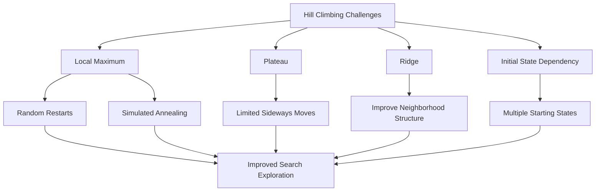

# 🏔️ Problems in Hill Climbing in Artificial Intelligence

### AI Vault | Chapter 14 — Challenges, Limitations & Optimization Strategies

[](https://github.com/ranjiGT/primitive-ai)


[](https://github.com/ranjiGT/primitive-ai)

Welcome to **Chapter 14 of [Primitive AI](https://github.com/ranjiGT/primitive-ai)**!

Hill Climbing is a popular local search algorithm in Artificial Intelligence that improves a candidate solution by repeatedly moving to a better neighboring state.

Although simple and memory-efficient, Hill Climbing has several limitations that can prevent it from finding the globally optimal solution.

This chapter explores four important challenges:

1. Local Maximum
2. Plateau
3. Ridge
4. Initial State Dependency

We will also explore techniques for overcoming these challenges, practical examples, Python implementations, and real-world applications.

---

## 🎨 Problems in Hill Climbing — Visual Explanation

<div align="center">


*Figure 1: Cartoon-style infographic explaining local maxima, plateaus, ridges, initial-state dependency, and strategies for overcoming hill-climbing limitations.*

</div>

The infographic uses mountain-climbing scenarios to illustrate why an AI search algorithm can stop improving even when better solutions exist elsewhere.

---

## 🧠 Why Does Hill Climbing Face Problems?

Hill Climbing is a **greedy local search algorithm**.

At each iteration, it evaluates nearby states and attempts to move toward a better solution.

However, it does not necessarily know the structure of the entire search space.

Consider a mountain climber attempting to reach the highest peak while only observing nearby locations.

The climber may:

- Stop at a smaller peak.
- Encounter a flat surface.
- Struggle to navigate a narrow ridge.
- Reach different peaks depending on the starting location.

These situations correspond to important challenges in AI optimization.

---

## 1️⃣ Local Maximum

### What Is a Local Maximum?

A local maximum is a state whose immediate neighboring states do not have higher objective values.

However, a better solution may exist elsewhere in the search space.

### Example

Suppose an algorithm evaluates the following states:

| State | Objective Value |
|---|---:|
| A | 4 |
| B | 8 |
| C | 12 |
| D | 9 |
| E | 15 |
| F | 20 |

Assume each state is connected only to its immediate predecessor and successor.

Starting from A, a strictly improving Hill Climbing algorithm follows:

`A → B → C`

At C, both neighboring states have lower values.

The algorithm stops at C, even though F has a higher value.

**Local maximum:** C = 12

**Global maximum:** F = 20

### Why Does This Happen?

The algorithm only accepts improving moves and cannot temporarily move downhill to reach a better peak.

### Possible Solutions

- Random-Restart Hill Climbing
- Simulated Annealing
- Tabu Search
- Population-based optimization

---

## 2️⃣ Plateau

### What Is a Plateau?

A plateau is a region of the search space where multiple neighboring states have the same objective value.

For example:

```text
State:    A   B   C   D   E
Value:    5   8   8   8   12
```

A strict Hill Climbing algorithm starting at B cannot move to C because there is no improvement.

However, reaching E requires crossing the flat region.

### Types of Plateaus

**Flat Local Maximum:** A flat region where no improving neighboring move is available.

**Shoulder:** A flat region from which a better solution can eventually be reached.

### Why Are Plateaus Problematic?

- Neighboring states may have identical evaluation values.
- Strict improvement rules prevent sideways movement.
- The algorithm may terminate prematurely.
- Search progress can become slow or unpredictable.

### Possible Solutions

- Allow limited sideways moves.
- Randomly select among equally valued neighbors.
- Use random restarts.
- Introduce stochastic exploration.

Sideways moves should generally be bounded or combined with cycle detection to avoid endless movement across equal-valued states.

---

## 3️⃣ Ridge

### What Is a Ridge?

A ridge is a narrow or irregular region in the search landscape where the direction toward a better solution may not align with the available neighborhood moves.

Imagine walking along a narrow mountain ridge.

The best route may require a sequence of carefully coordinated movements rather than simply choosing an obvious uphill direction.

### Example

Suppose a search algorithm can move only horizontally or vertically through a two-dimensional search space.

However, the most promising direction toward a higher solution lies diagonally.

The algorithm may struggle to follow the ridge efficiently.

### Why Does This Happen?

- The neighborhood structure limits available movements.
- Improving directions may be difficult to identify.
- The algorithm may alternate between directions.
- Some improvements may require coordinated changes.

### Possible Solutions

- Expand the neighborhood definition.
- Allow diagonal or compound moves.
- Use stochastic search.
- Apply simulated annealing.
- Explore alternative state representations.

---

## 4️⃣ Initial State Dependency

### What Is Initial State Dependency?

Hill Climbing may produce different results depending on where the search begins.

Consider a search landscape with two peaks:

- Peak A has an objective value of 15.
- Peak B has an objective value of 30.

A search starting near Peak A may converge to A.

A search starting near Peak B may converge to B.

### Example

| Starting State | Final State | Objective Value |
|---|---|---:|
| Start A | Local Maximum A | 15 |
| Start B | Global Maximum B | 30 |
| Start C | Local Maximum A | 15 |

The algorithm's result depends on the initial state and the surrounding search landscape.

### Possible Solutions

- Random-Restart Hill Climbing
- Multiple starting points
- Population-based search
- Improved initialization strategies

---

## 📊 Summary of Hill Climbing Problems

| Problem | Cause | Impact | Possible Solution |
|---|---|---|---|
| Local Maximum | No improving immediate neighbor | Suboptimal solution | Random restart |
| Plateau | Equal-valued neighbors | Search stagnation | Sideways moves |
| Ridge | Restrictive neighborhood structure | Slow or failed progress | Better neighborhood design |
| Initial State Dependency | Different starting positions | Different final solutions | Multiple restarts |

These problems are not unique to Hill Climbing. Similar challenges arise in many optimization and search algorithms.

---

## 🔄 How to Overcome Hill Climbing Problems



### Common Improvement Techniques

**Random-Restart Hill Climbing:** Runs Hill Climbing multiple times from different initial states and retains the best result.

**Sideways Moves:** Allows movement between equally valued states to explore plateaus.

**Stochastic Hill Climbing:** Uses randomness when selecting improving neighbors.

**Simulated Annealing:** Occasionally accepts worse solutions according to a temperature-dependent probability.

**Genetic Algorithms:** Maintain and evolve a population of candidate solutions.

**Tabu Search:** Uses memory to discourage cycling and guide exploration beyond local optima.

These approaches can improve exploration, but they do not automatically guarantee the global optimum.

---

## 💻 Python Example — Local Maximum Problem

The following Python implementation demonstrates how Hill Climbing can become trapped at a local maximum.

```python
def objective_function(x):
    values = {
        0: 2,
        1: 5,
        2: 9,
        3: 7,
        4: 4,
        5: 8,
        6: 12
    }

    return values[x]


def hill_climbing(start):
    current = start

    while True:
        neighbors = [
            x for x in [current - 1, current + 1]
            if 0 <= x <= 6
        ]

        best_neighbor = max(
            neighbors,
            key=objective_function
        )

        if (
            objective_function(best_neighbor)
            <= objective_function(current)
        ):
            break

        current = best_neighbor

    return current


result = hill_climbing(0)

print("Final State:", result)
print("Objective Value:", objective_function(result))
```

### Expected Output

```text
Final State: 2
Objective Value: 9
```

The algorithm stops at state 2 because both immediate neighbors have lower objective values.

However, state 6 has an objective value of 12.

Therefore, the algorithm finds a local maximum rather than the global maximum.

---

## 🔁 Python Example — Random-Restart Hill Climbing

One way to reduce initial-state dependency is to run Hill Climbing from multiple starting positions.

```python
import random

def random_restart_hill_climbing(restarts=20):
    best_solution = None
    best_value = float("-inf")

    for _ in range(restarts):
        start = random.randint(0, 6)

        solution = hill_climbing(start)
        value = objective_function(solution)

        if value > best_value:
            best_solution = solution
            best_value = value

    return best_solution, best_value


random.seed(42)

solution, value = random_restart_hill_climbing()

print("Best State:", solution)
print("Best Value:", value)
```

### Explanation

The algorithm:

1. Selects random initial states.
2. Runs Hill Climbing from each starting position.
3. Records the final solution of every run.
4. Retains the solution with the highest objective value.

This increases the opportunity to discover better peaks.

For this small example, the global maximum is state 6 with value 12, but a finite number of random restarts does not guarantee discovering it.

---

## 🆚 Comparison of Optimization Techniques

| Technique | Can Escape Local Maxima? | Uses Randomness? | Main Strategy |
|---|---|---|---|
| Simple Hill Climbing | Not within a single run | Not necessarily | First improvement |
| Steepest-Ascent Hill Climbing | Not within a single run | Not necessarily | Best improvement |
| Random-Restart Hill Climbing | Across restarts | Usually | Multiple initial states |
| Stochastic Hill Climbing | Not necessarily within a strict improving run | Yes | Random improving neighbor |
| Simulated Annealing | Yes, potentially | Yes | Sometimes accept worse moves |
| Genetic Algorithms | Can explore beyond local optima | Usually | Population evolution |
| Tabu Search | Yes, potentially | Not required | Memory-guided exploration |

---

## 🌍 Real-World Applications

Understanding Hill Climbing limitations is useful in many AI and optimization problems.

| Application | Relevant Challenge |
|---|---|
| Machine Learning | Optimization landscapes with local optima |
| Feature Selection | Locally optimal feature subsets |
| Scheduling | Getting trapped in suboptimal assignments |
| Route Optimization | Improving routes through local changes |
| Robotics | Search-space constraints and local traps |
| Resource Allocation | Initial-solution dependency |
| Timetabling | Plateaus and conflicting constraints |

Selecting an appropriate neighborhood structure and optimization strategy is essential for effective search.

---

## 🎓 Learning Outcomes

After completing this chapter, you should be able to:

- [ ] Explain why Hill Climbing can fail to find a global optimum.
- [ ] Define a local maximum.
- [ ] Identify plateaus and shoulders.
- [ ] Explain the ridge problem.
- [ ] Describe initial-state dependency.
- [ ] Compare local and global optima.
- [ ] Implement a basic Hill Climbing algorithm.
- [ ] Demonstrate premature convergence in Python.
- [ ] Explain Random-Restart Hill Climbing.
- [ ] Compare strategies for escaping local optima.

---

## 📚 Learning Resources

| Resource | Description |
|---|---|
| [🎨 Problems in Hill Climbing Infographic](./Problems%20in%20Hill%20Climbing%20in%20AI.png) | Visual overview of major challenges |
| [🏔️ Hill Climbing Fundamentals](../10-hill-climbing/) | Introduction to Hill Climbing |
| [🚶 Simple Hill Climbing](../12-simple-hill-climbing/) | First-improvement strategy |
| [⛰️ Steepest-Ascent Hill Climbing](../13-steepest-ascent-hill-climbing/) | Best-improvement strategy |
| [📚 AI Vault](../) | Explore other AI topics |
| [🏠 Primitive AI](../../) | Return to the repository homepage |

---

## 💡 Key Takeaway

> Hill Climbing is simple and efficient, but relying only on immediate improvements can cause an AI agent to become trapped in local maxima, plateaus, and ridges.

Understanding these limitations is the first step toward designing more effective search algorithms.

Methods such as Random-Restart Hill Climbing, Simulated Annealing, and Tabu Search introduce ways to explore beyond a single greedy search path.

---

## 🚀 Continue Learning

Recommended next topics:

1. Random-Restart Hill Climbing
2. Stochastic Hill Climbing
3. Simulated Annealing
4. Local Beam Search
5. Genetic Algorithms

These algorithms build on the foundations of local search and optimization.

---

## ⭐ Support Primitive AI

If this chapter helps you understand Artificial Intelligence, consider starring the repository.

**[⭐ Star Primitive AI](https://github.com/ranjiGT/primitive-ai)**

Contributions, educational examples, corrections, and improvements are welcome.

**Learn • Explore • Build • Share**

Made for curious minds and lifelong learners.
