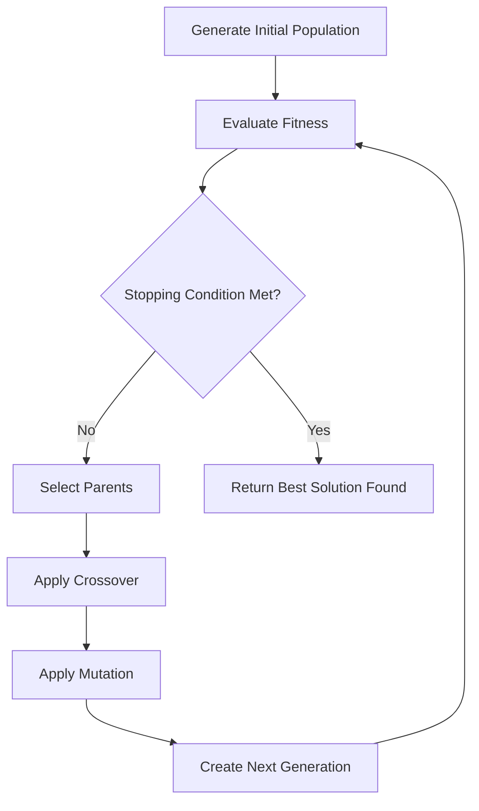
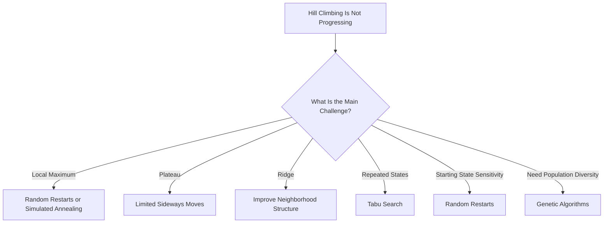

# 🏔️ Solutions to Problems in Hill Climbing in Artificial Intelligence

### AI Vault | Chapter 15 — Advanced Local Search & Optimization Techniques

[](https://github.com/ranjiGT/primitive-ai)


[](https://github.com/ranjiGT/primitive-ai)

Welcome to **Chapter 15 of [Primitive AI](https://github.com/ranjiGT/primitive-ai)**!

Hill Climbing is a greedy local search algorithm that repeatedly improves a candidate solution by moving toward a better neighboring state.

However, traditional Hill Climbing can encounter several challenges:

- **Local Maxima:** Getting trapped at a solution that is better than nearby states but worse than the global optimum.
- **Plateaus:** Encountering neighboring states with equal evaluation values.
- **Ridges:** Struggling to progress when the neighborhood structure does not align with promising directions.
- **Initial-State Dependency:** Reaching different solutions depending on the starting point.

In this chapter, we explore **six techniques for addressing these limitations**, supported by a cartoon-style infographic, practical examples, algorithms, and Python implementations.

---

## 🎨 Solutions to Hill Climbing Problems — Visual Explanation

<div align="center">


*Figure 1: Six optimization strategies for addressing hill-climbing challenges, including random restarts, sideways moves, stochastic search, simulated annealing, tabu search, and genetic algorithms.*

</div>

The infographic illustrates how different strategies improve exploration of the search space.

**Important:** These techniques improve the chances of discovering better solutions, but they do not universally guarantee finding the global optimum. Stochastic Hill Climbing, in particular, does not inherently escape a strict local maximum if it accepts only improving moves.

---

## 🧠 Why Do We Need Improved Hill Climbing Techniques?

Traditional Hill Climbing makes decisions using local information.

For a maximization problem, it typically moves from the current state `s` to a neighboring state `s'` only when:

**f(s') > f(s)**

This strict improvement rule can prevent the algorithm from crossing lower-valued or equal-valued regions to reach better solutions.

Improved local search techniques introduce mechanisms such as:

1. Multiple starting points.
2. Sideways exploration.
3. Randomized neighbor selection.
4. Probabilistic acceptance of worse moves.
5. Memory-guided exploration.
6. Population-based optimization.

---

## 1️⃣ Random-Restart Hill Climbing

### Concept

Random-Restart Hill Climbing executes Hill Climbing multiple times using different randomly selected initial states.

Instead of relying on a single starting position, it explores multiple regions of the search space.

### How It Works

1. Generate a random initial state.
2. Execute Hill Climbing.
3. Record the final solution.
4. Restart from another randomly selected state.
5. Repeat for a specified number of runs.
6. Return the best solution found.

### Example

| Run | Initial State | Final Objective Value |
|---|---|---:|
| 1 | A | 12 |
| 2 | B | 18 |
| 3 | C | 15 |
| 4 | D | 25 |

**Best solution found: 25**

### Advantages

- Reduces dependence on a single initial state.
- Can discover different local optima.
- Easy to implement using an existing Hill Climbing algorithm.
- Multiple runs can be executed independently.

### Limitations

- Requires additional computation.
- May revisit similar search regions.
- Does not guarantee the global optimum after a finite number of restarts.

---

## 2️⃣ Allowing Sideways Moves

### Concept

A sideways move allows the algorithm to transition to a neighboring state with the **same evaluation value**.

This is useful for crossing flat regions called plateaus.

### Example

```text
State:     A   B   C   D   E
Value:     5   8   8   8   12
```

Strict Hill Climbing starting at B cannot move to C because the objective value does not improve.

With sideways moves:

`B → C → D → E`

The algorithm can cross the plateau and eventually reach a better state.

### Advantages

- Helps navigate plateaus.
- May uncover improving moves beyond flat regions.
- Requires only a small modification to basic Hill Climbing.

### Limitations

- Can cause cycles between equal-valued states.
- May waste time exploring large plateaus.
- Requires a sideways-move limit or cycle detection.

---

## 3️⃣ Stochastic Hill Climbing

### Concept

Stochastic Hill Climbing introduces randomness when choosing among improving neighboring states.

Rather than always selecting the best neighbor, the algorithm randomly selects an improving neighbor.

### Example

Suppose the current state has value `10`.

| Neighbor | Value | Eligible? |
|---|---:|---|
| A | 12 | Yes |
| B | 15 | Yes |
| C | 8 | No |
| D | 11 | Yes |

A stochastic approach might randomly choose A, B, or D.

### Advantages

- Introduces diversity into search trajectories.
- Reduces deterministic selection bias.
- Can explore different improving paths.

### Limitations

- Results vary between runs.
- A strictly improving version still becomes trapped at local maxima.
- Random selection does not guarantee better final solutions.

Stochastic Hill Climbing should not be confused with Simulated Annealing, which can explicitly accept worse moves.

---

## 4️⃣ Simulated Annealing

### Concept

Simulated Annealing is inspired by the physical process of heating and gradually cooling materials.

It introduces a mechanism that sometimes accepts worse solutions, allowing the search to escape local optima.

### Acceptance Rule

For a maximization problem, let:

**Δ = f(new) − f(current)**

If Δ is positive, the new state is accepted.

If Δ is negative, the worse state may be accepted with probability:

**P = exp(Δ / T)**

Where:

- `Δ` is the change in objective value.
- `T` is the current temperature.
- `P` is the probability of accepting a worse move.

### Temperature Behavior

| Temperature | Behavior |
|---|---|
| High | More exploration; worse moves are more likely to be accepted |
| Medium | Balances exploration and exploitation |
| Low | Increasingly favors improving moves |

### Advantages

- Can escape local maxima.
- Can cross valleys and plateaus.
- Useful for complex optimization problems.

### Limitations

- Sensitive to cooling schedules.
- Requires parameter tuning.
- May converge slowly.
- Finite runs do not guarantee a globally optimal result.

---

## 5️⃣ Tabu Search

### Concept

Tabu Search uses memory to guide the search and discourage cycling.

It maintains a **tabu list** containing recently visited states, moves, or move attributes.

This prevents the algorithm from repeatedly returning to the same search positions.

### How It Works

1. Start from an initial solution.
2. Generate neighboring solutions.
3. Exclude tabu moves unless an aspiration criterion allows them.
4. Select the best admissible neighbor.
5. Update the tabu list.
6. Repeat until a stopping condition is reached.

### Example

```text
Current State: A

A → B → C → D

Tabu List:
A → B
B → C
C → D
```

The tabu list discourages immediately reversing recently performed moves.

### Advantages

- Helps prevent short-term cycles.
- Can explore beyond local optima.
- Uses search history to guide decisions.

### Limitations

- Requires additional memory.
- Tabu tenure must be selected carefully.
- Poorly chosen restrictions can exclude useful moves.

---

## 6️⃣ Genetic Algorithms

### Concept

Genetic Algorithms are population-based optimization techniques inspired by natural evolution.

Unlike traditional Hill Climbing, which usually maintains one current solution, Genetic Algorithms maintain a population of candidate solutions.

### Main Operations

**Selection:** Choose candidate solutions based on fitness.

**Crossover:** Combine information from parent solutions.

**Mutation:** Introduce random changes to maintain diversity.

**Replacement:** Form the next generation of candidate solutions.

### Workflow



### Advantages

- Explores multiple candidate solutions simultaneously.
- Supports diverse search strategies.
- Useful for large and complex optimization problems.

### Limitations

- Can be computationally expensive.
- Requires parameter tuning.
- Can experience premature convergence.
- Does not guarantee the global optimum.

---

## 📊 Comparison of Optimization Strategies

| Technique | Main Challenge Addressed | Key Strategy |
|---|---|---|
| Random-Restart Hill Climbing | Local maxima, initial-state dependency | Multiple starting points |
| Sideways Moves | Plateaus | Allow equal-value transitions |
| Stochastic Hill Climbing | Deterministic search paths | Randomly choose improving neighbors |
| Simulated Annealing | Local maxima, valleys, plateaus | Sometimes accept worse moves |
| Tabu Search | Cycles, local optima | Memory-guided exploration |
| Genetic Algorithms | Limited search diversity | Evolve a population of solutions |

---

## 💻 Python Example 1 — Random-Restart Hill Climbing

The following example demonstrates how multiple initial states can improve the chances of finding a global optimum.

```python
import random

# Discrete optimization landscape
values = [2, 5, 9, 7, 4, 8, 12]


def objective(x):
    return values[x]


def hill_climbing(start):
    current = start

    while True:
        neighbors = [
            n for n in (current - 1, current + 1)
            if 0 <= n < len(values)
        ]

        best = max(
            neighbors,
            key=objective,
            default=current
        )

        if objective(best) <= objective(current):
            return current

        current = best


def random_restart(restarts=20):
    best_state = None
    best_value = float("-inf")

    for _ in range(restarts):
        start = random.randrange(len(values))
        result = hill_climbing(start)

        if objective(result) > best_value:
            best_state = result
            best_value = objective(result)

    return best_state, best_value


random.seed(42)

state, value = random_restart()

print("Best State:", state)
print("Best Value:", value)
```

### Expected Output

```text
Best State: 6
Best Value: 12
```

### Explanation

The search landscape contains two peaks:

- State 2 has a local maximum of 9.
- State 6 has the global maximum of 12.

A single Hill Climbing run can become trapped at state 2.

Random restarts allow the algorithm to begin in different regions and potentially discover state 6.

---

## 💻 Python Example 2 — Simulated Annealing

```python
import math
import random

values = [2, 5, 9, 7, 4, 8, 12]


def objective(x):
    return values[x]


def simulated_annealing(
    start,
    temperature=10.0,
    cooling_rate=0.95,
    min_temperature=0.01
):
    current = start
    best = current

    while temperature > min_temperature:
        neighbors = [
            n for n in (current - 1, current + 1)
            if 0 <= n < len(values)
        ]

        if not neighbors:
            break

        candidate = random.choice(neighbors)

        delta = objective(candidate) - objective(current)

        if delta >= 0 or random.random() < math.exp(
            delta / temperature
        ):
            current = candidate

        if objective(current) > objective(best):
            best = current

        temperature *= cooling_rate

    return best


random.seed(42)

solution = simulated_annealing(start=0)

print("Best State:", solution)
print("Best Value:", objective(solution))
```

This implementation demonstrates the central principle of Simulated Annealing: accepting some worse moves to explore beyond local optima.

Results can depend on the random seed, initial temperature, and cooling schedule.

---

## 🧭 Choosing the Right Technique

Different search challenges benefit from different strategies.



No single optimization method is universally best.

The choice depends on the objective function, neighborhood structure, available computational resources, and required solution quality.

---

## 🌍 Real-World Applications

| Application | Relevant Technique |
|---|---|
| Scheduling | Random Restarts, Tabu Search |
| Timetabling | Tabu Search, Genetic Algorithms |
| Route Optimization | Simulated Annealing, Tabu Search |
| Feature Selection | Stochastic Search, Genetic Algorithms |
| Resource Allocation | Random Restarts, Simulated Annealing |
| Combinatorial Optimization | Genetic Algorithms, Tabu Search |
| Parameter Optimization | Stochastic Search, Simulated Annealing |

These algorithms are valuable when exhaustive search is computationally impractical.

---

## 🎓 Learning Outcomes

After completing this chapter, you should be able to:

- [ ] Explain the limitations of traditional Hill Climbing.
- [ ] Describe Random-Restart Hill Climbing.
- [ ] Explain how sideways moves help cross plateaus.
- [ ] Distinguish stochastic search from steepest-ascent search.
- [ ] Understand the acceptance probability in Simulated Annealing.
- [ ] Explain the purpose of a tabu list.
- [ ] Describe selection, crossover, and mutation in Genetic Algorithms.
- [ ] Implement Random-Restart Hill Climbing in Python.
- [ ] Implement a basic Simulated Annealing algorithm.
- [ ] Choose appropriate optimization techniques for different problems.

---

## 📚 Learning Resources

| Resource | Description |
|---|---|
| [🎨 Solutions Infographic](./Solutions%20to%20Problems%20in%20Hill%20Climbing%20in%20AI.png) | Visual explanation of optimization strategies |
| [🏔️ Hill Climbing Fundamentals](../10-hill-climbing/) | Introduction to Hill Climbing |
| [🚶 Simple Hill Climbing](../12-simple-hill-climbing/) | First-improvement local search |
| [⛰️ Steepest-Ascent Hill Climbing](../13-steepest-ascent-hill-climbing/) | Best-improvement local search |
| [⚠️ Problems in Hill Climbing](../14-problems-in-hill-climbing/) | Understanding common limitations |
| [📚 AI Vault](../) | Explore the complete AI collection |
| [🏠 Primitive AI](../../) | Return to the main repository |

---

## 💡 Key Takeaway

> Improving Hill Climbing is not simply about choosing a better neighboring state. It is about designing strategies that explore beyond the limitations of greedy local search.

Random restarts improve initial-state diversity, sideways moves help navigate plateaus, simulated annealing permits occasional downhill exploration, tabu search uses memory, and genetic algorithms explore populations of candidate solutions.

Together, these techniques provide a foundation for understanding advanced optimization in Artificial Intelligence.

---

## 🚀 Continue Learning

Recommended next topics:

1. Random-Restart Hill Climbing — Detailed Implementation
2. Simulated Annealing
3. Local Beam Search
4. Genetic Algorithms
5. Tabu Search

---

## ⭐ Support Primitive AI

If these educational resources help you understand Artificial Intelligence, consider supporting the project.

**[⭐ Star Primitive AI on GitHub](https://github.com/ranjiGT/primitive-ai)**

Contributions, corrections, examples, and improvements are welcome.

**Learn • Explore • Build • Share**

Made for curious minds and lifelong learners.
