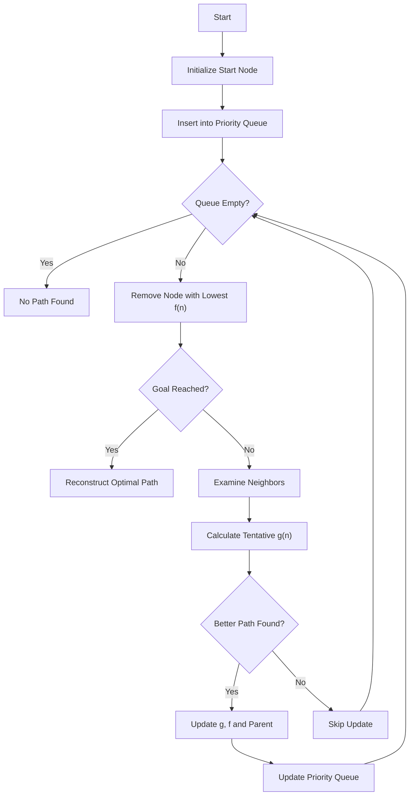

# ⭐ A* (A-Star) Search Algorithm in Artificial Intelligence

### AI Vault | Chapter 16 — Informed Search, Heuristics & Optimal Pathfinding

[](https://github.com/ranjiGT/primitive-ai)


[](https://github.com/ranjiGT/primitive-ai)

Welcome to **Chapter 16 of [Primitive AI](https://github.com/ranjiGT/primitive-ai)**!

The **A* (A-Star) Search Algorithm** is one of the most important informed search algorithms in Artificial Intelligence.

It combines the actual cost of reaching a state with an estimate of the remaining cost to the goal.

A* is widely used in robotics, video games, navigation systems, route planning, and automated problem-solving.

In this chapter, you will learn how A* works, how heuristics guide its decisions, and how to implement optimal pathfinding using Python.

---

## 🎨 A* Algorithm — Visual Explanation

<div align="center">


*Figure 1: Cartoon-style infographic illustrating A* search, the evaluation function, grid navigation, search trees, heuristics, and open/closed lists.*

</div>

The infographic introduces A* through a mountain-climbing and grid-navigation analogy.

Imagine a traveler trying to reach a destination while avoiding obstacles.

Instead of blindly exploring every possible route, A* evaluates promising paths using both their accumulated cost and their estimated distance to the destination.

---

## 🧠 1. What Is the A* Algorithm?

A* is an **informed best-first search algorithm** used to find a least-cost path from a starting state to a goal state.

It uses a heuristic function to estimate the remaining cost of reaching the goal.

A* combines two important ideas:

- **Uniform-Cost Search:** Considers the actual cost accumulated so far.
- **Greedy Best-First Search:** Uses an estimate of the remaining cost.

By combining these two approaches, A* can find optimal solutions under appropriate conditions.

### Key Characteristics

| Property | Description |
|---|---|
| Search Type | Informed search |
| Strategy | Best-first search using estimated total path cost |
| Data Structure | Priority queue |
| Evaluation Function | `f(n) = g(n) + h(n)` |
| Completeness | Yes, under standard assumptions such as finite branching and positive minimum step costs |
| Optimality | Yes, with suitable heuristic and search implementation |
| Main Challenge | Potentially high memory consumption |

---

## 🧮 2. A* Evaluation Function

The foundation of A* is:

### f(n) = g(n) + h(n)

Where:

| Component | Meaning |
|---|---|
| `f(n)` | Estimated total cost of a path through node `n` |
| `g(n)` | Actual cost from the start node to node `n` |
| `h(n)` | Estimated remaining cost from node `n` to the goal |

### Example

Suppose an AI agent is evaluating three possible routes.

| Node | g(n) | h(n) | f(n) |
|---|---:|---:|---:|
| A | 2 | 7 | 9 |
| B | 4 | 3 | 7 |
| C | 3 | 6 | 9 |

A* prioritizes **Node B**, because its estimated total cost is the lowest.

**Important:** A* selects the frontier node with the lowest `f(n)`. It does not necessarily choose the best immediate neighbor of the current node.

---

## 🗺️ 3. A* Pathfinding on a Grid

Consider a robot navigating a grid.

```text
S  .  .  #  .
.  #  .  #  .
.  #  .  .  .
.  .  #  .  .
#  .  .  .  G
```

Legend:

- `S` — Starting position
- `G` — Goal position
- `.` — Walkable cell
- `#` — Obstacle

The objective is to find a least-cost path from S to G without entering blocked cells.

For this example, assume:

- Movement is allowed horizontally and vertically.
- Each movement costs 1.
- Diagonal movement is not permitted.

A* evaluates possible routes and prioritizes those with lower estimated total costs.

---

## 🧭 4. Heuristic Functions in A*

A heuristic estimates the remaining cost from the current state to the goal.

Choosing an appropriate heuristic is essential for efficient search.

### Manhattan Distance

Manhattan distance is commonly used for four-directional grid movement with unit costs.

**h(n) = |x₂ − x₁| + |y₂ − y₁|**

Example:

Start: `(0, 0)`

Goal: `(5, 4)`

```text
h(n) = |5 - 0| + |4 - 0|
     = 5 + 4
     = 9
```

The estimated distance is 9 steps.

### Euclidean Distance

Euclidean distance measures straight-line distance between two points.

**h(n) = √((x₂ − x₁)² + (y₂ − y₁)²)**

It is useful when the movement model and costs make straight-line distance a valid lower bound.

### Heuristic Comparison

| Heuristic | Common Application |
|---|---|
| Manhattan Distance | Four-directional grid movement |
| Euclidean Distance | Geometric pathfinding |
| Chebyshev Distance | Eight-directional grids with equal move costs |
| Octile Distance | Eight-directional grids with diagonal cost √2 |
| Misplaced Tiles | Eight Puzzle Problem |
| Manhattan Tile Distance | Eight Puzzle Problem |

---

## 🔍 5. Admissible and Consistent Heuristics

### Admissible Heuristic

A heuristic is admissible if it never overestimates the true minimum remaining cost.

For every node `n`:

**h(n) ≤ h*(n)**

Where `h*(n)` is the actual optimal remaining cost.

For example, Manhattan distance is admissible for four-directional unit-cost grid movement.

### Consistent Heuristic

A heuristic is consistent if:

**h(n) ≤ c(n, n') + h(n')**

For every edge from `n` to `n'`, where `c(n, n')` is the cost of that edge.

A consistent heuristic also satisfies `h(goal) = 0`.

Consistency is especially useful in graph-search implementations because it ensures that a node removed from the priority queue with the lowest cost does not need to be reopened.

### Why Does This Matter?

With an admissible heuristic, standard A* tree search can find an optimal solution under the usual search assumptions.

For graph search that permanently closes expanded nodes, consistency is a sufficient condition for optimality.

An admissible but inconsistent heuristic may require reopening previously expanded nodes.

---

## ⚙️ 6. Step-by-Step Working of A*

A* maintains a frontier of discovered nodes and repeatedly expands the most promising one.

### Algorithm Steps

1. Initialize the start node with `g(start) = 0`.
2. Calculate its heuristic value.
3. Insert the start node into the priority queue.
4. Remove the node with the lowest `f(n)`.
5. Check whether the node is the goal.
6. If it is the goal, reconstruct and return the path.
7. Otherwise, examine its neighboring states.
8. Update a neighbor if a lower-cost route has been discovered.
9. Repeat until the goal is found or no reachable nodes remain.

### Algorithm Flowchart



---

## 📂 7. Open and Closed Lists

A* commonly uses two logical collections.

### Open List

The open list contains discovered nodes that are waiting to be expanded.

It is usually implemented using a priority queue ordered by `f(n)`.

### Closed List

The closed list contains nodes that have already been expanded.

For a consistent heuristic, expanded nodes can be finalized without reopening.

### Example

| Node | g(n) | h(n) | f(n) | Status |
|---|---:|---:|---:|---|
| S | 0 | 6 | 6 | Closed |
| A | 1 | 5 | 6 | Open |
| B | 2 | 3 | 5 | Open |
| C | 3 | 5 | 8 | Open |

A* selects Node B next because it has the lowest `f(n)` among the open nodes.

---

## 💻 8. Python Implementation of A*

The following implementation uses a priority queue and Manhattan distance to find a shortest path through a grid.

```python
import heapq


def heuristic(a, b):
    """Manhattan distance."""
    return abs(a[0] - b[0]) + abs(a[1] - b[1])


def reconstruct_path(came_from, current):
    path = [current]

    while current in came_from:
        current = came_from[current]
        path.append(current)

    return path[::-1]


def a_star(grid, start, goal):
    rows = len(grid)
    cols = len(grid[0])

    if grid[start[0]][start[1]] == 1:
        return None

    if grid[goal[0]][goal[1]] == 1:
        return None

    open_heap = []
    counter = 0

    heapq.heappush(
        open_heap,
        (heuristic(start, goal), counter, start)
    )

    came_from = {}
    g_score = {start: 0}
    closed = set()

    directions = [
        (0, 1),
        (1, 0),
        (0, -1),
        (-1, 0)
    ]

    while open_heap:
        _, _, current = heapq.heappop(open_heap)

        if current in closed:
            continue

        if current == goal:
            return reconstruct_path(came_from, current)

        closed.add(current)

        for dr, dc in directions:
            neighbor = (
                current[0] + dr,
                current[1] + dc
            )

            r, c = neighbor

            if not (0 <= r < rows and 0 <= c < cols):
                continue

            if grid[r][c] == 1:
                continue

            if neighbor in closed:
                continue

            tentative_g = g_score[current] + 1

            if tentative_g < g_score.get(
                neighbor, float("inf")
            ):
                came_from[neighbor] = current
                g_score[neighbor] = tentative_g

                f_score = (
                    tentative_g
                    + heuristic(neighbor, goal)
                )

                counter += 1

                heapq.heappush(
                    open_heap,
                    (f_score, counter, neighbor)
                )

    return None


grid = [
    [0, 0, 0, 1, 0],
    [0, 1, 0, 1, 0],
    [0, 1, 0, 0, 0],
    [0, 0, 1, 0, 0],
    [1, 0, 0, 0, 0]
]

start = (0, 0)
goal = (4, 4)

path = a_star(grid, start, goal)

print("Shortest Path:", path)

if path:
    print("Total Cost:", len(path) - 1)
else:
    print("No path found")
```

### Expected Output

```text
Shortest Path: [(0, 0), (0, 1), (0, 2),
                (1, 2), (2, 2), (2, 3),
                (3, 3), (4, 3), (4, 4)]

Total Cost: 8
```

### How the Code Works

- `heapq` implements the priority queue.
- `heuristic()` estimates the remaining cost.
- `g_score` stores the best discovered path cost.
- `came_from` records parent nodes for reconstructing the path.
- `closed` prevents repeated expansion of finalized nodes.
- `reconstruct_path()` builds the final route.

This implementation assumes a rectangular grid, unit movement costs, and a consistent Manhattan heuristic.

---

## 🆚 9. A* vs Other Search Algorithms

| Algorithm | Uses Actual Cost? | Uses Heuristic? | Optimality |
|---|---|---|---|
| Breadth-First Search | Implicitly for equal-cost edges | No | Optimal for equal-cost edges |
| Depth-First Search | No | No | Not generally optimal |
| Uniform-Cost Search | Yes | No | Optimal under standard positive-cost assumptions |
| Greedy Best-First Search | No | Yes | Not generally optimal |
| A* Search | Yes | Yes | Optimal under appropriate conditions |
| Hill Climbing | Not necessarily | Usually uses an evaluation function | Not generally optimal |

### A* vs Greedy Best-First Search

Greedy Best-First Search uses:

**f(n) = h(n)**

A* uses:

**f(n) = g(n) + h(n)**

Greedy search prioritizes the estimated remaining distance, while A* also accounts for the cost already incurred.

### A* vs Dijkstra's Algorithm

Dijkstra's algorithm can be viewed as a special case of A* where:

**h(n) = 0**

With a zero heuristic, A* prioritizes nodes entirely by their accumulated path cost.

---

## ⏱️ 10. Time and Space Complexity

A* performance depends on the search space, branching factor, solution depth, and heuristic quality.

| Measure | Explanation |
|---|---|
| Time Complexity | Can be exponential in solution depth in the worst case |
| Space Complexity | Can be exponential because many frontier nodes may be stored |
| Heuristic Quality | Better informed heuristics can reduce unnecessary exploration |
| Optimality | Depends on the heuristic and implementation assumptions |

For an explicitly represented finite graph, a heap-based implementation has bounds based on the numbers of vertices and edges; these differ from the usual search-tree analysis.

### Limitations

- High memory requirements for large search spaces.
- Performance depends heavily on heuristic quality.
- Poor heuristics can cause extensive exploration.
- Complex state spaces may require specialized optimization techniques.

---

## 🌍 11. Real-World Applications

| Application | How A* Is Used |
|---|---|
| Robotics | Finding collision-free paths through known environments |
| Video Games | Navigation for non-player characters |
| GPS Navigation | Finding low-cost routes through road networks |
| Warehouse Automation | Planning robot movement between locations |
| Eight Puzzle Problem | Searching for an optimal sequence of moves |
| Automated Planning | Finding sequences of actions toward a goal |
| Network Routing | Finding paths through weighted network graphs |

A* is particularly useful when the problem has a well-defined state space, path costs, and a meaningful heuristic.

---

## 🎯 12. Learning Outcomes

After completing this chapter, you should be able to:

- [ ] Explain informed search in Artificial Intelligence.
- [ ] Define the A* algorithm.
- [ ] Calculate `f(n) = g(n) + h(n)`.
- [ ] Explain Manhattan and Euclidean heuristics.
- [ ] Distinguish admissible and consistent heuristics.
- [ ] Understand open and closed lists.
- [ ] Trace A* through a search graph.
- [ ] Implement A* using Python.
- [ ] Explain why A* can find optimal paths.
- [ ] Compare A* with BFS, Dijkstra's algorithm, and Greedy Best-First Search.
- [ ] Identify applications and limitations of A*.

---

## 🧩 13. Practice Questions

Test your understanding:

**Q1.** What is the evaluation function used by A*?

**Q2.** What is the difference between `g(n)` and `h(n)`?

**Q3.** Why does A* use a priority queue?

**Q4.** What happens when the heuristic is always zero?

**Q5.** What makes a heuristic admissible?

**Q6.** Why is heuristic consistency useful in graph search?

**Q7.** Can A* always guarantee the shortest path?

**Q8.** How does A* differ from Hill Climbing?

**Q9.** What are the main memory limitations of A*?

**Q10.** How can A* be used to solve the Eight Puzzle Problem?

---

## 📚 14. Learning Resources

| Resource | Description |
|---|---|
| [🎨 A* Algorithm Infographic](./A-Star%20Algorithm%20in%20AI.png) | Visual explanation of A* |
| [🧩 Eight Puzzle Problem](../11-eight-puzzle-problem/) | Classic AI state-space search |
| [🏔️ Hill Climbing](../10-hill-climbing/) | Introduction to local search |
| [⚠️ Hill Climbing Problems](../14-problems-in-hill-climbing/) | Common optimization challenges |
| [🛠️ Hill Climbing Solutions](../15-solutions-to-hill-climbing-problems/) | Improved local search techniques |
| [📚 AI Vault](../) | Browse the AI learning collection |
| [🏠 Primitive AI](../../) | Return to the main repository |

---

## 💡 Key Takeaway

> A* combines the cost of the path already traveled with an estimate of the remaining cost, allowing it to prioritize promising routes while preserving optimality under suitable conditions.

The central idea is:

**f(n) = g(n) + h(n)**

Understanding A* provides an important foundation for studying intelligent search, robotics, navigation, and automated planning.

---

## 🚀 Continue Learning

Recommended next topics:

1. Greedy Best-First Search
2. Uniform-Cost Search
3. A* for the Eight Puzzle Problem
4. Iterative Deepening A* (IDA*)
5. Weighted A*
6. Bidirectional A* Search

---

## ⭐ Support Primitive AI

If this chapter helps you understand Artificial Intelligence, consider supporting the project.

**[⭐ Star Primitive AI](https://github.com/ranjiGT/primitive-ai)**

Contributions, corrections, educational examples, and improvements are welcome.

**Learn • Explore • Build • Share**

Made for curious minds and lifelong learners.
