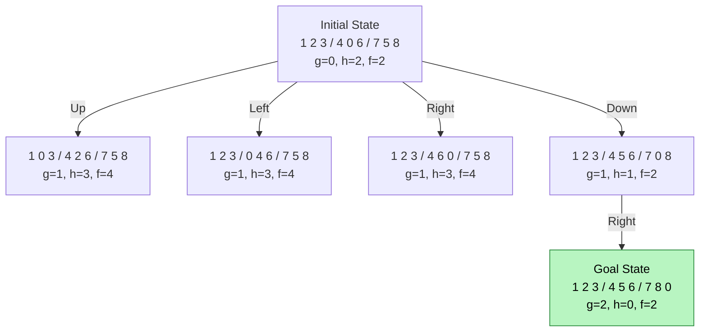

# 🧩 Eight Puzzle Problem Using A* Algorithm in Artificial Intelligence

### AI Vault | Chapter 17 — Heuristic Search, State-Space Exploration & Optimal Puzzle Solving

[](https://github.com/ranjiGT/primitive-ai)


Welcome to **Chapter 17 of [Primitive AI](https://github.com/ranjiGT/primitive-ai)**!

The **Eight Puzzle Problem** is a classic Artificial Intelligence problem that demonstrates how intelligent search algorithms can solve problems by exploring possible states.

In this chapter, we use the **A* (A-Star) Search Algorithm** to find the shortest sequence of moves that transforms an initial puzzle configuration into a desired goal configuration.

You will learn about state-space representation, heuristic evaluation, Manhattan distance, priority queues, optimal search, and Python implementation.

---

## 🎨 Eight Puzzle Using A* — Visual Explanation

<div align="center">


*Figure 1: Cartoon-style infographic illustrating the Eight Puzzle Problem, A* evaluation function, Manhattan distance, possible moves, search trees, and optimal pathfinding.*

</div>

The infographic provides a visual introduction to how A* evaluates puzzle configurations and selects promising states.

> **Note:** The infographic is a conceptual teaching aid. The worked example and executable implementation below provide a consistent, verifiable sequence of puzzle states.

---

## 🧠 1. What Is the Eight Puzzle Problem?

The Eight Puzzle is a sliding-tile puzzle consisting of:

- A 3 × 3 grid.
- Eight numbered tiles (1–8).
- One empty space, represented by `0`.
- A goal configuration that must be reached.

The player moves tiles into the empty space to rearrange the puzzle.

### Example Goal State

```text
+---+---+---+
| 1 | 2 | 3 |
+---+---+---+
| 4 | 5 | 6 |
+---+---+---+
| 7 | 8 |   |
+---+---+---+
```

### Objective

Find the shortest valid sequence of moves that transforms the initial state into the goal state.

Each legal move has a cost of 1.

---

## 🗺️ 2. State-Space Representation

In Artificial Intelligence, a **state** represents a particular configuration of the puzzle.

The entire collection of reachable configurations forms the state space.

### Initial State

```text
1 2 3
4 0 6
7 5 8
```

### Goal State

```text
1 2 3
4 5 6
7 8 0
```

Here, `0` represents the empty position.

### State Representation in Python

```python
initial_state = (
    1, 2, 3,
    4, 0, 6,
    7, 5, 8
)

goal_state = (
    1, 2, 3,
    4, 5, 6,
    7, 8, 0
)
```

Using tuples makes puzzle states immutable and suitable for dictionary keys and sets.

### State-Space Size

The total number of possible arrangements is:

**9! = 362,880**

However, only half of these arrangements are reachable from a given configuration.

Therefore, the Eight Puzzle has:

**181,440 reachable states per solvability class.**

---

## ⭐ 3. Why Use A* for the Eight Puzzle?

A* is an informed search algorithm that combines the actual path cost with a heuristic estimate.

Its evaluation function is:

### f(n) = g(n) + h(n)

Where:

| Function | Meaning |
|---|---|
| `g(n)` | Number of moves made from the initial state |
| `h(n)` | Estimated number of moves remaining |
| `f(n)` | Estimated total solution cost |

A* prioritizes states with the lowest estimated total cost.

With an admissible heuristic and a correct implementation, A* finds a shortest solution.

---

## 📏 4. Manhattan Distance Heuristic

Manhattan distance is one of the most widely used heuristics for the Eight Puzzle.

It calculates how far each numbered tile is from its goal position.

For each tile:

**Distance = |Current Row − Goal Row| + |Current Column − Goal Column|**

The heuristic is the sum of these distances over all numbered tiles.

The blank tile is excluded.

### Example

Initial state:

```text
1 2 3
4 0 6
7 5 8
```

Goal state:

```text
1 2 3
4 5 6
7 8 0
```

Tile 5 must move one position upward.

Tile 8 must move one position left.

Therefore:

```text
h(n) = 1 + 1
     = 2
```

At the initial state:

```text
g(n) = 0
h(n) = 2

f(n) = 0 + 2 = 2
```

Manhattan distance is admissible and consistent for the standard Eight Puzzle with unit-cost moves.

---

## 🔄 5. Possible Moves in the Eight Puzzle

The empty space can move in four directions:

| Direction | Action |
|---|---|
| Up | Swap the blank with the tile above |
| Down | Swap the blank with the tile below |
| Left | Swap the blank with the tile on the left |
| Right | Swap the blank with the tile on the right |

Only moves that remain inside the grid are valid.

For example, when the blank is in the center, all four directions are possible.

When the blank is in a corner, only two moves are possible.

---

## 🧭 6. Step-by-Step A* Solution

Consider the initial state:

```text
1 2 3
4 0 6
7 5 8
```

The goal is:

```text
1 2 3
4 5 6
7 8 0
```

### Step 0 — Initial State

```text
1 2 3
4 0 6
7 5 8
```

Evaluation:

```text
g(n) = 0
h(n) = 2
f(n) = 2
```

### Step 1 — Move Blank Down

```text
1 2 3
4 5 6
7 0 8
```

Evaluation:

```text
g(n) = 1
h(n) = 1
f(n) = 2
```

### Step 2 — Move Blank Right

```text
1 2 3
4 5 6
7 8 0
```

Evaluation:

```text
g(n) = 2
h(n) = 0
f(n) = 2
```

The goal has been reached.

### Optimal Solution

**Down → Right**

Total moves: **2**

This solution is optimal because the initial Manhattan distance is 2, meaning at least two moves are required, and the solution reaches the goal in exactly two moves.

---

## 🌳 7. A* Search Tree



A* expands the most promising frontier state based on the lowest `f(n)` value.

---

## 📂 8. Open and Closed Lists

A* maintains two logical collections.

### Open List

Contains discovered states waiting to be expanded.

The open list is usually implemented as a priority queue.

### Closed List

Contains states already expanded.

A closed list helps prevent unnecessary repeated exploration.

### Example

| State | g(n) | h(n) | f(n) | Status |
|---|---:|---:|---:|---|
| Initial | 0 | 2 | 2 | Expanded |
| Blank Up | 1 | 3 | 4 | Open |
| Blank Left | 1 | 3 | 4 | Open |
| Blank Right | 1 | 3 | 4 | Open |
| Blank Down | 1 | 1 | 2 | Selected |

The algorithm prioritizes **Blank Down** because it has the lowest `f(n)`.

---

## 💻 9. Complete Python Implementation

The following Python program implements A* search for the Eight Puzzle using Manhattan distance.

```python
import heapq
from itertools import count


GOAL = (
    1, 2, 3,
    4, 5, 6,
    7, 8, 0
)


def manhattan(state):
    distance = 0

    for index, tile in enumerate(state):
        if tile == 0:
            continue

        goal_index = tile - 1

        current_row, current_col = divmod(index, 3)
        goal_row, goal_col = divmod(goal_index, 3)

        distance += (
            abs(current_row - goal_row)
            + abs(current_col - goal_col)
        )

    return distance


def get_neighbors(state):
    blank = state.index(0)
    row, col = divmod(blank, 3)

    directions = [
        ("Up", -1, 0),
        ("Down", 1, 0),
        ("Left", 0, -1),
        ("Right", 0, 1)
    ]

    for move, dr, dc in directions:
        new_row = row + dr
        new_col = col + dc

        if 0 <= new_row < 3 and 0 <= new_col < 3:
            new_blank = new_row * 3 + new_col

            new_state = list(state)

            new_state[blank], new_state[new_blank] = (
                new_state[new_blank],
                new_state[blank]
            )

            yield move, tuple(new_state)


def is_solvable(state):
    numbers = [x for x in state if x != 0]

    inversions = sum(
        numbers[i] > numbers[j]
        for i in range(len(numbers))
        for j in range(i + 1, len(numbers))
    )

    return inversions % 2 == 0


def reconstruct_path(parent, goal):
    path = []
    current = goal

    while parent[current] is not None:
        previous, move = parent[current]
        path.append((move, current))
        current = previous

    return list(reversed(path))


def a_star(start):
    if not is_solvable(start):
        return None

    sequence = count()

    open_heap = [
        (manhattan(start), next(sequence), 0, start)
    ]

    g_score = {start: 0}
    parent = {start: None}

    while open_heap:
        f, _, g, current = heapq.heappop(open_heap)

        # Ignore outdated queue entries
        if g != g_score[current]:
            continue

        if current == GOAL:
            return reconstruct_path(parent, current)

        for move, neighbor in get_neighbors(current):
            tentative_g = g + 1

            if tentative_g < g_score.get(
                neighbor, float("inf")
            ):
                g_score[neighbor] = tentative_g
                parent[neighbor] = (current, move)

                new_f = tentative_g + manhattan(neighbor)

                heapq.heappush(
                    open_heap,
                    (
                        new_f,
                        next(sequence),
                        tentative_g,
                        neighbor
                    )
                )

    return None


def print_state(state):
    for i in range(0, 9, 3):
        print(state[i:i + 3])
    print()


initial = (
    1, 2, 3,
    4, 0, 6,
    7, 5, 8
)

solution = a_star(initial)

if solution is None:
    print("No solution exists.")
else:
    print("Initial State:")
    print_state(initial)

    for step, (move, state) in enumerate(solution, 1):
        print(f"Step {step}: Move {move}")
        print_state(state)

    print("Total Moves:", len(solution))
```

### Expected Output

```text
Initial State:
(1, 2, 3)
(4, 0, 6)
(7, 5, 8)

Step 1: Move Down
(1, 2, 3)
(4, 5, 6)
(7, 0, 8)

Step 2: Move Right
(1, 2, 3)
(4, 5, 6)
(7, 8, 0)

Total Moves: 2
```

### Implementation Highlights

- Uses Python's `heapq` priority queue.
- Calculates Manhattan distance.
- Generates valid neighboring states.
- Detects unsolvable configurations.
- Tracks the lowest known path cost.
- Reconstructs the complete solution.
- Returns an optimal path for the standard Eight Puzzle.

---

## ⚠️ 10. Solvability of the Eight Puzzle

Not every Eight Puzzle configuration can reach the standard goal state.

For a 3 × 3 puzzle, solvability depends on the number of inversions.

An inversion occurs when a larger numbered tile appears before a smaller numbered tile in the flattened sequence, excluding the blank.

For the standard goal arrangement:

- Even inversion count: Solvable.
- Odd inversion count: Unsolvable.

### Example of an Unsolvable State

```text
1 2 3
4 5 6
8 7 0
```

This state differs from the goal by swapping tiles 7 and 8.

It has an odd inversion count and cannot reach the standard goal using legal sliding moves.

---

## 🆚 11. A* vs Other Search Algorithms

| Algorithm | Heuristic | Optimal for Unit-Cost Puzzle? | Main Limitation |
|---|---|---|---|
| Breadth-First Search | No | Yes | Large memory usage |
| Depth-First Search | No | No | Can explore long paths |
| Uniform-Cost Search | No | Yes | Explores many states |
| Greedy Best-First Search | Yes | Not guaranteed | Ignores accumulated cost |
| A* Search | Yes | Yes, with admissible heuristic | Memory consumption |
| IDA* | Yes | Yes, with admissible heuristic | Repeated search iterations |

A* is especially effective when a useful heuristic helps reduce the number of explored states.

---

## ⏱️ 12. Complexity and Limitations

The Eight Puzzle has a finite state space, but search can still become expensive.

### Important Factors

- Number of reachable states.
- Depth of the optimal solution.
- Quality of the heuristic.
- Number of states retained in memory.
- Duplicate-state detection.

A* can require substantial memory because it stores discovered states and their costs.

For larger puzzles, such as the Fifteen Puzzle, memory-efficient algorithms like IDA* are often considered.

---

## 🌍 13. Real-World Applications

The Eight Puzzle is primarily an educational benchmark, but its underlying techniques apply to real AI systems.

| Application | Connection to A* |
|---|---|
| Robotics | Planning movement through state spaces |
| GPS Navigation | Finding least-cost routes |
| Game AI | Searching for efficient actions |
| Automated Planning | Finding action sequences |
| Puzzle Solving | Finding shortest valid solutions |
| Logistics | Exploring alternative arrangements |
| State-Space Search | Modeling transitions between configurations |

---

## 🎓 14. Learning Outcomes

After completing this chapter, you should be able to:

- [ ] Explain the Eight Puzzle Problem.
- [ ] Represent puzzle configurations as states.
- [ ] Identify legal blank-tile movements.
- [ ] Calculate Manhattan distance.
- [ ] Explain `f(n) = g(n) + h(n)`.
- [ ] Trace A* through a search tree.
- [ ] Understand open and closed lists.
- [ ] Determine whether a puzzle is solvable.
- [ ] Implement A* in Python.
- [ ] Reconstruct an optimal solution path.
- [ ] Compare A* with uninformed search algorithms.

---

## 📝 15. Practice Exercises

1. Solve the Eight Puzzle using the misplaced-tiles heuristic.
2. Compare the number of expanded states using Manhattan distance and misplaced tiles.
3. Implement Breadth-First Search and compare its results with A*.
4. Generate random solvable puzzle configurations.
5. Build an interactive Eight Puzzle game using Python.
6. Visualize the A* search process step by step.
7. Implement IDA* for memory-efficient puzzle solving.

---

## 📚 16. Learning Resources

| Resource | Description |
|---|---|
| [🎨 Eight Puzzle A* Infographic](./Eight%20Puzzle%20Problem%20using%20A%20Star%20Algorithm.png) | Visual explanation of A* puzzle solving |
| [⭐ A* Search Algorithm](../16-a-star-algorithm/) | A* fundamentals |
| [🧩 Eight Puzzle Problem](../11-eight-puzzle-problem/) | Puzzle fundamentals |
| [🏔️ Hill Climbing](../10-hill-climbing/) | Local search concepts |
| [📚 AI Vault](../) | Explore the AI learning collection |
| [🏠 Primitive AI](../../) | Return to the main repository |

---

## 💡 Key Takeaway

> The Eight Puzzle demonstrates how A* combines actual path cost and heuristic estimates to find an optimal sequence of actions.

The essential formula is:

**f(n) = g(n) + h(n)**

By using Manhattan distance and a priority queue, A* can efficiently prioritize promising puzzle configurations while preserving optimality under the standard assumptions.

---

## 🚀 Continue Learning

Recommended next topics:

1. A* with Misplaced Tiles Heuristic
2. A* with Manhattan Distance — Advanced Examples
3. Iterative Deepening A* (IDA*)
4. Fifteen Puzzle Problem
5. Interactive Eight Puzzle Solver
6. Heuristic Search Performance Comparison

---

## ⭐ Support Primitive AI

If this chapter helps you understand Artificial Intelligence, consider supporting the project.

**[⭐ Star Primitive AI on GitHub](https://github.com/ranjiGT/primitive-ai)**

Contributions, educational examples, corrections, and improvements are welcome.

**Learn • Explore • Build • Share**

Made for curious minds and lifelong learners.
