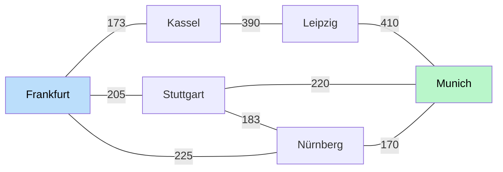

# 🗺️ Route Finding Problem in Artificial Intelligence

### AI Vault | Chapter 18 — Graph Search, Pathfinding & A* Algorithm

[](https://github.com/ranjiGT/primitive-ai)


Welcome to **Chapter 18 of [Primitive AI](https://github.com/ranjiGT/primitive-ai)**!

The **Route Finding Problem** is one of the most practical applications of Artificial Intelligence. It involves identifying the shortest, fastest, or least expensive path between two locations using graph-search algorithms.

From GPS navigation and autonomous vehicles to logistics and network routing, route-finding algorithms help intelligent systems make efficient decisions.

In this chapter, we explore how **A* (A-Star) Search** combines actual travel costs and heuristic estimates to discover an optimal route.

---

## 🎨 1. Route Finding in AI — Visual Explanation

<div align="center">


*Figure 1: Cartoon-style infographic illustrating route finding, graph representation, A* search, heuristic evaluation, and real-world applications.*

</div>

The infographic illustrates:

- Representing locations as nodes and roads as edges.
- Comparing alternative routes.
- Evaluating paths using A*.
- Understanding `g(n)`, `h(n)`, and `f(n)`.
- Selecting a minimum-cost route.
- Applying pathfinding to real-world problems.

> **Note:** The city distances and heuristic values in the infographic are illustrative, not verified road distances. The Python example below uses a self-contained graph with internally consistent calculations.

---

## 🧠 2. What Is the Route Finding Problem?

The Route Finding Problem involves finding a path between a starting location and a destination while minimizing a particular cost.

### Example

Suppose you want to travel from **Frankfurt to Munich**.

Several routes may be available:

- Frankfurt → Nürnberg → Munich
- Frankfurt → Stuttgart → Munich
- Frankfurt → Kassel → Leipzig → Munich

An intelligent route-finding system evaluates the available paths and selects the one that minimizes the chosen cost.

### Problem Components

| Component | Description |
|---|---|
| Initial State | Starting location |
| Goal State | Destination |
| State Space | All reachable locations |
| Actions | Travel along available connections |
| Transition Model | Describes which locations are connected |
| Path Cost | Distance, travel time, money, or another metric |
| Solution | A valid route from start to destination |
| Optimal Solution | A route with the minimum total cost |

---

## 🌐 3. Representing the Problem as a Graph

Route finding is commonly modeled as a **weighted graph**.

A graph consists of:

- **Vertices (nodes):** Cities, intersections, or locations.
- **Edges:** Roads or other connections.
- **Weights:** Travel distances, durations, or costs.

### Example Graph

The following is a simplified, fictional teaching graph, with weights measured in kilometers.



### Route Comparison

| Route | Total Cost |
|---|---:|
| Frankfurt → Kassel → Leipzig → Munich | 973 km |
| Frankfurt → Stuttgart → Munich | 425 km |
| Frankfurt → Nürnberg → Munich | 395 km |

For this example graph, the minimum-cost route is:

**Frankfurt → Nürnberg → Munich = 395 km**

---

## ⭐ 4. A* Search Algorithm

A* is an informed search algorithm that uses both actual cost and estimated remaining cost.

Its evaluation function is:

### f(n) = g(n) + h(n)

Where:

| Function | Meaning |
|---|---|
| `g(n)` | Actual cost from the starting node to node `n` |
| `h(n)` | Estimated cost from node `n` to the destination |
| `f(n)` | Estimated total cost of a solution through node `n` |

A* prioritizes nodes with the lowest `f(n)`.

### Example Heuristic Values

For the teaching graph, we can use these admissible heuristic estimates:

| City | h(n) |
|---|---:|
| Frankfurt | 390 |
| Kassel | 390 |
| Stuttgart | 220 |
| Nürnberg | 170 |
| Leipzig | 410 |
| Munich | 0 |

These values never overestimate the minimum remaining path cost in this graph.

For Frankfurt:

```text
g(Frankfurt) = 0
h(Frankfurt) = 390

f(Frankfurt) = 0 + 390 = 390
```

For Nürnberg:

```text
g(Nürnberg) = 225
h(Nürnberg) = 170

f(Nürnberg) = 225 + 170 = 395
```

For Stuttgart:

```text
g(Stuttgart) = 205
h(Stuttgart) = 220

f(Stuttgart) = 205 + 220 = 425
```

A* therefore prioritizes Nürnberg over Stuttgart after expanding Frankfurt.

---

## 🔍 5. Step-by-Step Route Finding Using A*

### Step 1 — Initialize

Start at Frankfurt.

```text
Open List: [Frankfurt]
g(Frankfurt) = 0
f(Frankfurt) = 390
```

### Step 2 — Explore Neighbors

Frankfurt has connections to Kassel, Stuttgart, and Nürnberg.

| Node | g(n) | h(n) | f(n) |
|---|---:|---:|---:|
| Kassel | 173 | 390 | 563 |
| Stuttgart | 205 | 220 | 425 |
| Nürnberg | 225 | 170 | 395 |

The node with the lowest `f(n)` is Nürnberg.

### Step 3 — Expand Nürnberg

Nürnberg connects to Munich and Stuttgart.

For Munich:

```text
g(Munich) = 225 + 170 = 395
h(Munich) = 0

f(Munich) = 395
```

For Stuttgart through Nürnberg:

```text
g(Stuttgart) = 225 + 183 = 408
```

This is worse than the existing route to Stuttgart, which costs 205, so that alternative is discarded.

### Step 4 — Reach the Goal

Munich has the lowest `f(n)` in the open list.

The algorithm selects Munich and terminates.

### Final Route

```text
Frankfurt
    |
    | 225 km
    v
Nürnberg
    |
    | 170 km
    v
Munich

Total Cost = 395 km
```

---

## 💻 6. Python Implementation of A* Route Finding

This implementation uses a priority queue to find the lowest-cost route.

```python
import heapq

graph = {
    "Frankfurt": {
        "Kassel": 173,
        "Stuttgart": 205,
        "Nürnberg": 225
    },
    "Kassel": {
        "Frankfurt": 173,
        "Leipzig": 390
    },
    "Leipzig": {
        "Kassel": 390,
        "Munich": 410
    },
    "Stuttgart": {
        "Frankfurt": 205,
        "Nürnberg": 183,
        "Munich": 220
    },
    "Nürnberg": {
        "Frankfurt": 225,
        "Stuttgart": 183,
        "Munich": 170
    },
    "Munich": {
        "Nürnberg": 170,
        "Stuttgart": 220,
        "Leipzig": 410
    }
}

heuristic = {
    "Frankfurt": 390,
    "Kassel": 390,
    "Leipzig": 410,
    "Stuttgart": 220,
    "Nürnberg": 170,
    "Munich": 0
}


def a_star(start, goal):
    open_list = [(heuristic[start], 0, start)]

    best_cost = {start: 0}
    parent = {start: None}

    while open_list:
        f, g, current = heapq.heappop(open_list)

        if g != best_cost[current]:
            continue

        if current == goal:
            path = []
            node = goal

            while node is not None:
                path.append(node)
                node = parent[node]

            path.reverse()
            return path, g

        for neighbor, distance in graph[current].items():
            new_g = g + distance

            if new_g < best_cost.get(neighbor, float("inf")):
                best_cost[neighbor] = new_g
                parent[neighbor] = current

                new_f = new_g + heuristic[neighbor]

                heapq.heappush(
                    open_list,
                    (new_f, new_g, neighbor)
                )

    return None, float("inf")


route, cost = a_star("Frankfurt", "Munich")

if route is not None:
    print("Optimal Route:", " -> ".join(route))
    print("Total Distance:", cost, "km")
else:
    print("No route found")
```

### Expected Output

```text
Optimal Route: Frankfurt -> Nürnberg -> Munich
Total Distance: 395 km
```

### Why This Works

The algorithm:

1. Starts with the initial location.
2. Calculates the estimated total cost.
3. Expands the most promising node.
4. Updates the best-known costs of neighboring nodes.
5. Continues until the destination is selected.
6. Reconstructs the optimal route.

The implementation assumes nonnegative edge weights and an admissible heuristic.

---

## 🆚 7. Comparison of Route Finding Algorithms

| Algorithm | Uses Heuristic? | Optimality |
|---|---|---|
| Breadth-First Search | No | For equal-cost edges |
| Depth-First Search | No | Not guaranteed |
| Uniform-Cost Search | No | Yes, for nonnegative costs |
| Dijkstra's Algorithm | No | Yes, for nonnegative costs |
| Greedy Best-First Search | Yes | Not guaranteed |
| A* Search | Yes | Yes, with admissible heuristic and correct search handling |

### A* vs Dijkstra's Algorithm

Dijkstra's algorithm considers the actual cost from the start.

A* additionally estimates the remaining cost to the destination.

With a useful heuristic, A* can expand fewer nodes than Dijkstra's algorithm.

When `h(n) = 0` for all nodes, A* behaves like uniform-cost search.

---

## 🌍 8. Real-World Applications

### 🚗 GPS Navigation

Finding shortest or fastest routes between locations.

### 🚚 Logistics and Delivery

Planning delivery routes while minimizing transportation costs.

### 🤖 Autonomous Robots

Navigating robots through environments containing obstacles.

### ✈️ Aviation Route Planning

Searching route networks while accounting for operational constraints.

### 🚆 Public Transportation

Identifying efficient connections between stations.

### 🎮 Game Development

Moving characters intelligently through virtual environments.

### 🌐 Computer Networks

Selecting paths through network topologies, subject to protocol-specific routing rules.

---

## ⚠️ 9. Challenges in Route Finding

Real-world route finding can be more complicated than finding the shortest path in a static graph.

Common challenges include:

- Traffic congestion and changing travel times.
- Road closures and unavailable connections.
- Multiple optimization objectives.
- Large search spaces.
- Dynamic edge weights.
- Vehicle restrictions and one-way roads.
- Memory and computational limitations.

An algorithm may need additional modeling to account for these constraints.

For example, the shortest-distance route may not be the fastest route during rush hour.

---

## 🎓 10. Learning Outcomes

After completing this chapter, you should be able to:

- [ ] Define the Route Finding Problem.
- [ ] Represent locations as a weighted graph.
- [ ] Identify nodes, edges, and edge weights.
- [ ] Explain the A* evaluation function.
- [ ] Calculate `g(n)`, `h(n)`, and `f(n)`.
- [ ] Trace A* search step by step.
- [ ] Identify a minimum-cost path.
- [ ] Implement A* using Python.
- [ ] Compare A* with Dijkstra's algorithm.
- [ ] Describe practical route-finding applications.

---

## 📝 11. Practice Exercises

1. Modify the graph to add another city and additional connections.
2. Implement Dijkstra's algorithm and compare its output with A*.
3. Replace distance weights with travel-time weights.
4. Set all heuristic values to zero and observe the search behavior.
5. Count how many nodes each algorithm expands.
6. Visualize the resulting path using NetworkX and Matplotlib.
7. Extend the implementation to support blocked roads.

---

## 📚 12. Learning Resources

| Resource | Description |
|---|---|
| [🎨 Route Finding Infographic](./Route%20Finding%20Problem%20in%20AI.png) | Visual explanation of route finding |
| [⭐ A* Search Algorithm](../16-a-star-algorithm/) | Heuristic search fundamentals |
| [🧩 Eight Puzzle Using A*](../17-eight-puzzle-using-a-star/) | A* applied to sliding-tile puzzles |
| [📚 AI Vault](../) | Explore all AI learning chapters |
| [🏠 Primitive AI](../../) | Main repository |

---

## 💡 Key Takeaways

> Route finding is a graph-search problem in which an intelligent system searches for a path that minimizes a specified cost.

The core A* formula is:

**f(n) = g(n) + h(n)**

- `g(n)` represents the actual cost incurred.
- `h(n)` estimates the remaining cost.
- `f(n)` helps prioritize promising paths.

A* is guaranteed to find an optimal route under appropriate heuristic and algorithmic assumptions.

---

## 🚀 What's Next?

Continue exploring Artificial Intelligence with:

1. Dijkstra's Shortest Path Algorithm
2. Greedy Best-First Search
3. A* vs Dijkstra's Algorithm
4. Bidirectional Search
5. Dynamic Route Planning
6. Real-World Pathfinding with Python and NetworkX

---

## ⭐ Support Primitive AI

If these educational resources help you learn Artificial Intelligence, consider starring the repository.

**[⭐ Star Primitive AI](https://github.com/ranjiGT/primitive-ai)**

Contributions, improvements, corrections, and educational examples are welcome.

**Learn • Explore • Build • Share**

Made for curious minds and lifelong learners.
