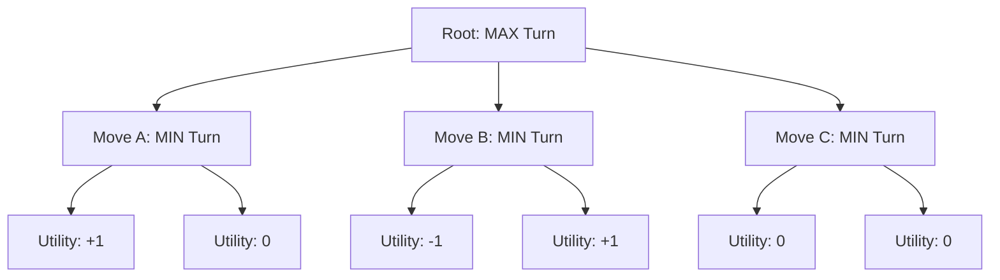
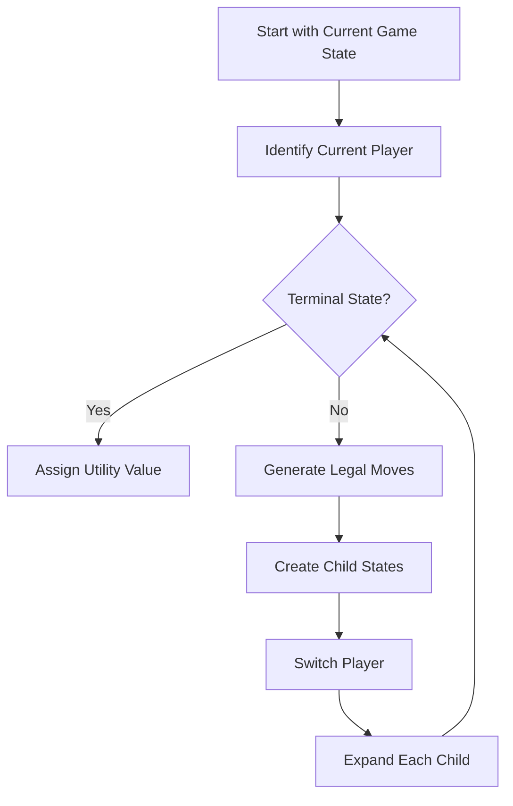
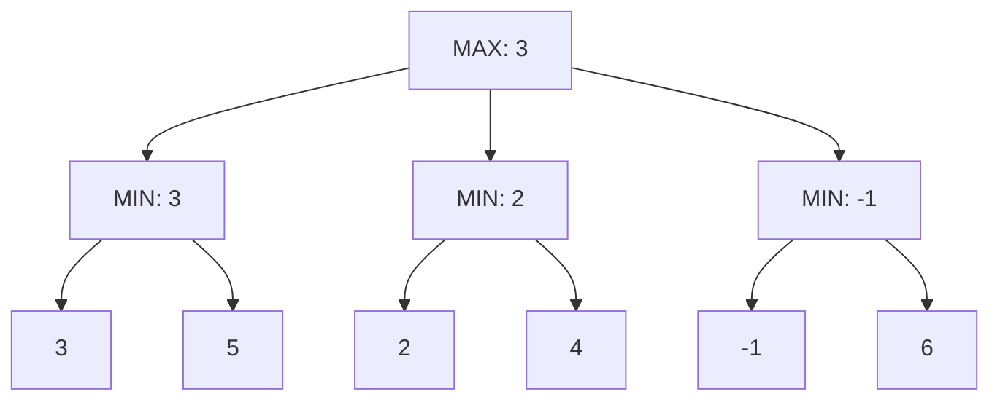

# 🌳 Game Tree in Artificial Intelligence

### AI Vault | Chapter 20 — Adversarial Search, Game States & Decision Trees

[](https://github.com/ranjiGT/primitive-ai)


[](https://github.com/ranjiGT/primitive-ai)

Welcome to **Chapter 20 of [Primitive AI](https://github.com/ranjiGT/primitive-ai)**!

A **Game Tree** is a fundamental concept in Artificial Intelligence used to represent possible future moves and game states in a competitive environment.

Game trees help intelligent agents reason about the consequences of their actions, anticipate opponent responses, and select effective strategies.

They form the foundation of several important AI algorithms, including **Minimax Search, Alpha-Beta Pruning, and Expectimax**.

In this chapter, we explore how game trees are constructed, how players alternate turns, how terminal states are evaluated, and how game-tree search supports intelligent decision-making.

---

## 🎨 1. Game Tree in AI — Visual Explanation

<div align="center">


*Figure 1: Cartoon-style infographic explaining game-tree structure, MAX/MIN players, root and terminal nodes, Tic-Tac-Toe examples, tree expansion, utility values, and applications.*

</div>

The infographic illustrates:

- What a game tree represents.
- How game states become nodes.
- How legal moves create branches.
- The roles of MAX and MIN players.
- Root, internal, and terminal nodes.
- How game trees grow as players make moves.
- How terminal outcomes receive utility values.
- Applications in AI-based game playing.

> **Note:** The infographic is a conceptual learning aid. The examples below use explicit game states and consistent utility values to demonstrate the underlying concepts.

---

## 🧠 2. What Is a Game Tree?

A game tree is a tree-shaped representation of possible sequences of actions in a game.

Each node represents a game state, and each edge represents a legal move.

Starting from the current state, the tree expands into possible future states until the game ends or a chosen search-depth limit is reached.

### Important Components

| Component | Description |
|---|---|
| Root Node | The current game state |
| Internal Node | A state from which further moves are possible |
| Child Node | A state produced by a legal move |
| Edge | A legal action or move |
| Terminal Node | A state where the game has ended |
| Utility Value | Numerical evaluation of an outcome |
| Depth | Number of moves from the root |
| Branching Factor | Number of legal moves available at a state |

### Example

In Tic-Tac-Toe, each placement of X or O produces a new board configuration.

The game tree captures the possible sequences of these placements.

---

## 🎮 3. Understanding MAX and MIN Players

In a standard two-player, zero-sum game, players have opposing objectives.

### MAX Player

MAX attempts to maximize the utility value.

For example, when X represents MAX:

- X wins: +1
- Draw: 0
- X loses: -1

### MIN Player

MIN attempts to minimize MAX's utility value.

If O represents MIN, then O tries to force outcomes unfavorable to X.

### Comparison

| MAX Player | MIN Player |
|---|---|
| Maximizes utility | Minimizes utility |
| Chooses the highest evaluated value | Chooses the lowest evaluated value |
| Often represented by X | Often represented by O |
| Acts on MAX levels | Acts on MIN levels |

Game-tree levels alternate between players in turn-based games.

---

## 🌳 4. Structure of a Game Tree

Consider a simplified game with three possible initial actions.



### Explanation

The root represents the current game state.

MAX can choose Move A, B, or C.

Each resulting state belongs to MIN, who can choose a response.

The leaves represent terminal outcomes with assigned utility values.

If both players act optimally, the utility of each initial move can be determined using Minimax.

---

## 🧩 5. Game Tree Example Using Tic-Tac-Toe

Consider the following board:

```text
 X | O | X
-----------
 O | X | .
-----------
 . | . | O
```

It is X's turn.

The available moves are:

- Position 5 (row 2, column 3)
- Position 6 (row 3, column 1)
- Position 7 (row 3, column 2)

Positions use zero-based indexing.

### Possible Moves

**Move A — Place X at Position 5**

```text
 X | O | X
-----------
 O | X | X
-----------
 . | . | O
```

**Move B — Place X at Position 6**

```text
 X | O | X
-----------
 O | X | .
-----------
 X | . | O
```

**Move C — Place X at Position 7**

```text
 X | O | X
-----------
 O | X | .
-----------
 . | X | O
```

Move B produces an immediate win for X through the diagonal:

**Top-right → Center → Bottom-left**

Therefore, this state is terminal and receives utility +1.

The other moves produce non-terminal states requiring further exploration.

---

## 🏁 6. Terminal States and Utility Values

A terminal state is a game state where no further moves are permitted because the game has ended.

For Tic-Tac-Toe:

| Outcome | Utility for MAX |
|---|---:|
| MAX wins | +1 |
| MIN wins | -1 |
| Draw | 0 |

### Why Utility Values Matter

Utility values allow an AI agent to compare possible outcomes mathematically.

They are used by algorithms such as Minimax to determine which moves are strategically preferable.

For example:

```text
Move A → Draw       → Utility  0
Move B → MAX Wins   → Utility +1
Move C → MIN Wins   → Utility -1
```

MAX prefers Move B.

---

## 🔄 7. How Game Trees Grow

Game trees expand by repeatedly generating successor states.

### Step-by-Step Process

1. Start with the current game state.
2. Identify the player whose turn it is.
3. Generate every legal move.
4. Apply each move to create child states.
5. Switch to the next player.
6. Repeat for each non-terminal child.
7. Stop when a terminal state or search-depth limit is reached.

### Flowchart



The number of nodes can increase rapidly as more moves become possible.

This phenomenon is known as **combinatorial explosion**.

---

## 📐 8. Branching Factor and Tree Depth

Two important properties determine the size of a game tree.

### Branching Factor (b)

The branching factor represents the number of possible actions from a state.

For example, an empty Tic-Tac-Toe board has nine possible opening moves.

After one move, at most eight empty positions remain.

### Tree Depth (d)

Depth represents the number of moves from the root to a node.

In Tic-Tac-Toe, a game can contain at most nine tile placements.

### Approximate Tree Size

For a uniform branching factor:

**Number of nodes ≈ 1 + b + b² + ... + bᵈ**

This gives:

**O(bᵈ)**

Actual game trees may be smaller because legal moves decrease over time, terminal states can occur early, and different action sequences may lead to equivalent states.

---

## 💻 9. Python Implementation — Generate a Game Tree

The following Python program constructs a Tic-Tac-Toe game tree.

```python
def check_winner(board):
    winning_lines = [
        (0, 1, 2),
        (3, 4, 5),
        (6, 7, 8),
        (0, 3, 6),
        (1, 4, 7),
        (2, 5, 8),
        (0, 4, 8),
        (2, 5, 8),
        (0, 4, 8),
        (2, 4, 6)
    ]

    for a, b, c in winning_lines:
        if board[a] != " " and (
            board[a] == board[b] == board[c]
        ):
            return board[a]

    return None


def is_terminal(board):
    return (
        check_winner(board) is not None
        or " " not in board
    )


def generate_moves(board, player):
    children = []

    if is_terminal(board):
        return children

    for i in range(9):
        if board[i] == " ":
            new_board = board.copy()
            new_board[i] = player

            children.append((i, new_board))

    return children


def build_game_tree(board, player, depth=0, max_depth=3):
    node = {
        "board": board.copy(),
        "player": player,
        "depth": depth,
        "children": []
    }

    if depth >= max_depth or is_terminal(board):
        return node

    next_player = "O" if player == "X" else "X"

    for move, new_board in generate_moves(board, player):
        child = build_game_tree(
            new_board,
            next_player,
            depth + 1,
            max_depth
        )

        child["move"] = move
        node["children"].append(child)

    return node


initial_board = [
    "X", "O", "X",
    "O", "X", " ",
    " ", " ", "O"
]

game_tree = build_game_tree(
    initial_board,
    player="X",
    max_depth=3
)

print("Root Depth:", game_tree["depth"])
print("Possible First Moves:", len(game_tree["children"]))

for child in game_tree["children"]:
    print("Move:", child["move"])
    print("Terminal:", is_terminal(child["board"]))
```

### Expected Output

```text
Root Depth: 0
Possible First Moves: 3

Move: 5
Terminal: False

Move: 6
Terminal: True

Move: 7
Terminal: False
```

### How the Code Works

- `check_winner()` identifies a winning player.
- `is_terminal()` detects completed games.
- `generate_moves()` creates legal successor states.
- `build_game_tree()` recursively expands the game tree.
- `max_depth` limits how many levels are generated.
- Each node stores its state, player, depth, and children.

The example demonstrates how a game tree can be represented using nested Python dictionaries.

---

## 🧮 10. Evaluating a Game Tree with Minimax

Game trees provide the structure needed for adversarial search algorithms.

Minimax assigns values to nodes by recursively evaluating their children.

### MAX Node

Select the maximum value:

**V(n) = max(V(child₁), V(child₂), ...)**

### MIN Node

Select the minimum value:

**V(n) = min(V(child₁), V(child₂), ...)**

### Example



MIN evaluates each branch:

```text
Left MIN   = min(3, 5)  = 3
Middle MIN = min(2, 4)  = 2
Right MIN  = min(-1, 6) = -1
```

MAX selects:

```text
max(3, 2, -1) = 3
```

Therefore, the left branch is optimal for MAX.

---

## ✂️ 11. Game Trees and Alpha-Beta Pruning

Large game trees may contain millions of nodes.

Alpha-Beta Pruning improves Minimax efficiency by skipping branches that cannot affect the final decision.

### Important Concepts

| Variable | Meaning |
|---|---|
| Alpha (α) | Best lower bound available to MAX |
| Beta (β) | Best upper bound available to MIN |

A branch can be pruned when:

**α ≥ β**

### Benefits

- Reduces unnecessary node evaluations.
- Preserves the Minimax result.
- Enables deeper search.
- Improves performance with good move ordering.

Alpha-Beta Pruning does not change the optimal decision; it changes how efficiently the decision is found.

---

## 🆚 12. Game Tree vs Search Tree vs Decision Tree

| Feature | Game Tree | Search Tree | Decision Tree |
|---|---|---|---|
| Purpose | Model possible game moves | Explore possible states or paths | Represent decisions or predictions |
| Multiple Players | Common | Not required | Not required |
| Adversarial Reasoning | Common | Not necessarily | Not necessarily |
| Terminal Values | Game outcomes | Goal or path costs | Predictions or decision outcomes |
| Example | Tic-Tac-Toe | Eight Puzzle | Classification model |

A game tree is a specialized form of search tree designed to represent sequences of moves in games.

---

## 🌍 13. Real-World Applications

### 🎮 Tic-Tac-Toe

Exploring all possible moves to identify winning or drawing strategies.

### ♟️ Chess

Evaluating future moves and opponent responses.

### 🏁 Checkers

Planning sequences of moves in a competitive environment.

### 🎲 Board Games

Modeling game states and evaluating strategies.

### 🤖 Game AI

Creating intelligent opponents in turn-based games.

### 🧠 Strategic Decision-Making

Representing competitive choices where one participant's actions affect another's outcomes.

---

## ⚠️ 14. Challenges and Limitations

Game-tree search has several practical challenges:

- Exponential growth of possible states.
- High computational requirements.
- Large memory requirements when storing full trees.
- Difficulty searching complex games to completion.
- Dependence on evaluation functions for depth-limited search.
- Repeated or equivalent states.

### Common Solutions

- Alpha-Beta Pruning
- Depth-Limited Search
- Iterative Deepening
- Heuristic Evaluation
- Transposition Tables
- Move Ordering
- Monte Carlo Tree Search

These techniques help AI systems reason about large game spaces more efficiently.

---

## 🎓 15. Learning Outcomes

After completing this chapter, you should be able to:

- [ ] Define a game tree.
- [ ] Identify root, internal, and terminal nodes.
- [ ] Explain MAX and MIN players.
- [ ] Represent game states as nodes.
- [ ] Generate legal successor states.
- [ ] Understand branching factor and depth.
- [ ] Assign utility values to terminal states.
- [ ] Construct a game tree using Python.
- [ ] Explain how Minimax evaluates game trees.
- [ ] Describe Alpha-Beta Pruning.
- [ ] Identify real-world applications.

---

## 📝 16. Practice Questions

1. What is a game tree in Artificial Intelligence?
2. What is the difference between a root node and a terminal node?
3. Why do game-tree levels alternate between players?
4. What is a branching factor?
5. How is game-tree depth calculated?
6. What is a terminal utility value?
7. How does Minimax use a game tree?
8. Why can game trees become computationally expensive?
9. How does Alpha-Beta Pruning improve search efficiency?
10. How would you construct a game tree for Connect Four?

---

## 🧪 17. Hands-On Exercises

### Beginner

Draw a game tree for a Tic-Tac-Toe board containing only two empty cells.

### Intermediate

Modify the Python implementation to count the total number of generated nodes.

### Advanced

Implement Minimax on the generated game tree and select the optimal move.

### Challenge

Build an interactive Tic-Tac-Toe application that visualizes the game tree and highlights the AI's selected move.

---

## 📚 18. Learning Resources

| Resource | Description |
|---|---|
| [🎨 Game Tree Infographic](./Game%20Tree%20in%20AI.png) | Visual explanation of game trees |
| [🎮 Minimax Search](../19-minimax-search/) | Adversarial decision-making |
| [⭐ A* Search Algorithm](../16-a-star-algorithm/) | Informed search |
| [🧩 Eight Puzzle Using A*](../17-eight-puzzle-using-a-star/) | State-space exploration |
| [🗺️ Route Finding Problem](../18-route-finding-problem/) | Graph-based pathfinding |
| [📚 AI Vault](../) | Explore the AI learning collection |
| [🏠 Primitive AI](../../) | Main repository |

---

## 💡 19. Key Takeaways

> A game tree represents possible future game states and actions, enabling intelligent agents to reason about competitive decisions.

Remember:

**Root Node → Current State**

**Branches → Legal Moves**

**Internal Nodes → Intermediate Game States**

**Terminal Nodes → Final Outcomes**

**Minimax → Optimal Adversarial Decision-Making**

Understanding game trees is essential for studying game-playing AI, adversarial search, and strategic planning.

---

## 🚀 20. What's Next?

Recommended topics:

1. Alpha-Beta Pruning
2. Depth-Limited Minimax Search
3. Heuristic Evaluation Functions
4. Expectimax Search
5. Monte Carlo Tree Search
6. Game AI with Python

---

## ⭐ Support Primitive AI

If this chapter helps you understand Artificial Intelligence, consider supporting the project.

**[⭐ Star Primitive AI on GitHub](https://github.com/ranjiGT/primitive-ai)**

Contributions, corrections, educational examples, and improvements are welcome.

**Learn • Explore • Build • Share**

Made for curious minds and lifelong learners.
