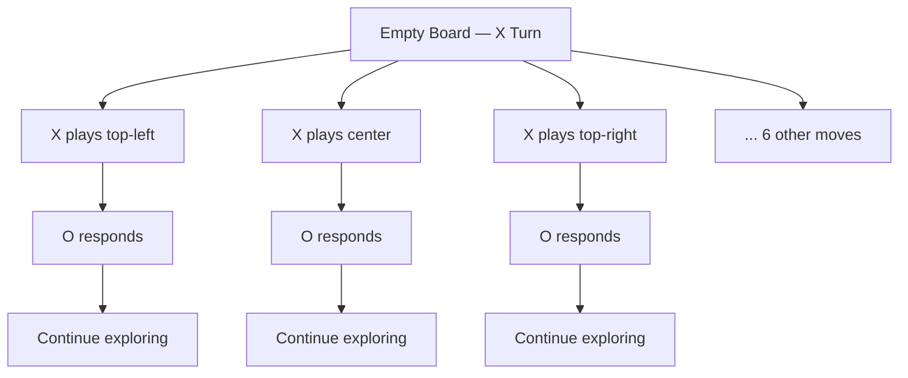
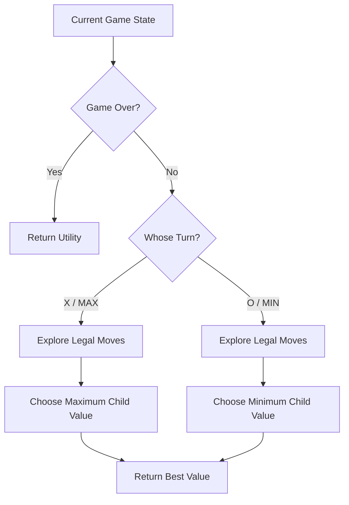

# 🎮 Tic-Tac-Toe in Artificial Intelligence

### AI Vault | Chapter 21 — Game Trees, Minimax Search & Intelligent Game Playing

[](https://github.com/ranjiGT/primitive-ai)


Welcome to **Chapter 21 of [Primitive AI](https://github.com/ranjiGT/primitive-ai)**!

**Tic-Tac-Toe** is one of the simplest yet most effective games for understanding how Artificial Intelligence makes decisions in competitive environments.

Despite its simple 3 × 3 board, Tic-Tac-Toe introduces several important AI concepts:

- State-space representation
- Game-tree construction
- Adversarial search
- Minimax decision-making
- Terminal-state evaluation
- Alpha-Beta Pruning
- Optimal game strategies

In this chapter, we will build a Tic-Tac-Toe AI capable of making optimal decisions against a human opponent.

---

## 🎨 1. Tic-Tac-Toe in AI — Visual Explanation

<div align="center">


*Figure 1: Cartoon-style infographic illustrating Tic-Tac-Toe rules, winning patterns, game trees, terminal states, Minimax search, and AI decision-making.*

</div>

The infographic provides an overview of how a simple board game can demonstrate intelligent decision-making.

> **Learning note:** The infographic is a conceptual learning aid. The verified board positions and executable examples below demonstrate the algorithm's precise behavior.

---

## 🧠 2. What Is Tic-Tac-Toe?

Tic-Tac-Toe is a deterministic, two-player, zero-sum, perfect-information game played on a 3 × 3 grid.

Two players take turns placing their symbols:

- **X — MAX Player**
- **O — MIN Player**

The objective is to place three identical symbols in a horizontal, vertical, or diagonal line.

### Example Board

```text
 X | O | X
-----------
 O | X |  
-----------
   |   | O
```

Each player can place their symbol only in an empty cell.

The game ends when a player wins or all cells are occupied without a winner.

---

## 📜 3. Rules of Tic-Tac-Toe

1. The game begins with an empty 3 × 3 board.
2. Player X makes the first move.
3. Players alternate turns.
4. Each move must occupy an empty cell.
5. The first player to complete three symbols in a line wins.
6. If all nine cells are filled without a winner, the game is a draw.

### Winning Combinations

| Pattern | Example |
|---|---|
| Horizontal | X X X |
| Vertical | Three X symbols in one column |
| Main diagonal | Top-left → Center → Bottom-right |
| Anti-diagonal | Top-right → Center → Bottom-left |

There are **8 possible winning lines**: three rows, three columns, and two diagonals.

---

## 🌳 4. Tic-Tac-Toe as a Game Tree

A game tree represents the possible future states of a game.

Each node represents a board configuration, and each edge represents a legal move.



An empty Tic-Tac-Toe board has nine legal opening moves.

After the first move, the next player has eight legal choices.

The number of possible move sequences grows rapidly, although terminal states stop expansion and different sequences can lead to the same board configuration.

### Important Concepts

| Concept | Description |
|---|---|
| Initial State | Empty 3 × 3 board |
| State | Current board configuration and player to move |
| Action | Place X or O in an empty cell |
| Successor State | Board after applying an action |
| Terminal State | Win, loss, or draw |
| Utility | Numerical value of the final outcome |

---

## 🏁 5. Terminal States and Utility Values

A terminal state represents the end of the game.

For an AI playing as X:

| Outcome | Utility |
|---|---:|
| X wins | +1 |
| O wins | -1 |
| Draw | 0 |

### Winning State

```text
 X | O | X
-----------
 O | X | O
-----------
 X |   |  
```

X wins through the anti-diagonal.

**Utility = +1**

### Draw State

```text
 X | O | X
-----------
 X | O | O
-----------
 O | X | X
```

Neither player has three symbols in a row.

**Utility = 0**

These values help the AI compare possible game outcomes.

---

## 🤖 6. Minimax Algorithm for Tic-Tac-Toe

Minimax is an adversarial search algorithm that determines the optimal move by considering all possible opponent responses.

It assumes both players act optimally.

### MAX Player

The AI playing X attempts to maximize utility.

### MIN Player

The opponent playing O attempts to minimize utility.

### Minimax Decision Process

1. Generate all legal moves.
2. Simulate each move.
3. Explore the opponent's possible responses.
4. Continue until reaching terminal states.
5. Assign utility values.
6. Propagate values upward through the game tree.
7. Select the move with the best guaranteed outcome.

### Minimax Flowchart



### Mathematical Representation

For a terminal state:

**Minimax(s) = Utility(s)**

For MAX:

**Minimax(s) = max(Minimax(successors(s)))**

For MIN:

**Minimax(s) = min(Minimax(successors(s)))**

---

## 🎯 7. Example — Finding the Best Move

Consider the following board:

```text
 X | O | X
-----------
 O | X |  
-----------
   |   | O
```

It is X's turn.

The available moves are:

- Row 2, Column 3
- Row 3, Column 1
- Row 3, Column 2

The optimal move is **Row 3, Column 1**.

### After the AI Move

```text
 X | O | X
-----------
 O | X |  
-----------
 X |   | O
```

X completes the anti-diagonal:

**Top-right → Center → Bottom-left**

Therefore:

**Best Move = (3, 1)**

**Utility = +1**

The AI wins immediately.

---

## 🐍 8. Python Implementation — Tic-Tac-Toe AI

The following implementation uses Minimax to select optimal moves.

```python
import math

EMPTY = " "
AI = "X"
HUMAN = "O"

WINNING_LINES = [
    (0, 1, 2),
    (3, 4, 5),
    (6, 7, 8),
    (0, 3, 6),
    (1, 4, 7),
    (2, 5, 8),
    (0, 4, 8),
    (2, 4, 6)
]


def print_board(board):
    for row in range(3):
        print(" | ".join(board[row * 3:row * 3 + 3]))

        if row < 2:
            print("---------")


def check_winner(board):
    for a, b, c in WINNING_LINES:
        if board[a] != EMPTY and board[a] == board[b] == board[c]:
            return board[a]

    return None


def evaluate(board):
    winner = check_winner(board)

    if winner == AI:
        return 1

    if winner == HUMAN:
        return -1

    if EMPTY not in board:
        return 0

    return None


def minimax(board, maximizing):
    result = evaluate(board)

    if result is not None:
        return result

    if maximizing:
        best = -math.inf

        for i in range(9):
            if board[i] == EMPTY:
                board[i] = AI

                score = minimax(board, False)

                board[i] = EMPTY

                best = max(best, score)

        return best

    else:
        best = math.inf

        for i in range(9):
            if board[i] == EMPTY:
                board[i] = HUMAN

                score = minimax(board, True)

                board[i] = EMPTY

                best = min(best, score)

        return best


def best_move(board):
    best_score = -math.inf
    move = None

    for i in range(9):
        if board[i] == EMPTY:
            board[i] = AI

            score = minimax(board, False)

            board[i] = EMPTY

            if score > best_score:
                best_score = score
                move = i

    return move, best_score


board = [
    "X", "O", "X",
    "O", "X", " ",
    " ", " ", "O"
]

print("Current Board:")
print_board(board)

move, score = best_move(board)

print("\nBest Move:", (move // 3 + 1, move % 3 + 1))
print("Utility:", score)

board[move] = AI

print("\nUpdated Board:")
print_board(board)
```

### Expected Output

```text
Current Board:
X | O | X
---------
O | X |  
---------
  |   | O

Best Move: (3, 1)
Utility: 1

Updated Board:
X | O | X
---------
O | X |  
---------
X |   | O
```

### How the Implementation Works

- `check_winner()` identifies a winner.
- `evaluate()` assigns utilities to terminal states.
- `minimax()` recursively evaluates future moves.
- `best_move()` selects the optimal action for X.
- The board is restored after evaluating each hypothetical move.

With complete Minimax search, the AI cannot be defeated when playing from a valid position against any opponent.

---

## ✂️ 9. Alpha-Beta Pruning

Alpha-Beta Pruning improves Minimax by eliminating branches that cannot influence the final decision.

It uses two bounds:

| Variable | Meaning |
|---|---|
| Alpha (α) | Best lower bound found for MAX |
| Beta (β) | Best upper bound found for MIN |

Pruning occurs when:

**α ≥ β**

### Advantages

- Evaluates fewer game states.
- Produces the same optimal Minimax value.
- Reduces unnecessary computation.
- Enables deeper search in larger games.

For Tic-Tac-Toe, complete Minimax is already practical, but Alpha-Beta Pruning provides a useful introduction to efficient game-tree search.

---

## ⏱️ 10. Time and Space Complexity

Let:

- `b` = branching factor
- `d` = maximum search depth

| Algorithm | Time Complexity | Auxiliary Space |
|---|---|---|
| Minimax | O(b^d) | O(d) with in-place depth-first search |
| Alpha-Beta (worst case) | O(b^d) | O(d) |
| Alpha-Beta (ideal ordering) | O(b^(d/2)) | O(d) |

For Tic-Tac-Toe, the maximum depth from an empty board is nine moves.

The branching factor decreases as the board fills.

---

## 🆚 11. Tic-Tac-Toe AI vs Human Strategy

| Human Player | Minimax AI |
|---|---|
| Uses experience and intuition | Evaluates future game states |
| May overlook winning moves | Detects winning moves through search |
| Can make strategic mistakes | Plays optimally with complete search |
| May struggle to anticipate responses | Considers all legal opponent responses |
| Learns through repeated practice | Uses a predefined search algorithm |

A Minimax-based Tic-Tac-Toe AI does not automatically learn from experience. It makes decisions through search.

Machine learning is not required to implement optimal Tic-Tac-Toe play.

---

## 🌍 12. Applications in Artificial Intelligence

Tic-Tac-Toe is widely used to introduce:

- Game-tree search
- Adversarial reasoning
- Recursive algorithms
- State-space exploration
- Utility functions
- Alpha-Beta Pruning
- Reinforcement learning environments
- Intelligent game-playing agents

The same underlying concepts extend to more complex games such as Chess, Checkers, and Connect Four.

---

## 🎓 13. Learning Outcomes

After completing this chapter, you should be able to:

- [ ] Explain Tic-Tac-Toe as an AI problem.
- [ ] Represent the game using states and actions.
- [ ] Identify terminal states.
- [ ] Assign utility values.
- [ ] Construct a game tree.
- [ ] Differentiate MAX and MIN players.
- [ ] Explain Minimax search.
- [ ] Identify optimal moves.
- [ ] Implement Minimax in Python.
- [ ] Explain Alpha-Beta Pruning.
- [ ] Analyze time and space complexity.

---

## 📝 14. Practice Questions

1. Why is Tic-Tac-Toe considered a perfect-information game?
2. What is the initial state of Tic-Tac-Toe?
3. How many legal opening moves exist?
4. What is the role of MAX and MIN?
5. How are terminal utility values assigned?
6. Why does Minimax use recursion?
7. How does Minimax guarantee optimal play?
8. What is the advantage of Alpha-Beta Pruning?
9. Can a complete Minimax AI lose Tic-Tac-Toe?
10. How would you modify the AI to play as O?

---

## 🧪 15. Hands-On Exercises

### Beginner

Create a Python function that checks whether a Tic-Tac-Toe board contains a winning combination.

### Intermediate

Build an interactive command-line game where a human plays against Minimax AI.

### Advanced

Implement Alpha-Beta Pruning and compare the number of evaluated states against standard Minimax.

### Challenge

Build a graphical Tic-Tac-Toe game using Streamlit, Tkinter, or Pygame.

Add three difficulty levels:

- Easy — Random legal moves
- Medium — Depth-limited Minimax
- Hard — Complete Minimax with optimal play

---

## 📚 16. Learning Resources

| Resource | Description |
|---|---|
| [🎨 Tic-Tac-Toe Infographic](./Tic-Tac-Toe%20in%20AI.png) | Visual explanation |
| [🌳 Game Tree](../20-game-tree/) | Game-state representation |
| [🎮 Minimax Search](../19-minimax-search/) | Adversarial search |
| [📚 AI Vault](../) | Complete learning collection |
| [🏠 Primitive AI](../../) | Main repository |

---

## 💡 17. Key Takeaways

> Tic-Tac-Toe demonstrates how Artificial Intelligence can make optimal decisions by exploring possible future states and anticipating an opponent's actions.

Remember:

**Game Tree → Represents possible moves**

**Terminal State → Determines the game outcome**

**Minimax → Finds the optimal move**

**Alpha-Beta Pruning → Makes search more efficient**

**Optimal Play → Guarantees at least a draw from the initial Tic-Tac-Toe position**

---

## 🚀 18. What's Next?

Recommended topics for further learning:

1. Alpha-Beta Pruning
2. Depth-Limited Minimax
3. Heuristic Evaluation Functions
4. Expectimax Search
5. Monte Carlo Tree Search
6. Reinforcement Learning for Tic-Tac-Toe

---

## ⭐ Support Primitive AI

If this chapter helps you understand Artificial Intelligence, consider supporting the project.

**[⭐ Star Primitive AI on GitHub](https://github.com/ranjiGT/primitive-ai)**

Contributions, corrections, educational examples, and improvements are welcome.

**Learn • Explore • Build • Share**

Made for curious minds and lifelong learners.
