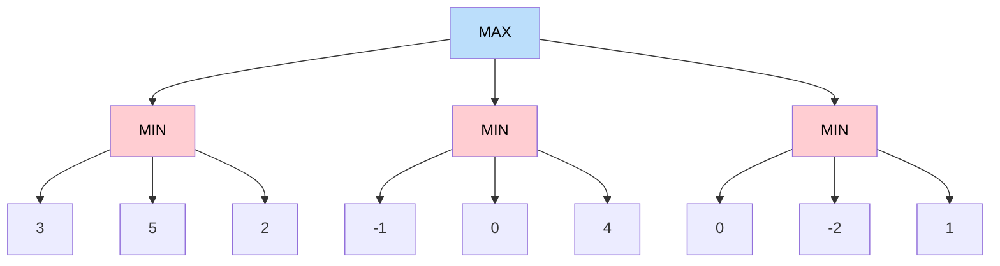
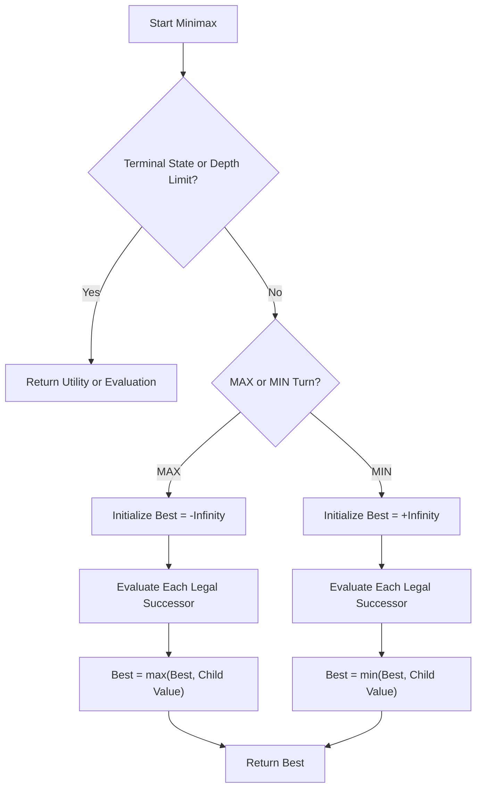

# 🎮 Minimax (Min-Max) Search Algorithm in Artificial Intelligence

### AI Vault | Chapter 19 — Adversarial Search, Game Trees & Intelligent Decision-Making

[](https://github.com/ranjiGT/primitive-ai)


[](https://github.com/ranjiGT/primitive-ai)

Welcome to **Chapter 19 of [Primitive AI](https://github.com/ranjiGT/primitive-ai)**!

The **Minimax Algorithm**, also called Min-Max Search, is a fundamental adversarial search algorithm used in Artificial Intelligence to make optimal decisions in competitive environments.

Unlike traditional search algorithms that focus on finding a path toward a goal, Minimax considers an intelligent opponent who is also trying to make the best possible decision.

It is commonly introduced through games such as Tic-Tac-Toe, Chess, and Checkers.

In this chapter, you will learn how Minimax explores game trees, evaluates possible outcomes, selects optimal moves, and improves efficiency through Alpha-Beta Pruning.

---

## 🎨 1. Min-Max Search — Visual Explanation

<div align="center">


*Figure 1: Cartoon-style infographic explaining Minimax search, MAX and MIN players, game-tree evaluation, utility propagation, Alpha-Beta Pruning, and game-playing applications.*

</div>

The infographic introduces the main ideas behind adversarial search:

- MAX tries to maximize the utility value.
- MIN tries to minimize the utility value.
- Game states are represented as nodes in a search tree.
- Terminal states are assigned utility values.
- Values propagate upward through the game tree.
- Minimax selects the best move assuming optimal opposition.
- Alpha-Beta Pruning can reduce unnecessary exploration.

> **Learning note:** The infographic is a conceptual illustration. The verified examples and executable Python implementation below provide the precise algorithmic behavior.

---

## 🧠 2. What Is Minimax Search?

Minimax is a recursive decision-making algorithm used primarily in deterministic, two-player, zero-sum, perfect-information games.

It assumes that both players act optimally.

### The Two Players

| Player | Objective | Decision Rule |
|---|---|---|
| MAX | Maximize the utility score | Select the highest value |
| MIN | Minimize the utility score | Select the lowest value |

The MAX player tries to obtain the most favorable outcome.

The MIN player attempts to reduce MAX's advantage.

### Example

Imagine playing Tic-Tac-Toe against an AI.

The AI must evaluate:

1. What moves can I make?
2. How might my opponent respond?
3. What moves will become available afterward?
4. Which choice guarantees the best possible outcome against an optimal opponent?

Minimax answers these questions by exploring possible future game states.

---

## 🌳 3. Understanding the Minimax Game Tree

A game tree represents possible sequences of moves.

Each node represents a game state, while each edge represents an action.

### Example Game Tree



### Step 1 — MIN Evaluates the Leaves

Each MIN node selects the smallest value among its children.

```text
Left MIN   = min(3, 5, 2)  = 2
Middle MIN = min(-1, 0, 4) = -1
Right MIN  = min(0, -2, 1) = -2
```

### Step 2 — MAX Selects the Best Outcome

The root MAX node chooses:

```text
MAX = max(2, -1, -2)

MAX = 2
```

Therefore, the optimal move is the **left branch**, guaranteeing a utility of 2 when both players act optimally.

---

## 🧮 4. Mathematical Representation

The Minimax value of a state can be expressed recursively.

For a terminal state:

**Minimax(s) = Utility(s)**

For a MAX state:

**Minimax(s) = max Minimax(s')**

For a MIN state:

**Minimax(s) = min Minimax(s')**

Here, `s'` represents a successor state reachable through a legal move.

### Terminal Utility Values

For a Tic-Tac-Toe game where MAX plays X:

| Outcome | Utility |
|---|---:|
| MAX wins | +1 |
| MIN wins | -1 |
| Draw | 0 |

The exact utility values depend on the game's scoring model.

---

## 🔄 5. How the Minimax Algorithm Works

The algorithm recursively evaluates possible moves until it reaches terminal states or a specified search-depth limit.

### Algorithm Steps

1. Start from the current game state.
2. Determine whose turn it is.
3. Generate all legal moves.
4. Recursively evaluate the resulting states.
5. At MAX nodes, select the highest value.
6. At MIN nodes, select the lowest value.
7. Propagate the selected values upward.
8. Choose the move with the highest guaranteed utility for MAX.

### Algorithm Flowchart



---

## 💻 6. Minimax Pseudocode

```text
function MINIMAX(state, depth, isMax):

    if state is terminal:
        return utility(state)

    if depth == 0:
        return heuristicEvaluation(state)

    if isMax:
        best = -infinity

        for each child in successors(state):
            value = MINIMAX(child, depth - 1, false)
            best = max(best, value)

        return best

    else:
        best = +infinity

        for each child in successors(state):
            value = MINIMAX(child, depth - 1, true)
            best = min(best, value)

        return best
```

For a complete search of Tic-Tac-Toe, the algorithm can continue until terminal states without a depth limit.

For larger games, depth-limited search uses a heuristic evaluation function at the cutoff.

---

## 🎯 7. Minimax Example Using Tic-Tac-Toe

Consider this board:

```text
 X | O | X
-----------
 O | X | .
-----------
 . | . | O
```

It is MAX's turn, playing X.

The available positions are:

- Row 2, Column 3
- Row 3, Column 1
- Row 3, Column 2

### Best Move

MAX should place X at Row 3, Column 1.

```text
 X | O | X
-----------
 O | X | .
-----------
 X | . | O
```

This completes the diagonal:

```text
Top Right → Center → Bottom Left
```

The result is an immediate win for MAX.

**Utility = +1**

Minimax recognizes that an immediate winning move is preferable to alternatives that allow the opponent to continue.

---

## 🐍 8. Complete Python Implementation

The following implementation creates a Tic-Tac-Toe AI using Minimax.

```python
import math

MAX_PLAYER = "X"
MIN_PLAYER = "O"
EMPTY = " "


def print_board(board):
    for row in range(3):
        print(" | ".join(board[row * 3:(row + 1) * 3]))
        if row < 2:
            print("---------")


def check_winner(board):
    winning_lines = [
        (0, 1, 2),
        (3, 4, 5),
        (6, 7, 8),
        (0, 3, 6),
        (1, 4, 7),
        (2, 5, 8),
        (0, 4, 8),
        (2, 4, 6)
    ]

    for a, b, c in winning_lines:
        if board[a] != EMPTY and (
            board[a] == board[b] == board[c]
        ):
            return board[a]

    return None


def evaluate(board):
    winner = check_winner(board)

    if winner == MAX_PLAYER:
        return 1

    if winner == MIN_PLAYER:
        return -1

    if EMPTY not in board:
        return 0

    return None


def minimax(board, maximizing):
    result = evaluate(board)

    if result is not None:
        return result

    if maximizing:
        best_score = -math.inf

        for i in range(9):
            if board[i] == EMPTY:
                board[i] = MAX_PLAYER

                score = minimax(board, False)

                board[i] = EMPTY

                best_score = max(best_score, score)

        return best_score

    else:
        best_score = math.inf

        for i in range(9):
            if board[i] == EMPTY:
                board[i] = MIN_PLAYER

                score = minimax(board, True)

                board[i] = EMPTY

                best_score = min(best_score, score)

        return best_score


def find_best_move(board):
    best_score = -math.inf
    best_move = None

    for i in range(9):
        if board[i] == EMPTY:
            board[i] = MAX_PLAYER

            score = minimax(board, False)

            board[i] = EMPTY

            if score > best_score:
                best_score = score
                best_move = i

    return best_move, best_score


board = [
    "X", "O", "X",
    "O", "X", " ",
    " ", " ", "O"
]

print("Current Board:")
print_board(board)

move, score = find_best_move(board)

print("\nBest Move Index:", move)
print("Best Move Position:", (move // 3 + 1, move % 3 + 1))
print("Expected Utility:", score)

board[move] = MAX_PLAYER

print("\nBoard After AI Move:")
print_board(board)
```

### Expected Output

```text
Current Board:
X | O | X
---------
O | X |  
---------
  |   | O

Best Move Index: 6
Best Move Position: (3, 1)
Expected Utility: 1

Board After AI Move:
X | O | X
---------
O | X |  
---------
X |   | O
```

### How the Code Works

- `check_winner()` checks whether a player has won.
- `evaluate()` assigns utility values to terminal states.
- `minimax()` recursively evaluates legal moves.
- MAX chooses the maximum utility.
- MIN chooses the minimum utility.
- `find_best_move()` selects the best available move for X.

The implementation assumes a valid Tic-Tac-Toe state and optimal play by both players.

---

## ✂️ 9. Alpha-Beta Pruning

Alpha-Beta Pruning is an optimization technique for Minimax.

It avoids exploring branches that cannot affect the final decision.

### Important Variables

| Variable | Meaning |
|---|---|
| Alpha (α) | Best lower bound found for MAX |
| Beta (β) | Best upper bound found for MIN |

A branch can be pruned when:

**α ≥ β**

### Example

Suppose MAX has already found a move guaranteeing a utility of 5.

While exploring another move, MIN discovers a response worth 3.

Because MIN can force that alternative to have a value no greater than 3, MAX has no reason to prefer it over the existing guaranteed value of 5.

The remaining successors of that MIN node can be skipped.

### Benefits

- Reduces the number of evaluated nodes.
- Produces the same Minimax value.
- Allows deeper search within a fixed computation budget.
- Performs especially well with good move ordering.

### Python Example

```python
def minimax_alpha_beta(board, maximizing, alpha, beta):
    result = evaluate(board)

    if result is not None:
        return result

    if maximizing:
        best = -math.inf

        for i in range(9):
            if board[i] == EMPTY:
                board[i] = MAX_PLAYER

                score = minimax_alpha_beta(
                    board, False, alpha, beta
                )

                board[i] = EMPTY

                best = max(best, score)
                alpha = max(alpha, best)

                if alpha >= beta:
                    break

        return best

    else:
        best = math.inf

        for i in range(9):
            if board[i] == EMPTY:
                board[i] = MIN_PLAYER

                score = minimax_alpha_beta(
                    board, True, alpha, beta
                )

                board[i] = EMPTY

                best = min(best, score)
                beta = min(beta, best)

                if alpha >= beta:
                    break

        return best
```

This function reuses the `evaluate()` function from the previous implementation.

---

## ⏱️ 10. Time and Space Complexity

Let:

- `b` = branching factor
- `d` = maximum search depth

### Standard Minimax

| Complexity | Value |
|---|---|
| Time | O(b^d) |
| Auxiliary Space | O(d) for depth-first traversal when successor states are generated incrementally |

### Alpha-Beta Pruning

| Scenario | Time Complexity |
|---|---|
| Worst Case | O(b^d) |
| Best Case with ideal move ordering | O(b^(d/2)) |

The actual complexity depends on game structure, move ordering, and implementation.

For games with very large search spaces, complete Minimax search is generally impractical.

---

## 🆚 11. Minimax vs Other AI Search Algorithms

| Algorithm | Primary Purpose | Opponent Modeling |
|---|---|---|
| Breadth-First Search | Explore states level by level | No |
| Depth-First Search | Explore search paths deeply | No |
| A* Search | Find minimum-cost paths | No |
| Hill Climbing | Improve a local evaluation score | No |
| Minimax | Select optimal adversarial moves | Yes |
| Alpha-Beta Pruning | Optimize Minimax exploration | Yes |

### Key Difference

Traditional pathfinding searches for a desirable destination.

Minimax searches for a move that remains favorable even when an opponent actively tries to reduce its value.

---

## 🌍 12. Applications of Minimax

### Tic-Tac-Toe

Finding optimal moves in a small, fully observable game.

### Chess

Evaluating candidate moves through adversarial game-tree search, typically with depth limits and other optimizations.

### Checkers

Selecting moves based on potential opponent responses.

### Connect Four

Planning moves while anticipating an opponent's strategy.

### Game AI

Building computer-controlled opponents for deterministic turn-based games.

### Competitive Decision-Making

Modeling certain adversarial scenarios where participants have opposing objectives.

---

## ⚠️ 13. Limitations of Minimax

Although Minimax provides a powerful decision-making framework, it has limitations.

- Search complexity grows exponentially with depth.
- Full search is impractical for many large games.
- Basic Minimax assumes deterministic transitions.
- Standard Minimax assumes perfect information.
- Depth-limited versions depend on evaluation-function quality.
- It assumes the opponent acts optimally.
- Real-time applications may require search budgets and approximations.

### Common Improvements

- Alpha-Beta Pruning
- Move Ordering
- Transposition Tables
- Iterative Deepening
- Heuristic Evaluation Functions
- Quiescence Search

---

## 🎓 14. Learning Outcomes

After completing this chapter, you should be able to:

- [ ] Define Minimax Search.
- [ ] Explain adversarial search.
- [ ] Differentiate MAX and MIN players.
- [ ] Represent a game using a search tree.
- [ ] Calculate terminal utility values.
- [ ] Propagate Minimax values upward.
- [ ] Identify the optimal move in a game tree.
- [ ] Implement Minimax in Python.
- [ ] Understand Alpha-Beta Pruning.
- [ ] Compare Minimax with traditional search algorithms.
- [ ] Explain the time and space complexity.
- [ ] Identify practical applications and limitations.

---

## 📝 15. Practice Questions

1. What is adversarial search in Artificial Intelligence?
2. Why does Minimax assume optimal opponent behavior?
3. What is the difference between MAX and MIN?
4. How are terminal utility values calculated?
5. Why is Minimax a recursive algorithm?
6. What happens when two moves have the same Minimax value?
7. How does Alpha-Beta Pruning improve efficiency?
8. What does the condition `alpha >= beta` represent?
9. Why is complete Minimax search impractical for Chess?
10. How would you implement a Minimax-based Connect Four AI?

---

## 🧪 16. Hands-On Exercises

### Beginner

Implement Minimax for a simple game tree with predefined utility values.

### Intermediate

Modify the Tic-Tac-Toe implementation to allow a human to play against the AI.

### Advanced

Implement Alpha-Beta Pruning and compare the number of evaluated nodes against standard Minimax.

### Challenge

Build a graphical Tic-Tac-Toe application using Python and implement multiple difficulty levels using depth-limited Minimax.

---

## 📚 17. Learning Resources

| Resource | Description |
|---|---|
| [🎨 Min-Max Search Infographic](./Min-Max%20Search%20in%20AI.png) | Visual explanation of Minimax |
| [⭐ A* Search Algorithm](../16-a-star-algorithm/) | Informed pathfinding |
| [🧩 Eight Puzzle Using A*](../17-eight-puzzle-using-a-star/) | State-space search |
| [🗺️ Route Finding Problem](../18-route-finding-problem/) | Graph-based search |
| [📚 AI Vault](../) | Browse the complete learning collection |
| [🏠 Primitive AI](../../) | Main repository |

---

## 💡 18. Key Takeaways

> Minimax is a fundamental adversarial search algorithm that selects moves by considering the best possible responses of an optimal opponent.

Remember:

**MAX → Choose the maximum value**

**MIN → Choose the minimum value**

**Alpha-Beta Pruning → Skip branches that cannot change the final Minimax decision**

Minimax provides an essential foundation for understanding intelligent game-playing systems and competitive decision-making.

---

## 🚀 19. What's Next?

Recommended topics for further exploration:

1. Alpha-Beta Pruning in Detail
2. Depth-Limited Minimax Search
3. Heuristic Evaluation Functions
4. Expectimax Search
5. Monte Carlo Tree Search
6. Game AI with Python

---

## ⭐ Support Primitive AI

If this chapter helps you understand Artificial Intelligence, consider supporting the project.

**[⭐ Star Primitive AI on GitHub](https://github.com/ranjiGT/primitive-ai)**

Contributions, corrections, educational examples, and improvements are welcome.

**Learn • Explore • Build • Share**

Made for curious minds and lifelong learners.
