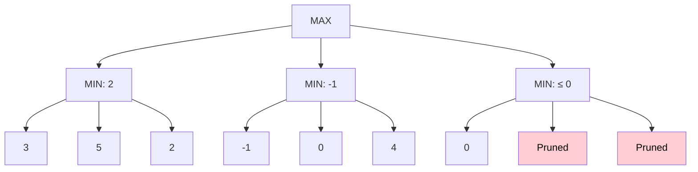

# ✂️ Alpha-Beta Pruning in Artificial Intelligence

### AI Vault | Chapter 22 — Optimizing Minimax Search and Intelligent Game Playing

[](https://github.com/ranjiGT/primitive-ai)


[](https://github.com/ranjiGT/primitive-ai)

Welcome to **Chapter 22 of [Primitive AI](https://github.com/ranjiGT/primitive-ai)**!

**Alpha-Beta Pruning** is an optimization technique for the Minimax algorithm that improves search efficiency by eliminating branches of a game tree that cannot influence the final decision.

While traditional Minimax explores all relevant possible game states to determine the optimal move, Alpha-Beta Pruning can achieve the **same optimal result while evaluating fewer nodes**.

This technique is fundamental to adversarial search and is widely used in game-playing Artificial Intelligence.

In this chapter, you will learn how Alpha-Beta Pruning works, how alpha and beta bounds are updated, when pruning occurs, and how to implement the algorithm using Python.

---

## 🎨 1. Alpha-Beta Pruning — Visual Explanation

<div align="center">


*Figure 1: Cartoon-style infographic introducing Alpha-Beta Pruning, alpha and beta bounds, game-tree evaluation, pruning decisions, pseudocode, complexity, and applications.*

</div>

The infographic introduces:

- The relationship between Minimax and Alpha-Beta Pruning.
- Alpha (α) and Beta (β) bounds.
- The pruning condition α ≥ β.
- MAX and MIN node evaluation.
- Branches that can be safely skipped.
- Search-efficiency improvements.
- Applications in intelligent game-playing systems.

> **Important:** The infographic is a conceptual learning aid. The worked example below provides a precise, internally consistent demonstration of which nodes are evaluated and pruned.

---

## 🧠 2. What Is Alpha-Beta Pruning?

Alpha-Beta Pruning is a search optimization technique used with Minimax.

Its main objective is to reduce the number of game-tree nodes that must be evaluated.

The algorithm skips branches that cannot improve the decision already available to the current player.

### Why Is It Needed?

Minimax is computationally expensive because the number of possible future game states grows rapidly.

For a game with branching factor `b` and search depth `d`, the worst-case search complexity is:

**O(b^d)**

Alpha-Beta Pruning reduces unnecessary exploration without changing the Minimax result.

### Main Benefits

- Reduces the number of evaluated nodes.
- Preserves optimal decision-making.
- Allows deeper searches within a fixed computational budget.
- Improves efficiency in adversarial search.
- Works especially well with effective move ordering.

---

## 🎯 3. Understanding Alpha (α) and Beta (β)

Alpha-Beta Pruning maintains two bounds during search.

### Alpha (α)

Alpha represents the best lower bound on the achievable Minimax value established for MAX along the current search path.

It begins at:

**α = −∞**

As better alternatives are discovered for MAX, alpha increases.

### Beta (β)

Beta represents the best upper bound on the achievable Minimax value established for MIN along the current search path.

It begins at:

**β = +∞**

As better alternatives are discovered for MIN, beta decreases.

### Comparison

| Property | Alpha (α) | Beta (β) |
|---|---|---|
| Associated with | MAX | MIN |
| Initial value | −∞ | +∞ |
| Updated using | Maximum | Minimum |
| Direction | Non-decreasing | Non-increasing |
| Represents | Lower bound | Upper bound |

### Pruning Condition

**α ≥ β**

When this condition is satisfied, the remaining unexplored children of the current node can be skipped.

They cannot influence the optimal decision of the relevant ancestor.

---

## 🌳 4. Alpha-Beta Pruning — Game Tree Example

Consider the following game tree.



Assume nodes are explored from left to right.

### Step 1 — Evaluate the Left MIN Node

Leaf values:

```text
3, 5, 2
```

MIN chooses:

```text
min(3, 5, 2) = 2
```

The root MAX node now has:

```text
alpha = 2
```

### Step 2 — Evaluate the Middle MIN Node

Leaf values:

```text
-1, 0, 4
```

The first leaf gives MIN a value of -1.

Because the root MAX already has an alternative worth 2, this middle branch cannot improve MAX's decision.

Therefore, the remaining leaves `0` and `4` can already be pruned.

### Step 3 — Evaluate the Right MIN Node

The first leaf is:

```text
0
```

The MIN node now has:

```text
beta = 0
```

The inherited alpha is:

```text
alpha = 2
```

Since:

```text
alpha >= beta
2 >= 0
```

The remaining two children are pruned.

### Final Decision

The left branch guarantees a utility of 2.

The other branches cannot produce a better result for MAX.

**Optimal Minimax Value = 2**

**Best Move = Left Branch**

In this example, only five of the nine leaves need evaluation: three on the left, one in the middle, and one on the right.

---

## 🔄 5. Step-by-Step Execution

| Step | Node | Action | Result |
|---|---|---|---|
| 1 | MAX Root | Initialize bounds | α = −∞, β = +∞ |
| 2 | Left MIN | Evaluate 3, 5, 2 | Returns 2 |
| 3 | MAX Root | Update alpha | α = 2 |
| 4 | Middle MIN | Evaluate -1 | β = -1 |
| 5 | Middle MIN | Check α ≥ β | Prune remaining children |
| 6 | Right MIN | Evaluate 0 | β = 0 |
| 7 | Right MIN | Check α ≥ β | Prune remaining children |
| 8 | MAX Root | Choose best branch | Utility = 2 |

### Important Observation

Pruning does not mean that the unexplored branches are unimportant in every situation.

It means they cannot change the decision given the bounds already established by previously explored alternatives.

---

## 🧮 6. Mathematical Representation

For a MAX node:

**V(n) = max(V(child₁), V(child₂), …)**

Alpha is updated as:

**α = max(α, V(child))**

For a MIN node:

**V(n) = min(V(child₁), V(child₂), …)**

Beta is updated as:

**β = min(β, V(child))**

The pruning condition is:

**α ≥ β**

At this point, further exploration of the current node's remaining children is unnecessary.

---

## 💻 7. Alpha-Beta Pruning Pseudocode

```text
function AlphaBeta(node, depth, alpha, beta, maximizing):

    if node is terminal or depth == 0:
        return evaluate(node)

    if maximizing:

        value = -infinity

        for each child in successors(node):

            score = AlphaBeta(
                child,
                depth - 1,
                alpha,
                beta,
                false
            )

            value = max(value, score)
            alpha = max(alpha, value)

            if alpha >= beta:
                break

        return value

    else:

        value = +infinity

        for each child in successors(node):

            score = AlphaBeta(
                child,
                depth - 1,
                alpha,
                beta,
                true
            )

            value = min(value, score)
            beta = min(beta, value)

            if alpha >= beta:
                break

        return value
```

The algorithm performs depth-first search while maintaining alpha and beta bounds.

---

## 🐍 8. Python Implementation — Alpha-Beta Pruning

The following program evaluates a small game tree using both standard Minimax and Alpha-Beta Pruning.

It also counts the number of evaluated terminal nodes.

```python
import math

game_tree = [
    [3, 5, 2],
    [-1, 0, 4],
    [0, -2, 1]
]


def minimax(tree):
    evaluated = 0
    best_value = -math.inf

    for branch in tree:
        branch_value = math.inf

        for value in branch:
            evaluated += 1
            branch_value = min(branch_value, value)

        best_value = max(best_value, branch_value)

    return best_value, evaluated


def alpha_beta(tree):
    alpha = -math.inf
    beta = math.inf

    best_value = -math.inf
    evaluated = 0
    best_move = None

    for branch_index, branch in enumerate(tree):
        branch_value = math.inf
        local_beta = beta

        for value in branch:
            evaluated += 1

            branch_value = min(branch_value, value)
            local_beta = min(local_beta, branch_value)

            if alpha >= local_beta:
                print(
                    f"Pruned remaining nodes "
                    f"in branch {branch_index + 1}"
                )
                break

        if branch_value > best_value:
            best_value = branch_value
            best_move = branch_index

        alpha = max(alpha, best_value)

    return best_value, best_move, evaluated


minimax_value, minimax_nodes = minimax(game_tree)

ab_value, best_move, ab_nodes = alpha_beta(game_tree)

print("\n--- Comparison ---")
print("Minimax Value:", minimax_value)
print("Minimax Nodes Evaluated:", minimax_nodes)

print("Alpha-Beta Value:", ab_value)
print("Best Move:", best_move + 1)
print("Alpha-Beta Nodes Evaluated:", ab_nodes)

print("Nodes Pruned:", minimax_nodes - ab_nodes)
```

### Expected Output

```text
Pruned remaining nodes in branch 2
Pruned remaining nodes in branch 3

--- Comparison ---
Minimax Value: 2
Minimax Nodes Evaluated: 9
Alpha-Beta Value: 2
Best Move: 1
Alpha-Beta Nodes Evaluated: 5
Nodes Pruned: 4
```

### Explanation

Standard Minimax evaluates all nine terminal nodes.

Alpha-Beta Pruning evaluates only five terminal nodes.

Both algorithms return the same optimal value:

**2**

In this particular example, pruning avoids four terminal-node evaluations.

This demonstrates how Alpha-Beta Pruning improves efficiency without changing the final decision.

---

## 🆚 9. Minimax vs Alpha-Beta Pruning

| Feature | Minimax | Alpha-Beta Pruning |
|---|---|---|
| Primary purpose | Find optimal adversarial move | Optimize Minimax search |
| Explores all relevant branches | Yes, without pruning | No |
| Uses alpha and beta bounds | No | Yes |
| Preserves optimal result | Yes | Yes |
| Search efficiency | Lower | Potentially higher |
| Depends on move ordering | Not for node count in full search | Strongly |
| Worst-case time | O(b^d) | O(b^d) |

### Key Difference

Minimax evaluates the game tree to determine the optimal decision.

Alpha-Beta Pruning performs the same decision-making process while avoiding unnecessary branches.

---

## ⏱️ 10. Time and Space Complexity

Let:

- `b` = branching factor
- `d` = maximum search depth

### Standard Minimax

**Time Complexity: O(b^d)**

### Alpha-Beta Pruning

| Scenario | Time Complexity |
|---|---|
| Worst Case | O(b^d) |
| Best Case with ideal move ordering | O(b^(d/2)) |

### Space Complexity

For depth-first search with successor states generated incrementally:

**O(d)** auxiliary recursion space, excluding stored game states and move-generation overhead.

### Why Move Ordering Matters

Alpha-Beta Pruning becomes more effective when promising moves are explored first.

Good move ordering establishes useful alpha and beta bounds earlier, allowing more branches to be pruned.

---

## 🎮 11. Alpha-Beta Pruning in Tic-Tac-Toe

Consider the following board:

```text
 X | O | X
-----------
 O | X |  
-----------
   |   | O
```

It is X's turn.

An optimal search identifies the winning move at:

**Row 3, Column 1**

```text
 X | O | X
-----------
 O | X |  
-----------
 X |   | O
```

X wins through the anti-diagonal.

Alpha-Beta Pruning can help avoid exploring alternative branches once sufficient bounds have been established.

However, the exact number of pruned nodes depends on move ordering and the implementation.

---

## 🌍 12. Applications of Alpha-Beta Pruning

### ♟️ Chess

Helps game-playing engines search deeper into possible moves.

### 🎮 Tic-Tac-Toe

Demonstrates optimal adversarial search and pruning.

### 🏁 Checkers

Improves efficiency when evaluating opponent responses.

### 🧩 Connect Four

Supports efficient exploration of possible future board states.

### 🤖 Game AI

Helps intelligent agents make strategic decisions in deterministic turn-based games.

### 🧠 Adversarial Planning

Provides a foundation for reasoning about competitive environments with opposing objectives.

---

## ⚠️ 13. Limitations

Although Alpha-Beta Pruning improves Minimax, it has limitations.

- Worst-case search complexity remains exponential.
- Efficiency depends heavily on move ordering.
- Large game trees may still be computationally expensive.
- Depth-limited search requires evaluation functions.
- Standard Alpha-Beta Pruning assumes deterministic, perfect-information game models.
- It does not automatically learn from previous games.

### Common Improvements

- Move Ordering
- Iterative Deepening
- Transposition Tables
- Heuristic Evaluation
- Quiescence Search
- Principal Variation Search

These techniques can further improve game-tree search efficiency.

---

## 🎓 14. Learning Outcomes

After completing this chapter, you should be able to:

- [ ] Define Alpha-Beta Pruning.
- [ ] Explain its relationship with Minimax.
- [ ] Differentiate alpha and beta bounds.
- [ ] Identify MAX and MIN nodes.
- [ ] Apply the condition α ≥ β.
- [ ] Determine which branches can be pruned.
- [ ] Evaluate a game tree step by step.
- [ ] Implement Alpha-Beta Pruning in Python.
- [ ] Compare Alpha-Beta Pruning with Minimax.
- [ ] Analyze time and space complexity.
- [ ] Explain the importance of move ordering.

---

## 📝 15. Practice Questions

1. What is Alpha-Beta Pruning?
2. Why is it used with Minimax?
3. What does alpha represent?
4. What does beta represent?
5. When does pruning occur?
6. Why does Alpha-Beta Pruning preserve the Minimax result?
7. How does move ordering affect pruning efficiency?
8. What is the worst-case time complexity?
9. What is the best-case time complexity?
10. How can Alpha-Beta Pruning improve a Tic-Tac-Toe AI?

---

## 🧪 16. Hands-On Exercises

### Beginner

Given a small game tree, manually calculate alpha and beta values.

Identify which branches can be safely pruned.

### Intermediate

Modify the Python implementation to display alpha and beta values after each evaluated node.

### Advanced

Implement a recursive Alpha-Beta Pruning algorithm for Tic-Tac-Toe.

Compare its evaluated-node count with standard Minimax.

### Challenge

Build an interactive game-tree visualizer that:

- Displays MAX and MIN nodes.
- Shows alpha and beta updates.
- Highlights pruned branches.
- Counts evaluated nodes.
- Compares Minimax and Alpha-Beta Pruning.

---

## 📚 17. Learning Resources

| Resource | Description |
|---|---|
| [🎨 Alpha-Beta Pruning Infographic](./Alpha-Beta%20Pruning%20in%20AI.png) | Visual explanation |
| [🎮 Tic-Tac-Toe in AI](../21-tic-tac-toe/) | Game-playing example |
| [🌳 Game Tree](../20-game-tree/) | Game-tree representation |
| [🧠 Minimax Search](../19-minimax-search/) | Adversarial decision-making |
| [📚 AI Vault](../) | Complete AI learning collection |
| [🏠 Primitive AI](../../) | Main repository |

---

## 💡 18. Key Takeaways

> Alpha-Beta Pruning is an optimization of Minimax that eliminates branches that cannot affect the final decision.

Remember:

**Alpha (α) → Lower bound**

**Beta (β) → Upper bound**

**α ≥ β → Prune remaining branches**

**Minimax → Finds the optimal move**

**Alpha-Beta Pruning → Finds the same optimal move more efficiently**

The effectiveness of pruning depends strongly on the order in which moves are explored.

---

## 🚀 19. What's Next?

Recommended topics for further exploration:

1. Depth-Limited Minimax Search
2. Heuristic Evaluation Functions
3. Iterative Deepening Search
4. Expectimax Algorithm
5. Monte Carlo Tree Search
6. Game AI with Python

---

## ⭐ Support Primitive AI

If this chapter helps you understand Artificial Intelligence, consider supporting the project.

**[⭐ Star Primitive AI on GitHub](https://github.com/ranjiGT/primitive-ai)**

Contributions, corrections, educational examples, and improvements are welcome.

**Learn • Explore • Build • Share**

Made for curious minds and lifelong learners.
