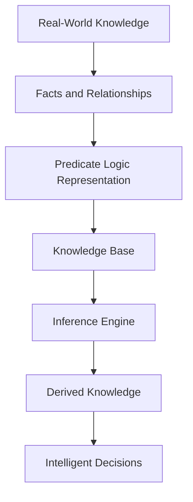
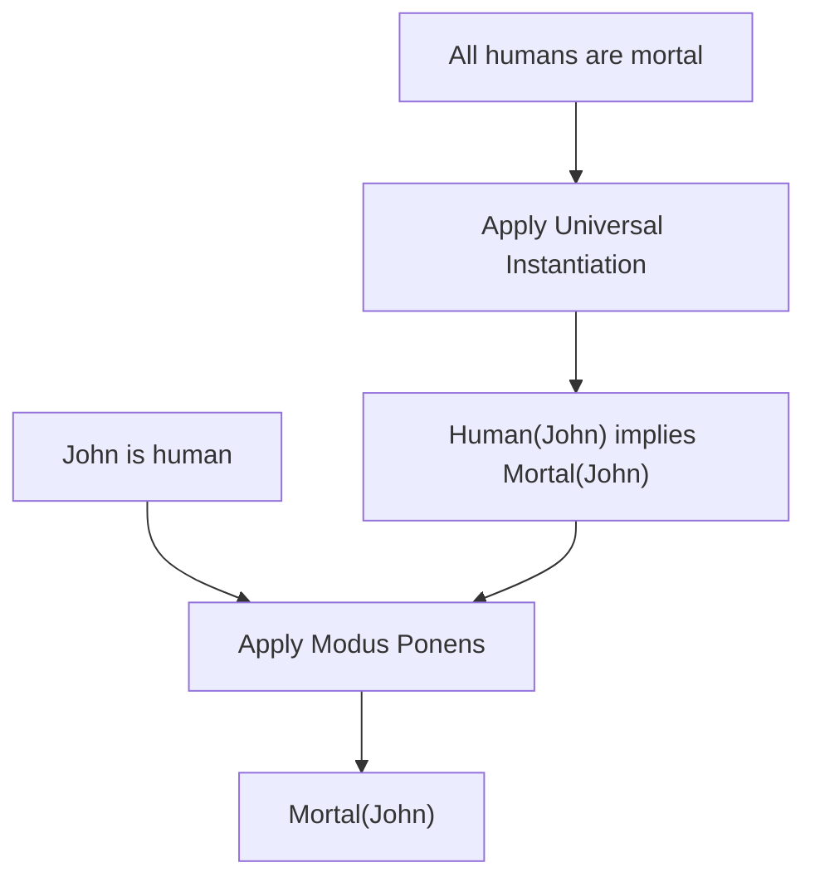
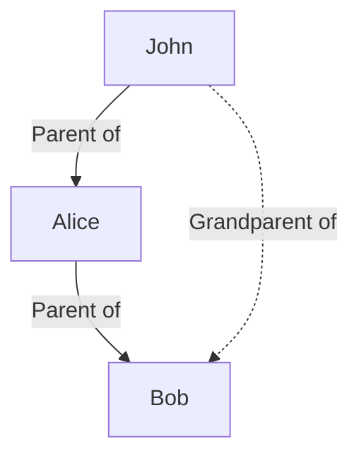

# 🧠 Predicate Logic in Artificial Intelligence

### AI Vault | Chapter 23 — First-Order Logic, Knowledge Representation & Logical Reasoning

[](https://github.com/ranjiGT/primitive-ai)


Welcome to **Chapter 23 of [Primitive AI](https://github.com/ranjiGT/primitive-ai)**!

**Predicate Logic**, also known as **First-Order Logic (FOL)**, is a powerful formal language used in Artificial Intelligence to represent knowledge about objects, their properties, and relationships.

Unlike propositional logic, which represents entire statements as true or false, predicate logic allows AI systems to reason about individual objects, express general rules, and derive new facts from existing knowledge.

This chapter explores the foundations of predicate logic through visual explanations, mathematical expressions, practical examples, and Python implementations.

---

## 🎨 1. Predicate Logic in AI — Visual Explanation

<div align="center">


*Figure 1: Cartoon-style infographic illustrating predicates, variables, constants, quantifiers, knowledge representation, logical inference, family relationships, and applications of predicate logic in Artificial Intelligence.*

</div>

The infographic introduces the essential building blocks of First-Order Logic:

- Predicates and relationships
- Variables and constants
- Universal and existential quantifiers
- Logical connectives
- Knowledge representation
- Inference and deduction
- Family relationship reasoning
- Applications in intelligent systems

---

## 🧠 2. What Is Predicate Logic?

Predicate Logic is a formal system used to describe objects, properties, and relationships.

It extends propositional logic by introducing variables, predicates, functions, and quantifiers.

### Example

Consider the statement:

**John is a human.**

In predicate logic:

```text
Human(John)
```

Here:

- `Human` is a predicate.
- `John` is a constant representing an individual.
- `Human(John)` is an atomic formula expressing a fact.

Now consider:

**All humans are mortal.**

```text
∀x (Human(x) → Mortal(x))
```

This means:

For every individual x, if x is human, then x is mortal.

Combining these statements allows an AI system to infer:

```text
Mortal(John)
```

This ability to derive new facts is one of the foundations of symbolic Artificial Intelligence.

---

## 🧩 3. Building Blocks of Predicate Logic

| Component | Description | Example |
|---|---|---|
| Predicate | Property or relationship | Human(x), Loves(x,y) |
| Constant | Specific individual | John, Alice |
| Variable | Represents an individual | x, y, z |
| Function | Maps individuals to an individual | FatherOf(x) |
| Universal Quantifier | Applies to every individual | ∀x |
| Existential Quantifier | Applies to at least one individual | ∃x |
| Logical Connective | Combines logical expressions | ∧, ∨, ¬, → |
| Equality | States two terms refer to the same object | x = y |

### Example: Relationships

```text
Loves(John, Fido)
```

This represents:

**John loves Fido.**

The predicate `Loves` has two arguments.

Such predicates are called **binary predicates**.

---

## 🔣 4. Logical Connectives

Predicate logic uses logical operators to construct complex expressions.

| Symbol | Operator | Meaning |
|---|---|---|
| ∧ | AND | Both statements are true |
| ∨ | OR | At least one statement is true |
| ¬ | NOT | Negation |
| → | IMPLIES | If P, then Q |
| ↔ | BICONDITIONAL | P if and only if Q |

### Example: AND

```text
Human(John) ∧ Student(John)
```

John is both human and a student.

### Example: OR

```text
Cat(x) ∨ Dog(x)
```

x is a cat or a dog, or possibly both.

### Example: Implication

```text
∀x (Human(x) → Mortal(x))
```

All humans are mortal.

---

## 🌍 5. Quantifiers in Predicate Logic

Quantifiers allow statements to refer to individuals within a domain.

### Universal Quantifier (∀)

The universal quantifier means **for all**.

Example:

```text
∀x (Human(x) → Mortal(x))
```

Meaning:

Every human is mortal.

### Existential Quantifier (∃)

The existential quantifier means **there exists**.

Example:

```text
∃x Dog(x)
```

Meaning:

There exists at least one dog.

### Combined Quantifiers

Consider:

**Every student studies at least one subject.**

```text
∀x (Student(x) → ∃y (Subject(y) ∧ Studies(x,y)))
```

This statement expresses a relationship between students and subjects.

### Quantifier Order Matters

```text
∀x ∃y Loves(x,y)
```

Everyone loves someone.

```text
∃y ∀x Loves(x,y)
```

There is someone whom everyone loves.

These statements have different meanings.

---

## 📚 6. Knowledge Representation in AI

Knowledge representation is the process of encoding information in a form that an AI system can use for reasoning.

Predicate logic is especially useful because it represents both facts and general rules.

### Example Knowledge Base

```text
Human(John)
Human(Alice)

Dog(Fido)

Loves(John, Fido)

∀x (Human(x) → Mortal(x))
```

The knowledge base contains facts about individuals and a general rule.

From this information, the AI can infer:

```text
Mortal(John)
Mortal(Alice)
```

### Knowledge Representation Workflow



This process is fundamental to rule-based AI systems.

---

## 🔍 7. Logical Inference in Predicate Logic

Logical inference is the process of deriving conclusions from premises.

One important inference rule is **Modus Ponens**.

### General Form

```text
P → Q
P
-----
Q
```

If P implies Q, and P is true, then Q must also be true.

### Example

Premise 1:

```text
∀x (Human(x) → Mortal(x))
```

Premise 2:

```text
Human(John)
```

Conclusion:

```text
Mortal(John)
```

### Inference Process



This example uses universal instantiation followed by Modus Ponens.

---

## 👨‍👩‍👦 8. Family Relationship Reasoning

Predicate logic can represent complex relationships among individuals.

### Knowledge Base

```text
Parent(John, Alice)

Parent(Alice, Bob)
```

This means:

- John is a parent of Alice.
- Alice is a parent of Bob.

We can define a grandparent relationship:

```text
∀x ∀y ∀z (
    (Parent(x,y) ∧ Parent(y,z))
    → Grandparent(x,z)
)
```

Therefore:

```text
Grandparent(John, Bob)
```

### Relationship Diagram



This type of inference is useful in knowledge graphs and expert systems.

---

## 🆚 9. Propositional Logic vs Predicate Logic

| Feature | Propositional Logic | Predicate Logic |
|---|---|---|
| Basic Unit | Proposition | Predicate applied to terms |
| Variables | No individual variables | Supported |
| Quantifiers | Not supported | ∀ and ∃ |
| Relationships | Limited representation | Explicit representation |
| Expressiveness | Lower | Higher |
| Example | P → Q | ∀x (Human(x) → Mortal(x)) |
| Typical Application | Boolean reasoning | Structured knowledge reasoning |

### Example

Propositional Logic:

```text
P = John is human
Q = John is mortal

P → Q
```

Predicate Logic:

```text
∀x (Human(x) → Mortal(x))
```

The predicate-logic statement expresses a general rule for all individuals in the domain.

---

## 🐍 10. Python Implementation — Predicate Logic Inference

We can demonstrate a simple rule-based inference system using Python.

The following example represents facts and a rule that derives mortality from humanity.

```python
# Predicate Logic Inference Example

facts = {
    ("Human", "John"),
    ("Human", "Alice"),
    ("Dog", "Fido")
}


def infer_mortality(facts):
    new_facts = set(facts)

    for predicate, individual in facts:
        if predicate == "Human":
            new_facts.add(("Mortal", individual))

    return new_facts


knowledge_base = infer_mortality(facts)

print("Knowledge Base:")

for fact in sorted(knowledge_base):
    print(f"{fact[0]}({fact[1]})")
```

### Expected Output

```text
Knowledge Base:
Dog(Fido)
Human(Alice)
Human(John)
Mortal(Alice)
Mortal(John)
```

### Explanation

The system starts with known facts.

It applies the rule:

```text
Human(x) → Mortal(x)
```

Whenever the system finds a human, it derives the corresponding mortality fact.

**Note:** This is a simplified, hard-coded rule engine demonstrating a single inference pattern, not a complete First-Order Logic theorem prover.

---

## 💻 11. Python Implementation — Family Relationship Inference

```python
parents = {
    ("John", "Alice"),
    ("Alice", "Bob"),
    ("Bob", "Charlie")
}


def find_grandparents(parent_relationships):
    grandparents = set()

    for parent1, child1 in parent_relationships:
        for parent2, child2 in parent_relationships:

            if child1 == parent2:
                grandparents.add((parent1, child2))

    return grandparents


results = find_grandparents(parents)

for grandparent, grandchild in sorted(results):
    print(f"Grandparent({grandparent}, {grandchild})")
```

### Expected Output

```text
Grandparent(Alice, Charlie)
Grandparent(John, Bob)
```

The program derives new relationships from existing parent relationships.

This demonstrates how structured facts and inference rules can produce additional knowledge.

---

## 🤖 12. Applications of Predicate Logic in AI

### Knowledge Representation

Represents facts, objects, and relationships in knowledge bases.

### Expert Systems

Supports rule-based decision-making in specialized domains.

### Automated Reasoning

Enables logical deduction and theorem proving.

### Natural Language Understanding

Provides formal representations of certain meanings expressed in language.

### AI Planning

Describes states, actions, preconditions, and effects.

### Knowledge Graphs

Supports reasoning about entities and relationships.

### Robotics

Can represent environmental facts, goals, and symbolic action conditions.

---

## ⚠️ 13. Limitations of Predicate Logic

Although predicate logic is expressive, it has limitations.

- Classical First-Order Logic does not directly represent uncertainty or probability.
- General logical inference can be computationally expensive.
- First-Order Logic validity is undecidable in general.
- Large knowledge bases may require specialized reasoning algorithms.
- Formalizing real-world knowledge can be difficult.
- Inconsistent knowledge bases can cause problems in classical reasoning.

### Common Extensions and Alternatives

- Description Logics
- Probabilistic Logic
- Fuzzy Logic
- Logic Programming
- Ontology Languages
- Knowledge Graph Reasoning

These approaches address different requirements in practical AI systems.

---

## 🎓 14. Learning Outcomes

After completing this chapter, you should be able to:

- [ ] Define predicate logic.
- [ ] Explain First-Order Logic.
- [ ] Identify predicates, constants, and variables.
- [ ] Understand logical connectives.
- [ ] Differentiate universal and existential quantifiers.
- [ ] Translate natural-language statements into logical expressions.
- [ ] Represent facts and relationships.
- [ ] Explain logical inference.
- [ ] Apply Modus Ponens.
- [ ] Model family relationships.
- [ ] Implement simple inference rules in Python.
- [ ] Compare propositional logic and predicate logic.

---

## 📝 15. Practice Questions

1. What is predicate logic?
2. How does predicate logic differ from propositional logic?
3. What is a predicate?
4. What is the difference between a variable and a constant?
5. What does the universal quantifier represent?
6. What does the existential quantifier represent?
7. Why does quantifier order matter?
8. What is Modus Ponens?
9. How does predicate logic support knowledge representation?
10. What are the limitations of First-Order Logic?

---

## 🧪 16. Hands-On Exercises

### Beginner

Translate the following statements into predicate logic:

1. All birds are animals.
2. Some students are programmers.
3. Every teacher teaches at least one subject.

### Intermediate

Create a knowledge base representing:

- Students
- Teachers
- Courses
- Enrollment relationships

Write rules that infer which teachers are associated with students through their courses.

### Advanced

Build a Python inference engine supporting simple rules such as:

```text
Human(x) → Mortal(x)
Parent(x,y) ∧ Parent(y,z) → Grandparent(x,z)
```

### Challenge

Explore a logic-programming language such as Prolog.

Implement a family relationship knowledge base and query inferred relationships.

---

## 📚 17. Learning Resources

| Resource | Description |
|---|---|
| [🎨 Predicate Logic Infographic](./Predicate%20Logic%20in%20AI.png) | Visual explanation |
| [📚 AI Vault](../) | Complete AI learning collection |
| [🏠 Primitive AI](../../) | Main repository |
| [SWI-Prolog](https://www.swi-prolog.org/) | Logic programming |
| [Stanford Encyclopedia of Philosophy — Classical Logic](https://plato.stanford.edu/entries/logic-classical/) | Formal logic reference |

---

## 💡 18. Key Takeaways

> Predicate Logic provides a formal foundation for representing structured knowledge and deriving logical conclusions in Artificial Intelligence.

Remember:

**Predicates → Represent properties and relationships**

**Constants → Identify specific individuals**

**Variables → Represent individuals**

**Quantifiers → Express general and existential statements**

**Knowledge Base → Stores facts and rules**

**Inference → Derives new knowledge**

Predicate logic is a foundational tool for symbolic AI, automated reasoning, and knowledge representation.

---

## 🚀 19. What's Next?

Recommended topics for further learning:

1. Propositional Logic
2. First-Order Logic Syntax and Semantics
3. Unification in Artificial Intelligence
4. Forward Chaining
5. Backward Chaining
6. Resolution in Predicate Logic
7. Knowledge-Based Agents
8. Expert Systems

---

## ⭐ Support Primitive AI

If this chapter helps you understand Artificial Intelligence, consider supporting the project.

**[⭐ Star Primitive AI on GitHub](https://github.com/ranjiGT/primitive-ai)**

Contributions, corrections, educational examples, and improvements are welcome.

**Learn • Explore • Build • Share**

Made for curious minds and lifelong learners.
