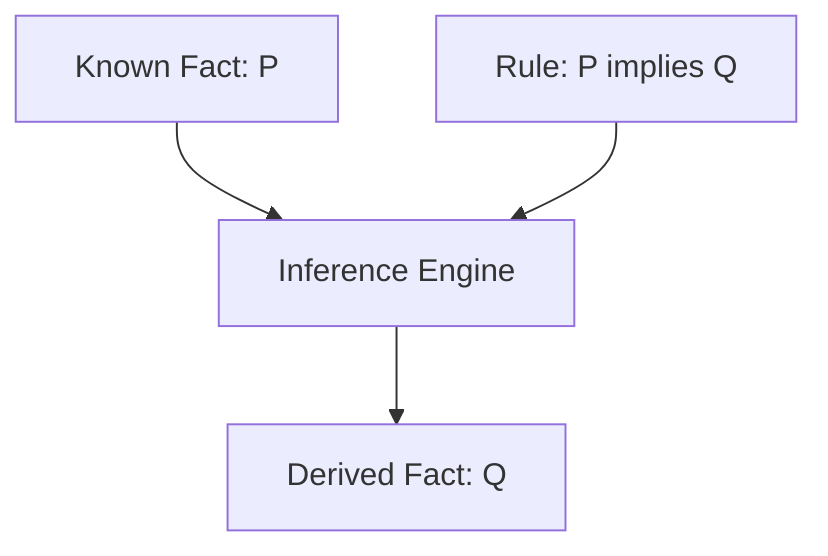
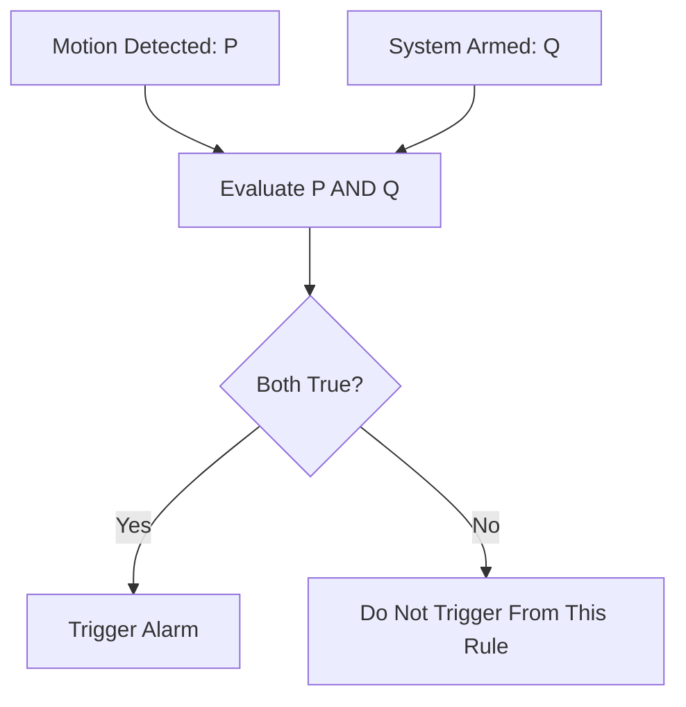

# 🧠 Propositional Logic in Artificial Intelligence

### AI Vault | Chapter 24 — Logical Reasoning, Truth Tables & Knowledge Representation

[](https://github.com/ranjiGT/primitive-ai)


[](../../LICENSE)

Welcome to **Chapter 24 of [Primitive AI](https://github.com/ranjiGT/primitive-ai)**!

**Propositional Logic**, also known as **Sentential Logic**, is a fundamental branch of mathematical logic used in Artificial Intelligence to represent knowledge and reason about statements that are either true or false.

It provides the foundation for understanding how intelligent systems evaluate conditions, apply logical rules, and derive conclusions from known information.

In this chapter, you will learn:

- What propositions are and how they represent knowledge.
- How logical operators combine statements.
- How to construct and interpret truth tables.
- How inference rules derive new facts.
- How propositional logic supports AI decision-making.
- How to implement logical reasoning using Python.

---

## 🎨 1. Propositional Logic — Visual Explanation

<div align="center">


*Figure 1: Cartoon-style infographic explaining propositions, logical operators, truth tables, compound statements, logical inference, knowledge representation, and applications of propositional logic in Artificial Intelligence.*

</div>

The infographic provides a visual introduction to the essential concepts of propositional logic.

---

## 📖 2. What Is Propositional Logic?

Propositional Logic is a formal system that deals with declarative statements called **propositions**.

A proposition must have exactly one truth value:

- **True (T)**
- **False (F)**

### Examples

| Statement | Proposition? | Explanation |
|---|---|---|
| The Earth revolves around the Sun. | Yes | Has a definite truth value |
| 5 + 3 = 8 | Yes | True statement |
| 10 is less than 4 | Yes | False statement |
| Close the door! | No | Command |
| What is Artificial Intelligence? | No | Question |
| x + 2 = 5 | Not a closed proposition | Truth depends on the value of x |

### Symbolic Representation

Consider:

```text
P: It is raining.
Q: I carry an umbrella.
```

A conditional relationship can be represented as:

```text
P → Q
```

Meaning:

**If it is raining, then I carry an umbrella.**

The statement expresses a logical implication, not necessarily a real-world causal relationship.

---

## 🧩 3. Components of Propositional Logic

| Component | Description | Example |
|---|---|---|
| Proposition | Statement with a truth value | P |
| Atomic Proposition | Statement without logical connectives | Q |
| Compound Proposition | Combination of propositions | P ∧ Q |
| Logical Operator | Connects or modifies propositions | ∧, ∨, ¬ |
| Truth Assignment | Assigns T or F to propositions | P = True |
| Logical Formula | Well-formed logical expression | (P ∧ Q) → R |
| Knowledge Base | Collection of logical formulas | {P, P → Q} |

### Atomic Proposition

An atomic proposition cannot be decomposed further using propositional connectives.

Example:

```text
P: The alarm is active.
```

### Compound Proposition

A compound proposition combines one or more propositions using logical operators.

Example:

```text
P ∧ Q
```

Meaning:

Both P and Q are true.

---

## 🔣 4. Logical Operators

Propositional logic uses five common logical operators.

| Operator | Symbol | Meaning | Example |
|---|---|---|---|
| Negation | ¬ | NOT | ¬P |
| Conjunction | ∧ | AND | P ∧ Q |
| Disjunction | ∨ | OR | P ∨ Q |
| Implication | → | IF...THEN | P → Q |
| Biconditional | ↔ | IF AND ONLY IF | P ↔ Q |

### 4.1 Negation (NOT)

Negation reverses the truth value of a proposition.

```text
P: It is raining.

¬P: It is not raining.
```

### 4.2 Conjunction (AND)

A conjunction is true only when both propositions are true.

```text
P ∧ Q
```

Example:

It is raining AND I carry an umbrella.

### 4.3 Disjunction (OR)

A disjunction is true when at least one proposition is true.

```text
P ∨ Q
```

In classical propositional logic, OR is inclusive.

### 4.4 Implication (IF...THEN)

```text
P → Q
```

An implication is false only when P is true and Q is false.

### 4.5 Biconditional (IF AND ONLY IF)

```text
P ↔ Q
```

A biconditional is true when P and Q have the same truth value.

---

## 📊 5. Truth Tables

Truth tables describe the truth values of logical expressions for every possible assignment of their component propositions.

### Complete Truth Table

| P | Q | ¬P | P ∧ Q | P ∨ Q | P → Q | P ↔ Q |
|---|---|---|---|---|---|---|
| T | T | F | T | T | T | T |
| T | F | F | F | T | F | F |
| F | T | T | F | T | T | F |
| F | F | T | F | F | T | T |

### Important Observations

**AND:** True only when both propositions are true.

**OR:** True when at least one proposition is true.

**NOT:** Reverses the truth value.

**Implication:** False only when the antecedent is true and the consequent is false.

**Biconditional:** True when both propositions have identical truth values.

For `n` distinct atomic propositions, a complete truth table contains:

**2ⁿ rows**

---

## 🧠 6. Logical Equivalence

Two logical expressions are equivalent when they produce identical truth values for every possible assignment.

Logical equivalence is represented by:

```text
P ≡ Q
```

### Important Logical Laws

| Law | Expression |
|---|---|
| Double Negation | ¬(¬P) ≡ P |
| De Morgan's First Law | ¬(P ∧ Q) ≡ ¬P ∨ ¬Q |
| De Morgan's Second Law | ¬(P ∨ Q) ≡ ¬P ∧ ¬Q |
| Implication | P → Q ≡ ¬P ∨ Q |
| Commutative AND | P ∧ Q ≡ Q ∧ P |
| Commutative OR | P ∨ Q ≡ Q ∨ P |
| Contrapositive | P → Q ≡ ¬Q → ¬P |

### Example

Consider:

```text
¬(P ∧ Q)
```

Using De Morgan's Law:

```text
¬P ∨ ¬Q
```

Both expressions are logically equivalent.

These transformations are useful in automated theorem proving and Boolean simplification.

---

## 🔍 7. Logical Inference in AI

Logical inference allows an AI system to derive new conclusions from existing facts and rules.

### Modus Ponens

Modus Ponens is one of the most important inference rules.

```text
P → Q
P
-------
Q
```

If P implies Q, and P is true, then Q must be true.

### Example

```text
P: It is raining.
Q: The ground is wet.

P → Q
P
-------
Q
```

Conclusion:

**The ground is wet.**

### Inference Workflow



### Other Inference Rules

| Rule | Form |
|---|---|
| Modus Ponens | P → Q, P ⊢ Q |
| Modus Tollens | P → Q, ¬Q ⊢ ¬P |
| Hypothetical Syllogism | P → Q, Q → R ⊢ P → R |
| Disjunctive Syllogism | P ∨ Q, ¬P ⊢ Q |
| Conjunction Introduction | P, Q ⊢ P ∧ Q |

The symbol `⊢` indicates that a conclusion is derivable from the premises.

---

## 🤖 8. Knowledge Representation in Artificial Intelligence

A knowledge base stores facts and rules in a structured form.

Consider a security monitoring system.

### Facts

```text
P: Motion is detected.
Q: Security system is armed.
```

### Rule

```text
(P ∧ Q) → R
```

Where:

```text
R: Trigger the alarm.
```

### Knowledge Base

```text
P
Q
(P ∧ Q) → R
```

The system can infer:

```text
R
```

### AI Reasoning Workflow



This is a simple example of rule-based reasoning.

---

## 🐍 9. Python Implementation — Logical Operators

Python provides Boolean operators that can represent common propositional connectives.

```python
from itertools import product

def implication(p, q):
    return (not p) or q

def biconditional(p, q):
    return p == q

print("P Q | NOT P | AND | OR | IMPLIES | IFF")
print("-" * 45)

for p, q in product([True, False], repeat=2):
    print(
        f"{int(p)} {int(q)} |"
        f"   {int(not p)}   |"
        f"  {int(p and q)}  |"
        f" {int(p or q)}  |"
        f"    {int(implication(p, q))}    |"
        f"  {int(biconditional(p, q))}"
    )
```

### Expected Output

```text
P Q | NOT P | AND | OR | IMPLIES | IFF
---------------------------------------------
1 1 |   0   |  1  | 1  |    1    |  1
1 0 |   0   |  0  | 1  |    0    |  0
0 1 |   1   |  0  | 1  |    1    |  0
0 0 |   1   |  0  | 0  |    1    |  1
```

This implementation demonstrates how Boolean expressions correspond to propositional logic operators.

---

## 💻 10. Python Implementation — Rule-Based AI System

Let's build a simple security alert system.

```python
def security_system(motion_detected, system_armed):
    """
    Rule:
    IF motion is detected AND system is armed
    THEN trigger alarm.
    """

    if motion_detected and system_armed:
        return "ALERT: Security alarm triggered!"

    return "No alarm triggered."


scenarios = [
    (True, True),
    (True, False),
    (False, True),
    (False, False)
]

for motion, armed in scenarios:
    result = security_system(motion, armed)

    print(
        f"Motion={motion}, "
        f"Armed={armed} -> {result}"
    )
```

### Expected Output

```text
Motion=True, Armed=True -> ALERT: Security alarm triggered!
Motion=True, Armed=False -> No alarm triggered.
Motion=False, Armed=True -> No alarm triggered.
Motion=False, Armed=False -> No alarm triggered.
```

### Explanation

The system evaluates the rule:

```text
(P ∧ Q) → R
```

When both conditions are true, the system triggers the alarm.

This demonstrates a practical application of propositional logic in rule-based automation.

---

## 🧪 11. Tautology, Contradiction & Contingency

Propositional formulas can be classified according to their truth values across all possible assignments.

### Tautology

A formula that is always true.

Example:

```text
P ∨ ¬P
```

This is the Law of Excluded Middle.

### Contradiction

A formula that is always false.

Example:

```text
P ∧ ¬P
```

### Contingency

A formula that is true for some assignments and false for others.

Example:

```text
P ∧ Q
```

### Comparison

| Type | Definition | Example |
|---|---|---|
| Tautology | Always true | P ∨ ¬P |
| Contradiction | Always false | P ∧ ¬P |
| Contingency | Sometimes true | P ∧ Q |

These concepts are important in logical verification and satisfiability problems.

---

## ⚙️ 12. Satisfiability in Propositional Logic

A propositional formula is **satisfiable** if at least one truth assignment makes it true.

Example:

```text
P ∨ Q
```

This formula is satisfiable because several assignments make it true.

A formula is **unsatisfiable** if no truth assignment makes it true.

Example:

```text
P ∧ ¬P
```

### SAT Problems

The Boolean Satisfiability Problem (SAT) asks whether a Boolean formula has a satisfying assignment.

SAT solvers are used in:

- Automated planning
- Hardware verification
- Software verification
- Constraint solving
- Scheduling
- Automated reasoning

SAT was the first problem proven NP-complete.

---

## 🆚 13. Propositional Logic vs Predicate Logic

| Feature | Propositional Logic | Predicate Logic |
|---|---|---|
| Basic Unit | Proposition | Predicate applied to terms |
| Variables over individuals | Not supported | Supported |
| Quantifiers | Not supported | ∀ and ∃ |
| Expressiveness | Limited | More expressive |
| Relationships | Represented only as whole propositions | Explicitly represented |
| Example | P → Q | ∀x (Human(x) → Mortal(x)) |
| Reasoning | Boolean inference | First-order inference |

### Propositional Logic

```text
P: John is human.
Q: John is mortal.

P → Q
```

### Predicate Logic

```text
∀x (Human(x) → Mortal(x))
Human(John)
```

Conclusion:

```text
Mortal(John)
```

Predicate logic allows general rules to be expressed across individuals.

---

## 🌍 14. Applications of Propositional Logic in AI

### Knowledge Representation

Stores facts and logical relationships.

### Automated Reasoning

Derives conclusions from premises.

### Expert Systems

Supports decision-making through logical rules.

### AI Planning

Represents conditions, goals, and constraints.

### Diagnosis Systems

Evaluates logical conditions for faults or symptoms.

### Intelligent Agents

Supports rule-based action selection.

### Software and Hardware Verification

Checks whether systems satisfy formal properties.

---

## ⚠️ 15. Limitations of Propositional Logic

Although propositional logic is useful, it has limitations.

- Cannot directly express universal or existential quantification.
- Cannot naturally represent relationships among arbitrary individuals.
- May require many propositions to represent complex domains.
- Classical propositional logic does not directly represent uncertainty.
- Does not inherently support learning from experience.
- Large satisfiability problems can be computationally difficult.

### Beyond Propositional Logic

More expressive reasoning systems include:

- Predicate Logic
- First-Order Logic
- Description Logic
- Fuzzy Logic
- Probabilistic Logic
- Temporal Logic

---

## 🎓 16. Learning Outcomes

After completing this chapter, you should be able to:

- [ ] Define propositional logic.
- [ ] Identify valid propositions.
- [ ] Explain atomic and compound propositions.
- [ ] Understand logical operators.
- [ ] Construct truth tables.
- [ ] Evaluate logical expressions.
- [ ] Apply logical equivalence laws.
- [ ] Explain Modus Ponens.
- [ ] Build a simple knowledge base.
- [ ] Implement Boolean reasoning in Python.
- [ ] Differentiate tautologies and contradictions.
- [ ] Explain satisfiability.
- [ ] Compare propositional and predicate logic.

---

## 📝 17. Practice Questions

1. What is propositional logic?
2. What makes a statement a proposition?
3. What is the difference between an atomic and a compound proposition?
4. When is a conjunction true?
5. When is an implication false?
6. What is the difference between implication and biconditional?
7. What is a truth table?
8. What is Modus Ponens?
9. What is a tautology?
10. What is a contradiction?
11. What is Boolean satisfiability?
12. How does propositional logic support AI systems?

---

## 🧪 18. Hands-On Exercises

### Beginner

Create truth tables for:

```text
P ∧ Q
P ∨ Q
¬P
P → Q
```

### Intermediate

Verify De Morgan's Laws using Python.

```text
¬(P ∧ Q) ≡ ¬P ∨ ¬Q
```

```text
¬(P ∨ Q) ≡ ¬P ∧ ¬Q
```

### Advanced

Implement a simple propositional knowledge base that supports:

- Adding facts
- Adding implication rules
- Deriving conclusions
- Querying known facts

### Challenge

Build a Boolean expression evaluator that accepts formulas containing:

```text
AND
OR
NOT
IMPLIES
IFF
```

Generate complete truth tables and identify whether each formula is a tautology, contradiction, or contingency.

---

## 📚 19. Learning Resources

| Resource | Description |
|---|---|
| [🎨 Propositional Logic Infographic](./Propositional%20Logic%20in%20AI.png) | Visual explanation |
| [🧠 Predicate Logic](../23-predicate-logic/) | First-Order Logic |
| [📚 AI Vault](../) | Complete AI learning collection |
| [🏠 Primitive AI](../../) | Main repository |
| [Stanford Encyclopedia of Philosophy — Classical Logic](https://plato.stanford.edu/entries/logic-classical/) | Formal logic reference |

---

## 💡 20. Key Takeaways

> Propositional Logic provides a mathematical foundation for representing true-or-false statements and deriving conclusions using formal inference rules.

Remember:

**Propositions → Represent facts**

**Logical Operators → Combine statements**

**Truth Tables → Evaluate expressions**

**Inference Rules → Derive conclusions**

**Knowledge Bases → Store logical information**

**SAT Solvers → Solve Boolean constraint problems**

Propositional logic is a fundamental building block of symbolic Artificial Intelligence.

---

## 🚀 21. What's Next?

Recommended topics for further learning:

1. Logical Equivalence and Normal Forms
2. Conjunctive Normal Form (CNF)
3. Disjunctive Normal Form (DNF)
4. Resolution in Propositional Logic
5. Forward Chaining
6. Backward Chaining
7. Unification in First-Order Logic
8. Knowledge-Based Agents

---

## ⭐ Support Primitive AI

If this chapter helps you understand Artificial Intelligence, consider supporting the project.

**[⭐ Star Primitive AI on GitHub](https://github.com/ranjiGT/primitive-ai)**

Contributions, corrections, educational examples, and improvements are welcome.

**Learn • Explore • Build • Share**

Made for curious minds and lifelong learners.
