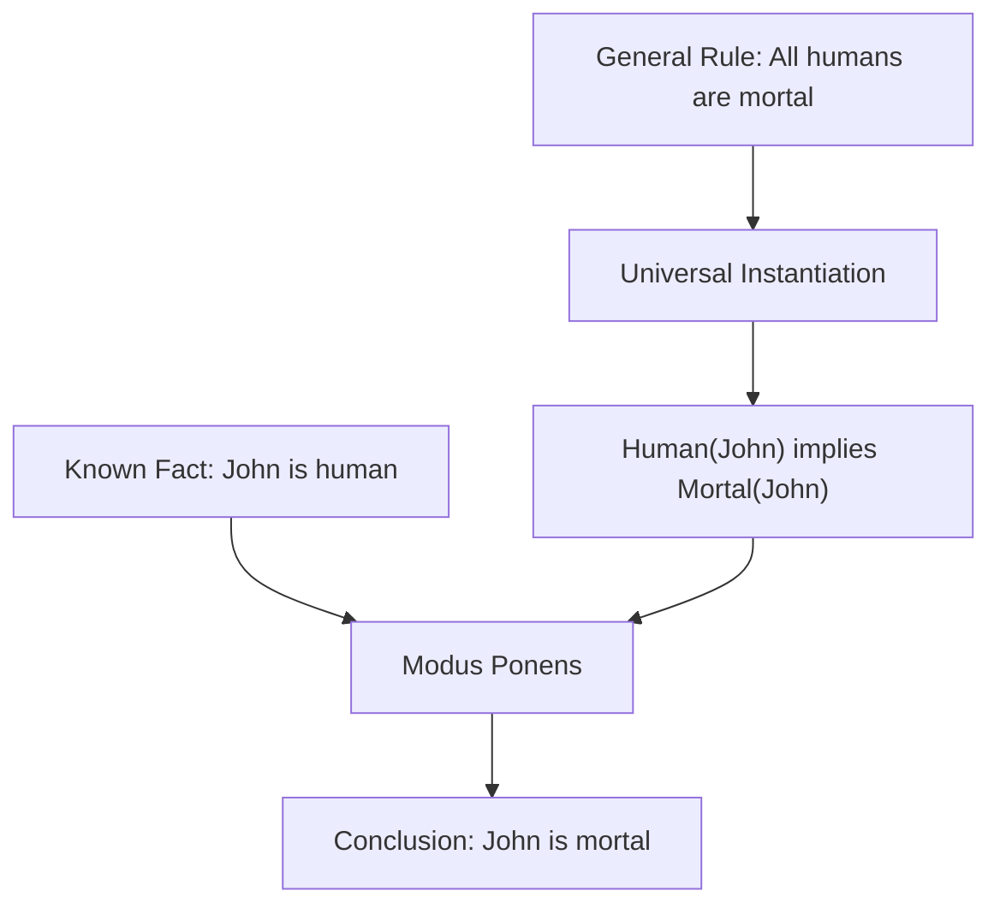

# 🧠 Quantifiers in Artificial Intelligence

### AI Vault | Chapter 25 — Universal & Existential Quantifiers in First-Order Logic

[](https://github.com/ranjiGT/primitive-ai)


[](https://github.com/ranjiGT/primitive-ai/blob/main/LICENSE)

Welcome to **Chapter 25 of [Primitive AI](https://github.com/ranjiGT/primitive-ai)**!

**Quantifiers** are essential components of First-Order Logic (FOL) that allow Artificial Intelligence systems to express statements about objects, individuals, and relationships within a domain.

Rather than describing only individual facts, quantifiers allow AI systems to represent general rules such as:

- Every human is mortal.
- Some students study Artificial Intelligence.
- Every student has at least one teacher.
- There exists a person whom everyone knows.

Quantifiers are fundamental to **knowledge representation, automated reasoning, expert systems, intelligent agents, and symbolic AI**.

---

## 🎨 1. Quantifiers in AI — Visual Explanation

<div align="center">


*Figure 1: Cartoon-style infographic explaining universal and existential quantifiers, domains, predicates, quantifier scope, logical inference, and real-world applications in AI.*

</div>

The infographic illustrates the major concepts of quantification using examples, diagrams, logical expressions, and AI applications.

---

## 📖 2. What Are Quantifiers?

Quantifiers are logical operators that specify how many objects in a domain satisfy a particular predicate.

In First-Order Logic, two fundamental quantifiers are used:

| Quantifier | Symbol | Meaning |
|---|---|---|
| Universal Quantifier | ∀ | For all |
| Existential Quantifier | ∃ | There exists at least one |

### Example

Consider the predicate:

```text
Human(x)
```

This means:

**x is a human.**

Using quantifiers, we can express more general statements.

```text
∀x (Human(x) → Mortal(x))
```

Meaning:

All humans are mortal.

```text
∃x Human(x)
```

Meaning:

At least one human exists in the domain.

---

## 🌍 3. Universal Quantifier (∀)

The **Universal Quantifier** represents statements that apply to every object in a specified domain.

### Mathematical Representation

\[
\forall x \ P(x)
\]

Meaning:

For every x in the domain, P(x) is true.

### Example 1: Humans

```text
∀x (Human(x) → Mortal(x))
```

Every human is mortal.

### Example 2: Students

```text
∀x (Student(x) → Learner(x))
```

Every student is a learner.

### Example 3: Robots

```text
∀x (Robot(x) → Machine(x))
```

Every robot is a machine.

### Important Property

A universally quantified statement is false if even one object in the domain fails to satisfy the specified condition.

For example:

```text
∀x (Student(x) → Passed(x))
```

This statement is false if at least one student has not passed.

---

## 🔎 4. Existential Quantifier (∃)

The **Existential Quantifier** expresses that at least one object in the domain satisfies a predicate.

### Mathematical Representation

\[
\exists x \ P(x)
\]

Meaning:

There exists at least one x for which P(x) is true.

### Example 1: Animals

```text
∃x Dog(x)
```

There exists at least one dog.

### Example 2: Students

```text
∃x (Student(x) ∧ Intelligent(x))
```

At least one student is intelligent.

### Example 3: Artificial Intelligence

```text
∃x (Robot(x) ∧ Autonomous(x))
```

There exists at least one autonomous robot.

### Important Property

An existential statement is true when at least one object satisfies the condition.

It does not require every object to satisfy the predicate.

---

## 🆚 5. Universal vs Existential Quantifiers

| Feature | Universal (∀) | Existential (∃) |
|---|---|---|
| Meaning | For all | There exists |
| Requirement | Every object satisfies the condition | At least one object satisfies it |
| Symbol | ∀ | ∃ |
| Example | ∀x P(x) | ∃x P(x) |
| False When | At least one counterexample exists | No satisfying object exists |
| AI Application | General rules | Existence queries |

### Visual Interpretation

Suppose a classroom contains four students.

For the predicate `Passed(x)`:

```text
Student A → Passed
Student B → Passed
Student C → Passed
Student D → Passed
```

Then:

```text
∀x Passed(x)
```

is true if the domain consists of these four students.

However, if only Student A passed:

```text
∃x Passed(x)
```

is true, but:

```text
∀x Passed(x)
```

is false.

---

## 🧩 6. Domain and Predicates

A **domain of discourse** defines the collection of objects being considered.

A **predicate** represents a property or relationship.

### Example Domain

```text
D = {Alice, Bob, Charlie}
```

Suppose:

```text
Student(Alice)
Student(Bob)
Student(Charlie)
```

All three individuals are students.

Then:

```text
∀x Student(x)
```

is true over this domain.

Now suppose:

```text
Programmer(Alice)
```

We can conclude:

```text
∃x Programmer(x)
```

However, we cannot conclude that every individual is a programmer.

### Why Domains Matter

The truth of a quantified statement depends on the domain.

For example:

```text
∀x Student(x)
```

may be true when the domain contains only students, but false when the domain includes teachers and other individuals.

---

## 🎯 7. Scope of Quantifiers

The **scope** of a quantifier is the part of a logical expression to which it applies.

Consider:

```text
∀x (Human(x) → Mortal(x))
```

Here, the universal quantifier applies to the entire implication.

Meaning:

Every human is mortal.

Compare this with:

```text
(∀x Human(x)) → Mortal(John)
```

This is a different logical statement.

It means:

If every individual in the domain is human, then John is mortal.

The second statement does not express the general rule that all humans are mortal.

**Important:** Parentheses and quantifier placement can completely change the meaning of a logical expression.

---

## 🔄 8. Order of Quantifiers Matters

When multiple quantifiers appear in the same expression, their order can change the meaning.

### Example 1: Everyone Loves Someone

```text
∀x ∃y Loves(x,y)
```

Meaning:

For every person x, there exists some person y whom x loves.

Different people may love different individuals.

### Example 2: Someone Is Loved by Everyone

```text
∃y ∀x Loves(x,y)
```

Meaning:

There exists a particular person y whom everyone loves.

### Comparison

| Expression | Meaning |
|---|---|
| ∀x ∃y Loves(x,y) | Everyone loves someone |
| ∃y ∀x Loves(x,y) | Someone is loved by everyone |
| ∀x ∀y Knows(x,y) | Everyone knows everyone |
| ∃x ∃y Knows(x,y) | Someone knows someone |

These interpretations assume the variables range over people.

### Key Insight

```text
∀x ∃y P(x,y)
```

and

```text
∃y ∀x P(x,y)
```

are not logically equivalent in general.

---

## ❌ 9. Negation of Quantifiers

Negating quantified statements is an important concept in automated reasoning.

### Universal Quantifier Negation

\[
\neg \forall x \ P(x)
\equiv
\exists x \ \neg P(x)
\]

Meaning:

Not everyone satisfies P.

Equivalent statement:

At least one individual does not satisfy P.

### Existential Quantifier Negation

\[
\neg \exists x \ P(x)
\equiv
\forall x \ \neg P(x)
\]

Meaning:

There is no individual satisfying P.

Equivalent statement:

Every individual fails to satisfy P.

### Examples

| Original Statement | Negation |
|---|---|
| All students passed | At least one student did not pass |
| Some robots are intelligent | No robots are intelligent |
| Everyone knows Python | Someone does not know Python |
| Some animals can fly | No animals can fly |

These transformations are useful in theorem proving and logical simplification.

---

## 🧠 10. Logical Inference with Quantifiers

Quantifiers allow AI systems to derive new facts from general rules.

### Example Knowledge Base

Premise 1:

```text
∀x (Human(x) → Mortal(x))
```

Premise 2:

```text
Human(John)
```

### Step 1: Universal Instantiation

Substitute John for x.

```text
Human(John) → Mortal(John)
```

### Step 2: Apply Modus Ponens

We know:

```text
Human(John)
```

Therefore:

```text
Mortal(John)
```

### Inference Workflow



This demonstrates how quantified rules support logical deduction.

---

## 📚 11. Inference Rules for Quantifiers

First-Order Logic uses several important quantifier inference rules.

| Rule | Description |
|---|---|
| Universal Instantiation | Apply a universal statement to a specific term |
| Universal Generalization | Derive a universal conclusion from an arbitrary individual |
| Existential Instantiation | Introduce a fresh witness for an existential statement |
| Existential Generalization | Infer that something exists from a specific example |

### Universal Instantiation

```text
∀x Human(x)
```

Therefore:

```text
Human(John)
```

Assuming John denotes an individual in the domain.

### Existential Generalization

```text
Student(Alice)
```

Therefore:

```text
∃x Student(x)
```

### Important Note

Existential instantiation must use an appropriately fresh witness, and universal generalization requires that the individual be arbitrary rather than a special case.

These restrictions help ensure logically valid conclusions.

---

## 🐍 12. Python Implementation — Universal Quantifier

Python's built-in `all()` function provides a useful analogy for universal quantification over a finite collection.

```python
students = {
    "Alice": True,
    "Bob": True,
    "Charlie": True
}

all_passed = all(students.values())

print("All students passed:", all_passed)
```

### Expected Output

```text
All students passed: True
```

### Explanation

The program checks whether every student has passed.

This corresponds to:

```text
∀x Passed(x)
```

where x ranges over the students in the dictionary.

---

## 💻 13. Python Implementation — Existential Quantifier

Python's `any()` function provides a useful analogy for existential quantification.

```python
students = {
    "Alice": False,
    "Bob": True,
    "Charlie": False
}

someone_passed = any(students.values())

print("At least one student passed:", someone_passed)
```

### Expected Output

```text
At least one student passed: True
```

### Explanation

The program checks whether at least one student passed.

This corresponds to:

```text
∃x Passed(x)
```

---

## 🔬 14. Python Implementation — Quantifier Order

Consider the relationship:

```text
Loves(x,y)
```

We can represent a finite relationship using Python.

```python
people = ["Alice", "Bob", "Charlie"]

loves = {
    ("Alice", "Bob"),
    ("Bob", "Charlie"),
    ("Charlie", "Alice")
}

# Everyone loves someone
everyone_loves_someone = all(
    any((x, y) in loves for y in people)
    for x in people
)

# Someone is loved by everyone
someone_loved_by_everyone = any(
    all((x, y) in loves for x in people)
    for y in people
)

print(
    "Everyone loves someone:",
    everyone_loves_someone
)

print(
    "Someone is loved by everyone:",
    someone_loved_by_everyone
)
```

### Expected Output

```text
Everyone loves someone: True
Someone is loved by everyone: False
```

### Explanation

The first expression checks:

```text
∀x ∃y Loves(x,y)
```

The second checks:

```text
∃y ∀x Loves(x,y)
```

The results demonstrate that changing quantifier order changes the logical requirement.

---

## 🤖 15. Applications of Quantifiers in AI

### Knowledge Representation

Quantifiers help encode general facts and relationships.

Example:

```text
∀x (Bird(x) → Animal(x))
```

### Expert Systems

Support rule-based reasoning about objects and conditions.

### Automated Theorem Proving

Enable formal deduction involving universally and existentially quantified statements.

### Natural Language Understanding

Represent meanings such as:

- Every student owns a book.
- Some teachers know Python.
- Every robot has a controller.

### AI Planning

Express general conditions and existential goals in planning domains.

### Knowledge Graph Reasoning

Support logical rules involving entities and their relationships.

### Intelligent Agents

Allow agents to reason about groups of objects rather than individual facts alone.

---

## ⚠️ 16. Common Mistakes

### Mistake 1: Confusing ∀ and ∃

Incorrect:

```text
∀x Dog(x)
```

when the intended meaning is:

There exists a dog.

Correct:

```text
∃x Dog(x)
```

### Mistake 2: Ignoring Quantifier Order

```text
∀x ∃y P(x,y)
```

does not generally mean the same thing as:

```text
∃y ∀x P(x,y)
```

### Mistake 3: Incorrect Negation

Incorrect:

```text
¬∀x P(x) ≡ ∀x ¬P(x)
```

Correct:

```text
¬∀x P(x) ≡ ∃x ¬P(x)
```

### Mistake 4: Incorrect Scope

Parentheses must accurately express which part of the formula is quantified.

### Mistake 5: Ignoring Empty Domains

In standard First-Order Logic, domains are assumed to be nonempty.

For programming analogies involving finite collections:

```python
all([])  # True
any([])  # False
```

This is consistent with vacuous truth for universal quantification and falsehood for existential quantification over an empty collection.

---

## 🎓 17. Learning Outcomes

After completing this chapter, you should be able to:

- [ ] Define quantifiers in First-Order Logic.
- [ ] Explain universal quantification.
- [ ] Explain existential quantification.
- [ ] Identify domains and predicates.
- [ ] Interpret quantified expressions.
- [ ] Understand quantifier scope.
- [ ] Explain why quantifier order matters.
- [ ] Negate quantified statements correctly.
- [ ] Apply universal instantiation.
- [ ] Apply existential generalization.
- [ ] Implement quantifier checks in Python.
- [ ] Explain applications in Artificial Intelligence.

---

## 📝 18. Practice Questions

1. What is a quantifier?
2. What does ∀ represent?
3. What does ∃ represent?
4. What is the difference between universal and existential quantification?
5. What is a domain of discourse?
6. What is quantifier scope?
7. Why does quantifier order matter?
8. How do you negate a universal statement?
9. How do you negate an existential statement?
10. What is universal instantiation?
11. How are quantifiers used in knowledge representation?
12. How can Python's `all()` and `any()` functions model finite quantification?

---

## 🧪 19. Hands-On Exercises

### Beginner

Translate the following statements into First-Order Logic:

1. All cats are animals.
2. Some students are programmers.
3. Every teacher is educated.
4. At least one robot is autonomous.

### Intermediate

Translate:

1. Every student studies at least one subject.
2. Some students study every subject.
3. Every person knows someone.
4. There exists someone whom everyone knows.

Compare the meanings of the expressions.

### Advanced

Implement a Python program that evaluates:

```text
∀x ∃y Friend(x,y)
```

and:

```text
∃y ∀x Friend(x,y)
```

using a finite set of people and friendship relationships.

### Challenge

Build a small First-Order Logic knowledge base that supports:

- Facts
- Predicates
- Universal rules
- Existential queries
- Basic inference

---

## 📚 20. Learning Resources

| Resource | Description |
|---|---|
| [🎨 Quantifiers in AI Infographic](./Quantifiers%20in%20AI.png) | Visual explanation of quantifiers |
| [🧠 Predicate Logic](../23-predicate-logic/) | First-Order Logic foundations |
| [🔣 Propositional Logic](../24-propositional-logic/) | Boolean reasoning foundations |
| [📚 AI Vault](../) | Complete AI learning collection |
| [🏠 Primitive AI](../../) | Main repository |
| [Stanford Encyclopedia of Philosophy — Classical Logic](https://plato.stanford.edu/entries/logic-classical/) | Formal logic reference |
| [SWI-Prolog](https://www.swi-prolog.org/) | Logic programming environment |

---

## 💡 21. Key Takeaways

> Quantifiers enable Artificial Intelligence systems to express general rules and existence claims about objects within a domain.

Remember:

**∀ Universal Quantifier → For all**

**∃ Existential Quantifier → There exists**

**Domain → Objects being considered**

**Predicate → Property or relationship**

**Scope → Portion of the expression being quantified**

**Quantifier Order → Can change logical meaning**

**Inference → Derives conclusions from quantified knowledge**

Quantifiers are fundamental building blocks of First-Order Logic and symbolic Artificial Intelligence.

---

## 🚀 22. What's Next?

Recommended topics for further learning:

1. Unification in Artificial Intelligence
2. Forward Chaining
3. Backward Chaining
4. Resolution in First-Order Logic
5. Knowledge Representation
6. Knowledge-Based Agents
7. Expert Systems
8. Automated Theorem Proving

---

## ⭐ Support Primitive AI

If this chapter helps you understand Artificial Intelligence, consider supporting the project.

**[⭐ Star Primitive AI on GitHub](https://github.com/ranjiGT/primitive-ai)**

Contributions, corrections, educational examples, and improvements are welcome.

**Learn • Explore • Build • Share**

Made for curious minds and lifelong learners.
