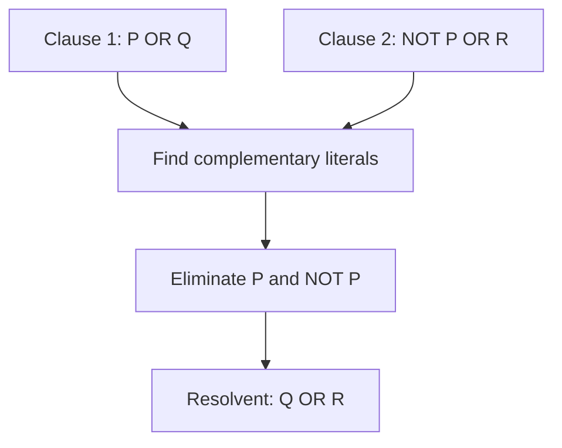
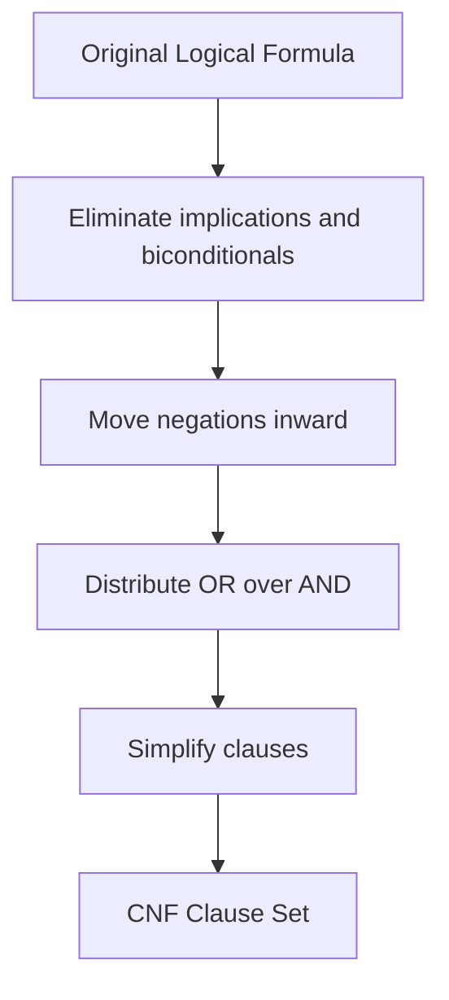
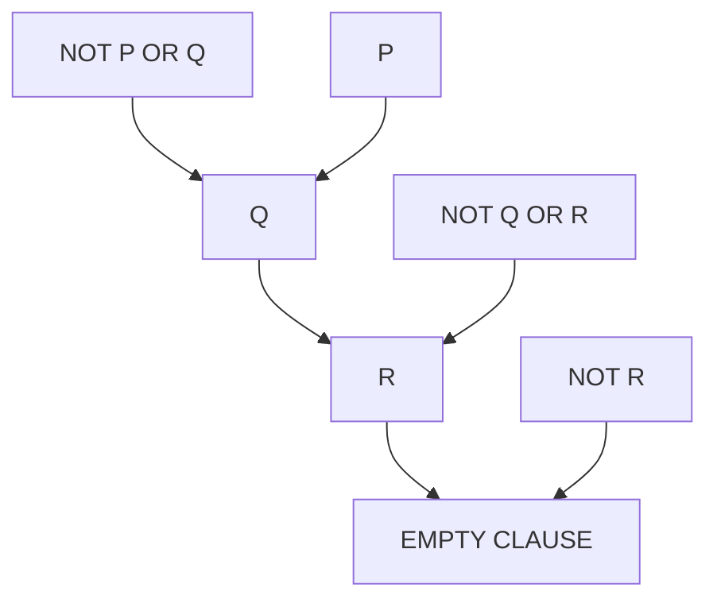

# 🧠 Resolution in Artificial Intelligence

### AI Vault | Chapter 26 — Logical Resolution, Automated Reasoning & Theorem Proving

[](https://github.com/ranjiGT/primitive-ai)


[](https://github.com/ranjiGT/primitive-ai/blob/main/LICENSE)

Welcome to **Chapter 26 of [Primitive AI](https://github.com/ranjiGT/primitive-ai)**!

**Resolution** is a fundamental inference rule used in Artificial Intelligence to derive logical conclusions from existing knowledge.

It is particularly important in **automated theorem proving, knowledge representation, logical reasoning, expert systems, and symbolic AI**.

Resolution works by combining clauses containing complementary literals and eliminating those literals to produce a new clause called a **resolvent**.

A common approach is *resolution by refutation*, where an AI system proves a statement by assuming its negation and deriving a contradiction.

In this chapter, you will learn:

- What resolution means in Artificial Intelligence.
- How the resolution inference rule works.
- Why Conjunctive Normal Form (CNF) is important.
- How to convert logical expressions into CNF.
- How resolution by refutation proves conclusions.
- How resolution trees represent logical proofs.
- How unification extends resolution to First-Order Logic.
- How to implement a basic resolution prover using Python.

---

## 🎨 1. Resolution in AI — Visual Explanation

<div align="center">


*Figure 1: Cartoon-style infographic illustrating the resolution inference rule, complementary literals, CNF conversion, resolution trees, refutation proofs, First-Order Logic resolution, and applications in Artificial Intelligence.*

</div>

The infographic introduces the key ideas behind logical resolution and demonstrates how AI systems can derive conclusions from facts and rules.

---

## 📖 2. What Is Resolution in AI?

Resolution is a rule of inference that combines two logical clauses containing complementary literals.

Complementary literals are a proposition and its negation.

For example:

```text
P
¬P
```

The resolution rule eliminates a complementary pair and produces a new clause.

### General Resolution Rule

Given:

```text
P ∨ Q
¬P ∨ R
```

We can derive:

```text
Q ∨ R
```

Mathematically:

\[
\frac{P \lor Q \qquad \neg P \lor R}{Q \lor R}
\]

The resulting clause is called the **resolvent**.

### Explanation

The first clause states:

Either P or Q is true.

The second clause states:

Either P is false or R is true.

Together, these clauses logically imply:

Either Q or R is true.

Resolution is sound: every resolvent is logically entailed by its parent clauses.

---

## 🧩 3. Key Concepts in Resolution

| Concept | Description | Example |
|---|---|---|
| Literal | Proposition or its negation | P, ¬Q |
| Clause | Disjunction of literals | P ∨ Q |
| Complementary Literals | A literal and its negation | P and ¬P |
| Resolvent | Clause derived by resolution | Q ∨ R |
| CNF | Conjunction of clauses | (P ∨ Q) ∧ (¬P ∨ R) |
| Empty Clause | Clause containing no literals | □ |
| Refutation | Proof by deriving a contradiction | KB ∧ ¬Goal ⊢ □ |
| Unification | Finding substitutions that make expressions identical | {x/John} |

### The Empty Clause

The empty clause is represented by:

```text
□
```

It represents a contradiction because an empty disjunction is false.

When a resolution proof derives the empty clause, the original set of clauses is unsatisfiable.

---

## 🔣 4. Understanding the Resolution Rule

Consider two clauses:

```text
Clause 1: P ∨ Q

Clause 2: ¬P ∨ R
```

### Step 1: Identify Complementary Literals

```text
P
¬P
```

### Step 2: Eliminate the Complementary Pair

Remove P and ¬P from their respective clauses.

### Step 3: Combine the Remaining Literals

```text
Q ∨ R
```

### Resolution Workflow



This operation can be applied repeatedly to derive additional logical consequences.

---

## 📚 5. Conjunctive Normal Form (CNF)

Resolution is typically performed on formulas represented as clauses in **Conjunctive Normal Form**.

CNF is a conjunction (AND) of clauses, where each clause is a disjunction (OR) of literals.

### Example

```text
(P ∨ Q) ∧ (¬P ∨ R) ∧ (¬Q ∨ R)
```

This expression is in CNF.

Its clauses are:

```text
Clause 1: P ∨ Q

Clause 2: ¬P ∨ R

Clause 3: ¬Q ∨ R
```

### Steps to Convert Propositional Logic into CNF

1. Eliminate biconditional operators (↔).
2. Eliminate implication operators (→).
3. Move negations inward using De Morgan's laws.
4. Eliminate double negations.
5. Distribute OR over AND.
6. Simplify the resulting clauses when appropriate.

### Example: Converting an Implication

Given:

```text
P → Q
```

Use logical equivalence:

```text
¬P ∨ Q
```

This is already a clause in CNF.

### Example: Distribution

Given:

```text
P ∨ (Q ∧ R)
```

Distribute OR over AND:

```text
(P ∨ Q) ∧ (P ∨ R)
```

### CNF Conversion Workflow



**Note:** First-Order Logic conversion additionally requires handling quantifiers, variable standardization, Skolemization, and removal of universal quantifiers under the usual clause-form conventions. Skolemization preserves satisfiability, not necessarily logical equivalence.

---

## 🧠 6. Resolution by Refutation

Resolution by refutation is a common technique used in automated theorem proving.

Instead of directly proving a goal, we assume the goal is false and derive a contradiction.

### General Method

To prove:

```text
KB ⊨ Goal
```

We test whether:

```text
KB ∧ ¬Goal
```

is unsatisfiable.

If resolution derives the empty clause, the goal follows logically from the knowledge base.

### Steps

1. Start with a knowledge base.
2. Identify the goal to prove.
3. Negate the goal.
4. Convert the knowledge base and negated goal into CNF.
5. Apply resolution repeatedly.
6. Derive the empty clause to establish the proof.

### Logical Representation

\[
KB \land \neg Goal \vdash \square
\]

This means that a contradiction can be derived from the knowledge base together with the negated goal.

---

## 🔍 7. Example — Proving a Conclusion

Consider the following knowledge base.

### Premises

```text
P → Q
Q → R
P
```

### Goal

Prove:

```text
R
```

### Step 1: Convert the Rules into CNF

```text
¬P ∨ Q
¬Q ∨ R
P
```

### Step 2: Negate the Goal

```text
¬R
```

### Step 3: Apply Resolution

| Step | Parent Clauses | Resolvent |
|---|---|---|
| 1 | ¬P ∨ Q, P | Q |
| 2 | ¬Q ∨ R, Q | R |
| 3 | R, ¬R | □ |

### Conclusion

Since the empty clause is derived:

```text
□
```

the original knowledge base logically entails R.

Therefore:

```text
KB ⊨ R
```

---

## 🌳 8. Resolution Tree

A resolution tree visually represents the derivation of new clauses.

### Example



### Explanation

- Resolve `¬P ∨ Q` with `P` to derive `Q`.
- Resolve `Q` with `¬Q ∨ R` to derive `R`.
- Resolve `R` with `¬R` to derive the empty clause.

The contradiction completes the refutation proof.

---

## 🌍 9. Resolution in First-Order Logic

Resolution can also be applied to First-Order Logic (FOL).

Unlike propositional resolution, First-Order Resolution must handle variables, predicates, and substitutions.

### Example Knowledge Base

```text
∀x (Human(x) → Mortal(x))

Human(John)
```

### Goal

```text
Mortal(John)
```

### Step 1: Convert the Rule to Clause Form

```text
¬Human(x) ∨ Mortal(x)
```

### Step 2: Add the Known Fact

```text
Human(John)
```

### Step 3: Negate the Goal

```text
¬Mortal(John)
```

### Step 4: Apply Unification

Use the substitution:

```text
{x / John}
```

The first clause becomes:

```text
¬Human(John) ∨ Mortal(John)
```

Resolve it with:

```text
Human(John)
```

to derive:

```text
Mortal(John)
```

### Step 5: Derive a Contradiction

Resolve:

```text
Mortal(John)
¬Mortal(John)
```

Result:

```text
□
```

Therefore, `Mortal(John)` is logically entailed by the knowledge base.

---

## 🔄 10. Unification in Resolution

**Unification** is the process of finding a substitution that makes two logical expressions identical.

It is essential for resolution in First-Order Logic.

### Example

Consider:

```text
Human(x)
Human(John)
```

A unifier is:

```text
{x / John}
```

After substitution:

```text
Human(John)
Human(John)
```

The expressions now match.

### Another Example

```text
Parent(x, Mary)
Parent(John, y)
```

A unifier is:

```text
{x / John, y / Mary}
```

### Most General Unifier (MGU)

A **Most General Unifier** is a unifier that does not impose unnecessary additional restrictions.

MGUs are important in automated theorem proving and logic programming.

A general unification algorithm must also handle nested terms, variable substitutions, and the occurs check.

---

## 🐍 11. Python Implementation — Basic Resolution Rule

Let's implement a simple propositional resolution function.

```python
def resolve(clause1, clause2):
    """
    Resolve two propositional clauses.

    Literals are represented as strings:
    P, Q, ~P, ~Q, etc.
    """

    def complement(literal):
        if literal.startswith("~"):
            return literal[1:]
        return "~" + literal

    resolvents = set()

    for literal in clause1:
        opposite = complement(literal)

        if opposite in clause2:
            resolvent = (
                (clause1 - {literal})
                | (clause2 - {opposite})
            )

            # Ignore tautological resolvents.
            if any(
                complement(item) in resolvent
                for item in resolvent
            ):
                continue

            resolvents.add(frozenset(resolvent))

    return resolvents


clause1 = frozenset({"P", "Q"})
clause2 = frozenset({"~P", "R"})

result = resolve(clause1, clause2)

for clause in result:
    print("Resolvent:", " OR ".join(sorted(clause)))
```

### Expected Output

```text
Resolvent: Q OR R
```

### Explanation

The program:

1. Accepts two clauses.
2. Searches for complementary literals.
3. Removes one complementary pair.
4. Combines the remaining literals.
5. Returns the resulting resolvents.

This demonstrates the fundamental operation used in propositional resolution.

---

## 💻 12. Python Implementation — Resolution Theorem Prover

We can extend the previous example to build a simple resolution-based satisfiability checker.

```python
from itertools import combinations


def complement(literal):
    return (
        literal[1:]
        if literal.startswith("~")
        else "~" + literal
    )


def resolve(clause1, clause2):
    resolvents = set()

    for literal in clause1:
        opposite = complement(literal)

        if opposite in clause2:
            resolvent = (
                (clause1 - {literal})
                | (clause2 - {opposite})
            )

            # Skip tautological clauses.
            if any(
                complement(item) in resolvent
                for item in resolvent
            ):
                continue

            resolvents.add(frozenset(resolvent))

    return resolvents


def resolution_prover(clauses):
    """
    Returns True if the clauses are unsatisfiable.
    Returns False if resolution reaches saturation
    without deriving the empty clause.
    """

    clauses = set(clauses)

    while True:
        new_clauses = set()

        for clause1, clause2 in combinations(clauses, 2):
            resolvents = resolve(clause1, clause2)

            if frozenset() in resolvents:
                return True

            new_clauses.update(resolvents)

        if new_clauses.issubset(clauses):
            return False

        clauses.update(new_clauses)


# Knowledge Base:
# P -> Q
# Q -> R
# P
#
# Negated goal:
# NOT R

knowledge_base = {
    frozenset({"~P", "Q"}),
    frozenset({"~Q", "R"}),
    frozenset({"P"}),
    frozenset({"~R"})
}

proved = resolution_prover(knowledge_base)

print("Goal proved:", proved)
```

### Expected Output

```text
Goal proved: True
```

### Explanation

The program checks whether the combined knowledge base and negated goal are unsatisfiable.

If the empty clause is derived, the goal has been proved by refutation.

**Important:** This is a basic propositional resolution implementation. It is not a complete First-Order Logic prover and is not optimized for large clause sets.

---

## 🆚 13. Resolution vs Other Inference Methods

| Method | Main Idea | Typical Application |
|---|---|---|
| Resolution | Eliminate complementary literals | Automated theorem proving |
| Modus Ponens | Infer Q from P and P → Q | Rule-based reasoning |
| Forward Chaining | Derive consequences from known facts | Expert systems |
| Backward Chaining | Work backward from a goal | Logic programming |
| Unification | Match expressions using substitutions | First-Order Logic |
| SAT Solving | Find satisfying Boolean assignments or prove none exist | Constraint solving |

### Key Difference

Resolution provides a uniform inference rule that can be used repeatedly to derive contradictions or logical consequences.

Forward and backward chaining describe reasoning strategies, while resolution describes a particular inference operation.

---

## 🤖 14. Applications of Resolution in AI

### Automated Theorem Proving

Resolution is used to prove logical consequences from formal premises.

### Knowledge Representation

Supports reasoning over logically represented facts and rules.

### Expert Systems

Can contribute to rule-based inference and logical consistency checking.

### Artificial Intelligence Planning

Supports reasoning about planning constraints and logical conditions.

### Software Verification

Helps establish whether formal specifications and properties are consistent or logically entailed.

### Hardware Verification

Resolution-based techniques contribute to Boolean reasoning used in verification.

### Natural Language Processing

Can support symbolic inference over formally represented sentence meanings.

### Logic Programming

Resolution-related inference methods underpin logic programming approaches such as Prolog's SLD-resolution.

---

## ⚠️ 15. Limitations of Resolution

Although resolution is powerful, it has practical limitations.

- Converting expressions into clause form can increase their size.
- Large clause sets can produce many intermediate resolvents.
- Naive resolution algorithms can be computationally expensive.
- First-Order Logic resolution requires unification.
- General First-Order Logic theorem proving is undecidable.
- Resolution does not inherently handle uncertainty or probabilities.
- Efficient implementations require specialized search strategies.

### Common Optimization Techniques

- Unit Resolution
- Set-of-Support Strategy
- Subsumption
- Clause Simplification
- Literal Selection
- Ordered Resolution
- Indexing and Efficient Unification

These techniques can improve theorem-proving performance.

---

## 🎓 16. Learning Outcomes

After completing this chapter, you should be able to:

- [ ] Define resolution in Artificial Intelligence.
- [ ] Identify literals and clauses.
- [ ] Recognize complementary literals.
- [ ] Apply the resolution inference rule.
- [ ] Explain Conjunctive Normal Form.
- [ ] Convert propositional expressions into CNF.
- [ ] Understand resolution by refutation.
- [ ] Interpret resolution proof trees.
- [ ] Explain the empty clause.
- [ ] Apply resolution to propositional logic.
- [ ] Explain resolution in First-Order Logic.
- [ ] Understand basic unification.
- [ ] Implement a propositional resolution prover in Python.
- [ ] Identify applications and limitations of resolution.

---

## 📝 17. Practice Questions

1. What is resolution in Artificial Intelligence?
2. What are complementary literals?
3. What is a clause?
4. What is a resolvent?
5. Why is CNF important in resolution?
6. What is resolution by refutation?
7. What does the empty clause represent?
8. How does resolution differ from Modus Ponens?
9. What is unification?
10. What is a Most General Unifier?
11. How is resolution applied in First-Order Logic?
12. What are the limitations of resolution?
13. How does resolution support automated theorem proving?
14. What is the difference between resolution and forward chaining?

---

## 🧪 18. Hands-On Exercises

### Beginner

Apply resolution to:

```text
P ∨ Q
¬P ∨ R
```

Find the resolvent.

### Intermediate

Convert the following formulas into CNF:

```text
P → Q
```

```text
(P ∧ Q) → R
```

```text
P ∨ (Q ∧ R)
```

### Advanced

Given:

```text
P → Q
Q → R
R → S
P
```

Prove:

```text
S
```

using resolution by refutation.

### Programming Challenge

Extend the Python resolution prover to:

- Record parent clauses.
- Track each resolution step.
- Display the derived resolvents.
- Construct a resolution proof tree.
- Detect tautological clauses.
- Apply subsumption to remove redundant clauses.

### Research Challenge

Investigate how modern automated theorem provers improve resolution through clause selection, indexing, and simplification.

---

## 📚 19. Learning Resources

| Resource | Description |
|---|---|
| [🎨 Resolution in AI Infographic](./Resolution%20in%20AI.png) | Visual explanation of resolution |
| [🧠 Predicate Logic](../23-predicate-logic/) | First-Order Logic foundations |
| [🔣 Propositional Logic](../24-propositional-logic/) | Propositional reasoning |
| [🌍 Quantifiers in AI](../25-quantifiers-in-ai/) | Universal and existential quantification |
| [📚 AI Vault](../) | Complete AI learning collection |
| [🏠 Primitive AI](../../) | Main repository |
| [Stanford Encyclopedia of Philosophy — Classical Logic](https://plato.stanford.edu/entries/logic-classical/) | Formal logic reference |
| [SWI-Prolog](https://www.swi-prolog.org/) | Logic programming |
| [Vampire Theorem Prover](https://vprover.github.io/) | Automated theorem proving |

---

## 💡 20. Key Takeaways

> Resolution is a fundamental inference rule that enables AI systems to derive logical consequences by combining clauses containing complementary literals.

Remember:

**Literals → Atomic propositions or their negations**

**Clauses → Disjunctions of literals**

**CNF → Conjunction of clauses**

**Resolution → Eliminates complementary literals**

**Resolvent → New clause derived from parent clauses**

**Empty Clause → Represents contradiction**

**Refutation → Proves a goal by showing its negation is inconsistent with the knowledge base**

**Unification → Matches First-Order Logic expressions**

Resolution is an important foundation of symbolic reasoning and automated theorem proving in Artificial Intelligence.

---

## 🚀 21. What's Next?

Recommended topics for further learning:

1. Unification in Artificial Intelligence
2. Forward Chaining
3. Backward Chaining
4. Horn Clauses
5. Knowledge-Based Agents
6. Automated Theorem Proving
7. Logic Programming with Prolog
8. SAT Solvers and Constraint Satisfaction

---

## ⭐ Support Primitive AI

If this chapter helps you understand Artificial Intelligence, consider supporting the project.

**[⭐ Star Primitive AI on GitHub](https://github.com/ranjiGT/primitive-ai)**

Contributions, corrections, educational examples, and improvements are welcome.

**Learn • Explore • Build • Share**

Made for curious minds and lifelong learners.
