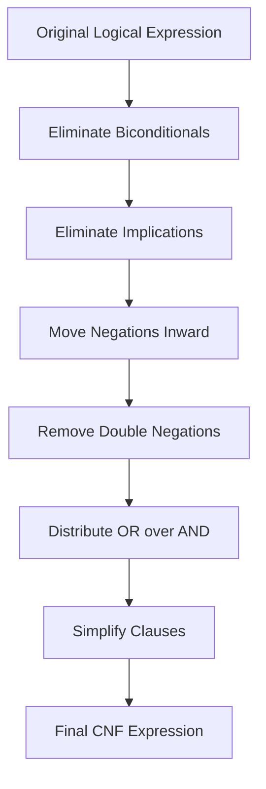
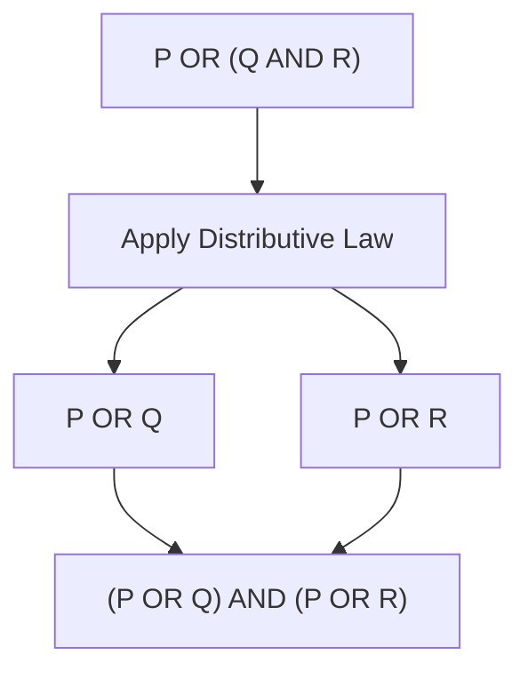
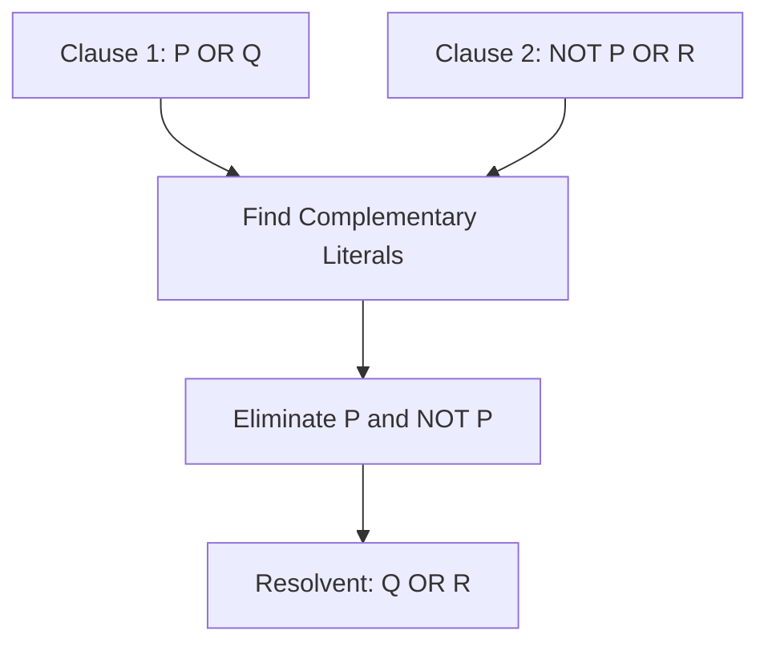

# 🧠 Conjunctive Normal Form (CNF) in Artificial Intelligence

### AI Vault | Chapter 27 — Logical Expressions, CNF Conversion, Resolution & SAT Solving

[](https://github.com/ranjiGT/primitive-ai)


[](https://github.com/ranjiGT/primitive-ai/blob/main/LICENSE)

Welcome to **Chapter 27 of [Primitive AI](https://github.com/ranjiGT/primitive-ai)**!

**Conjunctive Normal Form (CNF)** is a standardized representation of logical expressions used extensively in Artificial Intelligence, automated theorem proving, SAT solving, knowledge representation, and symbolic reasoning.

CNF represents a logical formula as an **AND (∧) of clauses**, where each clause is an **OR (∨) of literals**.

By transforming logical expressions into CNF, AI systems can apply systematic reasoning algorithms such as resolution and satisfiability checking.

### What You Will Learn

- What Conjunctive Normal Form means.
- The difference between literals, clauses, and conjunctions.
- How to identify CNF expressions.
- How to convert logical formulas into CNF.
- How De Morgan's laws and distribution work.
- How CNF supports resolution.
- How SAT solvers use CNF.
- How to implement CNF conversion in Python.
- Real-world applications of CNF in Artificial Intelligence.

---

## 🎨 1. Conjunctive Normal Form — Visual Explanation

<div align="center">


*Figure 1: Cartoon-style infographic explaining CNF structure, logical clauses, conversion steps, distribution laws, resolution, SAT solving, and applications in Artificial Intelligence.*

</div>

The infographic presents the fundamentals of CNF through colorful illustrations, logical formulas, and step-by-step examples.

---

## 📖 2. What Is Conjunctive Normal Form?

Conjunctive Normal Form is a logical representation in which a formula consists of a conjunction of one or more clauses.

Each clause contains a disjunction of one or more literals.

### General Structure

\[
(L_1 \lor L_2 \lor \cdots \lor L_k)
\land
(L_{k+1} \lor \cdots \lor L_m)
\]

Where:

- **L** represents a literal.
- **∨** represents logical OR.
- **∧** represents logical AND.

### Example

```text
(P ∨ Q) ∧ (¬P ∨ R)
```

This formula contains two clauses:

```text
Clause 1: P ∨ Q

Clause 2: ¬P ∨ R
```

The clauses are connected using AND.

Therefore, the complete expression is in CNF.

### Simple Definition

> CNF is an AND of ORs, where each OR expression consists of literals.

---

## 🧩 3. Important Terminology

| Term | Meaning | Example |
|---|---|---|
| Proposition | Statement that is true or false | P |
| Literal | Proposition or its negation | P, ¬P |
| Clause | Disjunction of literals | P ∨ Q |
| Conjunction | Logical AND | P ∧ Q |
| Disjunction | Logical OR | P ∨ Q |
| CNF | Conjunction of clauses | (P ∨ Q) ∧ (¬P ∨ R) |
| Satisfiable | Has at least one truth assignment making it true | P ∨ Q |
| Unsatisfiable | No truth assignment makes it true | P ∧ ¬P |

### Example

Consider:

```text
(P ∨ Q) ∧ (R ∨ ¬S)
```

The literals are:

```text
P, Q, R, ¬S
```

The clauses are:

```text
P ∨ Q

R ∨ ¬S
```

The entire expression is a conjunction of these clauses.

---

## 🔍 4. Identifying CNF Expressions

Not every logical expression is written in CNF.

### Examples

| Expression | CNF? | Explanation |
|---|---|---|
| P | ✅ Yes | A single literal is a clause |
| P ∨ Q | ✅ Yes | A single clause |
| P ∧ Q | ✅ Yes | Two unit clauses |
| (P ∨ Q) ∧ (R ∨ S) | ✅ Yes | Conjunction of clauses |
| P → Q | ❌ No | Contains implication |
| P ↔ Q | ❌ No | Contains biconditional |
| P ∨ (Q ∧ R) | ❌ No | Requires distribution |
| ¬(P ∧ Q) | ❌ No | Negation must be moved inward |

### Important Observation

A single literal is a valid CNF formula.

For example:

```text
P
```

is equivalent to a CNF containing one clause with one literal.

Such a clause is called a **unit clause**.

---

## 🔄 5. Steps to Convert a Formula into CNF

A propositional logic formula can be converted into CNF using logical equivalences.

### Step 1: Eliminate Biconditionals

Replace:

```text
P ↔ Q
```

with:

```text
(P → Q) ∧ (Q → P)
```

### Step 2: Eliminate Implications

Replace:

```text
P → Q
```

with:

```text
¬P ∨ Q
```

### Step 3: Move Negations Inward

Apply De Morgan's laws:

```text
¬(P ∧ Q) ≡ ¬P ∨ ¬Q
```

```text
¬(P ∨ Q) ≡ ¬P ∧ ¬Q
```

### Step 4: Eliminate Double Negations

```text
¬¬P ≡ P
```

### Step 5: Distribute OR over AND

```text
P ∨ (Q ∧ R)
```

becomes:

```text
(P ∨ Q) ∧ (P ∨ R)
```

### Step 6: Simplify

Remove duplicate literals and clauses when appropriate.

For example:

```text
P ∨ P ≡ P
```

A clause such as:

```text
P ∨ ¬P ∨ Q
```

is always true and can be removed from a conjunction without changing its meaning.

### Conversion Workflow



---

## 🧮 6. Complete CNF Conversion Example

Convert:

\[
(P \rightarrow Q) \land (Q \rightarrow R)
\]

### Step 1: Eliminate Implications

Using:

```text
A → B ≡ ¬A ∨ B
```

we obtain:

```text
(¬P ∨ Q) ∧ (¬Q ∨ R)
```

### Step 2: Check the Structure

The expression contains two clauses:

```text
Clause 1: ¬P ∨ Q

Clause 2: ¬Q ∨ R
```

Both are disjunctions of literals.

They are connected by conjunction.

### Final Result

\[
(\neg P \lor Q) \land (\neg Q \lor R)
\]

The expression is now in CNF.

---

## 🌳 7. CNF Conversion Using Distribution

Consider:

\[
P \lor (Q \land R)
\]

This expression is not in CNF because an OR operator connects a literal to a conjunction.

### Apply the Distributive Law

\[
P \lor (Q \land R)
\equiv
(P \lor Q) \land (P \lor R)
\]

### Result

```text
(P ∨ Q) ∧ (P ∨ R)
```

### Visual Workflow



The result contains two clauses connected by AND.

---

## 🧠 8. CNF Conversion with De Morgan's Laws

Consider:

```text
¬(P ∧ Q)
```

### Step 1: Apply De Morgan's Law

```text
¬P ∨ ¬Q
```

### Step 2: Identify the Clause

The resulting expression contains two literals:

```text
¬P
¬Q
```

connected using OR.

Therefore:

```text
¬P ∨ ¬Q
```

is already in CNF.

### Another Example

Convert:

```text
¬(P ∨ Q)
```

Applying De Morgan's law:

```text
¬P ∧ ¬Q
```

This is CNF consisting of two unit clauses.

---

## 🔬 9. Advanced CNF Conversion Example

Convert:

\[
(P \land Q) \rightarrow R
\]

### Step 1: Remove Implication

```text
¬(P ∧ Q) ∨ R
```

### Step 2: Apply De Morgan's Law

```text
(¬P ∨ ¬Q) ∨ R
```

### Step 3: Apply Associativity

```text
¬P ∨ ¬Q ∨ R
```

### Final CNF

\[
\neg P \lor \neg Q \lor R
\]

This is a single clause containing three literals.

---

## 🤖 10. CNF in Resolution

Resolution is an inference rule commonly applied to clauses in CNF.

It combines two clauses containing complementary literals.

### Example

Given:

```text
P ∨ Q
```

and:

```text
¬P ∨ R
```

we can derive:

```text
Q ∨ R
```

### Resolution Rule

\[
\frac{P \lor Q \qquad \neg P \lor R}{Q \lor R}
\]

### Resolution Workflow



### Why CNF Matters

CNF gives resolution algorithms a consistent representation of logical knowledge.

It allows automated theorem provers to systematically derive new clauses and detect contradictions.

---

## 🧪 11. CNF and SAT Solving

SAT stands for **Boolean Satisfiability Problem**.

A SAT solver determines whether there exists an assignment of truth values that makes a Boolean formula true.

CNF is a standard input representation for many SAT solvers.

### Example

Consider:

```text
(P ∨ Q) ∧ (¬P ∨ R)
```

Choose:

```text
P = True
Q = False
R = True
```

Evaluate the first clause:

```text
P ∨ Q = True
```

Evaluate the second clause:

```text
¬P ∨ R = True
```

Both clauses are true.

Therefore, the complete CNF formula is satisfiable.

### Unsatisfiable Example

```text
P ∧ ¬P
```

No assignment can make both clauses true.

Therefore, the expression is unsatisfiable.

### SAT Applications

- Automated planning
- Hardware verification
- Software verification
- Scheduling
- Constraint solving
- Configuration management
- Formal reasoning

---

## 🐍 12. Python Implementation — Evaluating CNF

We can represent CNF formulas using Python collections.

Each clause is a list of literals, and the entire CNF is a list of clauses.

```python
def evaluate_literal(literal, assignment):
    if literal.startswith("~"):
        return not assignment[literal[1:]]

    return assignment[literal]


def evaluate_clause(clause, assignment):
    return any(
        evaluate_literal(literal, assignment)
        for literal in clause
    )


def evaluate_cnf(cnf, assignment):
    return all(
        evaluate_clause(clause, assignment)
        for clause in cnf
    )


cnf = [
    ["P", "Q"],
    ["~P", "R"]
]

assignment = {
    "P": True,
    "Q": False,
    "R": True
}

result = evaluate_cnf(cnf, assignment)

print("CNF satisfied:", result)
```

### Expected Output

```text
CNF satisfied: True
```

### Explanation

The program:

1. Evaluates individual literals.
2. Evaluates clauses using OR.
3. Evaluates the entire CNF using AND.
4. Returns whether the supplied truth assignment satisfies the formula.

---

## 💻 13. Python Implementation — Simple SAT Solver

We can build a basic SAT solver by checking all possible truth assignments.

```python
from itertools import product


def evaluate_literal(literal, assignment):
    if literal.startswith("~"):
        return not assignment[literal[1:]]

    return assignment[literal]


def evaluate_cnf(cnf, assignment):
    return all(
        any(
            evaluate_literal(literal, assignment)
            for literal in clause
        )
        for clause in cnf
    )


def sat_solver(cnf, variables):
    for values in product(
        [False, True],
        repeat=len(variables)
    ):
        assignment = dict(zip(variables, values))

        if evaluate_cnf(cnf, assignment):
            return assignment

    return None


cnf = [
    ["P", "Q"],
    ["~P", "R"],
    ["~Q", "R"]
]

variables = ["P", "Q", "R"]

solution = sat_solver(cnf, variables)

if solution is not None:
    print("SATISFIABLE")
    print("Assignment:", solution)
else:
    print("UNSATISFIABLE")
```

### Expected Output

```text
SATISFIABLE
Assignment: {'P': False, 'Q': True, 'R': True}
```

### Explanation

The algorithm:

- Generates possible truth assignments.
- Evaluates the CNF formula.
- Returns the first satisfying assignment.
- Reports unsatisfiability if none exists.

**Important:** This brute-force solver has exponential worst-case complexity and is intended for educational purposes.

Modern SAT solvers commonly use algorithms such as DPLL and CDCL, together with unit propagation, clause learning, and efficient branching heuristics.

---

## ⚙️ 14. CNF Conversion vs Tseitin Transformation

Direct CNF conversion using repeated distribution can produce exponentially larger formulas.

For large formulas, SAT solvers often use **Tseitin transformation**.

### Direct CNF Conversion

Uses logical equivalences to create an equivalent CNF formula.

### Tseitin Transformation

Introduces auxiliary Boolean variables representing subexpressions.

It produces a CNF formula that is **equisatisfiable** with the original formula.

This means both formulas are either satisfiable or unsatisfiable, even though they may not be logically equivalent over their full sets of variables.

### Comparison

| Feature | Direct Conversion | Tseitin Transformation |
|---|---|---|
| Auxiliary variables | Usually no | Yes |
| Formula equivalence | Preserved | Equisatisfiability preserved |
| Formula size | May grow exponentially | Typically linear in input size |
| Common use | Learning and small formulas | Practical SAT encodings |

Tseitin transformation is especially useful in large-scale automated reasoning.

---

## 🆚 15. CNF vs DNF

DNF stands for **Disjunctive Normal Form**.

The difference lies in how AND and OR operators are organized.

| Feature | CNF | DNF |
|---|---|---|
| Full Name | Conjunctive Normal Form | Disjunctive Normal Form |
| Structure | AND of ORs | OR of ANDs |
| Example | (P ∨ Q) ∧ (R ∨ S) | (P ∧ Q) ∨ (R ∧ S) |
| Components | Clauses | Terms |
| Common Use | SAT solving and resolution | Boolean representation and rule analysis |

### CNF Example

```text
(P ∨ Q) ∧ (R ∨ S)
```

### DNF Example

```text
(P ∧ Q) ∨ (R ∧ S)
```

Both are standard representations of Boolean formulas.

---

## 🌍 16. Applications of CNF in Artificial Intelligence

### Automated Theorem Proving

CNF supports resolution-based proof procedures.

### SAT Solving

Many Boolean satisfiability algorithms operate on CNF clauses.

### Knowledge Representation

Logical knowledge can be transformed into clauses for systematic inference.

### AI Planning

Planning constraints can be encoded into Boolean formulas and solved using SAT.

### Software Verification

CNF supports checking logical constraints and verification conditions.

### Hardware Verification

SAT-based techniques can check circuit properties and logical equivalence.

### Scheduling and Optimization

Scheduling requirements can be represented using Boolean constraints.

### Constraint Satisfaction

Some constraint problems can be encoded into SAT and solved using CNF-based methods.

---

## ⚠️ 17. Common Mistakes

### Mistake 1: Confusing CNF with DNF

Incorrect CNF identification:

```text
(P ∧ Q) ∨ (R ∧ S)
```

This is DNF, not CNF in its displayed structure.

### Mistake 2: Forgetting to Remove Implications

```text
P → Q
```

is not written in CNF.

Correct conversion:

```text
¬P ∨ Q
```

### Mistake 3: Incorrect Distribution

Incorrect:

```text
P ∨ (Q ∧ R) = P ∨ Q ∧ R
```

Correct:

```text
P ∨ (Q ∧ R)
≡
(P ∨ Q) ∧ (P ∨ R)
```

### Mistake 4: Incorrect Negation

Incorrect:

```text
¬(P ∧ Q) = ¬P ∧ ¬Q
```

Correct:

```text
¬(P ∧ Q) = ¬P ∨ ¬Q
```

### Mistake 5: Assuming CNF Guarantees Satisfiability

A formula can be in CNF and still be unsatisfiable.

Example:

```text
P ∧ ¬P
```

---

## 🎓 18. Learning Outcomes

After completing this chapter, you should be able to:

- [ ] Define Conjunctive Normal Form.
- [ ] Identify literals and clauses.
- [ ] Recognize valid CNF formulas.
- [ ] Convert implications into disjunctions.
- [ ] Apply De Morgan's laws.
- [ ] Eliminate double negations.
- [ ] Apply the distributive law.
- [ ] Convert propositional formulas into CNF.
- [ ] Explain CNF in resolution.
- [ ] Understand SAT solving.
- [ ] Evaluate CNF formulas using Python.
- [ ] Explain the difference between CNF and DNF.
- [ ] Describe Tseitin transformation.
- [ ] Identify real-world applications of CNF.

---

## 📝 19. Practice Questions

1. What is Conjunctive Normal Form?
2. What is a literal?
3. What is a clause?
4. What is a unit clause?
5. Why is CNF important in Artificial Intelligence?
6. How do you eliminate an implication?
7. What are De Morgan's laws?
8. How do you distribute OR over AND?
9. What is the relationship between CNF and resolution?
10. How does a SAT solver use CNF?
11. What is the difference between CNF and DNF?
12. What is Tseitin transformation?
13. Why can direct CNF conversion increase formula size?
14. Can a CNF formula be unsatisfiable?

---

## 🧪 20. Hands-On Exercises

### Beginner

Identify whether the following expressions are in CNF:

```text
P ∨ Q
```

```text
P ∧ Q
```

```text
P → Q
```

```text
(P ∨ Q) ∧ (R ∨ S)
```

### Intermediate

Convert these expressions into CNF:

```text
P → Q
```

```text
¬(P ∧ Q)
```

```text
P ∨ (Q ∧ R)
```

```text
(P ∧ Q) → R
```

### Advanced

Convert:

```text
(P ↔ Q) ∧ (Q → R)
```

into CNF.

Explain each transformation.

### Programming Challenge

Extend the Python SAT solver to:

- Display all satisfying assignments.
- Count satisfying assignments.
- Identify unsatisfiable formulas.
- Support larger collections of clauses.
- Implement unit propagation.
- Implement a basic DPLL algorithm.

### Research Challenge

Investigate how modern SAT solvers use conflict-driven clause learning (CDCL) and compare it with brute-force satisfiability checking.

---

## 📚 21. Learning Resources

| Resource | Description |
|---|---|
| [🎨 CNF in AI Infographic](./Conjunctive%20Normal%20Form%20%28CNF%29%20in%20AI.png) | Visual explanation of CNF |
| [🧠 Predicate Logic](../23-predicate-logic/) | First-Order Logic foundations |
| [🔣 Propositional Logic](../24-propositional-logic/) | Boolean logic foundations |
| [🌍 Quantifiers in AI](../25-quantifiers-in-ai/) | Universal and existential quantifiers |
| [🔍 Resolution in AI](../26-resolution-in-ai/) | Resolution and theorem proving |
| [📚 AI Vault](../) | Complete AI learning collection |
| [🏠 Primitive AI](../../) | Main repository |
| [SAT Competition](https://satcompetition.github.io/) | SAT solving research and benchmarks |
| [Z3 Theorem Prover](https://github.com/Z3Prover/z3) | Automated theorem proving and SMT solving |
| [PySAT](https://pysathq.github.io/) | Python toolkit for SAT solving |

---

## 💡 22. Key Takeaways

> Conjunctive Normal Form provides a standardized logical representation that allows AI systems to perform systematic reasoning, resolution, and satisfiability checking.

Remember:

**Literal → Proposition or its negation**

**Clause → OR of literals**

**CNF → AND of clauses**

**Implication → Replace P → Q with ¬P ∨ Q**

**De Morgan's Laws → Move negations inward**

**Distribution → Distribute OR over AND**

**Resolution → Derive new clauses using complementary literals**

**SAT → Determine whether a satisfying truth assignment exists**

**Tseitin Transformation → Efficient equisatisfiable CNF encoding**

CNF is one of the most important foundations of symbolic reasoning and automated theorem proving.

---

## 🚀 23. What's Next?

Recommended topics for further learning:

1. Disjunctive Normal Form (DNF)
2. Unification in Artificial Intelligence
3. Forward Chaining
4. Backward Chaining
5. Horn Clauses
6. DPLL Algorithm
7. SAT Solvers
8. Knowledge-Based Agents
9. Automated Theorem Proving
10. Logic Programming

---

## ⭐ Support Primitive AI

If this chapter helps you understand Artificial Intelligence, consider supporting the project.

**[⭐ Star Primitive AI on GitHub](https://github.com/ranjiGT/primitive-ai)**

Contributions, corrections, educational examples, and improvements are welcome.

**Learn • Explore • Build • Share**

Made for curious minds and lifelong learners.
