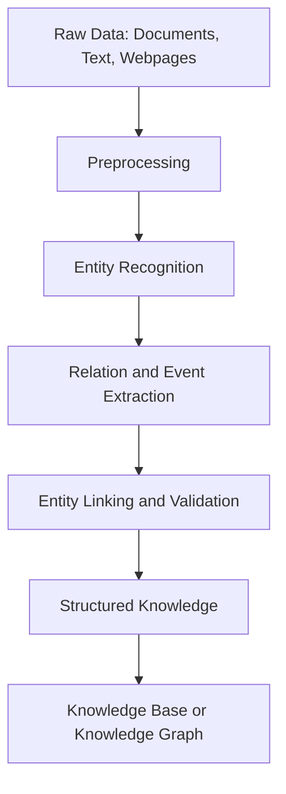
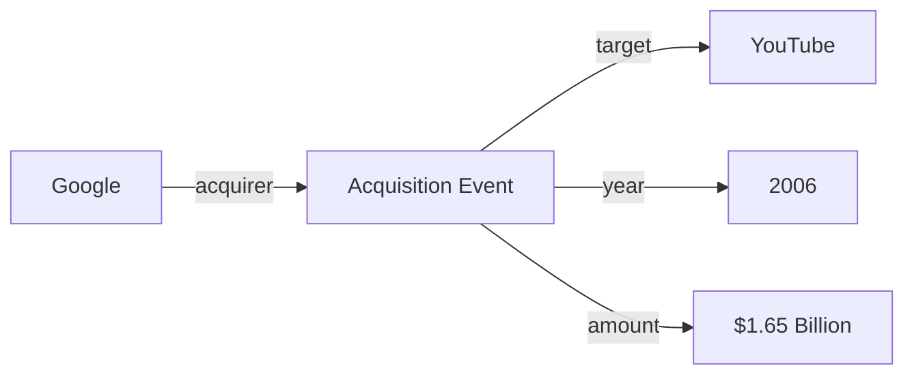

# 🧠 Knowledge Extraction in Artificial Intelligence

### AI Vault | Chapter 28 — From Unstructured Data to Structured Knowledge

[](https://github.com/ranjiGT/primitive-ai)


[](https://github.com/ranjiGT/primitive-ai/blob/main/LICENSE)

Welcome to **Chapter 28 of [Primitive AI](https://github.com/ranjiGT/primitive-ai)**!

**Knowledge Extraction** is the process of automatically identifying and transforming meaningful information from unstructured or semi-structured data into organized, machine-readable knowledge.

Artificial Intelligence systems use knowledge extraction to understand information contained in documents, webpages, conversations, research papers, and other data sources.

Rather than treating text as an unorganized collection of words, knowledge extraction identifies **entities, relationships, events, attributes, and facts** that can be stored, searched, analyzed, and used for reasoning.

### What You Will Learn

- What knowledge extraction means in AI.
- How raw information becomes structured knowledge.
- Named Entity Recognition (NER).
- Relation and event extraction.
- Rule-based, machine learning, and LLM-based extraction.
- Knowledge graphs and RDF-style triples.
- Building a basic extraction pipeline using Python.
- Common challenges and evaluation metrics.
- Applications in search, question answering, and intelligent systems.

---

## 🎨 1. Knowledge Extraction in AI — Visual Explanation

<div align="center">


*Figure 1: Cartoon-style infographic illustrating the knowledge extraction pipeline, entities, relationships, events, facts, knowledge graphs, extraction techniques, applications, and challenges.*

</div>

The infographic demonstrates how AI transforms raw information into structured representations that machines can process.

---

## 📖 2. What Is Knowledge Extraction?

Knowledge Extraction is an Artificial Intelligence and Natural Language Processing (NLP) process that identifies meaningful information from raw data and organizes it into structured formats.

### Simple Definition

> Knowledge Extraction converts unstructured information into structured facts, entities, relationships, and events that AI systems can understand and use.

### Example

Consider the sentence:

**"Google acquired YouTube in 2006 for $1.65 billion."**

A knowledge extraction system might identify:

| Information Type | Extracted Value |
|---|---|
| Organization 1 | Google |
| Organization 2 | YouTube |
| Relationship | acquired |
| Event | Acquisition |
| Year | 2006 |
| Amount | $1.65 billion |

The information can be represented as structured data:

```json
{
  "subject": "Google",
  "predicate": "acquired",
  "object": "YouTube",
  "year": 2006,
  "amount": {
    "value": 1.65,
    "unit": "billion",
    "currency": "USD"
  }
}
```

This representation is easier for software systems to query, validate, and connect with other knowledge.

---

## 🧩 3. What Do We Extract?

Knowledge extraction systems typically identify several kinds of information.

| Component | Description | Example |
|---|---|---|
| Entities | Real-world objects or concepts | Google, YouTube |
| Relationships | Connections between entities | Google acquired YouTube |
| Events | Actions or occurrences | Acquisition in 2006 |
| Attributes | Properties of entities | Acquisition price |
| Facts | Structured assertions | Acquisition amount was $1.65 billion |

### Entities

Entities can include:

- People
- Organizations
- Locations
- Products
- Dates
- Monetary values
- Scientific concepts

### Relationships

Relationships describe how entities are connected.

Examples:

```text
Employee → works_for → Company
Student → studies_at → University
Company → acquired → Company
Person → lives_in → City
```

### Events

Events describe actions or occurrences, often including participants, times, and locations.

Examples include company acquisitions, meetings, product launches, and scientific discoveries.

---

## 🔄 4. Knowledge Extraction Pipeline

A typical knowledge extraction pipeline consists of several stages.



### Step 1: Data Collection

Collect information from documents, webpages, APIs, databases, or conversations.

### Step 2: Preprocessing

Prepare the information using techniques such as text cleaning, sentence segmentation, tokenization, and normalization.

### Step 3: Entity Extraction

Identify people, organizations, locations, dates, and other entities.

### Step 4: Relation and Event Extraction

Identify connections between entities and the events in which they participate.

### Step 5: Entity Linking and Validation

Resolve ambiguous names, link mentions to known entities, and check extracted information.

### Step 6: Knowledge Representation

Store the extracted information in structured formats such as JSON, relational tables, RDF triples, or knowledge graphs.

---

## 🔎 5. Named Entity Recognition (NER)

Named Entity Recognition is an NLP technique used to identify and classify named entities in text.

### Example

Input:

```text
Sundar Pichai is the CEO of Google.
```

Possible output:

```text
Sundar Pichai → PERSON
Google → ORGANIZATION
```

NER identifies entity mentions but does not necessarily determine their relationships.

For example, identifying "Sundar Pichai" and "Google" is different from extracting the relationship:

```text
Sundar Pichai → CEO_of → Google
```

### Common NER Categories

| Category | Example |
|---|---|
| PERSON | Sundar Pichai |
| ORG | Google |
| GPE | Germany |
| DATE | October 2026 |
| MONEY | $1.65 billion |
| PRODUCT | iPhone |

The exact categories depend on the NLP model.

---

## 🐍 6. Python Implementation — Named Entity Recognition

We can implement a simple NER system using spaCy.

### Installation

```bash
pip install spacy
python -m spacy download en_core_web_sm
```

### Python Code

```python
import spacy

nlp = spacy.load("en_core_web_sm")

text = (
    "Google acquired YouTube in 2006 "
    "for $1.65 billion."
)

doc = nlp(text)

for entity in doc.ents:
    print(entity.text, "→", entity.label_)
```

### Example Output

```text
Google → ORG
YouTube → ORG
2006 → DATE
$1.65 billion → MONEY
```

The precise output can vary depending on the model version.

### Explanation

The program loads a pretrained NLP model, processes the sentence, identifies named entities, and displays their categories.

---

## 🔗 7. Relation Extraction

Relation Extraction identifies semantic relationships between entities.

### Example

Input:

```text
Google acquired YouTube in 2006.
```

Entities:

```text
Google → Organization
YouTube → Organization
```

Relationship:

```text
Google → acquired → YouTube
```

### Structured Triple

A common representation is:

```text
(Subject, Predicate, Object)
```

For example:

```text
(Google, acquired, YouTube)
```

### Additional Examples

| Subject | Predicate | Object |
|---|---|---|
| Alice | works_for | Company A |
| Paris | capital_of | France |
| Python | developed_by | Guido van Rossum |
| Google | acquired | YouTube |

### Why Relation Extraction Matters

Relationships allow AI systems to move beyond isolated entities and represent how different pieces of information are connected.

---

## 📅 8. Event Extraction

Event Extraction identifies events described in text and extracts their participants, dates, locations, and other relevant attributes.

### Example

Input:

```text
Google acquired YouTube in 2006 for $1.65 billion.
```

Possible event representation:

```json
{
  "event_type": "acquisition",
  "acquirer": "Google",
  "target": "YouTube",
  "year": 2006,
  "amount_usd": 1650000000
}
```

### Event Components

| Component | Description |
|---|---|
| Event Type | What happened |
| Participants | Who was involved |
| Time | When it happened |
| Location | Where it happened |
| Attributes | Additional event details |

Event extraction is useful for analyzing news, legal documents, financial reports, and scientific publications.

---

## ⚙️ 9. Knowledge Extraction Techniques

Knowledge extraction can be implemented using different approaches.

### Rule-Based Extraction

Uses predefined patterns, dictionaries, and linguistic rules.

Example:

```text
[Organization] acquired [Organization]
```

Advantages:

- Easy to understand.
- Predictable for known patterns.
- Useful in narrow domains.

Limitations:

- Difficult to generalize.
- Requires manual rule maintenance.
- Sensitive to language variations.

### Machine Learning-Based Extraction

Uses trained statistical models to recognize entities and relationships.

Common approaches include conditional random fields, neural sequence models, and transformer-based classifiers.

Advantages:

- Learns patterns from examples.
- Handles linguistic variation.
- Can generalize beyond fixed rules.

Limitations:

- Requires training data.
- May produce incorrect predictions.
- Performance depends on the training domain.

### LLM-Based Extraction

Uses large language models to identify and organize information according to instructions or schemas.

Advantages:

- Flexible across many document types.
- Can extract complex relationships.
- Supports schema-guided extraction.

Limitations:

- May hallucinate unsupported facts.
- Can produce inconsistent outputs.
- Requires validation and source grounding.
- Can introduce privacy and security concerns.

---

## 🧠 10. Knowledge Graphs

A Knowledge Graph represents entities and their relationships as a network.

### Example



### Knowledge Graph Components

**Nodes:** Represent entities, concepts, or events.

**Edges:** Represent relationships between nodes.

**Properties:** Store additional attributes.

### Benefits

Knowledge graphs support structured search, relationship discovery, question answering, data integration, and symbolic reasoning.

---

## 🗂️ 11. RDF-Style Knowledge Representation

RDF represents knowledge using subject-predicate-object triples.

For example:

```text
(Google, acquired, YouTube)
(Google, acquisitionYear, 2006)
(Google, acquisitionAmountUSD, 1650000000)
```

These are simplified, human-readable triples.

Formal RDF uses IRIs, blank nodes, and literals rather than arbitrary plain-text identifiers.

### Example Using RDFLib

Install:

```bash
pip install rdflib
```

Python:

```python
from rdflib import Graph, Namespace, Literal
from rdflib.namespace import XSD

graph = Graph()

EX = Namespace("https://example.org/")

graph.bind("ex", EX)

graph.add((EX.Google, EX.acquired, EX.YouTube))

graph.add((
    EX.Google,
    EX.acquisitionYear,
    Literal(2006, datatype=XSD.integer)
))

print(graph.serialize(format="turtle"))
```

This produces a machine-readable representation of extracted knowledge.

---

## 💻 12. Python Implementation — Rule-Based Knowledge Extraction

Let's build a simple educational extraction system using regular expressions.

```python
import re

text = (
    "Google acquired YouTube in 2006 "
    "for $1.65 billion."
)

pattern = (
    r"(?P<subject>[A-Z][A-Za-z]+)\s+"
    r"acquired\s+"
    r"(?P<object>[A-Z][A-Za-z]+)\s+"
    r"in\s+(?P<year>\d{4})"
)

match = re.search(pattern, text)

if match:
    knowledge = {
        "subject": match.group("subject"),
        "predicate": "acquired",
        "object": match.group("object"),
        "year": int(match.group("year"))
    }

    print(knowledge)
```

### Expected Output

```python
{
    'subject': 'Google',
    'predicate': 'acquired',
    'object': 'YouTube',
    'year': 2006
}
```

### Explanation

The program identifies a specific acquisition sentence pattern, extracts the organizations and year, and creates a structured record.

**Important:** This is a demonstration of pattern-based extraction, not a general-purpose relation extraction model.

---

## 🧪 13. Building a Mini Knowledge Extraction Pipeline

We can combine entity recognition with structured output generation.

```python
import json
import spacy

nlp = spacy.load("en_core_web_sm")

text = (
    "Google acquired YouTube in 2006 "
    "for $1.65 billion."
)

doc = nlp(text)

entities = [
    {
        "text": ent.text,
        "label": ent.label_
    }
    for ent in doc.ents
]

result = {
    "source_text": text,
    "entities": entities
}

print(json.dumps(result, indent=2))
```

### Example Output

```json
{
  "source_text": "Google acquired YouTube in 2006 for $1.65 billion.",
  "entities": [
    {"text": "Google", "label": "ORG"},
    {"text": "YouTube", "label": "ORG"},
    {"text": "2006", "label": "DATE"},
    {"text": "$1.65 billion", "label": "MONEY"}
  ]
}
```

This pipeline performs entity extraction and produces JSON output. Relation and event extraction can be added as separate processing stages.

---

## 🤖 14. LLM-Based Knowledge Extraction

Large Language Models can extract structured knowledge from natural-language documents.

### Example Prompt

```text
Extract entities, relationships, and events
from the following text.

Return valid JSON.

Do not invent information.
Use null for missing values.

Text:
"Google acquired YouTube in 2006
for $1.65 billion."

Schema:
{
  "entities": [],
  "relationships": [],
  "events": []
}
```

### Example Response

```json
{
  "entities": [
    {"name": "Google", "type": "Organization"},
    {"name": "YouTube", "type": "Organization"}
  ],
  "relationships": [
    {
      "subject": "Google",
      "predicate": "acquired",
      "object": "YouTube"
    }
  ],
  "events": [
    {
      "type": "acquisition",
      "year": 2006,
      "amount_usd": 1650000000
    }
  ]
}
```

### Best Practices

- Define an explicit extraction schema.
- Require evidence from the source.
- Validate JSON structure and data types.
- Check entities against authoritative records where appropriate.
- Preserve source references and provenance.
- Review uncertain or high-impact facts.

An LLM's structured output is not automatically verified knowledge.

---

## 📊 15. Evaluating Knowledge Extraction

Extraction systems are commonly evaluated using precision, recall, and F1-score.

### Precision

Measures the proportion of predicted extractions that are correct.

\[
Precision = \frac{TP}{TP+FP}
\]

### Recall

Measures the proportion of correct reference extractions that were successfully identified.

\[
Recall = \frac{TP}{TP+FN}
\]

### F1-Score

Combines precision and recall.

\[
F1 = 2 \times \frac{Precision \times Recall}{Precision + Recall}
\]

Where:

- TP = True Positives
- FP = False Positives
- FN = False Negatives

### Example

Suppose an extraction system produces:

```text
True Positives = 80
False Positives = 20
False Negatives = 10
```

Then:

```text
Precision = 80 / 100 = 0.80
Recall = 80 / 90 ≈ 0.889
F1 ≈ 0.842
```

Different extraction tasks may require exact-match, partial-match, entity-level, relation-level, or event-level evaluation.

---

## ⚠️ 16. Challenges in Knowledge Extraction

| Challenge | Description |
|---|---|
| Ambiguity | Words may refer to different entities |
| Complex Sentences | Relationships may span multiple clauses |
| Domain Terminology | Specialized language can confuse models |
| Noisy Data | OCR errors, typos, and formatting problems |
| Entity Linking | Multiple mentions may refer to the same entity |
| Incorrect Relationships | Systems may connect unrelated entities |
| Hallucination | LLMs may generate unsupported facts |
| Data Provenance | Extracted facts need traceable sources |
| Privacy | Documents may contain sensitive information |

### Example of Ambiguity

Consider:

```text
Apple announced a new product.
```

The word "Apple" refers to a company in this context.

However:

```text
She ate an apple.
```

Here, "apple" refers to a fruit.

An extraction system must use context to distinguish these meanings.

---

## 🌍 17. Applications of Knowledge Extraction in AI

### Search and Information Retrieval

Extracted entities and relationships improve structured search and filtering.

### Question Answering

Knowledge extraction supports systems that answer questions using information from documents.

### Knowledge Bases

Extracted facts can populate structured repositories of information.

### Knowledge Graph Construction

Entities and relationships can be connected into graph representations.

### Business Intelligence

Organizations can extract trends and events from reports, news, and documents.

### Scientific Research

Systems can identify findings, methods, entities, and relationships in research publications.

### Compliance and Risk Analysis

Information extraction can identify relevant obligations, events, organizations, and risk indicators for further review.

### Retrieval-Augmented Generation (RAG)

Structured knowledge can complement document retrieval by providing explicit entities and relationships.

---

## 🆚 18. Knowledge Extraction vs Information Retrieval

| Feature | Knowledge Extraction | Information Retrieval |
|---|---|---|
| Primary Goal | Identify structured facts | Find relevant information |
| Input | Text, documents, webpages | Queries and indexed content |
| Output | Entities, relations, events | Documents or passages |
| Common Techniques | NER, relation extraction, LLMs | Keyword and semantic search |
| Example | Extract an acquisition event | Find articles about an acquisition |

The two approaches are complementary.

Information retrieval finds relevant content, while knowledge extraction identifies structured information within that content.

---

## 🎓 19. Learning Outcomes

After completing this chapter, you should be able to:

- [ ] Define knowledge extraction.
- [ ] Explain the knowledge extraction pipeline.
- [ ] Identify entities, relations, events, and facts.
- [ ] Describe Named Entity Recognition.
- [ ] Explain relation extraction.
- [ ] Explain event extraction.
- [ ] Compare rule-based, ML-based, and LLM-based methods.
- [ ] Represent extracted knowledge as triples.
- [ ] Explain knowledge graphs.
- [ ] Implement basic extraction in Python.
- [ ] Evaluate extraction quality.
- [ ] Identify common challenges.
- [ ] Explain real-world applications.

---

## 📝 20. Practice Questions

1. What is knowledge extraction in AI?
2. How is knowledge extraction different from information retrieval?
3. What is Named Entity Recognition?
4. What is relation extraction?
5. What is event extraction?
6. What are subject-predicate-object triples?
7. How does a knowledge graph represent information?
8. What is entity linking?
9. How can machine learning improve extraction?
10. What are the benefits and risks of LLM-based extraction?
11. How do precision and recall measure extraction quality?
12. Why is source provenance important?

---

## 🧪 21. Hands-On Exercises

### Beginner

Extract entities from:

```text
Microsoft acquired GitHub in 2018.
```

Identify the organizations and date.

### Intermediate

Extract a relationship from:

```text
Marie Curie conducted research in Paris.
```

Represent the result as a subject-predicate-object triple.

### Advanced

Create a Python program that extracts organization names, dates, and monetary amounts from multiple sentences.

### Programming Challenge

Build a mini knowledge extraction system that:

1. Reads text files.
2. Identifies named entities.
3. Extracts selected relationships.
4. Generates structured JSON.
5. Records source sentences.
6. Exports triples into a knowledge graph.

### Research Challenge

Compare a rule-based extractor, a pretrained NLP model, and an LLM-based extractor using the same dataset.

Measure precision, recall, and F1-score.

---

## 📚 22. Learning Resources

| Resource | Description |
|---|---|
| [🎨 Knowledge Extraction Infographic](./Knowledge%20Extraction%20in%20AI.png) | Visual explanation of knowledge extraction |
| [🧠 Predicate Logic](../23-predicate-logic/) | Logical knowledge representation |
| [🔣 Propositional Logic](../24-propositional-logic/) | Logical reasoning foundations |
| [🔍 Resolution in AI](../26-resolution-in-ai/) | Automated logical inference |
| [📚 AI Vault](../) | Complete AI learning collection |
| [🏠 Primitive AI](../../) | Main repository |
| [spaCy Documentation](https://spacy.io/usage/linguistic-features#named-entities) | Named Entity Recognition |
| [RDFLib Documentation](https://rdflib.readthedocs.io/) | RDF and knowledge graphs |
| [Hugging Face](https://huggingface.co/tasks/token-classification) | NLP models and token classification |
| [W3C RDF](https://www.w3.org/RDF/) | RDF standards |

---

## 💡 23. Key Takeaways

> Knowledge Extraction transforms raw information into structured knowledge that AI systems can search, connect, analyze, and reason over.

Remember:

**Raw Data → Unstructured information**

**NER → Identifies named entities**

**Relation Extraction → Identifies connections**

**Event Extraction → Identifies actions and occurrences**

**Knowledge Graph → Connects entities and relationships**

**RDF Triples → Subject, predicate, object**

**LLM Extraction → Flexible schema-guided extraction**

**Validation → Improves reliability and accuracy**

**Provenance → Tracks where extracted knowledge originated**

Knowledge extraction is a foundational capability of modern knowledge-driven AI systems.

---

## 🚀 24. What's Next?

Recommended topics for further learning:

1. Knowledge Representation in AI
2. Semantic Networks
3. Frames in Artificial Intelligence
4. Ontologies and Knowledge Graphs
5. Forward Chaining
6. Backward Chaining
7. Knowledge-Based Agents
8. Natural Language Processing
9. Information Retrieval
10. Retrieval-Augmented Generation (RAG)

---

## ⭐ Support Primitive AI

If this chapter helps you understand Artificial Intelligence, consider supporting the project.

**[⭐ Star Primitive AI on GitHub](https://github.com/ranjiGT/primitive-ai)**

Contributions, corrections, educational examples, and improvements are welcome.

**Learn • Explore • Build • Share**

Made for curious minds and lifelong learners.
