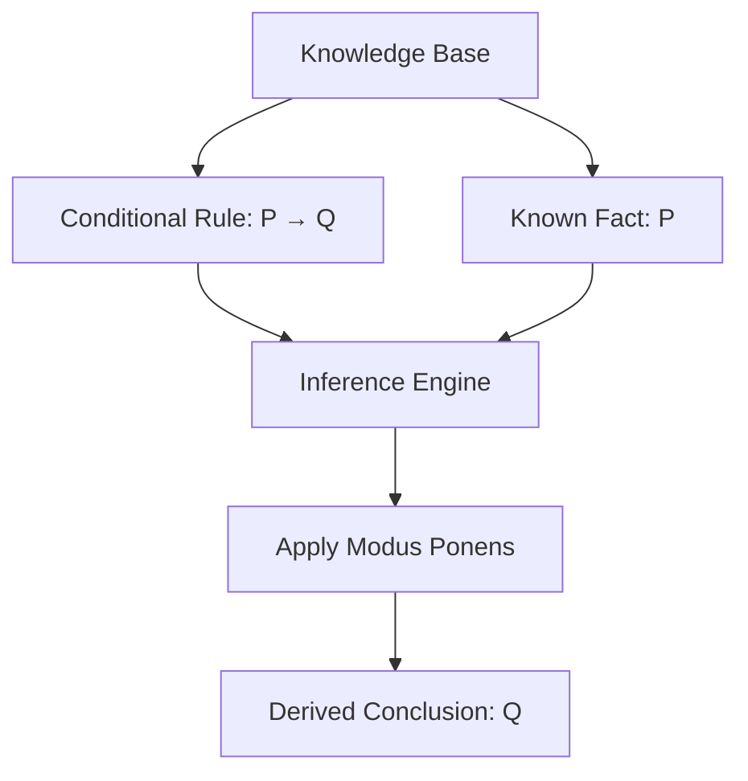
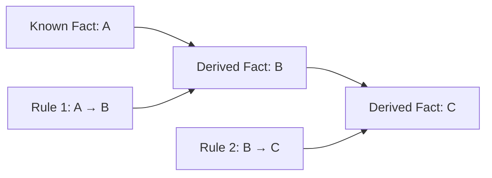
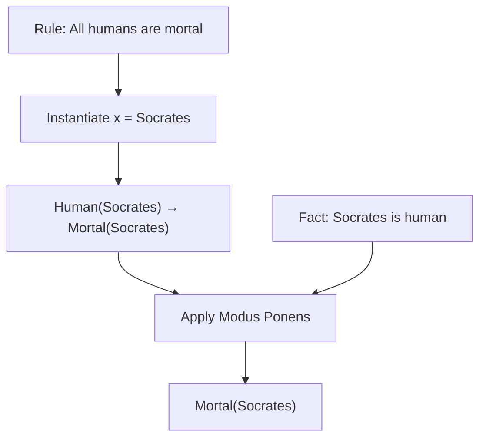

# 🧠 Modus Ponens in Artificial Intelligence

### AI Vault | Chapter 29 — Logical Inference, Deductive Reasoning & Rule-Based AI

[](https://github.com/ranjiGT/primitive-ai)


[](https://github.com/ranjiGT/primitive-ai/blob/main/LICENSE)

Welcome to **Chapter 29 of [Primitive AI](https://github.com/ranjiGT/primitive-ai)**!

**Modus Ponens** is one of the most fundamental rules of inference in logic and Artificial Intelligence.

It allows an intelligent system to derive a logically valid conclusion from a conditional statement and a known fact.

The reasoning follows a simple principle:

**If P implies Q, and P is true, then Q must be true.**

Modus Ponens plays an important role in knowledge-based systems, expert systems, automated theorem proving, rule-based agents, and logical reasoning.

## 🎯 What You Will Learn

- What Modus Ponens means in Artificial Intelligence.
- Its mathematical and logical representation.
- How conditional rules produce conclusions.
- How truth tables demonstrate its validity.
- How AI systems apply Modus Ponens.
- The difference between Modus Ponens and Modus Tollens.
- How Modus Ponens works in first-order logic.
- How to implement a simple inference engine using Python.
- Real-world applications and common logical mistakes.

---

## 🎨 1. Modus Ponens — Visual Explanation

<div align="center">


*Figure 1: Cartoon-style infographic illustrating the Modus Ponens inference rule, logical representation, reasoning flow, truth table, practical examples, first-order logic, and Python implementation.*

</div>

The infographic demonstrates how an AI reasoning system combines a conditional rule with a known fact to derive a conclusion.

---

## 📖 2. What Is Modus Ponens?

Modus Ponens is a valid deductive inference rule, also called **affirming the antecedent**.

It allows us to derive a conclusion when a conditional statement and its antecedent are both established.

### Simple Definition

> Modus Ponens is the logical rule that allows us to conclude Q when we know that P implies Q and P is true.

### Example

Consider:

**Rule:** If it rains, then the ground becomes wet.

**Fact:** It is raining.

**Conclusion:** The ground becomes wet.

In symbolic form:

```text
P → Q
P
─────
∴ Q
```

Where:

- **P** represents the condition.
- **Q** represents the consequence.
- **→** represents logical implication.
- **∴** means therefore.

The conclusion follows logically from the two premises.

---

## 🧮 3. Formal Representation

The general structure of Modus Ponens is:

\[
\frac{P \rightarrow Q \qquad P}{Q}
\]

This consists of three components.

| Component | Logical Form | Description |
|---|---|---|
| Major Premise | P → Q | Conditional rule |
| Minor Premise | P | Known fact |
| Conclusion | Q | Derived statement |

### Example

```text
Rule:
If a student studies, then the student passes.

Fact:
The student studies.

Conclusion:
The student passes.
```

Symbolically:

\[
Studies \rightarrow Passes
\]

\[
Studies
\]

\[
\therefore Passes
\]

**Important:** Modus Ponens guarantees that the conclusion follows if both premises are true. It does not independently establish that the premises accurately describe the real world.

---

## 🔄 4. Reasoning Flow in Artificial Intelligence

An AI inference engine can apply Modus Ponens to derive new facts from existing knowledge.



### Step-by-Step Explanation

**Step 1: Identify the Rule**

The knowledge base contains:

```text
If P, then Q.
```

**Step 2: Verify the Fact**

The system determines that P is established.

**Step 3: Apply the Inference Rule**

The inference engine matches the established fact with the antecedent of the conditional rule.

**Step 4: Derive the Conclusion**

The system concludes Q.

**Step 5: Update the Knowledge Base**

The newly derived conclusion may be added to the knowledge base and used for further reasoning.

---

## 📊 5. Truth Table of Modus Ponens

Modus Ponens can be verified using propositional logic.

| P | Q | P → Q | (P → Q) ∧ P | Q |
|---|---|---|---|---|
| True | True | True | True | True |
| True | False | False | False | False |
| False | True | True | False | True |
| False | False | True | False | False |

Notice that whenever both premises are true, the conclusion Q is also true.

### Logical Validity

The following formula is a tautology:

\[
((P \rightarrow Q) \land P) \rightarrow Q
\]

This means Modus Ponens is logically valid for every possible truth assignment.

### Key Observation

Logical validity is about the relationship between premises and conclusions.

It does not mean that every conditional statement supplied to an AI system is factually correct.

---

## 🌍 6. Real-World Examples of Modus Ponens

### Example 1: Cybersecurity

```text
Rule:
If a file is classified as malicious,
then block the file.

Fact:
The file is classified as malicious.

Conclusion:
Block the file.
```

This illustrates how a rule-based security system can derive an action from a classification.

### Example 2: Medical Expert Systems

```text
Rule:
If a patient meets a defined clinical criterion,
then flag the case for review.

Fact:
The patient meets the criterion.

Conclusion:
Flag the case for review.
```

Such systems depend on validated rules and reliable evidence.

### Example 3: Intelligent Agents

```text
Rule:
If an obstacle is detected,
then stop the robot.

Fact:
An obstacle is detected.

Conclusion:
Stop the robot.
```

### Example 4: Access Control

```text
Rule:
If a user has the required permission,
then the user is authorized for the operation.

Fact:
The user has the required permission.

Conclusion:
The user is authorized for the operation.
```

This simplified example assumes the permission rule captures all relevant authorization requirements.

---

## 🧠 7. Modus Ponens in Knowledge-Based Systems

Knowledge-based systems store facts and rules that can be used to derive additional information.

### Example Knowledge Base

```text
Rule 1:
If A, then B.

Rule 2:
If B, then C.

Fact:
A is true.
```

### First Inference

From:

```text
A → B
A
```

derive:

```text
B
```

### Second Inference

From:

```text
B → C
B
```

derive:

```text
C
```

### Reasoning Chain



This illustrates how repeated applications of Modus Ponens can produce a chain of deductions.

Such reasoning is central to many forward-chaining systems.

---

## 🐍 8. Python Implementation — Basic Modus Ponens

Let's implement a simple educational version of Modus Ponens.

```python
def modus_ponens(implication, known_fact):
    """
    Apply Modus Ponens to a conditional rule.

    implication: (antecedent, consequent)
    known_fact: established proposition
    """

    antecedent, consequent = implication

    if known_fact == antecedent:
        return consequent

    return None


rule = ("raining", "carry_umbrella")

fact = "raining"

conclusion = modus_ponens(rule, fact)

if conclusion is not None:
    print("Conclusion:", conclusion)
else:
    print("No conclusion derived.")
```

### Expected Output

```text
Conclusion: carry_umbrella
```

### Explanation

The program:

1. Stores the conditional rule.
2. Receives an established fact.
3. Compares the fact with the rule's antecedent.
4. Returns the consequent when the antecedent matches.

This is a simplified symbolic inference demonstration rather than a complete logic engine.

---

## ⚙️ 9. Python Implementation — Rule-Based Inference Engine

We can extend the idea to derive multiple conclusions automatically.

```python
def forward_chain(rules, initial_facts):
    facts = set(initial_facts)

    changed = True

    while changed:
        changed = False

        for antecedent, consequent in rules:
            if antecedent in facts and consequent not in facts:
                facts.add(consequent)
                changed = True

                print(
                    f"Derived: {consequent} "
                    f"from {antecedent}"
                )

    return facts


rules = [
    ("raining", "ground_wet"),
    ("ground_wet", "surface_slippery"),
    ("surface_slippery", "use_caution")
]

initial_facts = {"raining"}

derived_facts = forward_chain(rules, initial_facts)

print("\nFinal Knowledge Base:")

for fact in sorted(derived_facts):
    print("-", fact)
```

### Expected Output

```text
Derived: ground_wet from raining
Derived: surface_slippery from ground_wet
Derived: use_caution from surface_slippery

Final Knowledge Base:
- ground_wet
- raining
- surface_slippery
- use_caution
```

### How It Works

The inference engine repeatedly examines the available rules.

Whenever an antecedent is already known, the engine adds the consequent to its collection of facts.

The process continues until no new facts can be derived.

This is an example of **forward chaining** using simple propositional rules.

---

## 🔬 10. Modus Ponens in First-Order Logic

Modus Ponens also applies to first-order logic.

When rules contain variables, a reasoning system may need to perform substitution or unification before applying the inference.

### Example

Consider the rule:

\[
\forall x\,(Human(x) \rightarrow Mortal(x))
\]

This means:

**For every x, if x is human, then x is mortal.**

Known fact:

\[
Human(Socrates)
\]

Using universal instantiation and Modus Ponens:

\[
\therefore Mortal(Socrates)
\]

### Reasoning Process



### Generalized Modus Ponens

Generalized Modus Ponens extends the inference process to rules with variables and multiple conditions.

For example:

\[
Parent(x,y) \land Parent(y,z) \rightarrow Grandparent(x,z)
\]

If the knowledge base contains:

\[
Parent(Alice,Bob)
\]

\[
Parent(Bob,Charlie)
\]

then the system can infer:

\[
Grandparent(Alice,Charlie)
\]

This combines substitution, conjunction of premises, and rule-based inference.

---

## 🆚 11. Modus Ponens vs Modus Tollens

Modus Ponens and Modus Tollens are both valid inference rules, but they work differently.

| Feature | Modus Ponens | Modus Tollens |
|---|---|---|
| Meaning | Affirming the antecedent | Denying the consequent |
| Rule | P → Q | P → Q |
| Additional Premise | P | ¬Q |
| Conclusion | Q | ¬P |
| Validity | Valid | Valid |

### Modus Ponens

```text
P → Q
P
─────
∴ Q
```

### Modus Tollens

```text
P → Q
¬Q
─────
∴ ¬P
```

### Example

Rule:

```text
If the server is running, then its status indicator is active.
```

Modus Ponens:

```text
The server is running.

Therefore, its status indicator is active.
```

Modus Tollens:

```text
The status indicator is not active.

Therefore, the server is not running.
```

Both deductions are valid under the stated conditional rule.

---

## ⚠️ 12. Common Logical Mistakes

### Mistake 1: Affirming the Consequent

```text
P → Q
Q
─────
∴ P
```

This is not a valid inference rule.

Example:

```text
If it rains, the road is wet.

The road is wet.

Therefore, it is raining.
```

The road could be wet for another reason.

### Mistake 2: Denying the Antecedent

```text
P → Q
¬P
─────
∴ ¬Q
```

This is also invalid.

Example:

```text
If it rains, the road is wet.

It is not raining.

Therefore, the road is not wet.
```

The road may still be wet.

### Mistake 3: Confusing Implication with Causation

A logical implication does not automatically establish a causal relationship.

### Mistake 4: Using Unsupported Premises

Modus Ponens is valid, but conclusions may be unreliable when the knowledge base contains incorrect or unsupported premises.

### Mistake 5: Treating Probabilistic Rules as Certain

A statement such as:

```text
If it rains, the road is usually wet.
```

is not the same as the strict logical implication:

```text
Raining → RoadWet
```

Probabilistic relationships require different reasoning methods or additional assumptions.

---

## 🤖 13. Applications of Modus Ponens in AI

| Application | How Modus Ponens Helps |
|---|---|
| Expert Systems | Derives conclusions from domain rules |
| Knowledge-Based Agents | Applies rules to known facts |
| Automated Theorem Proving | Supports formal deductions |
| Forward Chaining | Generates new facts from existing facts |
| Logic Programming | Supports rule-driven computation |
| Access Control | Evaluates authorization rules |
| Software Verification | Reasons about specified conditions |
| Intelligent Automation | Derives actions from established conditions |

Modus Ponens is particularly useful when the AI system operates with explicit, deterministic rules.

---

## 📚 14. Relationship with Other AI Concepts

### Propositional Logic

Modus Ponens uses logical propositions and implications.

### Predicate Logic

The inference rule can operate on instantiated predicates.

### Knowledge Representation

Facts and rules provide the information required for inference.

### Forward Chaining

Repeatedly applies inference rules to derive new facts.

### Backward Chaining

Starts from a goal and searches for facts or rules that could establish it.

### Resolution

A related inference technique that operates on logical clauses, often represented in Conjunctive Normal Form.

### Knowledge-Based Agents

Agents can use inference rules to determine what follows from their knowledge.

---

## 🎓 15. Learning Outcomes

After completing this chapter, you should be able to:

- [ ] Define Modus Ponens.
- [ ] Explain the meaning of P → Q.
- [ ] Identify the antecedent and consequent.
- [ ] Apply Modus Ponens to logical statements.
- [ ] Demonstrate validity using a truth table.
- [ ] Explain how inference engines use Modus Ponens.
- [ ] Implement a basic inference function in Python.
- [ ] Build a simple forward-chaining system.
- [ ] Apply Modus Ponens in first-order logic.
- [ ] Compare Modus Ponens with Modus Tollens.
- [ ] Recognize invalid inference patterns.
- [ ] Describe practical applications in AI.

---

## 📝 16. Practice Questions

1. What is Modus Ponens?
2. Why is Modus Ponens considered a valid inference rule?
3. What is the antecedent of a conditional statement?
4. What is the consequent?
5. What does the symbol → represent?
6. How does Modus Ponens differ from Modus Tollens?
7. What is affirming the consequent?
8. How does an inference engine apply Modus Ponens?
9. What is the relationship between Modus Ponens and forward chaining?
10. Can Modus Ponens be used in first-order logic?
11. Why is the correctness of premises important?
12. How can Modus Ponens support intelligent agents?

---

## 🧪 17. Hands-On Exercises

### Beginner

Given:

```text
If A, then B.

A is true.
```

Determine the conclusion.

### Intermediate

Given:

```text
If a student completes the assignment,
then the student receives a completion badge.

The student completes the assignment.
```

Identify the rule, fact, and conclusion.

### Advanced

Given:

```text
A → B
B → C
C → D
A
```

Derive all possible conclusions using Modus Ponens.

### Python Challenge

Extend the inference engine to:

1. Support multiple antecedents.
2. Detect duplicate rules.
3. Track which rules produced each conclusion.
4. Explain the complete inference chain.
5. Detect conflicting facts.
6. Support variables and simple unification.

### Research Challenge

Compare forward chaining and backward chaining in rule-based Artificial Intelligence.

Explain how Modus Ponens contributes to each approach.

---

## 📚 18. Learning Resources

| Resource | Description |
|---|---|
| [🎨 Modus Ponens Infographic](./Modus%20Ponens%20in%20AI.png) | Cartoon-style visual explanation |
| [🧠 Predicate Logic](../23-predicate-logic/) | First-order logic foundations |
| [🔣 Propositional Logic](../24-propositional-logic/) | Logical propositions and implications |
| [🌍 Quantifiers](../25-quantifiers-in-ai/) | Universal and existential quantification |
| [🔍 Resolution](../26-resolution-in-ai/) | Automated inference |
| [📘 Conjunctive Normal Form](../27-conjunctive-normal-form/) | Clause-based logical representation |
| [📚 AI Vault](../) | Complete AI learning collection |
| [🏠 Primitive AI](../../) | Main repository |
| [Stanford Encyclopedia of Philosophy — Classical Logic](https://plato.stanford.edu/entries/logic-classical/) | Formal logic reference |
| [SWI-Prolog](https://www.swi-prolog.org/) | Logic programming environment |

---

## 💡 19. Key Takeaways

> Modus Ponens is a fundamental rule of deductive reasoning that allows an AI system to derive a conclusion from a conditional rule and an established fact.

Remember:

**Conditional Rule → P implies Q**

**Known Fact → P is true**

**Inference → Apply Modus Ponens**

**Conclusion → Q follows logically**

**Knowledge Base → Stores facts and rules**

**Inference Engine → Applies logical rules**

**Forward Chaining → Repeatedly derives new facts**

**First-Order Logic → Extends reasoning to predicates and variables**

**Sound Reasoning → Valid deductions depend on valid premises**

Modus Ponens provides an essential foundation for symbolic reasoning and rule-based Artificial Intelligence.

---

## 🚀 20. What's Next?

Recommended topics for further learning:

1. Modus Tollens in AI
2. Forward Chaining
3. Backward Chaining
4. Unification in Artificial Intelligence
5. Horn Clauses
6. Knowledge Representation
7. Expert Systems
8. First-Order Logic Inference
9. Automated Theorem Proving
10. Logic Programming with Prolog

---

## ⭐ Support Primitive AI

If this chapter helps you understand Artificial Intelligence, consider supporting the project.

**[⭐ Star Primitive AI on GitHub](https://github.com/ranjiGT/primitive-ai)**

Contributions, corrections, educational examples, and improvements are welcome.

**Learn • Explore • Build • Share**

Made for curious minds and lifelong learners.
