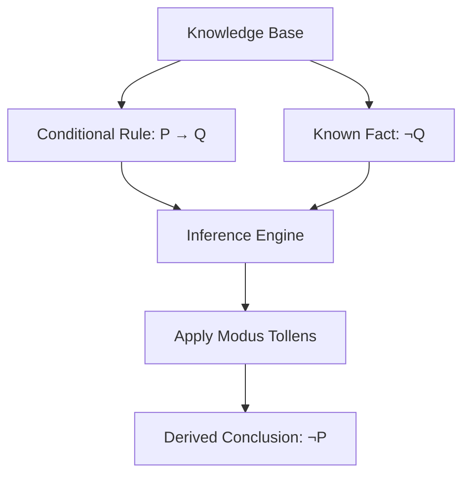
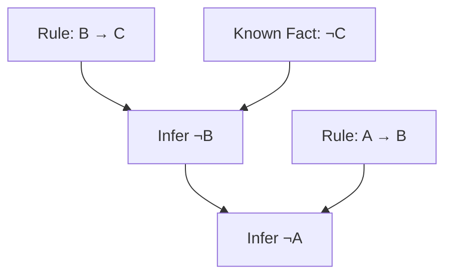
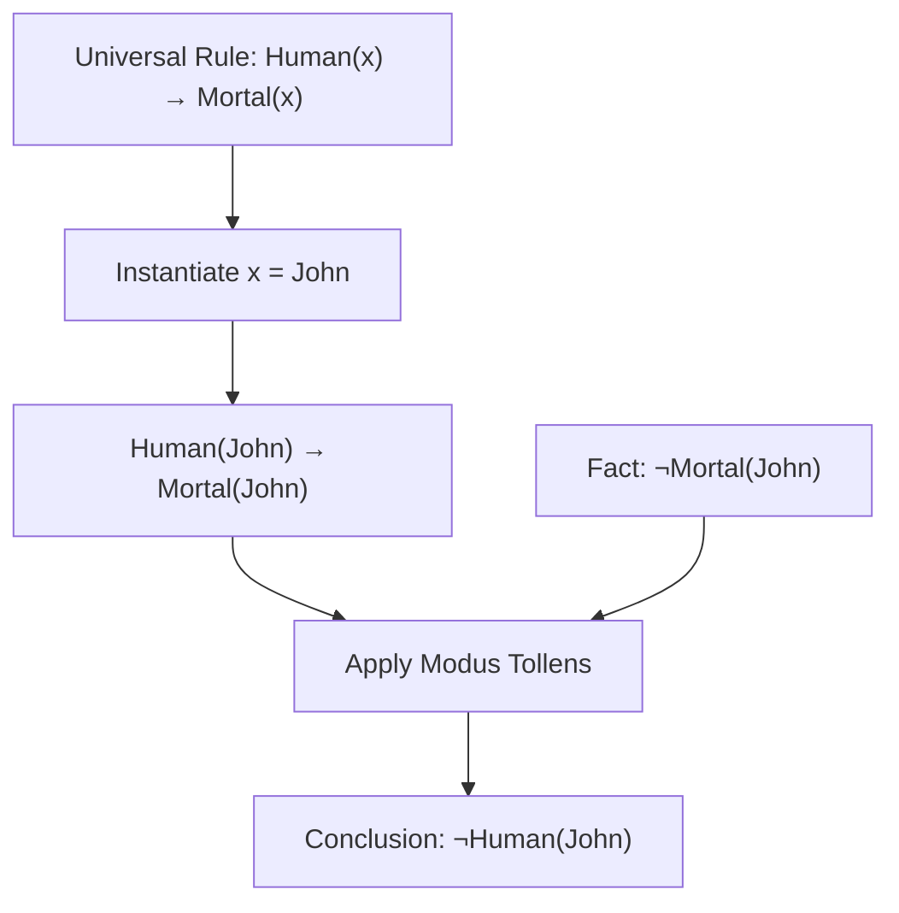

# 🧠 Modus Tollens in Artificial Intelligence

### AI Vault | Chapter 30 — Logical Inference, Deductive Reasoning & Rule-Based AI

[](https://github.com/ranjiGT/primitive-ai)


[](https://github.com/ranjiGT/primitive-ai/blob/main/LICENSE)

Welcome to **Chapter 30 of [Primitive AI](https://github.com/ranjiGT/primitive-ai)**!

**Modus Tollens** is a fundamental rule of deductive inference used in logic and Artificial Intelligence.

It allows a reasoning system to conclude that a condition is false when a conditional rule states that the condition implies a particular result, but that result is known to be false.

The principle is simple:

**If P implies Q, and Q is false, then P must be false.**

Modus Tollens is also called **denying the consequent**. It is useful in automated reasoning, rule-based systems, formal verification, fault diagnosis, and knowledge-based AI.

## 🎯 What You Will Learn

- What Modus Tollens means in AI.
- Its formal mathematical representation.
- How to derive conclusions using negation.
- How truth tables demonstrate logical validity.
- How Modus Tollens differs from Modus Ponens.
- How first-order logic supports Modus Tollens.
- How to implement basic inference using Python.
- How to build a small rule-based inference engine.
- Common logical fallacies and practical applications.

---

## 🎨 1. Modus Tollens — Visual Explanation

<div align="center">


*Figure 1: Cartoon-style infographic explaining Modus Tollens, formal representation, truth tables, reasoning flow, first-order logic, Python examples, and AI applications.*

</div>

The infographic demonstrates how a reasoning system derives the negation of a condition from a conditional rule and the negation of its expected consequence.

---

## 📖 2. What Is Modus Tollens?

Modus Tollens is a logically valid inference rule that derives the negation of an antecedent from a conditional statement and the negation of its consequent.

### Simple Definition

> Modus Tollens states that if P implies Q, and Q is false, then P must also be false.

### Example

Consider the following statements:

**Rule:** If the server is running, then its status indicator is active.

**Fact:** The status indicator is not active.

**Conclusion:** The server is not running.

This conclusion is valid under the stated rule.

### Symbolic Representation

```text
P → Q
¬Q
──────
∴ ¬P
```

Where:

- **P** represents the antecedent.
- **Q** represents the consequent.
- **→** represents logical implication.
- **¬** represents logical negation.
- **∴** means therefore.

The inference follows necessarily when both premises are true.

---

## 🧮 3. Formal Representation

The general mathematical form is:

\[
\frac{P \rightarrow Q \qquad \neg Q}{\neg P}
\]

| Component | Logical Form | Description |
|---|---|---|
| Major Premise | P → Q | Conditional rule |
| Minor Premise | ¬Q | The consequent is false |
| Conclusion | ¬P | The antecedent is false |

### Example

Let:

- P = The alarm system is functioning correctly.
- Q = The alarm system passes its required self-test.

Given:

\[
P \rightarrow Q
\]

and:

\[
\neg Q
\]

we conclude:

\[
\therefore \neg P
\]

Therefore, the alarm system is not functioning correctly according to the specified rule.

**Important:** Modus Tollens establishes a valid logical conclusion, but it does not establish that a real-world conditional rule is accurate. Real systems may contain additional causes, measurement errors, or exceptions.

---

## 🔄 4. Reasoning Flow in AI

A rule-based AI system can apply Modus Tollens when it knows a conditional rule and has established that the rule's consequent is false.



### Step-by-Step Explanation

**Step 1: Identify the rule**

```text
If P, then Q.
```

**Step 2: Establish the observation**

```text
Q is false.
```

**Step 3: Apply Modus Tollens**

The inference engine matches the negated consequent with the conditional rule.

**Step 4: Derive the conclusion**

```text
P is false.
```

**Step 5: Update the knowledge base**

The conclusion can be recorded as a newly derived fact and used for further reasoning.

---

## 📊 5. Truth Table of Modus Tollens

We can verify Modus Tollens using propositional logic.

| P | Q | P → Q | ¬Q | ¬P | (P → Q) ∧ ¬Q |
|---|---|---|---|---|---|
| True | True | True | False | False | False |
| True | False | False | True | False | False |
| False | True | True | False | True | False |
| False | False | True | True | True | True |

Notice that the premises are simultaneously true only in the final row.

In that row, ¬P is also true.

### Logical Validity

\[
((P \rightarrow Q) \land \neg Q) \rightarrow \neg P
\]

This expression is a **tautology**, meaning it is true under every possible truth assignment.

Therefore, Modus Tollens is a logically valid inference rule.

---

## 🌍 6. Real-World Examples of Modus Tollens

### Example 1: Cybersecurity

```text
Rule:
If a request satisfies all authorization requirements,
then access is granted.

Observation:
Access was not granted.

Conclusion:
The request did not satisfy all authorization requirements.
```

This deduction is valid if the stated rule holds without exceptions.

### Example 2: Robotics

```text
Rule:
If the sensor is functioning correctly,
then it produces a required diagnostic signal.

Observation:
The required diagnostic signal is absent.

Conclusion:
The sensor is not functioning correctly.
```

### Example 3: Software Verification

```text
Rule:
If the implementation satisfies the specified property,
then the corresponding verification check passes.

Observation:
The verification check does not pass.

Conclusion:
The implementation does not satisfy the specified property.
```

This conclusion assumes the verification check is sound, complete for the stated property, and executed correctly.

### Example 4: Expert Systems

```text
Rule:
If a component is operating normally,
then the required output is present.

Observation:
The required output is absent.

Conclusion:
The component is not operating normally.
```

These examples demonstrate how Modus Tollens can support diagnostic reasoning.

---

## 🧠 7. Modus Tollens in Knowledge-Based Systems

A knowledge-based system stores facts and logical rules.

Consider the following knowledge base:

```text
Rule 1:
A → B

Rule 2:
B → C

Known Fact:
¬C
```

### First Inference

Using Rule 2:

```text
B → C
¬C
──────
∴ ¬B
```

### Second Inference

Using Rule 1:

```text
A → B
¬B
──────
∴ ¬A
```

### Final Conclusions

```text
¬B
¬A
```

### Reasoning Chain



This illustrates how multiple applications of Modus Tollens can derive additional knowledge.

---

## 🐍 8. Python Implementation — Basic Modus Tollens

Let's implement a simple symbolic inference function.

```python
def modus_tollens(implication, negated_consequent):
    """
    Apply Modus Tollens.

    implication: (antecedent, consequent)
    negated_consequent: proposition known to be false

    Returns the negated antecedent if the rule matches.
    """

    antecedent, consequent = implication

    if consequent == negated_consequent:
        return f"not_{antecedent}"

    return None


rule = ("raining", "ground_wet")

known_false = "ground_wet"

conclusion = modus_tollens(rule, known_false)

if conclusion is not None:
    print("Conclusion:", conclusion)
else:
    print("No conclusion derived.")
```

### Expected Output

```text
Conclusion: not_raining
```

### Explanation

The program:

1. Stores a conditional rule.
2. Receives a proposition known to be false.
3. Checks whether that proposition matches the consequent.
4. Derives the negation of the antecedent.

This is a simplified educational implementation of Modus Tollens.

---

## ⚙️ 9. Python Implementation — Rule-Based Inference Engine

We can extend the previous example to support multiple rules.

```python
def modus_tollens_engine(rules, initial_false_facts):
    """
    Repeatedly apply Modus Tollens.

    Each rule is represented as:
        (antecedent, consequent)

    initial_false_facts contains propositions
    established to be false.
    """

    false_facts = set(initial_false_facts)

    changed = True

    while changed:
        changed = False

        for antecedent, consequent in rules:

            if (
                consequent in false_facts
                and antecedent not in false_facts
            ):
                false_facts.add(antecedent)
                changed = True

                print(
                    f"Derived: NOT {antecedent} "
                    f"because NOT {consequent}"
                )

    return false_facts


rules = [
    ("server_running", "status_active"),
    ("application_healthy", "server_running"),
    ("service_available", "application_healthy")
]

initial_false_facts = {"status_active"}

results = modus_tollens_engine(
    rules,
    initial_false_facts
)

print("\nEstablished False Propositions:")

for fact in sorted(results):
    print("-", fact)
```

### Expected Output

```text
Derived: NOT server_running because NOT status_active
Derived: NOT application_healthy because NOT server_running
Derived: NOT service_available because NOT application_healthy

Established False Propositions:
- application_healthy
- server_running
- service_available
- status_active
```

### How It Works

The inference engine examines each conditional rule and checks whether its consequent has been established as false.

If so, it derives the negation of the antecedent.

The process continues until no additional conclusions can be derived.

**Note:** The program assumes every conditional rule is valid and does not implement a complete propositional logic reasoner, contradiction detection, or uncertainty handling.

---

## 🔬 10. Modus Tollens in First-Order Logic

Modus Tollens can also be applied to predicates in first-order logic after suitable instantiation.

### Example

Consider:

\[
\forall x\,(Human(x) \rightarrow Mortal(x))
\]

This means:

**For every x, if x is human, then x is mortal.**

Suppose we know:

\[
\neg Mortal(John)
\]

By universal instantiation:

\[
Human(John) \rightarrow Mortal(John)
\]

Applying Modus Tollens:

\[
\therefore \neg Human(John)
\]

### Reasoning Workflow



This demonstrates how propositional inference rules can operate on instantiated first-order formulas.

---

## 🆚 11. Modus Ponens vs Modus Tollens

Both are valid deductive inference rules, but they use different premises.

| Feature | Modus Ponens | Modus Tollens |
|---|---|---|
| Meaning | Affirming the antecedent | Denying the consequent |
| Conditional Rule | P → Q | P → Q |
| Additional Premise | P | ¬Q |
| Conclusion | Q | ¬P |
| Validity | Valid | Valid |
| Reasoning Pattern | Derives a consequence | Rejects an antecedent |

### Modus Ponens

```text
P → Q
P
──────
∴ Q
```

### Modus Tollens

```text
P → Q
¬Q
──────
∴ ¬P
```

### Example

Rule:

```text
If the server is running,
then the status indicator is active.
```

**Modus Ponens:**

```text
The server is running.

Therefore, the status indicator is active.
```

**Modus Tollens:**

```text
The status indicator is not active.

Therefore, the server is not running.
```

Both deductions are logically valid under the conditional rule.

---

## ⚠️ 12. Common Logical Mistakes

### Mistake 1: Affirming the Consequent

```text
P → Q
Q
──────
∴ P
```

This is invalid.

Example:

```text
If it rains, the road is wet.

The road is wet.

Therefore, it is raining.
```

The road could be wet for another reason.

### Mistake 2: Denying the Antecedent

```text
P → Q
¬P
──────
∴ ¬Q
```

This is also invalid.

Example:

```text
If it rains, the road is wet.

It is not raining.

Therefore, the road is not wet.
```

The road may still be wet.

### Mistake 3: Treating Correlation as Implication

Observing that two events frequently occur together does not establish a strict logical implication.

### Mistake 4: Using Incorrect Rules

A valid inference can still produce an unreliable real-world conclusion when its premises are inaccurate.

### Mistake 5: Confusing Uncertainty with Negation

Not knowing whether Q is true is not equivalent to knowing that Q is false.

In classical logic:

**Unknown Q ≠ ¬Q**

Modus Tollens requires an established negation of the consequent.

---

## 🤖 13. Applications of Modus Tollens in AI

| Application | Role of Modus Tollens |
|---|---|
| Expert Systems | Derives conclusions from missing expected outcomes |
| Fault Diagnosis | Rules out conditions when required effects are absent |
| Automated Reasoning | Supports deductive inference |
| Formal Verification | Reasons about logical properties |
| Knowledge-Based Agents | Derives negative facts from rules |
| Rule-Based Systems | Evaluates conditional knowledge |
| Logic Programming | Supports reasoning over logical implications |
| Security Analysis | Evaluates conditions under explicit authorization rules |

Modus Tollens is especially useful when the system has reliable conditional rules and established negative observations.

---

## 📚 14. Relationship with Other AI Concepts

### Propositional Logic

Modus Tollens uses conditional statements and negation.

### Predicate Logic

The rule can be applied to instantiated predicates.

### Knowledge Representation

Facts and conditional rules provide the basis for inference.

### Modus Ponens

Derives the consequent from the antecedent.

### Forward Chaining

Can derive additional facts through repeated rule application.

### Backward Chaining

Works backward from a goal to determine which premises could establish it.

### Resolution

Modus Tollens can also be understood through resolution.

Given:

\[
P \rightarrow Q
\]

Convert the implication:

\[
\neg P \lor Q
\]

With:

\[
\neg Q
\]

Resolution derives:

\[
\neg P
\]

This connects Modus Tollens with clause-based automated theorem proving.

---

## 🎓 15. Learning Outcomes

After completing this chapter, you should be able to:

- [ ] Define Modus Tollens.
- [ ] Explain its logical structure.
- [ ] Identify antecedents and consequents.
- [ ] Apply Modus Tollens to conditional rules.
- [ ] Demonstrate its validity using a truth table.
- [ ] Distinguish Modus Tollens from Modus Ponens.
- [ ] Recognize invalid logical arguments.
- [ ] Implement basic inference using Python.
- [ ] Build a simple rule-based inference engine.
- [ ] Apply Modus Tollens in first-order logic.
- [ ] Explain its relationship with resolution.
- [ ] Identify real-world applications in AI.

---

## 📝 16. Practice Questions

1. What is Modus Tollens?
2. Why is it called denying the consequent?
3. What is the antecedent of an implication?
4. What is the consequent?
5. What does the symbol ¬ represent?
6. How does Modus Tollens differ from Modus Ponens?
7. Why is Modus Tollens logically valid?
8. What is affirming the consequent?
9. What is denying the antecedent?
10. How does Modus Tollens support fault diagnosis?
11. Can Modus Tollens be applied to first-order logic?
12. How can Modus Tollens be expressed using resolution?

---

## 🧪 17. Hands-On Exercises

### Beginner

Given:

```text
A → B
¬B
```

Determine the conclusion.

### Intermediate

Consider:

```text
If the application is healthy,
then the health check passes.

The health check does not pass.
```

Identify the conditional rule, observation, and conclusion.

### Advanced

Given:

```text
A → B
B → C
C → D
¬D
```

Derive all possible conclusions using Modus Tollens.

### Python Challenge

Extend the inference engine to:

1. Support multiple antecedents.
2. Track the rules used for each conclusion.
3. Explain the inference chain.
4. Detect contradictory facts.
5. Support explicit positive and negative propositions.
6. Handle first-order predicates with simple substitution.

### Research Challenge

Compare Modus Tollens with abductive reasoning in fault diagnosis.

Explain why a valid logical deduction differs from selecting the most likely explanation for an observed failure.

---

## 📚 18. Learning Resources

| Resource | Description |
|---|---|
| [🎨 Modus Tollens Infographic](./Modus%20Tollens%20in%20AI.png) | Cartoon-style visual explanation |
| [🧠 Predicate Logic](../23-predicate-logic/) | First-order logic foundations |
| [🔣 Propositional Logic](../24-propositional-logic/) | Logical propositions and implications |
| [🌍 Quantifiers](../25-quantifiers-in-ai/) | Universal and existential quantification |
| [🔍 Resolution](../26-resolution-in-ai/) | Automated logical inference |
| [📘 Conjunctive Normal Form](../27-conjunctive-normal-form/) | Clause-based logical representation |
| [📗 Modus Ponens](../29-modus-ponens/) | Affirming the antecedent |
| [📚 AI Vault](../) | Complete AI learning collection |
| [🏠 Primitive AI](../../) | Main repository |
| [Stanford Encyclopedia of Philosophy — Classical Logic](https://plato.stanford.edu/entries/logic-classical/) | Formal logic reference |
| [SWI-Prolog](https://www.swi-prolog.org/) | Logic programming environment |

---

## 💡 19. Key Takeaways

> Modus Tollens is a valid deductive inference rule that allows an AI system to conclude that a condition is false when its logically required consequence is known to be false.

Remember:

**Conditional Rule → P implies Q**

**Known Fact → Q is false**

**Inference → Apply Modus Tollens**

**Conclusion → P is false**

**Negation → Represents logical falsity**

**Knowledge Base → Stores facts and rules**

**Inference Engine → Derives logical conclusions**

**Resolution → Provides an alternative clause-based derivation**

**Sound Reasoning → Depends on valid rules and established premises**

Modus Tollens is an important foundation of symbolic reasoning, formal verification, and rule-based Artificial Intelligence.

---

## 🚀 20. What's Next?

Recommended topics for further learning:

1. Forward Chaining
2. Backward Chaining
3. Unification in Artificial Intelligence
4. Horn Clauses
5. Knowledge Representation
6. Expert Systems
7. First-Order Logic Inference
8. Automated Theorem Proving
9. Logic Programming with Prolog
10. Abductive Reasoning

---

## ⭐ Support Primitive AI

If this chapter helps you understand Artificial Intelligence, consider supporting the project.

**[⭐ Star Primitive AI on GitHub](https://github.com/ranjiGT/primitive-ai)**

Contributions, corrections, educational examples, and improvements are welcome.

**Learn • Explore • Build • Share**

Made for curious minds and lifelong learners.
