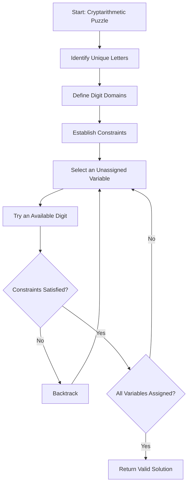

# 🔢 Cryptarithmetic Problem in Artificial Intelligence

### AI Vault | Chapter 11 — Constraint Satisfaction, Backtracking & Logical Reasoning

[](https://github.com/ranjiGT/primitive-ai)


[](https://github.com/ranjiGT/primitive-ai/blob/main/LICENSE)

Welcome to the **Cryptarithmetic Problem** chapter of [Primitive AI](https://github.com/ranjiGT/primitive-ai)!

Cryptarithmetic is a mathematical puzzle in which letters represent digits. The objective is to assign a unique digit to each letter so that the resulting arithmetic equation is correct.

In Artificial Intelligence, cryptarithmetic is a classic example of a **Constraint Satisfaction Problem (CSP)**.

It demonstrates how intelligent systems can solve complex problems using search algorithms, logical constraints, backtracking, and heuristic reasoning.

## 🎯 Learning Objectives

By the end of this chapter, you will understand:

- What cryptarithmetic problems are.
- Why cryptarithmetic is considered a CSP.
- How to represent variables, domains, and constraints.
- How to solve SEND + MORE = MONEY.
- How column-wise arithmetic and carries restrict possible assignments.
- How backtracking search works.
- How constraint propagation and heuristics improve search.
- How to implement a cryptarithmetic solver in Python.
- How these techniques relate to real-world AI applications.

---

## 🎨 1. Cryptarithmetic — Visual Explanation

<div align="center">


*Figure 1: Cartoon-style infographic illustrating cryptarithmetic puzzles, constraint satisfaction, the SEND + MORE = MONEY solution, column-wise reasoning, backtracking, and AI applications.*

</div>

The infographic illustrates how an AI system transforms a letter-based arithmetic puzzle into a structured constraint satisfaction problem.

---

## 🧠 2. What Is Cryptarithmetic?

Cryptarithmetic, also known as an **alphametic puzzle**, is a mathematical problem in which letters are substituted for numerical digits.

Each distinct letter represents exactly one digit, and the same letter must represent the same digit throughout the equation.

### Example

```text
    S E N D
  + M O R E
  ---------
  M O N E Y
```

The goal is to find digits for the letters:

```text
S, E, N, D, M, O, R, Y
```

such that the addition is mathematically correct.

### Fundamental Rules

1. Every distinct letter represents a unique digit.
2. Digits range from 0 to 9.
3. The same letter always represents the same digit.
4. Different letters cannot represent the same digit.
5. Leading letters cannot be assigned zero.
6. The resulting arithmetic equation must be valid.

---

## 🧩 3. Why Is Cryptarithmetic Important in AI?

Cryptarithmetic demonstrates several fundamental Artificial Intelligence concepts.

| AI Concept | Role in Cryptarithmetic |
|---|---|
| Constraint Satisfaction | Assign digits while satisfying rules |
| State-Space Search | Explore possible digit assignments |
| Backtracking | Undo assignments that violate constraints |
| Constraint Propagation | Eliminate impossible values early |
| Heuristics | Choose promising variables and values |
| Logical Reasoning | Derive restrictions from arithmetic |
| Optimization | Reduce unnecessary search |

Unlike unrestricted brute-force search, an intelligent CSP solver uses constraints to eliminate invalid possibilities.

---

## 📘 4. Classic Example: SEND + MORE = MONEY

Consider:

```text
      S E N D
    + M O R E
    ---------
    M O N E Y
```

There are eight distinct letters:

\[
\{S,E,N,D,M,O,R,Y\}
\]

Each letter must be assigned a different digit.

### Correct Solution

| Letter | Digit |
|---|---|
| S | 9 |
| E | 5 |
| N | 6 |
| D | 7 |
| M | 1 |
| O | 0 |
| R | 8 |
| Y | 2 |

Substituting the digits:

```text
      9 5 6 7
    + 1 0 8 5
    ---------
    1 0 6 5 2
```

Therefore:

\[
9567 + 1085 = 10652
\]

The equation is mathematically correct, and every distinct letter has a unique digit.

---

## ⚙️ 5. Cryptarithmetic as a Constraint Satisfaction Problem

A Constraint Satisfaction Problem consists of three main components:

\[
CSP = (X,D,C)
\]

Where:

- \(X\) represents variables.
- \(D\) represents domains.
- \(C\) represents constraints.

### Variables

\[
X = \{S,E,N,D,M,O,R,Y\}
\]

### Domains

Every variable initially has the domain:

\[
D_i = \{0,1,2,3,4,5,6,7,8,9\}
\]

### Constraints

**Constraint 1 — All digits must be different**

\[
AllDifferent(S,E,N,D,M,O,R,Y)
\]

**Constraint 2 — Leading digits cannot be zero**

\[
S \neq 0,\quad M \neq 0
\]

**Constraint 3 — Arithmetic equality**

\[
SEND + MORE = MONEY
\]

Expanding the numbers:

\[
1000S+100E+10N+D
\]

\[
+1000M+100O+10R+E
\]

\[
=10000M+1000O+100N+10E+Y
\]

The solver must find assignments satisfying all these constraints simultaneously.

---

## 🧮 6. Column-Wise Reasoning and Carries

Rather than guessing every digit combination, we can analyze the addition column by column.

Let \(c_1,c_2,c_3,c_4\) represent the carries from right to left.

### Units Column

\[
D+E=Y+10c_1
\]

### Tens Column

\[
N+R+c_1=E+10c_2
\]

### Hundreds Column

\[
E+O+c_2=N+10c_3
\]

### Thousands Column

\[
S+M+c_3=O+10c_4
\]

### Ten-Thousands Column

\[
c_4=M
\]

Each carry is either 0 or 1.

Since two four-digit numbers produce a five-digit result, the leading carry is 1:

\[
M=1
\]

Further reasoning establishes:

\[
O=0
\]

These deductions significantly reduce the number of possible assignments.

### Verify the Solution

| Column | Calculation | Result |
|---|---|---|
| Units | 7 + 5 = 12 | Y = 2, carry 1 |
| Tens | 6 + 8 + 1 = 15 | E = 5, carry 1 |
| Hundreds | 5 + 0 + 1 = 6 | N = 6, carry 0 |
| Thousands | 9 + 1 + 0 = 10 | O = 0, carry 1 |
| Ten-Thousands | Carry = 1 | M = 1 |

Every column satisfies the arithmetic constraints.

---

## 🔄 7. How AI Solves Cryptarithmetic Problems

A typical constraint-based search algorithm follows this process:



### Algorithm Explanation

**Step 1:** Identify all unique letters.

**Step 2:** Assign possible digit domains.

**Step 3:** Apply leading-zero and uniqueness constraints.

**Step 4:** Select an unassigned variable.

**Step 5:** Try an available digit.

**Step 6:** Check whether the assignment remains consistent.

**Step 7:** Backtrack when a constraint is violated.

**Step 8:** Continue until a complete valid assignment is found.

---

## 🔍 8. Backtracking Search

Backtracking is a depth-first search technique that constructs a solution incrementally.

Whenever a partial assignment violates a constraint, the algorithm abandons that branch and tries another possibility.

### Example

```text
Start
 |
 M = 1
 |
 S = 9
 |
 E = 5
 |
 +-- N = 4 --> Invalid branch
 |
 +-- N = 6
      |
      O = 0
      |
      R = 8
      |
      D = 7
      |
      Y = 2
      |
      Valid Solution
```

This is an illustrative search path, not a complete trace of all assignments examined by a solver.

### Why Backtracking Helps

- Avoids exploring already-invalid branches.
- Reduces unnecessary computation.
- Supports incremental constraint checking.
- Can be combined with heuristics and propagation.
- Finds valid assignments systematically.

---

## 🐍 9. Python Implementation — Cryptarithmetic Solver

The following Python program solves the classic SEND + MORE = MONEY puzzle using digit permutations.

```python
from itertools import permutations


def solve_cryptarithmetic():
    digits = range(10)

    letters = "SENDMORY"

    solutions = []

    for values in permutations(digits, len(letters)):
        assignment = dict(zip(letters, values))

        S = assignment["S"]
        E = assignment["E"]
        N = assignment["N"]
        D = assignment["D"]
        M = assignment["M"]
        O = assignment["O"]
        R = assignment["R"]
        Y = assignment["Y"]

        # Leading digits cannot be zero
        if S == 0 or M == 0:
            continue

        send = 1000*S + 100*E + 10*N + D
        more = 1000*M + 100*O + 10*R + E
        money = 10000*M + 1000*O + 100*N + 10*E + Y

        if send + more == money:
            solutions.append((assignment, send, more, money))

    return solutions


solutions = solve_cryptarithmetic()

for assignment, send, more, money in solutions:
    print("Assignment:", assignment)
    print(f"{send} + {more} = {money}")
```

### Expected Result

```text
9567 + 1085 = 10652
```

### How It Works

The program:

1. Generates permutations of digits for the eight unique letters.
2. Maps each letter to a distinct digit.
3. Rejects assignments with leading zeros.
4. Converts the letter sequences into numbers.
5. Checks the arithmetic equality.
6. Returns valid assignments.

**Note:** This implementation uses exhaustive permutation search with basic constraint checks. It is not an optimized CSP backtracking solver.

---

## 🚀 10. Improving Search Efficiency

An AI solver can perform much better by applying constraints before exploring all possible assignments.

### Constraint Propagation

Constraint propagation removes values from variable domains when they cannot participate in a valid solution.

For example, column-wise reasoning establishes that:

\[
M=1
\]

This allows the solver to avoid trying other digits for M.

### Minimum Remaining Values (MRV)

MRV selects the variable with the fewest legal values remaining.

This is also called the **fail-first heuristic**.

### Degree Heuristic

The degree heuristic prioritizes variables involved in the largest number of constraints on other unassigned variables.

### Least Constraining Value (LCV)

LCV prefers values that eliminate the fewest choices for other variables.

### Forward Checking

Forward checking removes inconsistent values from neighboring unassigned variables after each assignment.

### Comparison

| Technique | Purpose |
|---|---|
| Brute Force | Explore complete assignments |
| Backtracking | Abandon invalid partial assignments |
| Forward Checking | Detect some future conflicts early |
| Constraint Propagation | Reduce domains using constraints |
| MRV | Select the most constrained variable |
| Degree Heuristic | Prioritize highly connected variables |
| LCV | Preserve flexibility for remaining variables |

---

## 🧠 11. Cryptarithmetic and State-Space Search

Cryptarithmetic can also be modeled as a state-space search problem.

### Initial State

No letters have assigned digits.

### State

A partial mapping of letters to digits.

For example:

```python
{
    "M": 1,
    "O": 0,
    "S": 9
}
```

### Actions

Assign an unused digit to an unassigned letter.

### Goal Test

Verify that:

- Every letter has a digit.
- All digits are distinct.
- Leading digits are nonzero.
- The arithmetic equation is satisfied.

### Search Strategy

Possible strategies include:

- Depth-First Search
- Backtracking Search
- Constraint-Based Search
- Heuristic-Guided Search

For this problem, CSP-based backtracking with propagation is generally more appropriate than uninformed search.

---

## 🌍 12. Applications in Artificial Intelligence

Cryptarithmetic is primarily an educational benchmark, but the underlying techniques are useful in real-world applications.

| Application | Related AI Technique |
|---|---|
| Timetable Scheduling | Constraint Satisfaction |
| Employee Scheduling | Variable Assignment |
| Resource Allocation | Constraint Optimization |
| Sudoku Solving | Backtracking and Propagation |
| Configuration Systems | Constraint Checking |
| Circuit Design | Logical Constraints |
| Planning | Search and Constraint Reasoning |
| Verification | Consistency Checking |

The central idea is the same: find assignments that satisfy a collection of rules.

---

## ⚠️ 13. Common Mistakes

### Mistake 1: Reusing Digits

Different letters must not share the same digit.

### Mistake 2: Allowing Leading Zeros

For SEND + MORE = MONEY:

\[
S \neq 0,\quad M \neq 0
\]

### Mistake 3: Ignoring Carries

Each arithmetic column must account for carries from the previous column.

### Mistake 4: Checking Only the Final Equation

An implementation must also enforce letter uniqueness and leading-zero constraints.

### Mistake 5: Confusing Brute Force with CSP Search

Exhaustive search can solve the puzzle, but CSP algorithms can eliminate many invalid assignments before reaching complete solutions.

---

## 🎓 14. Learning Outcomes

After completing this chapter, you should be able to:

- [ ] Define cryptarithmetic.
- [ ] Explain the rules of an alphametic puzzle.
- [ ] Represent cryptarithmetic as a CSP.
- [ ] Identify variables, domains, and constraints.
- [ ] Solve SEND + MORE = MONEY.
- [ ] Explain column-wise carry constraints.
- [ ] Describe backtracking search.
- [ ] Implement a Python solver.
- [ ] Explain constraint propagation.
- [ ] Compare brute force with CSP techniques.
- [ ] Identify practical applications of constraint satisfaction.

---

## 📝 15. Practice Questions

1. What is a cryptarithmetic problem?
2. Why is cryptarithmetic considered a CSP?
3. What are variables and domains?
4. Why must different letters have different digits?
5. Why are leading zeros prohibited?
6. How are carries represented in the SEND + MORE = MONEY puzzle?
7. What is backtracking?
8. How does constraint propagation improve search?
9. What is the MRV heuristic?
10. How does forward checking work?
11. What is the difference between brute-force search and CSP-based search?
12. Where are constraint satisfaction techniques used in real-world AI?

---

## 🧪 16. Hands-On Exercises

### Beginner

Solve:

```text
  A
+ A
---
  B
```

Find at least three valid assignments where A and B represent different digits.

### Intermediate

Solve the classic puzzle:

```text
    T W O
  + T W O
  -------
  F O U R
```

Ensure that each distinct letter receives a unique digit.

### Advanced

Modify the Python program to:

1. Use recursive backtracking.
2. Reject partial assignments violating column constraints.
3. Implement forward checking.
4. Add an MRV variable-selection heuristic.
5. Count the number of explored assignments.
6. Compare execution times with the brute-force solver.

### Research Challenge

Investigate how constraint programming libraries such as Google's OR-Tools can solve alphametic puzzles using CP-SAT.

---

## 📚 17. Learning Resources

| Resource | Description |
|---|---|
| [🎨 Cryptarithmetic Infographic](./Cryptarithmetic%20Problem%20in%20AI.png) | Cartoon-style visual explanation |
| [📚 AI Vault](../) | Complete AI learning collection |
| [🏠 Primitive AI](../../) | Main repository |
| [Google OR-Tools](https://developers.google.com/optimization) | Constraint programming and optimization |
| [Python itertools](https://docs.python.org/3/library/itertools.html) | Permutations and combinatorial tools |
| [AIMA — Artificial Intelligence: A Modern Approach](https://aima.cs.berkeley.edu/) | AI search and CSP foundations |

---

## 💡 18. Key Takeaways

> Cryptarithmetic demonstrates how Artificial Intelligence can solve mathematical puzzles by combining logical constraints with systematic search.

Remember:

**Variables → Letters representing unknown digits**

**Domains → Possible digits from 0 to 9**

**Constraints → Rules that assignments must satisfy**

**Backtracking → Undo invalid choices**

**Constraint Propagation → Eliminate impossible values early**

**Heuristics → Improve the order of search**

**Goal → Find a complete, consistent digit assignment**

The classic solution is:

\[
\boxed{9567+1085=10652}
\]

Cryptarithmetic provides a practical introduction to constraint satisfaction, combinatorial search, and logical reasoning in Artificial Intelligence.

---

## 🚀 19. What's Next?

Recommended topics for further learning:

1. Constraint Satisfaction Problems
2. Backtracking Search
3. Forward Checking
4. Constraint Propagation
5. Minimum Remaining Values
6. Graph Coloring Problems
7. Sudoku as a CSP
8. N-Queens Problem
9. Heuristic Search
10. Constraint Optimization

---

## ⭐ Support Primitive AI

If this chapter helps you understand Artificial Intelligence, consider supporting the project.

**[⭐ Star Primitive AI on GitHub](https://github.com/ranjiGT/primitive-ai)**

Contributions, corrections, educational examples, and improvements are welcome.

**Learn • Explore • Build • Share**

Made for curious minds and lifelong learners.
