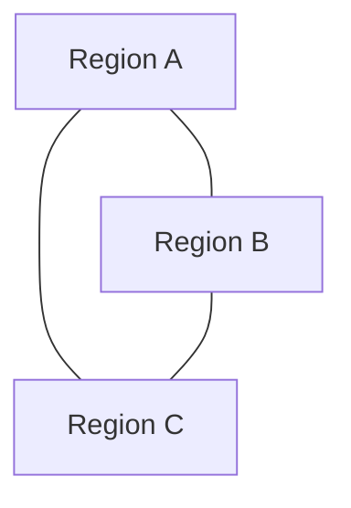
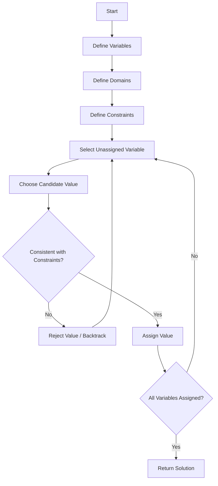
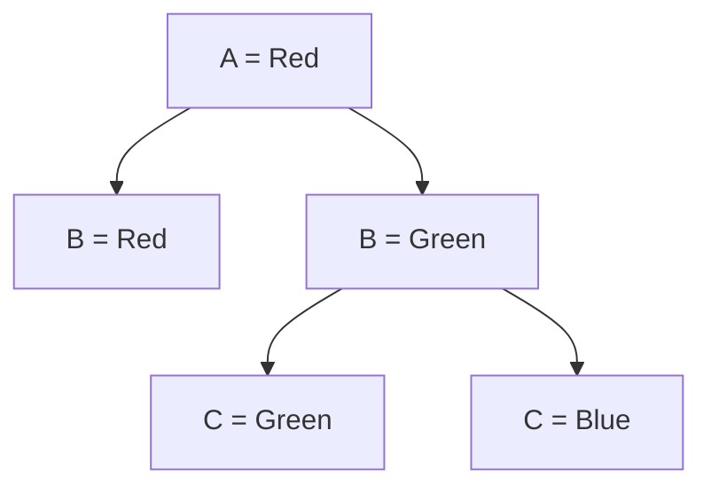

# 🧩 Constraint Satisfaction Problem (CSP) in Artificial Intelligence

### AI Vault | Chapter 31 — Variables, Domains, Constraints & Intelligent Search

[](https://github.com/ranjiGT/primitive-ai)


[](https://github.com/ranjiGT/primitive-ai/blob/main/LICENSE)

Welcome to the **Constraint Satisfaction Problem (CSP)** chapter of [Primitive AI](https://github.com/ranjiGT/primitive-ai)!

A Constraint Satisfaction Problem is a mathematical framework used in Artificial Intelligence to solve problems by assigning values to variables while satisfying a collection of rules or restrictions.

CSPs are widely used in scheduling, planning, resource allocation, configuration, logical reasoning, and puzzle solving.

The fundamental objective is simple:

> Find an assignment of values to variables such that every specified constraint is satisfied.

This chapter explores how AI systems represent CSPs, solve them using backtracking, and improve search efficiency through heuristics and constraint propagation.

---

## 🎯 1. Learning Objectives

By the end of this chapter, you will understand:

- What a Constraint Satisfaction Problem is.
- How variables, domains, and constraints define a CSP.
- How to formulate real-world problems as CSPs.
- How map coloring and Sudoku illustrate constraint satisfaction.
- How backtracking search works.
- How Minimum Remaining Values (MRV), Degree Heuristic, and Least Constraining Value (LCV) improve search.
- How forward checking and constraint propagation reduce search complexity.
- How to implement a CSP solver using Python.
- How CSPs differ from conventional state-space search.
- Where CSP techniques are used in real-world AI applications.

---

## 🎨 2. CSP — Visual Explanation

<div align="center">


*Figure 1: Cartoon-style infographic explaining CSP fundamentals, mathematical representation, map coloring, Sudoku, backtracking, heuristics, constraint propagation, and AI applications.*

</div>

The infographic illustrates how an AI system identifies variables, assigns possible values, checks constraints, and systematically searches for a consistent solution.

---

## 🧠 3. What Is a Constraint Satisfaction Problem?

A **Constraint Satisfaction Problem (CSP)** is a problem in which we must assign values to a collection of variables while ensuring that all specified constraints are satisfied.

### Simple Example

Imagine three neighboring regions:

```text
Region A
Region B
Region C
```

Each region must receive one of three colors:

```text
Red
Green
Blue
```

The rule is:

**Neighboring regions must have different colors.**

A valid assignment could be:

```text
A = Red
B = Green
C = Blue
```

If all three regions are pairwise adjacent, this assignment satisfies the constraints.

### Core Idea

A CSP is not simply about finding any assignment.

It is about finding a **consistent assignment** that satisfies all constraints.

---

## 🧮 4. Mathematical Formulation

A CSP is commonly represented as:

\[
CSP = (X,D,C)
\]

Where:

| Symbol | Component | Description |
|---|---|---|
| X | Variables | Unknown quantities to assign |
| D | Domains | Possible values for each variable |
| C | Constraints | Rules restricting valid assignments |

### Variables

Let:

\[
X = \{X_1,X_2,\ldots,X_n\}
\]

Each variable represents a decision that must be made.

### Domains

Each variable \(X_i\) has a domain:

\[
D_i = \{v_1,v_2,\ldots,v_k\}
\]

A domain contains the values that can be assigned to that variable.

### Constraints

Constraints specify which combinations of variable assignments are permitted.

For example:

\[
X_1 \neq X_2
\]

This means that the two variables must receive different values.

### Goal

Find a complete assignment:

\[
A = \{X_1=v_1,X_2=v_2,\ldots,X_n=v_n\}
\]

such that:

\[
\forall c \in C,\quad c(A)=True
\]

Every constraint must evaluate to true.

---

## 🗺️ 5. Example 1 — Map Coloring Problem

Map coloring is one of the most widely used introductory CSP examples.

### Problem Statement

Suppose three regions A, B, and C are pairwise adjacent.

We must color them using:

\[
D = \{Red,Green,Blue\}
\]

### Variables

\[
X = \{A,B,C\}
\]

### Domains

\[
D_A=D_B=D_C=\{Red,Green,Blue\}
\]

### Constraints

\[
A \neq B
\]

\[
A \neq C
\]

\[
B \neq C
\]

### Valid Solution

```text
A = Red
B = Green
C = Blue
```

### Invalid Solution

```text
A = Red
B = Red
C = Blue
```

The invalid assignment violates:

\[
A \neq B
\]

### Constraint Graph



Each edge represents a constraint requiring the connected regions to have different colors.

---

## 🔢 6. Example 2 — Sudoku as a CSP

Sudoku is another classic Constraint Satisfaction Problem.

A standard Sudoku puzzle contains a 9 × 9 grid.

### Variables

Each empty cell represents a variable.

\[
X_{ij}
\]

Where:

- \(i\) represents the row.
- \(j\) represents the column.

### Domains

Each unfilled cell initially has a domain drawn from:

\[
D_{ij} \subseteq \{1,2,3,4,5,6,7,8,9\}
\]

### Constraints

A valid Sudoku solution must satisfy:

1. Every row contains the digits 1–9 exactly once.
2. Every column contains the digits 1–9 exactly once.
3. Every 3 × 3 subgrid contains the digits 1–9 exactly once.
4. Every originally provided digit remains unchanged.

### Example

```text
5 3 . | . 7 . | . . .
6 . . | 1 9 5 | . . .
. 9 8 | . . . | . 6 .
------+-------+------
8 . . | . 6 . | . . 3
4 . . | 8 . 3 | . . 1
7 . . | . 2 . | . . 6
------+-------+------
. 6 . | . . . | 2 8 .
. . . | 4 1 9 | . . 5
. . . | . 8 . | . 7 9
```

The AI solver searches for a complete assignment that satisfies every Sudoku constraint.

---

## 🔄 7. How AI Solves a CSP

A typical CSP-solving process follows these steps:



### Explanation

**Step 1:** Identify the decision variables.

**Step 2:** Define the domain for each variable.

**Step 3:** Establish the constraints.

**Step 4:** Select an unassigned variable.

**Step 5:** Try a value from its domain.

**Step 6:** Check consistency with existing assignments.

**Step 7:** Reject invalid assignments and backtrack when necessary.

**Step 8:** Continue until a complete valid assignment is found.

---

## 🌳 8. Backtracking Search

Backtracking is a depth-first search technique that builds an assignment incrementally.

Whenever an assignment violates a constraint, the algorithm undoes that assignment and explores another possibility.

### Example

Consider map coloring:

```text
A = Red
```

Next, assign B.

```text
B = Red    ❌ Invalid
B = Green  ✅ Valid
```

Next, assign C.

```text
C = Green  ❌ Invalid
C = Blue   ✅ Valid
```

Final assignment:

```text
A = Red
B = Green
C = Blue
```

### Search Tree



The branch where B = Red is rejected because it conflicts with A.

The branch where C = Green is rejected because it conflicts with B.

The remaining assignment is valid.

---

## 🐍 9. Python Implementation — CSP Map Coloring Solver

The following implementation demonstrates recursive backtracking.

```python
def solve_csp(variables, domains, neighbors):
    assignment = {}

    def is_consistent(variable, value):
        for neighbor in neighbors[variable]:
            if (
                neighbor in assignment
                and assignment[neighbor] == value
            ):
                return False

        return True

    def backtrack():
        if len(assignment) == len(variables):
            return assignment.copy()

        variable = next(
            var for var in variables
            if var not in assignment
        )

        for value in domains[variable]:
            if is_consistent(variable, value):
                assignment[variable] = value

                result = backtrack()

                if result is not None:
                    return result

                del assignment[variable]

        return None

    return backtrack()


variables = ["A", "B", "C"]

domains = {
    "A": ["Red", "Green", "Blue"],
    "B": ["Red", "Green", "Blue"],
    "C": ["Red", "Green", "Blue"]
}

neighbors = {
    "A": ["B", "C"],
    "B": ["A", "C"],
    "C": ["A", "B"]
}

solution = solve_csp(
    variables,
    domains,
    neighbors
)

print("CSP Solution:", solution)
```

### Expected Output

```text
CSP Solution: {
    'A': 'Red',
    'B': 'Green',
    'C': 'Blue'
}
```

### Explanation

The solver:

1. Creates an initially empty assignment.
2. Selects an unassigned variable.
3. Tries available colors.
4. Checks whether adjacent regions already use that color.
5. Recursively assigns remaining variables.
6. Backtracks when no valid value is available.
7. Returns the first complete consistent assignment.

This implementation is designed specifically for graph coloring with inequality constraints.

---

## 🚀 10. Heuristics for Efficient CSP Search

Basic backtracking can be expensive for large problems.

AI systems use heuristics to reduce the search space.

### Minimum Remaining Values (MRV)

MRV selects the variable with the fewest remaining legal values.

It is also called the **fail-first heuristic**.

For example:

```text
Variable A: {Red, Green, Blue}
Variable B: {Green}
Variable C: {Red, Blue}
```

MRV selects B because it has only one possible value.

### Degree Heuristic

The degree heuristic selects the variable involved in the greatest number of constraints with other unassigned variables.

It is often used to break ties between variables with equal MRV scores.

### Least Constraining Value (LCV)

LCV chooses the value that eliminates the fewest possibilities for neighboring unassigned variables.

### Comparison

| Heuristic | Strategy | Purpose |
|---|---|---|
| MRV | Fewest legal values first | Detect failure early |
| Degree | Most constraints on remaining variables | Prioritize influential variables |
| LCV | Least restrictive value first | Preserve future choices |

---

## 🔍 11. Constraint Propagation

Constraint propagation reduces variable domains by using information from constraints.

Instead of waiting for a complete assignment, the solver removes values that cannot participate in a valid solution.

### Example

Suppose:

```text
A = Red
```

And:

```text
A ≠ B
```

Then B cannot be Red.

Before propagation:

```text
B = {Red, Green, Blue}
```

After propagation:

```text
B = {Green, Blue}
```

This reduces the number of possible assignments.

### Forward Checking

Forward checking removes values from neighboring unassigned variables that conflict with a newly assigned value.

### Arc Consistency

A binary constraint is arc-consistent from variable X to variable Y if every value in X's domain has at least one compatible value in Y's domain.

### AC-3 Algorithm

AC-3 repeatedly revises variable domains until no further values can be removed or an inconsistency is detected.

Constraint propagation can greatly reduce search effort, although it does not always solve the entire CSP without search.

---

## ⚙️ 12. Types of Constraint Satisfaction Problems

CSPs can be classified in several ways.

| Type | Description | Example |
|---|---|---|
| Binary CSP | Constraints involve two variables | Map coloring |
| Non-Binary CSP | Constraints involve three or more variables | Scheduling |
| Discrete CSP | Variables have discrete domains | Sudoku |
| Continuous CSP | Variables have continuous domains | Geometric constraints |
| Weighted CSP | Constraint violations have costs | Preference-based scheduling |
| Constraint Optimization | Finds the best feasible assignment | Resource allocation |

### Hard Constraints

Hard constraints must always be satisfied.

Example:

```text
Two exams cannot use the same room at the same time.
```

### Soft Constraints

Soft constraints represent preferences that may be violated at a cost.

Example:

```text
Prefer scheduling classes in the morning.
```

A traditional CSP seeks a feasible assignment satisfying all hard constraints.

A constraint optimization problem additionally considers objectives or preferences.

---

## 🆚 13. CSP vs Traditional Search Problems

| Feature | Traditional Search | CSP |
|---|---|---|
| State Representation | General states | Variable assignments |
| Actions | State transitions | Assign variable values |
| Goal | Reach a goal state | Satisfy all constraints |
| Main Focus | Paths through a state space | Consistent assignments |
| Common Algorithms | BFS, DFS, A* | Backtracking, AC-3, Min-Conflicts |
| Heuristics | Path or state estimates | Variable and value ordering |

CSPs exploit the structure of variables and constraints to search more efficiently than treating every assignment as an unrelated state.

---

## 🌍 14. Applications of CSP in Artificial Intelligence

| Application | CSP Role |
|---|---|
| Exam Scheduling | Assign exams to rooms and times |
| Employee Rostering | Assign staff to shifts |
| Resource Allocation | Assign limited resources to tasks |
| Network Configuration | Select compatible settings |
| Product Configuration | Choose compatible components |
| Robotics | Solve geometric or planning constraints |
| Sudoku | Assign digits consistently |
| Map Coloring | Assign colors to adjacent regions |
| Cryptarithmetic | Assign unique digits to letters |
| Timetabling | Assign classes, teachers, and rooms |

These problems share a common structure: decisions must be made while respecting restrictions.

---

## ⚠️ 15. Common Mistakes in CSP

### Mistake 1: Ignoring Constraints

A complete assignment is not necessarily a valid solution.

Every constraint must be satisfied.

### Mistake 2: Incorrect Domain Definition

If a domain excludes a required value, a valid solution may become impossible.

### Mistake 3: Incomplete Backtracking

Failing to undo assignments correctly can produce incorrect search behavior.

### Mistake 4: Applying Heuristics Incorrectly

MRV, Degree, and LCV guide search ordering. They do not replace constraint checking.

### Mistake 5: Assuming Propagation Always Solves the Problem

Constraint propagation can reduce domains but may still leave multiple possibilities requiring search.

### Mistake 6: Confusing Feasibility with Optimization

A standard CSP asks whether a satisfying assignment exists.

Optimization additionally seeks the best assignment according to an objective.

---

## 🎓 16. Learning Outcomes

After completing this chapter, you should be able to:

- [ ] Define a Constraint Satisfaction Problem.
- [ ] Explain variables, domains, and constraints.
- [ ] Formulate a map coloring problem as a CSP.
- [ ] Explain Sudoku as a CSP.
- [ ] Describe recursive backtracking.
- [ ] Implement a basic CSP solver in Python.
- [ ] Explain the MRV heuristic.
- [ ] Explain the Degree heuristic.
- [ ] Explain Least Constraining Value.
- [ ] Describe forward checking.
- [ ] Explain arc consistency.
- [ ] Identify real-world CSP applications.
- [ ] Distinguish CSPs from constraint optimization problems.

---

## 📝 17. Practice Questions

1. What is a Constraint Satisfaction Problem?
2. What are the three main components of a CSP?
3. What is a variable domain?
4. What is the difference between unary and binary constraints?
5. Why is map coloring considered a CSP?
6. How can Sudoku be represented as a CSP?
7. What is backtracking search?
8. Why is MRV called the fail-first heuristic?
9. What is the purpose of the Degree heuristic?
10. How does LCV improve search?
11. What is constraint propagation?
12. How does forward checking differ from arc consistency?
13. What is the AC-3 algorithm?
14. What is the difference between hard and soft constraints?
15. How do CSPs support scheduling and resource allocation?

---

## 🧪 18. Hands-On Exercises

### Beginner — Map Coloring

Create a CSP with four regions:

```text
A, B, C, D
```

Use three colors:

```text
Red, Green, Blue
```

Define adjacency constraints and find a valid coloring.

### Intermediate — N-Queens Problem

Represent the 4-Queens problem as a CSP.

Variables represent queens' column positions.

Constraints prevent queens from sharing rows or diagonals.

### Advanced — Improve the Python Solver

Extend the map coloring solver to:

1. Use MRV variable selection.
2. Use Degree heuristic tie-breaking.
3. Implement LCV ordering.
4. Add forward checking.
5. Count explored search nodes.
6. Compare performance against basic backtracking.

### Research Challenge

Investigate how Google's OR-Tools CP-SAT solver handles scheduling and constraint optimization problems.

Explain how modern constraint solvers combine propagation, search, and optimization.

---

## 📚 19. Learning Resources

| Resource | Description |
|---|---|
| [🎨 CSP Infographic](./Constraint%20Satisfaction%20Problem%20in%20AI.png) | Cartoon-style visual explanation |
| [📚 AI Vault](../) | Complete AI learning collection |
| [🏠 Primitive AI](../../) | Main repository |
| [Google OR-Tools](https://developers.google.com/optimization) | Constraint programming and optimization |
| [Python Documentation](https://docs.python.org/3/) | Python programming reference |
| [AIMA — Artificial Intelligence: A Modern Approach](https://aima.cs.berkeley.edu/) | AI search and CSP foundations |

---

## 💡 20. Key Takeaways

> A Constraint Satisfaction Problem is a mathematical framework for finding assignments to variables that satisfy a collection of constraints.

Remember:

**Variables → What needs to be assigned**

**Domains → Possible values**

**Constraints → Rules restricting assignments**

**Backtracking → Undo inconsistent choices**

**MRV → Select the most constrained variable**

**Degree Heuristic → Prioritize highly connected variables**

**LCV → Preserve future choices**

**Forward Checking → Eliminate immediate conflicts**

**Arc Consistency → Remove unsupported domain values**

**Goal → Find a complete consistent assignment**

CSPs are a foundational approach to solving structured combinatorial problems in Artificial Intelligence.

---

## 🚀 21. What's Next?

Recommended topics for further learning:

1. Backtracking Search in AI
2. Forward Checking
3. Arc Consistency and AC-3
4. Minimum Remaining Values
5. Degree Heuristic
6. Least Constraining Value
7. N-Queens Problem
8. Graph Coloring
9. Min-Conflicts Algorithm
10. Constraint Optimization

---

## ⭐ Support Primitive AI

If this chapter helps you understand Artificial Intelligence, consider supporting the project.

**[⭐ Star Primitive AI on GitHub](https://github.com/ranjiGT/primitive-ai)**

Contributions, corrections, educational examples, and improvements are welcome.

**Learn • Explore • Build • Share**

Made for curious minds and lifelong learners.
