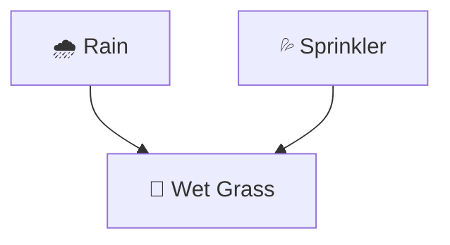
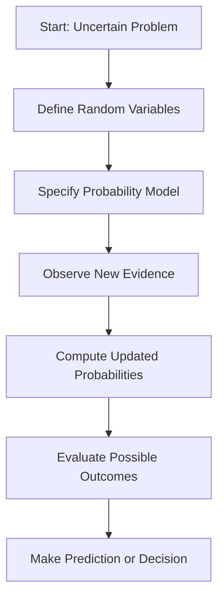

# 🎲 Probabilistic Reasoning in Artificial Intelligence

### AI Vault | Chapter 32 — Reasoning Under Uncertainty, Bayesian Inference & Probabilistic Models

[](https://github.com/ranjiGT/primitive-ai)


[](https://github.com/ranjiGT/primitive-ai/blob/main/LICENSE)

Welcome to the **Probabilistic Reasoning** chapter of [Primitive AI](https://github.com/ranjiGT/primitive-ai)!

In real-world environments, Artificial Intelligence systems rarely have complete or perfectly reliable information.

A medical diagnosis may be uncertain, weather forecasts may change, and autonomous vehicles must interpret noisy sensor measurements.

**Probabilistic reasoning enables AI systems to represent uncertainty mathematically, update beliefs using evidence, and make informed predictions and decisions.**

This chapter introduces probability theory, conditional probability, Bayes' theorem, Bayesian networks, and practical probabilistic inference.

---

## 🎯 1. Learning Objectives

By the end of this chapter, you will understand:

- What probabilistic reasoning means in Artificial Intelligence.
- Why uncertainty is important in intelligent systems.
- How probabilities represent uncertain events.
- The difference between prior and posterior probabilities.
- Conditional probability and statistical independence.
- Bayes' theorem and Bayesian inference.
- How Bayesian networks represent probabilistic dependencies.
- How to calculate probabilities using real examples.
- How to implement Bayesian inference in Python.
- How probabilistic reasoning differs from deterministic reasoning.
- Where probabilistic reasoning is applied in real-world AI systems.

---

## 🎨 2. Probabilistic Reasoning — Visual Explanation

<div align="center">


*Figure 1: Cartoon-style infographic illustrating probabilistic reasoning, Bayes' theorem, Bayesian networks, conditional probability, weather inference, Python examples, and real-world AI applications.*

</div>

The infographic demonstrates how an AI system can reason about uncertain situations, incorporate new evidence, and update its predictions.

---

## 🧠 3. What Is Probabilistic Reasoning?

**Probabilistic reasoning** is an approach in Artificial Intelligence that uses probability theory to represent uncertainty and reason about events whose outcomes are not known with certainty.

Unlike classical logic, which commonly evaluates propositions as true or false, probabilistic reasoning assigns probabilities to possible outcomes.

### Example: Weather Prediction

Suppose an AI weather forecasting system predicts:

\[
P(Rain)=0.7
\]

This means the estimated probability of rain is 70%.

The system may recommend carrying an umbrella, depending on the costs and benefits of doing so.

### Fundamental Principle

\[
0 \leq P(A) \leq 1
\]

Where:

- \(P(A)=0\): Event A is impossible under the model.
- \(P(A)=1\): Event A is certain under the model.
- \(0<P(A)<1\): Event A is uncertain.

Probabilities provide a mathematical foundation for reasoning about incomplete or uncertain information.

---

## ❓ 4. Why Does AI Need Probabilistic Reasoning?

Real-world environments contain many sources of uncertainty.

| Source of Uncertainty | Example |
|---|---|
| Incomplete Information | Missing medical test results |
| Noisy Data | Inaccurate sensor readings |
| Randomness | Weather variations |
| Ambiguity | Multiple meanings of a sentence |
| Hidden Variables | Unknown causes of observed symptoms |
| Model Uncertainty | Limited training data |

### Example

A patient experiences a fever.

Possible causes include:

- Influenza
- Other viral infections
- Bacterial infections
- Noninfectious conditions

The symptom alone does not determine the diagnosis.

Probabilistic reasoning allows an AI system to estimate how likely different explanations are given the available evidence.

---

## 📘 5. Fundamental Probability Concepts

### 5.1 Random Variable

A random variable represents a quantity or outcome whose value is uncertain.

Example:

\[
Weather \in \{Rain,Sunny,Cloudy\}
\]

### 5.2 Prior Probability

A prior probability represents a belief before considering new evidence.

Example:

\[
P(Flu)=0.1
\]

The prior probability of influenza is 10%.

### 5.3 Posterior Probability

A posterior probability represents an updated belief after observing evidence.

Example:

\[
P(Flu \mid Fever)
\]

This is the probability of influenza given that a patient has a fever.

### 5.4 Conditional Probability

Conditional probability describes the probability of one event given another event.

\[
P(A \mid B)=\frac{P(A \cap B)}{P(B)}
\]

Provided:

\[
P(B)>0
\]

### 5.5 Statistical Independence

Two events A and B are independent if:

\[
P(A \cap B)=P(A)P(B)
\]

Equivalently, when \(P(B)>0\):

\[
P(A \mid B)=P(A)
\]

Observing B does not change the probability of A.

---

## 🧮 6. Basic Probability Rules

| Rule | Formula |
|---|---|
| Complement | \(P(\neg A)=1-P(A)\) |
| Addition | \(P(A\cup B)=P(A)+P(B)-P(A\cap B)\) |
| Multiplication | \(P(A\cap B)=P(A\mid B)P(B)\) |
| Conditional Probability | \(P(A\mid B)=P(A\cap B)/P(B)\) |
| Independence | \(P(A\cap B)=P(A)P(B)\) |
| Total Probability | \(P(B)=\sum_i P(B\mid A_i)P(A_i)\) |

For the law of total probability, the events \(A_i\) must form a partition of the sample space.

These rules provide the mathematical foundation for probabilistic inference.

---

## 🔍 7. Bayes' Theorem

Bayes' theorem is one of the most important mathematical tools in probabilistic reasoning.

It describes how probabilities should be updated when new evidence becomes available.

### Mathematical Formula

\[
\boxed{P(A\mid B)=\frac{P(B\mid A)P(A)}{P(B)}}
\]

Where:

| Term | Meaning |
|---|---|
| \(P(A)\) | Prior probability |
| \(P(B\mid A)\) | Likelihood |
| \(P(B)\) | Evidence probability |
| \(P(A\mid B)\) | Posterior probability |

### Interpretation

**Posterior ∝ Likelihood × Prior**

Bayes' theorem combines existing beliefs with new evidence to calculate updated probabilities.

---

## 🏥 8. Worked Example — Medical Diagnosis

Suppose an AI system evaluates the probability of influenza based on a fever.

Assume the following hypothetical probabilities:

\[
P(Flu)=0.1
\]

\[
P(Fever\mid Flu)=0.9
\]

\[
P(Fever\mid \neg Flu)=0.2
\]

We want to calculate:

\[
P(Flu\mid Fever)
\]

### Step 1: Calculate the Probability of Fever

Using the law of total probability:

\[
P(Fever)=P(Fever\mid Flu)P(Flu)
\]

\[
+P(Fever\mid\neg Flu)P(\neg Flu)
\]

Substituting:

\[
P(Fever)=(0.9)(0.1)+(0.2)(0.9)
\]

\[
P(Fever)=0.09+0.18=0.27
\]

### Step 2: Apply Bayes' Theorem

\[
P(Flu\mid Fever)=\frac{0.9\times0.1}{0.27}
\]

\[
=\frac{0.09}{0.27}
\]

\[
\boxed{P(Flu\mid Fever)\approx0.3333}
\]

### Result

The posterior probability of influenza is approximately **33.33%**.

Although fever is common among patients with influenza, fever can also occur without influenza.

Therefore, observing fever does not imply that influenza is certain.

**Note:** These probabilities are illustrative, not clinical estimates or medical diagnostic guidance.

---

## 🌧️ 9. Worked Example — Weather Inference

Suppose an AI system observes wet grass and wants to determine whether it rained.

### Given

\[
P(Rain)=0.7
\]

\[
P(Wet\mid Rain)=0.9
\]

\[
P(Wet\mid\neg Rain)=0.2
\]

### Goal

Calculate:

\[
P(Rain\mid Wet)
\]

### Step 1: Calculate the Evidence Probability

\[
P(Wet)=0.9(0.7)+0.2(0.3)
\]

\[
P(Wet)=0.63+0.06=0.69
\]

### Step 2: Apply Bayes' Theorem

\[
P(Rain\mid Wet)=\frac{0.9(0.7)}{0.69}
\]

\[
=\frac{0.63}{0.69}
\]

\[
\boxed{P(Rain\mid Wet)\approx0.9130}
\]

### Interpretation

There is approximately a **91.30% probability that it rained**, given the observed wet grass and the assumed probabilities.

This illustrates how observing evidence can change an AI system's beliefs.

---

## 🕸️ 10. Bayesian Networks

A **Bayesian Network** is a probabilistic graphical model representing random variables and their conditional dependencies using a directed acyclic graph (DAG).

### Example: Rain, Sprinkler, and Wet Grass



### Components

**Nodes:** Random variables.

**Directed edges:** Direct probabilistic dependencies represented by the model.

**Conditional Probability Tables (CPTs):** Specify the probability distribution of each variable given its parents.

### Example Conditional Probability Table

| Rain | Sprinkler | P(Wet Grass = Yes) |
|---|---|---|
| Yes | Yes | 0.99 |
| Yes | No | 0.90 |
| No | Yes | 0.80 |
| No | No | 0.05 |

These values are hypothetical.

### Joint Probability Factorization

For this network:

\[
P(R,S,W)=P(R)P(S)P(W\mid R,S)
\]

This factorization assumes Rain and Sprinkler are independent root variables in the illustrated network.

Bayesian networks allow AI systems to represent complex probability distributions through smaller conditional distributions.

---

## 🔄 11. Probabilistic Inference Workflow

A typical probabilistic reasoning system follows this process:



### Step-by-Step Explanation

1. **Model:** Identify relevant variables and probability distributions.
2. **Observe:** Collect evidence from the environment.
3. **Infer:** Calculate posterior probabilities.
4. **Evaluate:** Compare possible outcomes.
5. **Decide:** Select an action using probabilities and relevant costs or utilities.
6. **Update:** Incorporate additional evidence when it becomes available.

Probabilistic inference estimates beliefs; decision-making may additionally require a utility or loss function.

---

## 🐍 12. Python Implementation — Bayesian Inference

The following Python example calculates the probability of influenza given fever.

```python
def bayes_theorem(prior, likelihood, false_positive_rate):
    """
    Calculate P(Hypothesis | Evidence).

    prior:
        P(Hypothesis)

    likelihood:
        P(Evidence | Hypothesis)

    false_positive_rate:
        P(Evidence | not Hypothesis)
    """

    evidence_probability = (
        likelihood * prior
        + false_positive_rate * (1 - prior)
    )

    if evidence_probability == 0:
        raise ValueError(
            "Evidence has zero probability."
        )

    posterior = (
        likelihood * prior
    ) / evidence_probability

    return posterior


p_flu = 0.1
p_fever_given_flu = 0.9
p_fever_given_no_flu = 0.2

result = bayes_theorem(
    p_flu,
    p_fever_given_flu,
    p_fever_given_no_flu
)

print(f"P(Flu | Fever) = {result:.4f}")
print(f"Probability = {result * 100:.2f}%")
```

### Expected Output

```text
P(Flu | Fever) = 0.3333
Probability = 33.33%
```

### Explanation

The program:

1. Defines the prior probability.
2. Defines the likelihood of observing evidence.
3. Defines the probability of the evidence without the hypothesis.
4. Calculates the total evidence probability.
5. Applies Bayes' theorem.
6. Returns the posterior probability.

---

## 🌦️ 13. Python Implementation — Weather Prediction

```python
def calculate_rain_probability():
    p_rain = 0.7
    p_wet_given_rain = 0.9
    p_wet_given_no_rain = 0.2

    p_wet = (
        p_wet_given_rain * p_rain
        + p_wet_given_no_rain * (1 - p_rain)
    )

    posterior = (
        p_wet_given_rain * p_rain
    ) / p_wet

    return posterior


probability = calculate_rain_probability()

print(
    f"P(Rain | Wet Grass) = "
    f"{probability:.4f}"
)

print(
    f"Probability of Rain = "
    f"{probability * 100:.2f}%"
)
```

### Expected Output

```text
P(Rain | Wet Grass) = 0.9130
Probability of Rain = 91.30%
```

This example demonstrates how an AI system can update the probability of rain after observing wet grass.

---

## 🧩 14. Other Probabilistic Models in AI

Probabilistic reasoning extends beyond Bayes' theorem.

| Model | Description | Applications |
|---|---|---|
| Naive Bayes | Probabilistic classifier with conditional independence assumptions | Spam filtering, text classification |
| Bayesian Networks | Graphical representation of conditional dependencies | Diagnosis, reasoning |
| Hidden Markov Models | Models sequences with hidden states | Speech recognition, sequence analysis |
| Markov Chains | Models transitions between states | Stochastic processes |
| Markov Random Fields | Undirected probabilistic graphical models | Image analysis |
| Probabilistic Graphical Models | General framework for structured probability distributions | Complex inference |
| Bayesian Decision Theory | Combines probabilities with utilities or losses | Decision-making under uncertainty |

Each model represents uncertainty differently and is suited to particular problem structures.

---

## 🆚 15. Deterministic vs Probabilistic Reasoning

| Feature | Deterministic Reasoning | Probabilistic Reasoning |
|---|---|---|
| Information | Assumed certain | May be uncertain |
| Representation | Logical rules and fixed relationships | Probability distributions |
| Conclusions | Definite under assumptions | Probabilistic |
| Evidence | Establishes logical consequences | Updates beliefs |
| Example | All humans are mortal | 70% chance of rain |
| Common Methods | Propositional logic, predicate logic | Bayesian inference, graphical models |

### Example

**Deterministic:**

```text
All birds in a specified class can fly.
Tweety belongs to that class.
Therefore, Tweety can fly.
```

This conclusion follows from the stated premises.

**Probabilistic:**

```text
Most birds in a population can fly.
Tweety is a bird from that population.
Therefore, Tweety is likely to fly.
```

The second conclusion is uncertain and depends on the probability model.

---

## 🌍 16. Real-World Applications

### Medical Decision Support

Estimate the probability of diseases given symptoms, test results, and patient information.

### Robotics

Interpret uncertain sensor measurements and estimate the robot's state or surroundings.

### Natural Language Processing

Model ambiguity, classify text, and estimate probabilities of possible language interpretations.

### Autonomous Vehicles

Estimate uncertain object positions, trajectories, and environmental conditions.

### Recommendation Systems

Estimate the probability that users will interact with or prefer particular items.

### Fraud Detection

Estimate the likelihood of suspicious activity from transaction patterns.

### Weather Forecasting

Predict possible weather conditions using probabilistic models.

### Risk Analysis

Estimate the probability and consequences of uncertain events.

---

## ⚠️ 17. Common Mistakes

### Mistake 1: Confusing Conditional Probabilities

Generally:

\[
P(A\mid B)\neq P(B\mid A)
\]

For example, the probability of fever given influenza is not the same as the probability of influenza given fever.

### Mistake 2: Ignoring Prior Probabilities

Even strong evidence may not produce a high posterior probability when the prior probability is very low.

### Mistake 3: Assuming Independence

Independence must be justified by the model or data.

### Mistake 4: Treating Probabilities as Certainties

A 90% probability does not guarantee that an event will occur.

### Mistake 5: Using Unreliable Probability Estimates

Incorrect priors or likelihoods can produce misleading posterior probabilities.

### Mistake 6: Confusing Correlation with Causation

A Bayesian network's directed edges represent dependencies encoded by the model; they do not automatically establish causal relationships.

---

## 🎓 18. Learning Outcomes Checklist

After completing this chapter, you should be able to:

- [ ] Define probabilistic reasoning.
- [ ] Explain uncertainty in Artificial Intelligence.
- [ ] Define random variables.
- [ ] Calculate basic probabilities.
- [ ] Explain prior and posterior probabilities.
- [ ] Apply conditional probability.
- [ ] Explain statistical independence.
- [ ] Derive and apply Bayes' theorem.
- [ ] Solve a basic medical inference example.
- [ ] Solve a weather inference example.
- [ ] Explain Bayesian networks.
- [ ] Implement Bayesian inference in Python.
- [ ] Compare deterministic and probabilistic reasoning.
- [ ] Identify applications of probabilistic models.

---

## 📝 19. Practice Questions

1. What is probabilistic reasoning in AI?
2. Why is uncertainty important in intelligent systems?
3. What is a random variable?
4. What is the difference between prior and posterior probability?
5. What is conditional probability?
6. State Bayes' theorem.
7. What is the difference between likelihood and posterior probability?
8. What is statistical independence?
9. What is a Bayesian network?
10. What are conditional probability tables?
11. How does Bayesian inference update beliefs?
12. Why are prior probabilities important?
13. What is the difference between deterministic and probabilistic reasoning?
14. What are Hidden Markov Models?
15. How is probabilistic reasoning used in robotics and NLP?

---

## 🧪 20. Hands-On Exercises

### Beginner — Coin Toss

A fair coin is tossed once.

Calculate:

\[
P(Heads)
\]

\[
P(Tails)
\]

Then calculate the probability of getting at least one head in two independent tosses.

### Intermediate — Medical Test

Suppose:

\[
P(Disease)=0.02
\]

\[
P(Positive\mid Disease)=0.95
\]

\[
P(Positive\mid\neg Disease)=0.05
\]

Calculate:

\[
P(Disease\mid Positive)
\]

Use Bayes' theorem and explain the result.

### Advanced — Bayesian Network

Create a Bayesian network containing:

```text
Rain
Sprinkler
Wet Grass
```

Define conditional probability tables and calculate:

\[
P(Rain\mid WetGrass)
\]

### Programming Challenge

Extend the Python implementation to:

1. Accept probabilities from user input.
2. Validate that probabilities lie between 0 and 1.
3. Handle zero-probability evidence.
4. Calculate posterior probabilities for multiple hypotheses.
5. Compare prior and posterior distributions.
6. Visualize the probability updates using Matplotlib.

---

## 📚 21. Learning Resources

| Resource | Description |
|---|---|
| [🎨 Probabilistic Reasoning Infographic](./Probabilistic%20Reasoning%20in%20AI.png) | Cartoon-style visual explanation |
| [📚 AI Vault](../) | Complete AI learning collection |
| [🏠 Primitive AI](../../) | Main repository |
| [AIMA — Artificial Intelligence: A Modern Approach](https://aima.cs.berkeley.edu/) | Probabilistic reasoning and AI foundations |
| [Stanford CS228](https://cs228.stanford.edu/) | Probabilistic graphical models |
| [Python Documentation](https://docs.python.org/3/) | Python programming reference |
| [PyMC](https://www.pymc.io/) | Bayesian statistical modeling |
| [pgmpy](https://pgmpy.org/) | Probabilistic graphical models in Python |

---

## 💡 22. Key Takeaways

> Probabilistic reasoning enables Artificial Intelligence systems to make informed predictions and decisions when information is incomplete, noisy, or uncertain.

Remember:

**Probability → Represents uncertainty**

**Prior → Initial belief**

**Evidence → New information**

**Likelihood → Probability of evidence under a hypothesis**

**Posterior → Updated belief**

**Bayes' Theorem → Mathematical rule for updating beliefs**

**Bayesian Network → Represents conditional dependencies**

**Inference → Computes probabilities from a model and evidence**

**Decision Theory → Combines beliefs with consequences and preferences**

The central equation is:

\[
\boxed{P(A\mid B)=\frac{P(B\mid A)P(A)}{P(B)}}
\]

Probabilistic reasoning is a foundational technique for building intelligent systems that operate in uncertain environments.

---

## 🚀 23. What's Next?

Recommended topics for further learning:

1. Bayesian Networks
2. Naive Bayes Classifier
3. Conditional Independence
4. Hidden Markov Models
5. Markov Decision Processes
6. Probabilistic Graphical Models
7. Bayesian Decision Theory
8. Maximum Likelihood Estimation
9. Maximum A Posteriori Estimation
10. Probabilistic Inference Algorithms

---

## ⭐ Support Primitive AI

If this chapter helps you understand Artificial Intelligence, consider supporting the project.

**[⭐ Star Primitive AI on GitHub](https://github.com/ranjiGT/primitive-ai)**

Contributions, corrections, educational examples, and improvements are welcome.

**Learn • Explore • Build • Share**

Made for curious minds and lifelong learners.
