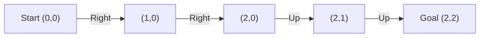
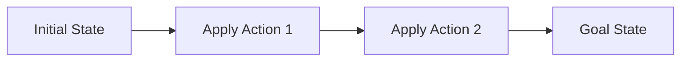
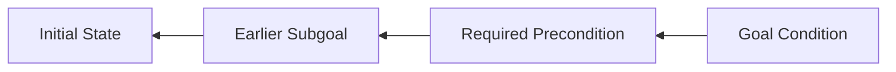
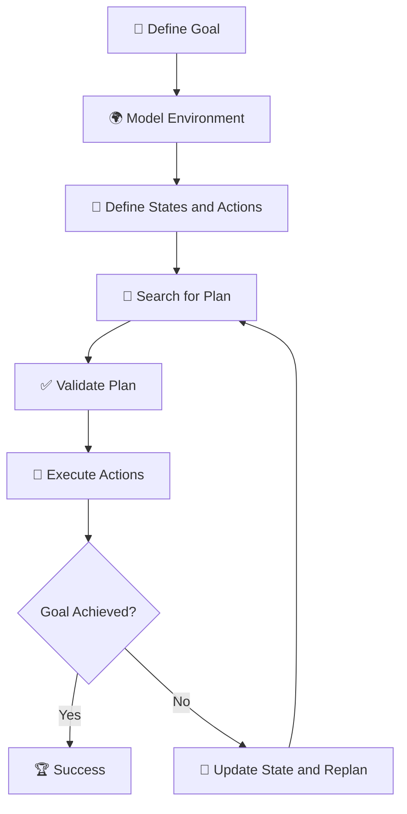

# 🤖 Planning in Artificial Intelligence

### AI Vault | Chapter 34 — Goal-Based Planning, State-Space Search, STRIPS & Intelligent Agents

[](https://github.com/ranjiGT/primitive-ai)


[](https://github.com/ranjiGT/primitive-ai/blob/main/LICENSE)

Welcome to the **Planning in AI Systems** chapter of [Primitive AI](https://github.com/ranjiGT/primitive-ai)!

Artificial Intelligence is not only about predicting outcomes or recognizing patterns. Intelligent systems must also determine **which actions to perform, in what order, and how those actions contribute toward achieving a goal**.

For example:

- How does a robot navigate from its starting position to a destination?
- How can an AI system schedule tasks while respecting dependencies?
- How can a warehouse robot move objects into a desired arrangement?
- How does an autonomous agent choose a sequence of actions to complete a mission?

These problems belong to **Artificial Intelligence Planning**.

AI planning is the process of finding a sequence or structure of actions that transforms an initial state into a desired goal state, subject to the constraints and dynamics of the environment.

---

## 🎯 1. Learning Objectives

By the end of this chapter, you will understand:

- What planning means in Artificial Intelligence.
- Why planning is important for intelligent agents.
- The components of a formal planning problem.
- Initial states, goal states, actions, and transition models.
- How state-space search supports planning.
- Forward and backward planning.
- Classical, probabilistic, and conditional planning.
- How STRIPS represents planning actions.
- The Blocks World planning problem.
- The relationship between planning and search algorithms.
- How to implement a basic planner in Python.
- Applications of AI planning in real-world systems.

---

## 🎨 2. Planning in AI — Visual Explanation

<div align="center">


*Figure 1: Cartoon-style infographic explaining AI planning, formal planning models, robot navigation, state-space representations, Blocks World, STRIPS, planning algorithms, workflows, and applications.*

</div>

The infographic illustrates how an intelligent agent reasons about actions and their consequences to achieve a goal.

The key principle is:

**Initial State → Actions → State Transitions → Goal State**

---

## 🧠 3. What Is Planning in Artificial Intelligence?

**AI Planning** is the computational process of constructing a plan that achieves a desired goal from a given initial state.

A plan usually consists of actions whose execution changes the state of the environment.

### Example: Robot Navigation

Imagine a robot in a warehouse.

Its initial position is:

\[
S_0=(0,0)
\]

Its desired destination is:

\[
G=(2,2)
\]

The robot can perform actions such as:

- Move Up
- Move Down
- Move Left
- Move Right

A valid plan might be:

```text
Start: (0,0)

Move Right → (1,0)
Move Right → (2,0)
Move Up    → (2,1)
Move Up    → (2,2)

Goal Reached!
```

The robot must also consider obstacles and movement restrictions.

Planning determines which sequence of valid actions achieves the goal.

---

## 📘 4. Formal Representation of a Planning Problem

A deterministic planning problem can be represented as:

\[
\boxed{P=(S,A,T,s_0,G,c)}
\]

Where:

| Symbol | Description |
|---|---|
| \(S\) | Set of possible states |
| \(A\) | Set of available actions |
| \(T\) | State transition function |
| \(s_0\) | Initial state |
| \(G\) | Goal condition or set of goal states |
| \(c\) | Optional action-cost function |

The transition function describes the result of performing an action in a state:

\[
T:S\times A\rightarrow S
\]

For applicable actions, this determines the successor state.

### Planning Objective

Find a plan:

\[
\pi=(a_1,a_2,\ldots,a_n)
\]

such that:

\[
T^*(s_0,\pi)\in G
\]

Here, \(T^*\) represents the repeated application of the transition function across the action sequence.

The objective may be to find any valid plan or an optimal plan according to a cost function.

---

## 🧩 5. Components of an AI Planning System

### 5.1 Initial State

The starting configuration of the environment.

Example:

```text
Robot Position: (0,0)
Battery: 100%
Destination: (2,2)
```

### 5.2 Goal State

The condition the agent wants to achieve.

Example:

```text
Robot Position: (2,2)
```

### 5.3 Actions

Operations available to the agent.

Examples:

```text
MoveUp
MoveDown
MoveLeft
MoveRight
```

### 5.4 Preconditions

Conditions that must be satisfied before an action can execute.

Example:

```text
MoveRight:
    Target cell must be inside the grid.
    Target cell must not contain an obstacle.
```

### 5.5 Effects

Changes produced by executing an action.

Example:

```text
Before: RobotAt(0,0)

Action: MoveRight

After: RobotAt(1,0)
```

### 5.6 Action Costs

Some actions may be more expensive than others.

Examples include:

- Travel distance
- Execution time
- Energy consumption
- Financial cost

A planner may attempt to minimize total cost:

\[
Cost(\pi)=\sum_{i=1}^{n}c(a_i)
\]

For state-dependent costs, each action's cost also depends on the state in which it is executed.

---

## 🗺️ 6. State-Space Representation

A **state space** contains all possible states reachable through available actions.

States are represented as nodes, while actions are represented as transitions between nodes.

### Example



### State-Space Search

The planning system searches for a path connecting the initial state to a state satisfying the goal.

Common search algorithms include:

- Breadth-First Search (BFS)
- Depth-First Search (DFS)
- Uniform-Cost Search
- A* Search
- Greedy Best-First Search

BFS finds a shortest path in the number of actions when transitions have equal cost.

A* can find an optimal path when used with an admissible heuristic and appropriate search conditions.

---

## 🔎 7. Types of Planning in Artificial Intelligence

### 7.1 Classical Planning

Classical planning commonly assumes:

- A fully observable environment.
- Deterministic actions.
- A known initial state.
- A known transition model.
- A finite, discrete planning representation.

**Example:** Rearranging blocks on a table.

### 7.2 Probabilistic Planning

Probabilistic planning handles uncertainty in action outcomes.

For example, a robot attempting to move forward may fail because of slippery terrain.

The transition model becomes probabilistic:

\[
P(s'\mid s,a)
\]

This describes the probability of reaching state \(s'\) after taking action \(a\) in state \(s\).

### 7.3 Conditional or Contingent Planning

Conditional planning creates plans containing branches based on observations.

Example:

```text
Check Weather
    |
    |-- Rain → Carry Umbrella
    |
    |-- Sunny → Wear Sunglasses
```

Unlike a fixed sequence, a contingent plan adapts to information obtained during execution.

### 7.4 Hierarchical Planning

Hierarchical planning decomposes high-level tasks into smaller subtasks.

Example:

```text
Deliver Package
    |
    +-- Locate Package
    |
    +-- Pick Up Package
    |
    +-- Navigate to Destination
    |
    +-- Drop Off Package
```

Hierarchical Task Network (HTN) planning is a common approach to this problem.

---

## ⚙️ 8. Planning Algorithms

| Algorithm | Approach | Characteristics |
|---|---|---|
| Forward Search | Initial state toward goal | Explores applicable actions |
| Backward Search | Goal toward initial state | Regresses goal conditions |
| Breadth-First Search | Level-by-level exploration | Complete for finite branching; shortest action count with unit costs |
| Uniform-Cost Search | Lowest accumulated cost first | Optimal with suitable positive action costs |
| A* Search | Cost plus heuristic | Can be optimal with an admissible heuristic |
| Heuristic Planning | Uses estimated goal distance | Guides exploration |
| Partial-Order Planning | Orders actions only when necessary | Supports flexible action ordering |
| Hierarchical Planning | Decomposes high-level tasks | Useful for structured domains |

### Forward Planning

Forward planning starts from the initial state and applies actions until the goal is achieved.



### Backward Planning

Backward planning begins with the goal condition and reasons about which actions could establish it.



Backward planning is particularly useful when relatively few actions can achieve the goal.

---

## 🧱 9. Example — Blocks World Planning

Blocks World is a classical AI planning problem involving blocks arranged on a table or stacked on one another.

### Initial State

```text
    B
    C       A
───────────────
     Table
```

### Goal State

```text
    A
    B
    C
───────────────
     Table
```

### Goal

Construct a stack in which:

- C is on the table.
- B is on C.
- A is on B.

### A Valid Plan

Assume the robot can pick up, put down, stack, and unstack one block at a time.

```text
1. Unstack(B, C)
2. Putdown(B)
3. Pickup(A)
4. Stack(A, B)
```

That sequence would not achieve the displayed goal because it puts A on B while B remains on the table.

The correct sequence is:

```text
1. Unstack(B, C)
2. Putdown(B)
3. Pickup(B)
4. Stack(B, C)
5. Pickup(A)
6. Stack(A, B)
```

However, if B is initially on C, as shown in the initial state, the first four actions are unnecessary.

The minimal plan for the displayed initial state is:

```text
1. Pickup(A)
2. Stack(A, B)
```

**Result:** A is on B, B is on C, and C remains on the table.

This example demonstrates why a planner must verify both the initial configuration and the goal before constructing actions.

---

## 📋 10. STRIPS Representation

**STRIPS** stands for Stanford Research Institute Problem Solver.

It is a classical planning representation in which actions are described through preconditions and effects.

An action can be represented as:

\[
a=(Pre(a),Add(a),Del(a))
\]

Where:

- \(Pre(a)\): Conditions required to execute the action.
- \(Add(a)\): Facts that become true.
- \(Del(a)\): Facts that become false.

### Example: Stack(x, y)

The action places block x on top of block y.

**Preconditions**

\[
Holding(x)\land Clear(y)
\]

**Add Effects**

\[
On(x,y)\land HandEmpty
\]

**Delete Effects**

\[
Holding(x)\land Clear(y)
\]

### State Update

For an applicable action:

\[
S'=(S\setminus Del(a))\cup Add(a)
\]

This describes how an action transforms the current state into the next state.

---

## 🔄 11. AI Planning Workflow

A typical planning system follows these stages:



### Workflow Explanation

1. **Define the Goal:** Identify the desired outcome.
2. **Model the Environment:** Represent relevant states, actions, and constraints.
3. **Generate Candidate Plans:** Explore possible action sequences.
4. **Validate:** Ensure the plan is executable and achieves the goal in the model.
5. **Execute:** Perform the selected actions.
6. **Monitor:** Observe whether execution matches expectations.
7. **Replan:** Update the plan if the environment changes.

---

## 🐍 12. Python Implementation — Robot Planning Using BFS

This example implements a simple AI planner that finds a route through a grid while avoiding obstacles.

```python
from collections import deque

def plan_route(start, goal, obstacles, grid_size):
    """
    Find a shortest path in an unweighted grid
    using Breadth-First Search.
    """

    rows, cols = grid_size

    actions = {
        "Up": (0, 1),
        "Down": (0, -1),
        "Left": (-1, 0),
        "Right": (1, 0)
    }

    def valid(position):
        x, y = position

        return (
            0 <= x < cols
            and 0 <= y < rows
            and position not in obstacles
        )

    if not valid(start) or not valid(goal):
        return None

    queue = deque([(start, [])])
    visited = {start}

    while queue:
        state, plan = queue.popleft()

        if state == goal:
            return plan

        for action, (dx, dy) in actions.items():
            next_state = (
                state[0] + dx,
                state[1] + dy
            )

            if valid(next_state) and next_state not in visited:
                visited.add(next_state)

                queue.append((
                    next_state,
                    plan + [(action, next_state)]
                ))

    return None


start = (0, 0)
goal = (2, 2)

obstacles = {(1, 1)}
grid_size = (3, 3)

plan = plan_route(
    start,
    goal,
    obstacles,
    grid_size
)

if plan is None:
    print("No valid plan found.")
else:
    print("Planning successful!")

    for step, (action, state) in enumerate(plan, 1):
        print(f"{step}. {action} -> {state}")
```

### Expected Output

```text
Planning successful!
1. Up -> (0, 1)
2. Up -> (0, 2)
3. Right -> (1, 2)
4. Right -> (2, 2)
```

The planner finds a shortest valid route in terms of movement actions.

Because every movement has equal cost, BFS guarantees a shortest path in this finite grid.

---

## 🧮 13. Planning with Action Costs

In real-world AI systems, different actions may have different costs.

A planning system may minimize:

\[
\boxed{Cost(\pi)=\sum_{i=1}^{n}c(s_{i-1},a_i)}
\]

For example:

| Action | Cost |
|---|---:|
| Move Forward | 1 |
| Turn Left | 2 |
| Turn Right | 2 |
| Cross Difficult Terrain | 5 |

The cheapest plan may not be the plan with the fewest actions.

### A* Planning

A* evaluates states using:

\[
f(n)=g(n)+h(n)
\]

Where:

- \(g(n)\): Cost accumulated from the initial state.
- \(h(n)\): Estimated remaining cost to reach the goal.
- \(f(n)\): Estimated total solution cost through node n.

A* uses this estimate to prioritize promising states during search.

---

## 🆚 14. Planning vs Search vs Scheduling

| Feature | Planning | Search | Scheduling |
|---|---|---|---|
| Primary Question | What actions should be performed? | How can a target state or solution be found? | When and with which resources should tasks run? |
| Focus | Actions and their effects | Exploring a solution space | Time and resource allocation |
| Representation | States, actions, preconditions, goals | Nodes, edges, costs | Tasks, durations, dependencies |
| Example | Robot rearranges boxes | Find path through a maze | Assign delivery tasks to robots |

These techniques are closely related and often combined.

For example, a warehouse system may use planning to determine tasks, search to find routes, and scheduling to allocate robots and time slots.

---

## 🌍 15. Real-World Applications of AI Planning

### 🤖 Robotics

Robots use planning to navigate environments, manipulate objects, and perform tasks.

### 📅 Scheduling

AI systems organize tasks while considering deadlines, dependencies, and resources.

### 🚚 Logistics

Planning helps optimize deliveries, warehouse operations, and transportation workflows.

### 🎮 Game AI

Game agents plan action sequences to achieve objectives and respond to opponents.

### 🏭 Industrial Automation

AI planning supports manufacturing processes, assembly sequences, and resource coordination.

### 🚀 Space Exploration

Autonomous spacecraft and robotic systems use planning to coordinate activities under operational constraints.

### 🏠 Smart Environments

Intelligent systems plan actions for energy management, automation, and device coordination.

---

## ⚠️ 16. Challenges and Limitations

### State-Space Explosion

The number of possible states and action sequences can grow exponentially.

### Incomplete Information

The agent may not know the exact state of the environment.

### Uncertain Outcomes

Actions may not always produce the expected result.

### Dynamic Environments

Other agents or environmental changes may invalidate an existing plan.

### Resource Constraints

Plans must often respect time, energy, memory, and resource limitations.

### Model Accuracy

A plan that works in a simplified model may fail in the real world if important constraints were omitted.

### Computational Complexity

Many general planning problems are computationally difficult, motivating heuristics, abstractions, and specialized planning algorithms.

---

## 🎓 17. Learning Outcomes Checklist

After completing this chapter, you should be able to:

- [ ] Define AI planning.
- [ ] Explain initial and goal states.
- [ ] Identify actions, preconditions, and effects.
- [ ] Describe state-space representation.
- [ ] Explain classical planning.
- [ ] Compare deterministic and probabilistic planning.
- [ ] Explain forward and backward planning.
- [ ] Describe STRIPS representation.
- [ ] Solve a basic Blocks World problem.
- [ ] Explain the role of BFS and A* in planning.
- [ ] Implement a grid-based planner in Python.
- [ ] Identify real-world applications of planning.
- [ ] Explain when replanning is necessary.

---

## 📝 18. Practice Questions

1. What is planning in Artificial Intelligence?
2. Why is planning important for intelligent agents?
3. What are the components of a planning problem?
4. What is the difference between an initial state and a goal state?
5. What are action preconditions?
6. What are action effects?
7. What is state-space search?
8. Explain forward planning with an example.
9. Explain backward planning.
10. What is classical planning?
11. What is probabilistic planning?
12. What is conditional planning?
13. What is STRIPS?
14. Explain the Blocks World problem.
15. How does A* support planning?
16. What is heuristic planning?
17. What is hierarchical planning?
18. Why do AI systems need replanning?
19. How does planning differ from scheduling?
20. What are the main challenges in AI planning?

---

## 🧪 19. Hands-On Exercises

### Beginner — Robot Navigation

Create a 4×4 grid.

Set:

```text
Start: (0,0)
Goal:  (3,3)

Obstacles:
(1,1)
(2,1)
```

Find a valid plan using BFS.

### Intermediate — Blocks World

Given three blocks A, B, and C, define:

- Initial state
- Goal state
- Available actions
- Preconditions
- Add effects
- Delete effects

Construct a valid sequence of actions that achieves the goal.

### Advanced — A* Planning

Modify the robot planner to use A* Search.

Implement the Manhattan distance heuristic:

\[
h(n)=|x_n-x_g|+|y_n-y_g|
\]

Compare BFS and A* based on the number of explored states.

### Programming Challenge

Extend the Python planner to support:

1. Weighted movement costs.
2. Multiple obstacles.
3. Dynamic obstacles.
4. Action preconditions.
5. Multiple goal states.
6. Plan visualization using Matplotlib.
7. Replanning after environmental changes.
8. A* and Uniform-Cost Search comparisons.

---

## 📚 20. Learning Resources

| Resource | Description |
|---|---|
| [🎨 Planning in AI Infographic](./Planning%20in%20AI%20Systems.png) | Cartoon-style planning illustration |
| [📚 AI Vault](../) | Complete AI learning collection |
| [🏠 Primitive AI](../../) | Main repository |
| [AIMA — Artificial Intelligence: A Modern Approach](https://aima.cs.berkeley.edu/) | AI planning and search foundations |
| [Planning.wiki](https://planning.wiki/) | Automated planning concepts |
| [Unified Planning](https://unified-planning.readthedocs.io/) | Python framework for AI planning |
| [Fast Downward](https://www.fast-downward.org/) | Automated classical planning system |
| [Python Documentation](https://docs.python.org/3/) | Python programming reference |

---

## 💡 21. Key Takeaways

> Planning enables intelligent agents to reason about future actions and construct a sequence of steps that achieves a desired goal.

Remember:

**Initial State → Where the agent starts**

**Goal State → What the agent wants to achieve**

**Actions → Operations available to the agent**

**Preconditions → Requirements for executing actions**

**Effects → Changes caused by actions**

**State-Space Search → Exploration of possible action sequences**

**STRIPS → Representation of actions using preconditions and effects**

**Heuristics → Estimates that guide planning search**

**Replanning → Updating plans when circumstances change**

The fundamental objective is:

\[
\boxed{T^*(s_0,\pi)\in G}
\]

A successful planner finds an executable plan that transforms the initial state into a state satisfying the goal.

---

## 🚀 22. What's Next?

Recommended topics for further learning:

1. Classical Planning
2. Forward State-Space Planning
3. Backward State-Space Planning
4. STRIPS Planning
5. Partial-Order Planning
6. Hierarchical Task Network Planning
7. Planning Graphs
8. GraphPlan Algorithm
9. Planning Under Uncertainty
10. Markov Decision Processes

---

## ⭐ Support Primitive AI

If this chapter helps you understand Artificial Intelligence, consider supporting the project.

**[⭐ Star Primitive AI on GitHub](https://github.com/ranjiGT/primitive-ai)**

Contributions, corrections, educational examples, and improvements are welcome.

**Learn • Explore • Build • Share**

Made for curious minds and lifelong learners.
