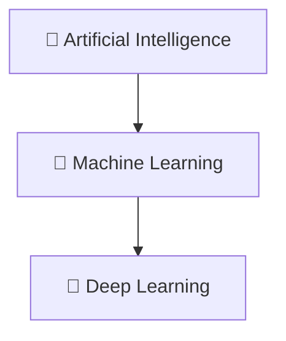
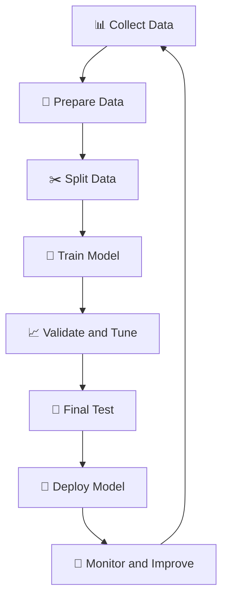
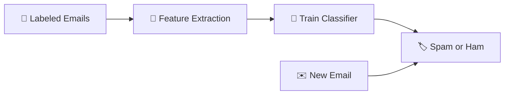
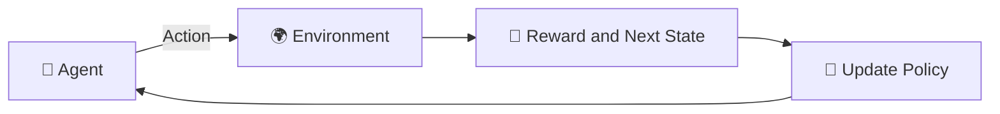
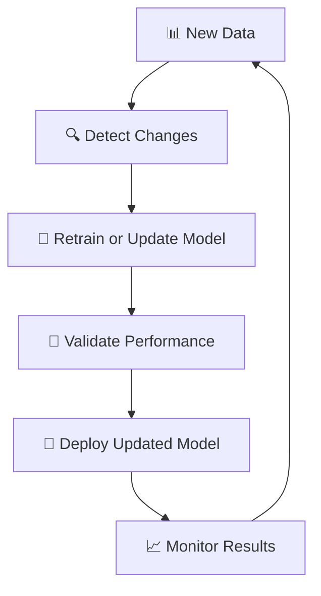

# 🧠 Learning in Artificial Intelligence Systems

### AI Vault | Chapter 35 — Learning Paradigms, Algorithms, Model Training & Evaluation

[](https://github.com/ranjiGT/primitive-ai)


[](https://github.com/ranjiGT/primitive-ai/blob/main/LICENSE)

Welcome to the **Learning in AI Systems** chapter of [Primitive AI](https://github.com/ranjiGT/primitive-ai)!

One of the most important characteristics of intelligent systems is their ability to **improve performance through data, experience, and feedback**.

Traditional rule-based programs follow explicitly defined instructions. Learning-based AI systems can instead discover useful patterns, estimate relationships, and adapt their behavior through training.

For example:

- How does an email filter learn to identify spam?
- How can an AI system discover customer groups without predefined labels?
- How does a robot learn to navigate using rewards and penalties?
- How can an AI model improve its predictions after observing more data?
- How do we measure whether an AI system has actually learned?

These questions form the foundation of **Learning in Artificial Intelligence**.

---

## 🎯 1. Learning Objectives

By the end of this chapter, you will understand:

- What learning means in Artificial Intelligence.
- The relationship between AI, Machine Learning, and Deep Learning.
- The major learning paradigms.
- Supervised, unsupervised, reinforcement, and semi-supervised learning.
- Classification, regression, clustering, and policy learning.
- The machine learning workflow.
- How training and evaluation work.
- Common machine learning algorithms.
- Loss functions and optimization.
- Model generalization and overfitting.
- How to evaluate classification models.
- How to implement basic learning algorithms using Python.
- Applications of learning in intelligent systems.

---

## 🎨 2. Learning in AI Systems — Visual Explanation

<div align="center">


*Figure 1: Cartoon-style infographic illustrating learning paradigms, the learning workflow, supervised and unsupervised learning, reinforcement learning, algorithms, model evaluation, learning curves, and real-world applications.*

</div>

The central idea is:

**Data → Learning → Evaluation → Improvement**

AI systems use information and feedback to develop models that perform tasks more effectively.

The infographic contains illustrative examples. Its evaluation panel has a numerical inconsistency, so the mathematically verified evaluation example later in this README should be used for calculations.

---

## 🧠 3. What Is Learning in Artificial Intelligence?

**Learning in AI** refers to processes through which an intelligent system improves its ability to perform tasks by using data, experience, or feedback.

A commonly used conceptual definition of machine learning comes from Tom Mitchell:

> A computer program learns from experience E with respect to tasks T and performance measure P if its performance at tasks in T, as measured by P, improves with experience E.

### Example: Spam Detection

An AI system receives emails containing features such as:

- Sender information
- Message content
- Keywords
- Links
- Email metadata

During training, it learns patterns associated with spam and legitimate emails.

When a new email arrives, the trained model predicts whether the message is spam.

The system does not necessarily require a programmer to manually define every spam-detection rule.

---

## 🌳 4. Relationship Between AI, ML, and Deep Learning

Artificial Intelligence is the broader field concerned with building systems capable of performing tasks associated with intelligence.

Machine Learning is a major subfield of AI.

Deep Learning is a subfield of Machine Learning that uses multilayer neural networks.



| Field | Description | Example |
|---|---|---|
| Artificial Intelligence | Broad field of intelligent systems | Planning and reasoning |
| Machine Learning | Learning patterns from data | Spam classification |
| Deep Learning | Learning using multilayer neural networks | Image recognition |

Not all AI systems use Machine Learning, and not all Machine Learning models use Deep Learning.

---

## 📚 5. Major Learning Paradigms

There are several approaches through which AI systems learn.

### 5.1 Supervised Learning

Supervised learning uses labeled training examples.

Each example contains input features and a known target.

The model learns a mapping:

\[
f:X\rightarrow Y
\]

Where:

- \(X\) represents input features.
- \(Y\) represents target values.
- \(f\) represents the learned prediction function.

**Examples:**

- Spam detection
- House price prediction
- Disease classification
- Image classification

### 5.2 Unsupervised Learning

Unsupervised learning works with data that does not contain predefined target labels.

The objective is to discover patterns, structures, or relationships.

**Examples:**

- Customer segmentation
- Clustering similar documents
- Dimensionality reduction
- Discovering hidden data structures

### 5.3 Reinforcement Learning

Reinforcement Learning involves an agent interacting with an environment and learning from rewards.

The agent attempts to maximize expected cumulative reward.

**Examples:**

- Game-playing agents
- Robot navigation
- Resource allocation
- Autonomous control

### 5.4 Semi-Supervised Learning

Semi-supervised learning combines labeled and unlabeled data.

It is useful when labeled examples are expensive or difficult to obtain.

**Examples:**

- Medical image classification
- Document classification
- Speech recognition
- Large-scale image categorization

---

## 🆚 6. Comparison of Learning Paradigms

| Feature | Supervised | Unsupervised | Reinforcement | Semi-Supervised |
|---|---|---|---|---|
| Training Information | Labeled examples | Unlabeled examples | Rewards and experience | Labeled and unlabeled examples |
| Primary Goal | Predict targets | Discover structure | Learn action policies | Improve learning using limited labels |
| Common Tasks | Classification, regression | Clustering, dimensionality reduction | Sequential decision-making | Classification |
| Example | Spam detection | Customer segmentation | Robot navigation | Medical image analysis |
| Feedback | Known targets | No explicit target labels | Reward signals | Partial target labels |

Each paradigm is suitable for different problem types.

---

## 🔄 7. The Machine Learning Workflow

A typical machine learning system follows several stages.



### Step 1: Data Collection

Gather relevant examples from appropriate sources.

### Step 2: Data Preparation

Prepare the dataset by:

- Handling missing values.
- Removing duplicates where appropriate.
- Encoding categorical variables.
- Scaling numerical features when necessary.
- Checking data quality.

### Step 3: Data Splitting

Separate data into training, validation, and testing subsets.

A possible split is:

| Dataset | Percentage |
|---|---:|
| Training | 70% |
| Validation | 15% |
| Testing | 15% |

The exact split depends on dataset size and problem requirements.

Data leakage must be avoided, and preprocessing parameters should generally be learned from training data only.

### Step 4: Model Training

Train a model using the training dataset.

### Step 5: Validation

Evaluate candidate models and tune hyperparameters using validation data.

### Step 6: Testing

Evaluate the selected model on previously unseen test data.

### Step 7: Deployment

Integrate the model into an application or AI system.

### Step 8: Monitoring

Track model performance, data changes, and potential degradation.

---

## 🎯 8. Learning Tasks in AI

### Classification

Classification predicts a discrete category.

Examples:

- Spam or not spam
- Cat or dog
- Fraudulent or legitimate transaction

### Regression

Regression predicts a numerical value.

Examples:

- House price
- Temperature
- Energy consumption

### Clustering

Clustering groups similar observations without predefined target labels.

Examples:

- Customer segmentation
- Document grouping
- Pattern discovery

### Policy Learning

Policy learning determines which actions an agent should take in different states.

A policy is represented as:

\[
\pi(a\mid s)
\]

This describes the probability of choosing action \(a\) in state \(s\).

---

## 📧 9. Example — Supervised Learning for Spam Detection

Consider a dataset of emails.

| Email | Features | Label |
|---|---|---|
| Email 1 | Meeting invitation | Ham |
| Email 2 | Free prize offer | Spam |
| Email 3 | Project update | Ham |
| Email 4 | Suspicious promotional link | Spam |

The learning system uses these labeled examples to identify patterns.

### Workflow



### Mathematical Representation

Given training data:

\[
D=\{(x_i,y_i)\}_{i=1}^{n}
\]

The learning algorithm estimates model parameters:

\[
\theta^*=\arg\min_{\theta}\frac{1}{n}\sum_{i=1}^{n}L(f_\theta(x_i),y_i)
\]

Where:

- \(x_i\) is an input example.
- \(y_i\) is its label.
- \(f_\theta\) is the model.
- \(L\) is the loss function.
- \(\theta\) represents model parameters.

---

## 🐍 10. Python Implementation — Supervised Learning

This example uses the Iris dataset and a Decision Tree classifier.

### Install Dependencies

```bash
pip install scikit-learn numpy matplotlib
```

### Python Code

```python
from sklearn.datasets import load_iris
from sklearn.model_selection import train_test_split
from sklearn.tree import DecisionTreeClassifier
from sklearn.metrics import accuracy_score, classification_report

# Load dataset
iris = load_iris()

X = iris.data
y = iris.target

# Split into training and testing data
X_train, X_test, y_train, y_test = train_test_split(
    X,
    y,
    test_size=0.2,
    random_state=42,
    stratify=y
)

# Create classifier
model = DecisionTreeClassifier(
    max_depth=3,
    random_state=42
)

# Train model
model.fit(X_train, y_train)

# Predict
predictions = model.predict(X_test)

# Evaluate
accuracy = accuracy_score(y_test, predictions)

print(f"Accuracy: {accuracy:.2%}")

print(
    classification_report(
        y_test,
        predictions,
        target_names=iris.target_names
    )
)
```

### Explanation

The program:

1. Loads the Iris dataset.
2. Splits the data into training and testing subsets.
3. Creates a Decision Tree classifier.
4. Trains the classifier.
5. Predicts labels for unseen test examples.
6. Evaluates the predictions.

This demonstrates the supervised learning process.

---

## 🧩 11. Example — Unsupervised Learning

Suppose a business has customer information such as:

- Purchase frequency
- Average spending
- Product preferences
- Website engagement

The business wants to identify customer segments without manually assigning labels.

A clustering algorithm can group customers with similar characteristics.

### K-Means Clustering

K-Means attempts to minimize the within-cluster sum of squared distances.

\[
\boxed{
J=\sum_{i=1}^{k}\sum_{x\in C_i}\|x-\mu_i\|^2
}
\]

Where:

- \(k\) is the number of clusters.
- \(C_i\) is the set of observations assigned to cluster \(i\).
- \(\mu_i\) is the centroid of cluster \(i\).

---

## 🐍 12. Python Implementation — Unsupervised Learning

```python
import numpy as np
import matplotlib.pyplot as plt

from sklearn.cluster import KMeans

# Example customer data
# Columns: annual spending and purchase frequency

customers = np.array([
    [20, 2],
    [22, 3],
    [25, 2],
    [50, 6],
    [55, 7],
    [52, 6],
    [85, 9],
    [90, 10],
    [88, 9]
])

# Train K-Means
model = KMeans(
    n_clusters=3,
    random_state=42,
    n_init=10
)

labels = model.fit_predict(customers)

# Visualize clusters
plt.scatter(
    customers[:, 0],
    customers[:, 1],
    c=labels,
    cmap="viridis",
    s=100
)

plt.scatter(
    model.cluster_centers_[:, 0],
    model.cluster_centers_[:, 1],
    marker="X",
    s=200,
    color="red",
    label="Centroids"
)

plt.xlabel("Annual Spending")
plt.ylabel("Purchase Frequency")
plt.title("Customer Segmentation Using K-Means")
plt.legend()
plt.show()
```

### Explanation

The algorithm groups customers based on similarities in their features.

The resulting clusters can help identify patterns in customer behavior.

In real applications, features may require scaling before applying K-Means.

---

## 🤖 13. Example — Reinforcement Learning

Imagine a robot learning to reach a destination.

The robot interacts with an environment and receives feedback.

### Components

| Component | Meaning |
|---|---|
| Agent | The learning robot |
| Environment | The world in which the robot operates |
| State | Current situation |
| Action | Movement selected by the robot |
| Reward | Feedback from the environment |
| Policy | Strategy for choosing actions |

### Interaction Loop



### Reward Example

| Event | Reward |
|---|---:|
| Reach goal | +10 |
| Take a step | -1 |
| Hit obstacle | -5 |

The agent attempts to learn a policy that maximizes expected cumulative reward.

---

## 🧮 14. Reinforcement Learning — Mathematical Foundation

A common mathematical framework for Reinforcement Learning is the **Markov Decision Process (MDP)**.

An MDP can be represented as:

\[
\boxed{M=(S,A,P,R,\gamma)}
\]

Where:

- \(S\): Set of states.
- \(A\): Set of actions.
- \(P\): Transition probability model.
- \(R\): Reward function.
- \(\gamma\): Discount factor.

The discounted return is:

\[
G_t=\sum_{k=0}^{\infty}\gamma^kR_{t+k+1}
\]

The objective is to learn a policy that maximizes expected return.

### Q-Learning Update

\[
\boxed{
Q(s,a)\leftarrow Q(s,a)+\alpha
\left[
r+\gamma\max_{a'}Q(s',a')-Q(s,a)
\right]
}
\]

Where:

- \(\alpha\): Learning rate.
- \(\gamma\): Discount factor.
- \(r\): Observed reward.
- \(s'\): Next state.
- \(Q(s,a)\): Estimated action value.

For terminal transitions, the future-value term is typically zero.

---

## ⚙️ 15. Common Machine Learning Algorithms

| Algorithm | Learning Paradigm | Typical Application |
|---|---|---|
| Linear Regression | Supervised | Numerical prediction |
| Logistic Regression | Supervised | Classification |
| Decision Tree | Supervised | Classification and regression |
| Random Forest | Supervised | Classification and regression |
| Support Vector Machine | Supervised | Classification |
| K-Nearest Neighbors | Supervised | Classification and regression |
| K-Means | Unsupervised | Clustering |
| Principal Component Analysis | Unsupervised | Dimensionality reduction |
| Neural Networks | Supervised and other paradigms | Complex pattern learning |
| Q-Learning | Reinforcement | Sequential decision-making |

No single algorithm is best for every task.

The appropriate choice depends on the data, learning objective, computational constraints, and evaluation criteria.

---

## 📊 16. Model Evaluation

Evaluating a learning system helps determine whether it performs well on unseen examples.

For classification, common metrics include:

- Accuracy
- Precision
- Recall
- F1-Score

### Confusion Matrix

| | Predicted Positive | Predicted Negative |
|---|---:|---:|
| Actual Positive | TP = 50 | FN = 10 |
| Actual Negative | FP = 5 | TN = 35 |

Where:

- TP: True Positives
- TN: True Negatives
- FP: False Positives
- FN: False Negatives

### Accuracy

\[
Accuracy=\frac{TP+TN}{TP+TN+FP+FN}
\]

\[
=\frac{50+35}{100}
\]

\[
\boxed{Accuracy=85\%}
\]

### Precision

\[
Precision=\frac{TP}{TP+FP}
\]

\[
=\frac{50}{55}
\]

\[
\boxed{Precision\approx90.91\%}
\]

### Recall

\[
Recall=\frac{TP}{TP+FN}
\]

\[
=\frac{50}{60}
\]

\[
\boxed{Recall\approx83.33\%}
\]

### F1-Score

\[
F1=\frac{2TP}{2TP+FP+FN}
\]

\[
=\frac{100}{115}
\]

\[
\boxed{F1\approx86.96\%}
\]

These values are calculated consistently from the confusion matrix.

---

## 📈 17. Learning Curves

A learning curve illustrates how model performance changes as training progresses or as the amount of training data increases.

Learning curves can help identify:

- Underfitting
- Overfitting
- Generalization gaps
- Whether additional data may be useful

### Underfitting

A model is underfitting when it fails to capture important patterns in the training data.

Both training and validation performance may be poor.

### Overfitting

A model is overfitting when it learns patterns specific to the training data that do not generalize well.

Training performance may be high while validation performance is substantially lower.

### Generalization

Generalization refers to the ability of a model to perform well on new, unseen examples.

A successful learning system should not merely memorize its training dataset.

---

## 🧠 18. Bias-Variance Tradeoff

The bias-variance tradeoff helps explain model generalization.

### High Bias

A model with high bias may be too simple to capture important relationships.

This can lead to underfitting.

### High Variance

A model with high variance may be overly sensitive to the particular training dataset.

This can lead to overfitting.

### Goal

Select a model with sufficient flexibility to learn useful patterns while maintaining good generalization.

Common techniques include:

- Cross-validation
- Regularization
- Feature selection
- Early stopping
- Data augmentation
- Hyperparameter tuning

---

## 🔁 19. Continuous Learning and Model Improvement

AI systems may need to adapt when data or environmental conditions change.

For example:

- Spam messages evolve.
- Customer preferences change.
- Traffic patterns vary.
- New products enter the market.
- Sensor conditions change.

A monitoring and improvement workflow can be represented as:



Not all AI systems update automatically.

Some require scheduled retraining, human approval, or controlled deployment procedures.

---

## 🌍 20. Applications of Learning in AI Systems

| Domain | Application |
|---|---|
| Healthcare | Disease prediction and medical image analysis |
| Finance | Fraud detection and risk modeling |
| Autonomous Vehicles | Object recognition and driving decisions |
| Natural Language Processing | Text classification and translation |
| Recommendation Systems | Personalized content and product suggestions |
| Robotics | Navigation and control |
| Cybersecurity | Anomaly detection and threat classification |
| Manufacturing | Predictive maintenance |
| Education | Adaptive learning systems |
| Game AI | Learning strategies through interaction |

Learning enables AI systems to identify patterns and improve task performance across many domains.

---

## ⚠️ 21. Challenges and Limitations

### Data Quality

Poor-quality training data can produce unreliable models.

### Data Bias

Biased datasets may lead to systematically unfair or inaccurate predictions.

### Overfitting

A model may perform well on training data but poorly on unseen examples.

### Computational Cost

Training large models can require substantial computational resources.

### Interpretability

Some models are difficult to explain or inspect.

### Concept Drift

The relationship between input data and target outcomes may change over time.

### Privacy and Security

Learning systems must protect sensitive information and account for threats such as data poisoning and adversarial manipulation.

### Evaluation Limitations

High performance on a benchmark does not guarantee reliable behavior in every real-world environment.

---

## 🎓 22. Learning Outcomes Checklist

After completing this chapter, you should be able to:

- [ ] Define learning in Artificial Intelligence.
- [ ] Explain the relationship between AI, ML, and Deep Learning.
- [ ] Describe supervised learning.
- [ ] Describe unsupervised learning.
- [ ] Explain reinforcement learning.
- [ ] Explain semi-supervised learning.
- [ ] Distinguish classification from regression.
- [ ] Explain clustering.
- [ ] Describe the machine learning workflow.
- [ ] Implement a supervised learning model in Python.
- [ ] Implement K-Means clustering.
- [ ] Explain the role of rewards in reinforcement learning.
- [ ] Calculate accuracy, precision, recall, and F1-score.
- [ ] Explain overfitting and underfitting.
- [ ] Interpret learning curves.
- [ ] Identify real-world applications of learning.

---

## 📝 23. Practice Questions

1. What is learning in Artificial Intelligence?
2. How does learning differ from traditional rule-based programming?
3. What is supervised learning?
4. What is unsupervised learning?
5. Explain reinforcement learning with an example.
6. What is semi-supervised learning?
7. What is the difference between classification and regression?
8. How does clustering work?
9. What is a training dataset?
10. Why do we need validation data?
11. What is the purpose of a test dataset?
12. What is a loss function?
13. What is model generalization?
14. Explain overfitting and underfitting.
15. What is a confusion matrix?
16. How is precision calculated?
17. What is recall?
18. What is the F1-score?
19. What is a learning curve?
20. What is the role of rewards in reinforcement learning?
21. What is the bias-variance tradeoff?
22. Why is data quality important?
23. What is concept drift?
24. How can an AI model be improved after deployment?
25. What are the major challenges in learning systems?

---

## 🧪 24. Hands-On Exercises

### Beginner — Classification

Train a classifier using the Iris dataset.

Tasks:

1. Load the dataset.
2. Split it into training and testing subsets.
3. Train a Decision Tree.
4. Generate predictions.
5. Calculate accuracy.

### Intermediate — Customer Clustering

Create a customer dataset with spending and purchase frequency.

Tasks:

1. Apply K-Means clustering.
2. Experiment with different numbers of clusters.
3. Visualize the results.
4. Compare cluster assignments.

### Advanced — Reinforcement Learning

Build a simple grid-world environment.

Define:

```text
Agent: Robot
Environment: Grid
Goal: Reach destination
Reward: +10 for reaching goal
Step penalty: -1
```

Implement Q-Learning to learn a navigation policy.

### Programming Challenge

Develop a mini learning framework that supports:

1. Data loading.
2. Preprocessing.
3. Train-validation-test splitting.
4. Model selection.
5. Model training.
6. Hyperparameter tuning.
7. Evaluation metrics.
8. Learning curve visualization.
9. Model persistence.
10. Prediction on unseen data.

---

## 📚 25. Learning Resources

| Resource | Description |
|---|---|
| [🎨 Learning in AI Systems Infographic](./Learning%20in%20AI%20Systems.png) | Cartoon-style learning overview |
| [📚 AI Vault](../) | Complete AI learning collection |
| [🏠 Primitive AI](../../) | Main repository |
| [Scikit-learn](https://scikit-learn.org/stable/) | Machine learning algorithms and evaluation |
| [Google Machine Learning Crash Course](https://developers.google.com/machine-learning/crash-course) | Practical ML fundamentals |
| [Stanford CS229](https://cs229.stanford.edu/) | Machine Learning foundations |
| [Sutton & Barto — Reinforcement Learning](http://incompleteideas.net/book/the-book-2nd.html) | Reinforcement Learning foundations |
| [NumPy](https://numpy.org/) | Numerical computation |
| [Matplotlib](https://matplotlib.org/) | Data visualization |
| [PyTorch](https://pytorch.org/) | Deep Learning framework |

---

## 💡 26. Key Takeaways

> Learning enables AI systems to improve their performance through data, experience, and feedback rather than relying exclusively on explicitly programmed rules.

Remember:

**Supervised Learning → Learn from labeled examples**

**Unsupervised Learning → Discover patterns in unlabeled data**

**Reinforcement Learning → Learn through rewards and interaction**

**Semi-Supervised Learning → Combine labeled and unlabeled examples**

**Classification → Predict categories**

**Regression → Predict numerical values**

**Clustering → Discover groups**

**Training → Learn model parameters**

**Evaluation → Measure performance**

**Generalization → Perform well on unseen data**

The central workflow is:

\[
\boxed{
Data\rightarrow Training\rightarrow Evaluation\rightarrow Improvement
}
\]

Learning is one of the foundations of modern intelligent systems.

---

## 🚀 27. What's Next?

Recommended topics for further learning:

1. Supervised Learning
2. Unsupervised Learning
3. Reinforcement Learning
4. Semi-Supervised Learning
5. Decision Tree Learning
6. Neural Networks
7. Backpropagation
8. Gradient Descent
9. Q-Learning
10. Deep Reinforcement Learning

---

## ⭐ Support Primitive AI

If this chapter helps you understand Artificial Intelligence, consider supporting the project.

**[⭐ Star Primitive AI on GitHub](https://github.com/ranjiGT/primitive-ai)**

Contributions, corrections, educational examples, and improvements are welcome.

**Learn • Explore • Build • Share**

Made for curious minds and lifelong learners.
