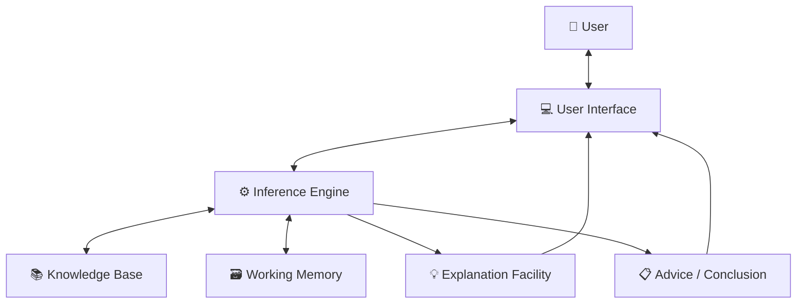
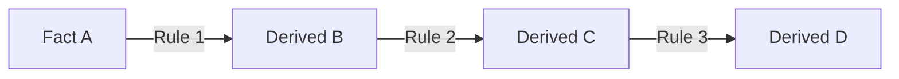
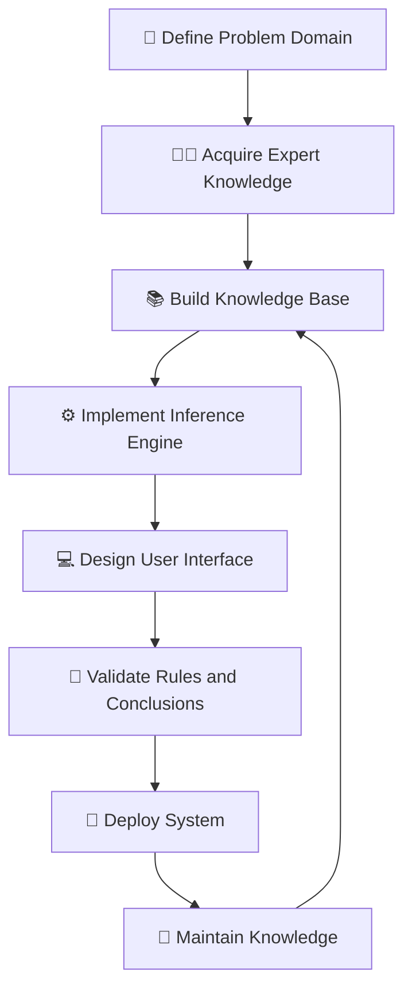

# 🧠 Expert Systems in Artificial Intelligence

### AI Vault | Chapter 36 — Knowledge-Based Systems, Inference Engines & Rule-Based Reasoning

[](https://github.com/ranjiGT/primitive-ai)


[](https://github.com/ranjiGT/primitive-ai/blob/main/LICENSE)

Welcome to the **Expert Systems in Artificial Intelligence** chapter of [Primitive AI](https://github.com/ranjiGT/primitive-ai)!

Expert systems are among the foundational technologies of Artificial Intelligence.

They are designed to capture specialized knowledge and use logical reasoning to solve problems within a particular domain.

Unlike many modern machine learning systems, traditional expert systems do not primarily learn patterns from large datasets. Instead, they use explicitly represented knowledge and reasoning rules to derive conclusions.

For example:

- How can an AI system assist in identifying possible equipment faults?
- How can a computer apply expert-defined rules to diagnose a technical problem?
- How can a financial advisory system evaluate eligibility criteria?
- How can an intelligent system explain why it reached a particular conclusion?

These questions introduce the field of **Knowledge-Based Expert Systems**.

---

## 🎯 1. Learning Objectives

By the end of this chapter, you will understand:

- What an expert system is.
- The history and purpose of expert systems.
- The major components of an expert system.
- Knowledge bases and inference engines.
- Working memory and explanation facilities.
- IF–THEN rule representation.
- Forward chaining and backward chaining.
- How expert systems perform logical inference.
- The architecture of a knowledge-based system.
- The difference between expert systems and machine learning.
- How to implement a simple expert system using Python.
- Advantages, limitations, and real-world applications.

---

## 🎨 2. Expert Systems in AI — Visual Explanation

<div align="center">


*Figure 1: Cartoon-style infographic explaining expert systems, knowledge bases, inference engines, rule representation, forward and backward chaining, medical decision-support examples, architecture, applications, advantages, and limitations.*

</div>

The central idea is:

**Expert Knowledge → Knowledge Base → Inference Engine → Conclusion**

An expert system uses stored domain knowledge and reasoning procedures to produce recommendations or conclusions.

---

## 🧠 3. What Is an Expert System?

An **Expert System** is a knowledge-based Artificial Intelligence system designed to perform reasoning tasks that normally require specialized human expertise.

It combines:

1. A representation of domain knowledge.
2. An inference mechanism for applying that knowledge.
3. Information about the current problem.
4. A mechanism for communicating results.

### Example: Computer Troubleshooting

Suppose a computer does not start.

An expert system may use rules such as:

```text
IF computer_does_not_start
AND power_indicator_is_off
THEN check_power_supply
```

Another rule might be:

```text
IF power_supply_is_connected
AND power_indicator_is_off
THEN inspect_power_adapter
```

The system evaluates the available facts and determines which rules are applicable.

The result may be a troubleshooting recommendation.

---

## 🏛️ 4. History of Expert Systems

Expert systems became an important area of AI research during the 1960s, 1970s, and 1980s.

Some notable early systems include:

| Expert System | Domain | Contribution |
|---|---|---|
| DENDRAL | Chemistry | Assisted in identifying molecular structures |
| MYCIN | Medicine | Investigated rule-based support for bacterial infection diagnosis and antibiotic selection |
| XCON (R1) | Computer Configuration | Configured computer system orders |
| PROSPECTOR | Geology | Supported mineral exploration reasoning |

These systems demonstrated that specialized knowledge and logical inference could be used to solve complex domain-specific problems.

However, they also revealed challenges involving knowledge acquisition, maintenance, uncertainty, and scalability.

---

## 🧩 5. Components of an Expert System

A typical expert system contains several interconnected components.

### 5.1 Knowledge Base

The knowledge base stores domain-specific information.

It may contain:

- Facts
- Rules
- Relationships
- Constraints
- Heuristics

Example:

```text
Rule 1:
IF fever AND cough
THEN possible_respiratory_illness

Rule 2:
IF possible_respiratory_illness
THEN recommend_medical_assessment
```

### 5.2 Inference Engine

The inference engine applies reasoning procedures to the available facts and rules.

It determines:

- Which rules are applicable.
- Which conclusions can be derived.
- Whether additional information is needed.
- Whether a goal has been established.

### 5.3 Working Memory

Working memory stores facts relevant to the current problem.

Example:

```text
fever = True
cough = True
```

These facts may change during a reasoning session.

### 5.4 User Interface

The user interface allows users to:

- Enter facts.
- Answer questions.
- Request advice.
- View conclusions.

### 5.5 Explanation Facility

The explanation facility provides information about how the system reached its conclusion.

For example:

```text
Conclusion:
Recommend medical assessment.

Reason:
The supplied facts satisfy Rule 1,
which establishes the premise of Rule 2.
```

Explanation facilities are especially useful in domains where users need to understand the reasoning process.

---

## 🏗️ 6. Expert System Architecture

A simplified expert system architecture can be represented as follows:



### Architecture Workflow

1. The user submits information.
2. The user interface passes the information to the inference engine.
3. Relevant facts are stored in working memory.
4. The inference engine evaluates knowledge-base rules.
5. Applicable rules produce new facts or conclusions.
6. The explanation facility records the reasoning.
7. The system presents its recommendation.

---

## 📜 7. Knowledge Representation Using IF–THEN Rules

Rule-based expert systems commonly represent knowledge using production rules.

### General Structure

```text
IF condition
THEN conclusion
```

Mathematically:

\[
P \rightarrow Q
\]

Where:

- \(P\) is the premise or condition.
- \(Q\) is the conclusion.

### Example

```text
IF temperature > 38°C
AND cough = True
THEN possible_respiratory_illness = True
```

This is an illustrative rule, not a medically validated diagnostic rule.

### Multiple Conditions

Rules may use logical operators.

**AND**

\[
A\land B\rightarrow C
\]

Both conditions must be satisfied.

**OR**

\[
A\lor B\rightarrow C
\]

At least one condition must be satisfied.

**NOT**

\[
\neg A\rightarrow B
\]

The rule depends on the negation of a condition.

In practical expert systems, the meaning of missing or unknown facts must be defined carefully. An unknown fact is not necessarily false.

---

## 🔍 8. Inference Techniques

Two fundamental inference strategies are:

1. Forward Chaining
2. Backward Chaining

### 8.1 Forward Chaining — Data-Driven Reasoning

Forward chaining begins with known facts.

The system repeatedly applies applicable rules to derive new facts.

### Example

Consider the rules:

```text
R1: IF A THEN B
R2: IF B THEN C
R3: IF C THEN D
```

Known fact:

```text
A = True
```

Reasoning:



The system concludes:

\[
D=True
\]

### Forward Chaining Algorithm

```text
1. Initialize working memory with known facts.

2. Find rules whose premises are satisfied.

3. Apply applicable rules.

4. Add newly derived facts.

5. Repeat until:
   - The target conclusion is reached, or
   - No additional facts can be derived.
```

Forward chaining is useful when a system must discover all conclusions supported by available facts.

### 8.2 Backward Chaining — Goal-Driven Reasoning

Backward chaining begins with a desired conclusion.

The system works backward to determine which facts or subgoals would establish it.

### Example

Goal:

```text
Prove D
```

Rules:

```text
R1: IF A THEN B
R2: IF B THEN C
R3: IF C THEN D
```

Reasoning:


If A is known to be true, the system can establish D.

### Backward Chaining Algorithm

```text
1. Select a goal.

2. Check whether the goal is already known.

3. Find rules that could establish the goal.

4. Treat their premises as subgoals.

5. Recursively verify the subgoals.

6. Succeed if the required premises can be established.
```

Backward chaining is useful when the system must answer a specific question or verify a hypothesis.

---

## 🆚 9. Forward Chaining vs Backward Chaining

| Feature | Forward Chaining | Backward Chaining |
|---|---|---|
| Reasoning Direction | Facts to conclusions | Goals to supporting facts |
| Approach | Data-driven | Goal-driven |
| Starting Point | Known facts | Target hypothesis |
| Main Objective | Derive applicable conclusions | Prove a selected goal |
| Typical Application | Monitoring and diagnosis support | Query answering and troubleshooting |
| Rule Processing | Finds rules triggered by facts | Finds rules supporting goals |

Both approaches can derive logically supported conclusions when used with appropriate rules and inference procedures.

---

## 🩺 10. Example — Medical Decision-Support Expert System

Consider an educational expert system that uses simplified rules to demonstrate logical inference.

### Knowledge Base

```text
R1:
IF fever AND cough
THEN possible_respiratory_illness

R2:
IF possible_respiratory_illness
THEN recommend_medical_assessment
```

### User Facts

```text
fever = True
cough = True
```

### Reasoning Process

**Step 1**

The system checks Rule 1.

Both premises are satisfied.

Therefore:

```text
possible_respiratory_illness = True
```

**Step 2**

The system checks Rule 2.

Its premise is satisfied.

Therefore:

```text
recommend_medical_assessment = True
```

### Conclusion

```text
Recommendation:
Seek an appropriate medical assessment.
```

**Important:** This example illustrates rule chaining only. Symptoms alone cannot reliably establish a specific diagnosis, and this educational system is not suitable for clinical decision-making.

---

## 🐍 11. Python Implementation — Simple Expert System

The following Python program demonstrates a rule-based expert system using forward chaining.

It supports:

- A knowledge base of rules.
- A set of known facts.
- Rule evaluation.
- Derivation of new facts.
- An explanation trace.

### Python Code

```python
class ExpertSystem:
    def __init__(self):
        self.facts = set()
        self.rules = []
        self.explanations = []

    def add_fact(self, fact):
        self.facts.add(fact)

    def add_rule(self, conditions, conclusion):
        self.rules.append({
            "conditions": set(conditions),
            "conclusion": conclusion
        })

    def infer(self):
        changed = True

        while changed:
            changed = False

            for rule in self.rules:
                conditions = rule["conditions"]
                conclusion = rule["conclusion"]

                if (
                    conditions.issubset(self.facts)
                    and conclusion not in self.facts
                ):
                    self.facts.add(conclusion)

                    self.explanations.append({
                        "conditions": sorted(conditions),
                        "conclusion": conclusion
                    })

                    changed = True

    def explain(self):
        for step, explanation in enumerate(
            self.explanations, start=1
        ):
            print(f"\nStep {step}")

            print(
                "Known conditions:",
                ", ".join(explanation["conditions"])
            )

            print(
                "Derived conclusion:",
                explanation["conclusion"]
            )


# Create expert system
system = ExpertSystem()

# Add known facts
system.add_fact("fever")
system.add_fact("cough")

# Add rules
system.add_rule(
    ["fever", "cough"],
    "possible_respiratory_illness"
)

system.add_rule(
    ["possible_respiratory_illness"],
    "recommend_medical_assessment"
)

# Execute inference
system.infer()

print("Derived Facts:")

for fact in sorted(system.facts):
    print("-", fact)

print("\nExplanation Trace:")
system.explain()
```

### Expected Output

```text
Derived Facts:
- cough
- fever
- possible_respiratory_illness
- recommend_medical_assessment

Explanation Trace:

Step 1
Known conditions: cough, fever
Derived conclusion: possible_respiratory_illness

Step 2
Known conditions: possible_respiratory_illness
Derived conclusion: recommend_medical_assessment
```

### How It Works

1. The system stores known facts.
2. Rules define relationships between conditions and conclusions.
3. The inference engine checks which rules can fire.
4. New conclusions are added to working memory.
5. The process repeats until no new facts can be derived.
6. The explanation trace shows which rules produced the conclusions.

This is a basic implementation of forward chaining.

---

## 🧪 12. Example — Computer Troubleshooting Expert System

Expert systems can also support technical troubleshooting.

### Rules

```text
R1:
IF computer_not_starting
AND power_indicator_off
THEN possible_power_issue

R2:
IF possible_power_issue
THEN check_power_connection

R3:
IF computer_not_starting
AND power_indicator_on
THEN investigate_boot_failure
```

### Example Facts

```text
computer_not_starting
power_indicator_off
```

### Derived Conclusions

```text
possible_power_issue
check_power_connection
```

This demonstrates how the same inference engine can be reused across different domains by changing the knowledge base.

---

## 🧠 13. Types of Expert Systems

### Rule-Based Expert Systems

Represent knowledge using IF–THEN rules.

### Case-Based Reasoning Systems

Use previously solved cases to help address new problems.

### Fuzzy Expert Systems

Use fuzzy logic to reason with gradual categories and imprecise concepts.

For example:

```text
Temperature is moderately high.
```

### Model-Based Expert Systems

Use an explicit model of how a system works to support diagnosis or reasoning.

### Hybrid Expert Systems

Combine multiple approaches, such as:

- Rules
- Case-based reasoning
- Statistical models
- Machine learning
- Fuzzy logic

Hybrid architectures may help address limitations of purely rule-based systems.

---

## 🤖 14. Expert Systems vs Machine Learning

| Feature | Expert Systems | Machine Learning |
|---|---|---|
| Knowledge Source | Expert-defined knowledge | Training data and learning objectives |
| Primary Mechanism | Logical or heuristic inference | Statistical learning and optimization |
| Representation | Rules, facts, models | Learned parameters and structures |
| Adaptation | Often requires explicit updates | Can improve through retraining |
| Explainability | Rule traces can be inspected | Depends on model type |
| Common Challenge | Knowledge acquisition bottleneck | Data quality and generalization |
| Example | Troubleshooting rules | Image classification |

Expert systems and machine learning are not mutually exclusive.

Modern AI systems can combine explicit rules with learned predictions.

---

## 🌍 15. Real-World Applications

| Domain | Application |
|---|---|
| Healthcare | Clinical decision-support research |
| Manufacturing | Equipment fault diagnosis |
| Finance | Rule-based eligibility assessment |
| Agriculture | Crop management advisory |
| Cybersecurity | Rule-based security event analysis |
| Aviation | Maintenance troubleshooting support |
| Education | Intelligent tutoring and assessment |
| Telecommunications | Network fault diagnosis |
| Customer Support | Guided troubleshooting |
| Legal Technology | Rule-based compliance checking |

Expert systems are especially useful when a domain contains well-defined rules, structured knowledge, and requirements for traceable reasoning.

---

## ✅ 16. Advantages of Expert Systems

### Consistent Reasoning

The same facts and rules generally produce the same conclusions.

### Knowledge Preservation

Expert knowledge can be stored and reused.

### Explanation Capabilities

Rule-based systems can record which rules contributed to a conclusion.

### Availability

Automated reasoning can support users without requiring an expert to be present for every interaction.

### Domain Specialization

Expert systems can perform well in narrowly defined domains with reliable knowledge.

### Reduced Repetitive Work

Routine reasoning and troubleshooting tasks can be automated.

---

## ⚠️ 17. Limitations of Expert Systems

### Knowledge Acquisition Bottleneck

Capturing expert knowledge accurately can be difficult and time-consuming.

### Maintenance Complexity

Rules must be updated when domain knowledge changes.

### Limited Adaptability

Traditional rule-based systems generally do not learn automatically from new data.

### Uncertainty Handling

Simple Boolean rules may be inadequate for uncertain or incomplete information.

### Rule Conflicts

Different rules may produce conflicting recommendations.

### Scalability

Large rule bases can become difficult to maintain and reason over efficiently.

### Dependence on Knowledge Quality

Incorrect or incomplete rules may produce unreliable conclusions.

### Lack of Common Sense

An expert system may perform well in its defined domain but fail when confronted with situations outside its knowledge base.

---

## 🧮 18. Expert Systems and Logical Reasoning

Expert systems are closely connected to formal logic.

### Modus Ponens

Given:

\[
P\rightarrow Q
\]

And:

\[
P
\]

We can conclude:

\[
\boxed{Q}
\]

### Example

```text
IF A THEN B

A is true.

Therefore, B is true.
```

This is the fundamental reasoning pattern behind many production-rule systems.

### Multiple Rule Inference

Consider:

\[
A\land B\rightarrow C
\]

\[
C\rightarrow D
\]

Given:

\[
A=True,\quad B=True
\]

We derive:

\[
C=True
\]

Then:

\[
D=True
\]

This is the logical foundation of forward chaining.

---

## 🔄 19. Expert System Development Workflow



### Development Stages

1. Define the problem and scope.
2. Identify domain experts.
3. Acquire relevant knowledge.
4. Represent knowledge formally.
5. Develop the inference mechanism.
6. Build the user interface.
7. Validate reasoning against expert-reviewed cases.
8. Deploy the system.
9. Maintain and update the knowledge base.

Validation is especially important when recommendations could affect safety, finances, or health.

---

## 🎓 20. Learning Outcomes Checklist

After completing this chapter, you should be able to:

- [ ] Define an expert system.
- [ ] Explain the purpose of knowledge-based AI.
- [ ] Identify the components of an expert system.
- [ ] Explain the role of a knowledge base.
- [ ] Describe how an inference engine works.
- [ ] Explain working memory.
- [ ] Write IF–THEN production rules.
- [ ] Apply forward chaining.
- [ ] Apply backward chaining.
- [ ] Explain the difference between data-driven and goal-driven reasoning.
- [ ] Describe the architecture of an expert system.
- [ ] Implement a simple rule-based system in Python.
- [ ] Explain how an explanation facility works.
- [ ] Compare expert systems with machine learning.
- [ ] Identify applications, advantages, and limitations.

---

## 📝 21. Practice Questions

1. What is an expert system?
2. Why are expert systems considered knowledge-based AI?
3. What are the major components of an expert system?
4. What is a knowledge base?
5. What is an inference engine?
6. What is working memory?
7. What is an explanation facility?
8. How are IF–THEN rules represented?
9. What is forward chaining?
10. What is backward chaining?
11. Compare forward and backward chaining.
12. Explain the architecture of an expert system.
13. What is knowledge acquisition?
14. What is the knowledge acquisition bottleneck?
15. What are the advantages of expert systems?
16. What are the limitations of expert systems?
17. What is a rule-based expert system?
18. What is case-based reasoning?
19. What is a fuzzy expert system?
20. How do expert systems differ from machine learning?
21. Explain Modus Ponens.
22. How can expert systems provide explanations?
23. Why is rule validation important?
24. What are hybrid expert systems?
25. Where are expert systems used in real-world applications?

---

## 🧪 22. Hands-On Exercises

### Beginner — Rule-Based Troubleshooting

Create a simple expert system with the following rules:

```text
IF internet_not_working
AND router_power_off
THEN check_router_power

IF internet_not_working
AND router_power_on
THEN check_network_connection
```

Implement these rules in Python.

### Intermediate — Forward Chaining

Given:

```text
R1: IF A AND B THEN C
R2: IF C THEN D
R3: IF D THEN E
```

Initial facts:

```text
A
B
```

Derive all possible conclusions using forward chaining.

### Advanced — Backward Chaining

Implement a goal-driven inference engine.

Your program should:

1. Accept a target goal.
2. Search for rules that establish the goal.
3. Recursively verify rule premises.
4. Detect circular dependencies.
5. Report whether the goal can be proven.
6. Display the reasoning trace.

### Programming Challenge

Extend the Python expert system to support:

1. Multiple conditions per rule.
2. AND and OR operators.
3. Negation with explicitly defined semantics.
4. Rule priorities.
5. Conflict resolution.
6. Interactive user input.
7. Explanation traces.
8. Knowledge-base loading from JSON.
9. Forward and backward chaining.
10. Automated tests for rule correctness.

---

## 📚 23. Learning Resources

| Resource | Description |
|---|---|
| [🎨 Expert Systems Infographic](./Expert%20Systems%20in%20AI.png) | Cartoon-style explanation |
| [📚 AI Vault](../) | Complete AI learning collection |
| [🏠 Primitive AI](../../) | Main repository |
| [AIMA — Artificial Intelligence: A Modern Approach](https://aima.cs.berkeley.edu/) | Knowledge representation and reasoning |
| [CLIPS](https://www.clipsrules.net/) | Rule-based expert system development |
| [Drools](https://www.drools.org/) | Business rules and decision management |
| [Experta](https://github.com/nilp0inter/experta) | Python rule-based expert system library |
| [Python Documentation](https://docs.python.org/3/) | Python programming reference |

---

## 💡 24. Key Takeaways

> Expert systems use explicitly represented knowledge and inference mechanisms to solve specialized problems and explain their reasoning.

Remember:

**Knowledge Base → Stores domain knowledge**

**Inference Engine → Applies reasoning rules**

**Working Memory → Stores current facts**

**User Interface → Enables interaction**

**Explanation Facility → Explains conclusions**

**IF–THEN Rules → Represent conditional knowledge**

**Forward Chaining → Facts to conclusions**

**Backward Chaining → Goals to supporting facts**

**Knowledge Acquisition → Captures domain expertise**

**Hybrid Expert Systems → Combine different reasoning approaches**

The fundamental reasoning structure is:

\[
\boxed{Facts+Rules\rightarrow Inference\rightarrow Conclusions}
\]

Expert systems remain an important foundation of symbolic AI, knowledge representation, and explainable reasoning.

---

## 🚀 25. What's Next?

Recommended topics for further learning:

1. Knowledge-Based Agents
2. Knowledge Representation
3. Forward Chaining
4. Backward Chaining
5. Rule-Based Reasoning
6. Semantic Networks
7. Frames in Artificial Intelligence
8. Fuzzy Expert Systems
9. Case-Based Reasoning
10. Hybrid Intelligent Systems

---

## ⭐ Support Primitive AI

If this chapter helps you understand Artificial Intelligence, consider supporting the project.

**[⭐ Star Primitive AI on GitHub](https://github.com/ranjiGT/primitive-ai)**

Contributions, corrections, educational examples, and improvements are welcome.

**Learn • Explore • Build • Share**

Made for curious minds and lifelong learners.
